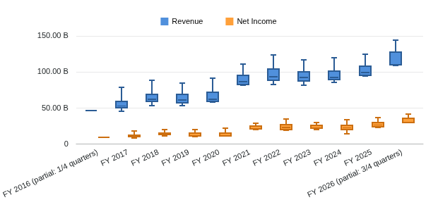
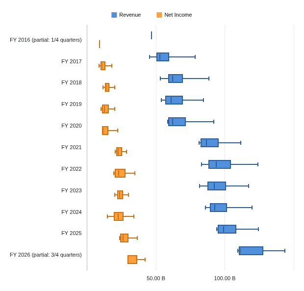

# Box plot milestone

Restore Box Plot in the ordinary Table/File chart journey after the published pie/donut milestone. Preserve the existing gallery, editor, dashboard framing, themes and saved settings. The owner approved this next slice on 2026-10-21 under the continuing autonomous chart-port workflow.

## Acceptance contract

1. Preserve the original selected fields, category grouping, observation order and aggregation behavior. Establish the original numerical contract before implementation; a conventional statistical default is not evidence of compatibility.
2. Preserve the original five-number summary. The retained original proxy uses linearly interpolated quartiles and absolute minimum/maximum whiskers, without an IQR outlier series. Do not substitute ECharts' automatic statistical transform.
3. Keep the existing reachable editor controls and saved paths. Preserve category/series changes, titles, legend, axes, box/whisker styling, tooltips and other controls actually exposed by the original. No feature flag, hidden button, second editor or unavailable placeholder counts as completion.
4. Verify numerical output, financial units and period provenance with retained real FMP observations. Label the observations as a historical sample, not a forecast or a statistically representative population. Cover missing, repeated, signed and degenerate samples separately.
5. Preserve refresh, theme changes, empty recovery, save/reopen and PNG export in the existing session/host. Compare original and replacement at matched data, theme and widget size. Ask the owner about concrete uncertain appearance differences rather than expanding a visual test matrix.
6. Complete independent review, executable complexity checks, breadth/checklist reconciliation and one concise evidence record. Publish one alpha after application acceptance, then verify both public image identities and anonymous pulls.

## Bounded tasks

Production paths are relative to `vendor/workspace/terminalpro/src/components/General/Table/Chart/`. Every modified production file must pass 400 physical lines, 300 logical units and 50 units per function through the existing explicit-scope checker. Tests and documentation are exempt. The controller owns shared records, inventories, commits and builds.

- [x] B0. Freeze original numerical semantics and the first executable boundary in `box-plot-design.md`, with independent financial/design review. Trace current integration points separately. Source research does not establish browser behavior.
- [x] B1. Implement and independently verify the small inactive five-number-summary helper and its focused tests. Capture meaningful RED/GREEN, scoped typing and whole-file caps. No rendering, editor, saved-state or provider changes.
- [x] B2. Implement the independently reviewed inactive ECharts mapper, preserving original field/category semantics, geometry, tooltip values and appearance. Input and ownership are frozen in the independently reviewed [renderer design](box-plot-renderer-design.md); use actual engine checks for box/whisker geometry.
- [x] B3a. Preserve raw aggregation identity and normalized statistical categories in the inactive [capture helper](box-plot-integration-design.md). Independently verified; no application activation.
- [x] B3b. Independently accept inactive capture and original aggregate setup under the [setup contract](box-plot-setup-design.md). Inherited verification failures are disclosed in [verification](../../../artifacts/reviewed/chart-box/verification.md).
- [x] B3c. Independently accept inactive [axes/navigation and the existing-host adapter join](box-plot-axis-navigation-design.md); original/replacement visual decisions remain at B4.
- [x] B3. Connect the existing session, gallery and editor to the mapper. Preserve all reachable controls and saved settings. Define exact file ownership and any necessary cohesive extraction before dispatch; no implicit size exceptions.
- [ ] B4. Verify an identified image with real FMP observations and focused synthetic edge cases, original visual comparison, controls, lifecycle and export. Reuse the existing isolated browser harness and run affected prior-family checks at the join.
- [ ] B5. Complete independent feature review, update README/docs and breadth, publish reviewed FMP chart samples, commit/push the task work and dispatch one image build. Close only after tagged release and both public image identities/pulls are verified.

## Fan-out and boundaries

Original-contract research and current integration tracing are independent read-only lanes. B1, B2 and B3 are dependent. Once the mapper interface is frozen, a separate worker may prepare only new browser files while the integration worker edits production/application tests. Owner-approved two-lane work also permits the inactive [Range foundation](range-chart-plan.md) alongside Box integration; its new files are disjoint. Shared helpers and harness changes remain controller-owned and serialized. Use Sol for bounded implementation and Astra for numerical/integration review; preserve unrelated catalog/Perspective work.

Standalone/AI callers, other specialty/radial families, provider expansion and analyst workflow changes remain open. One heavy build or suite runs at a time; browser checks use the existing one-worker isolated configuration and login-rate budget. Normal pushes run checks only; the completed milestone triggers one image publication.

## Actual FMP chart samples: browser scenarios verified, visual comparison pending

Two packaged-candidate browser scenarios pass; see [verified scope and test corrections](../../../artifacts/reviewed/chart-box/verification.md#b4-packaged-candidate-browser-progress). B4 remains open for original appearance and default miniature comparisons. No new release is published.

Retained FMP AAPL quarterly income statements, 40 observations across 11 fiscal years, 2016-09-24 through 2026-06-27. Revenue and net income use original reported USD; display labels may abbreviate billions. Partial fiscal years are labelled. Candidate source `ba98f00`, image `05c1c6fc`; these images do not establish original/replacement parity.

Original comparison is now captured. Fill/legend, vertical scale/category layout and miniature spacing need refinement; see the [documented miniature comparison](../../../artifacts/reviewed/chart-box/verification.md#b4-original-capture-and-default-miniature-comparison).
