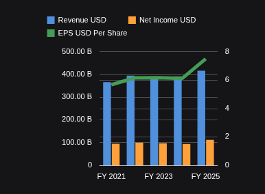

# Chart port milestone: combination charts

Owner direction, 2026-10-20: continue chart porting autonomously, preserve the existing UX and reachable behavior, and accept complete milestones with real FMP data before dispatching the alpha image pipeline. This bounded milestone belongs to analyst-workspace; the remaining analyst features are not prerequisites.

## Actual FMP chart sample

AAPL FY2021-FY2025 FMP annual statements: revenue and net income columns in USD; EPS line in USD/share on the right axis. Five unchanged observations, no aggregation; B formats billions. Accepted Workspace `6123991`.

[Application and release evidence](../../../artifacts/reviewed/chart-combo/verification.md); [Image and source provenance](../../../artifacts/reviewed/chart-samples/provenance.json). Captured FMP data through File Table; live data API routing is not established.

## Outcome and acceptance

Restore the ordinary Table/File combination-chart journey: Column Line, Area Column and saved Custom Combo assignments. Existing gallery/context-menu choices must render correctly, preserve settings and data, and keep the existing editor style. Do not count an unavailable placeholder or hidden control as implementation.

Acceptance includes per-series type and axis selection, financially correct geometry, relevant appearance controls, theme, navigator, refresh, save/reopen and export. Verify real FMP observations and units against the captured response. Synthetic fixtures remain necessary for negative/null/duplicate edge cases. A source-only helper is not a finished feature and does not trigger an image release.

## Source contract

Reference: original Workspace 38dffc33389aca0e4a87e0e88d42f7067aa220df and retained AG Grid Enterprise 34.1.1 bundle, `artifacts/task-2.1/frontend/terminalpro/node_modules/ag-grid-enterprise/dist/ag-grid-enterprise.js`.

- `ComboChartModel` (18073-18165): selected value columns split at ceil(count/2). Column Line assigns groupedColumn then line; Area Column assigns stackedArea then groupedColumn. Builtins set secondaryAxis false. A one-series builtin retains only its first type.
- Nonempty supplied seriesChartTypes enters Custom Combo. Custom types are line, groupedColumn, stackedColumn, area and stackedArea. Unsupported type strings fall back to line with a diagnostic. Missing column assignments become line/false; duplicate assignments use the first match; extra IDs are omitted. Project custom assignments in value-column order, retaining unselected columns.
- groupedColumn, stackedColumn and stackedArea force secondaryAxis false. Existing line/area assignments preserve an omitted flag; do not mutate caller-owned objects. Malformed structures produce explicit invalid diagnostics rather than an exception or invented financial output.
- `ComboChartProxy` (9017-9084): bottom X, one left numeric axis when primary series exist, and a distinct right numeric axis for each secondary series. Secondary series are not pooled onto one axis.
- `SeriesDataPanel` (12163-12238): per-selected-series type dropdown; secondary-axis control enabled only for line/area. `ChartController.updateSeriesChartType` (7833-7852) converts edits to Custom Combo and preserves assignments.
- Customize selects active geometry types in area/bar/line order and writes type-wide appearance, not per-column appearance (SeriesPanel 13930-14166; ChartOptionsService 18596-18602, 18834-18840). Keep these concepts separate from Set Up column assignments.
- The axis editor uses xAxis/yAxis and selects among the first two concrete axes by direction (18817-18828). Theme overrides apply numeric-axis style across left/right orientations; concrete setters target the selected axis. Do not invent persistent secondary-axis editor IDs.
- seriesGroupType controls radial grouping elsewhere; preserve it without applying it as a combo-wide stacking rule.

## Bounded tasks and ownership

- [x] C1. Implement the pure assignment resolver and focused regression tests. Ownership: new `terminalpro/src/components/General/Table/Chart/compatibility/comboAssignments.ts` and `terminalpro/tests/unit/chart-compatibility/comboAssignments.test.ts` in the Workspace fork. No gallery activation or renderer behavior changes. Validate builtin splits, custom fallback/order/duplicates, selected versus unselected columns, primary-only coercion, malformed data and immutable inputs.
- [x] C2. Implement mixed-series geometry and distinct numeric-axis mapping using existing ECharts/area helpers, following [the frozen mapper contract](combo-mapper-design.md). Keep original observations and financial units separate from presentation.
- [x] C2a. Implement admission, axis planning and shared coordinate/domain helpers within the mapper contract's exclusive files; review and commit before C2b.
- [x] C2b. Assemble the inactive mixed mapper and extend the existing area helper; independently verify actual ECharts geometry before C3/C4 activation.
- [x] C3. Connect per-series editor choices and saved state through existing session/widget ownership; preserve unknown/inactive settings. Freeze editor/mapper interfaces before parallel work.
- [x] C3a. Implement assignment transactions and transient custom cache within [the editor contract](combo-editor-design.md). This C1-dependent lane may run alongside C2a/C2b: its application/caller ownership is disjoint from mapper files; no activation or shared appearance edits are allowed. Serialize reviews, verification using shared files, and commits.
- [x] C3b. Resolve type-wide appearance and editor selection after the assignment transaction is accepted.
- [x] C3c/C4b. Connect controls and production routing as one [cohesive join](combo-production-join.md), after the state/appearance contracts are accepted. Source/component acceptance only; the real application gate below remains open.
- [x] C4. Join caller, navigator, refresh, export and save/reopen behavior; verify actual FMP data in an isolated application. No milestone acceptance based only on mocked APIs or synthetic rows.
- [x] C4a. Extend navigator axis/series cloning independently of C3b, using the contract below. Ownership is confined to `echarts/cartesianNavigator.ts`, new `cartesianNavigatorOverview.ts` and `tests/unit/chart-compatibility/cartesian.navigator.test.ts`. No application activation.
- [x] C4c. Preserve the mounted File chart during same-source refresh. The packaged lifecycle check found that a changed query key temporarily clears data, and the loading wrapper unmounts the renderer, losing transient navigator and legend state. Independently reviewed scope: `General/Table/AgGridFile.tsx`, one identity helper only if needed, and focused query/component regressions. Retain previous successful data only for the same source/parser identity; preserve initial loading, source-change invalidation and visible refresh errors. Do not change shared loading behavior, add a chart-state owner or persist transient interactions. Verify deferred successful refresh, changed source, initial loading and failed refresh, then rerun the packaged lifecycle and FMP journeys. Enforce 400/300/50 whole-file caps and source-relative static checks.
- [x] C5. Independent feature review, update breadth/checklists, sync concise evidence, commit/push the finished milestone and dispatch the alpha pipeline once. Published `alpha-39415813584-1`; both service images passed anonymous digest/tag/latest pulls and manifest checks. See [release evidence](../../../artifacts/reviewed/chart-combo/verification.md).

Every implementation task requires independent review and a per-task commit. Production files must pass 400 physical lines/file, 300 logical units/file and 50 logical units/function; maintained inventory must include additions. Reuse focused unit/static/browser commands and one heavy integration run. Existing untracked Perspective financial work is outside this milestone.

## Real-data evidence

One fresh authorized FMP request retrieved five AAPL annual income statements on 2026-10-20. Ignored `artifacts/chart-combo/fmp/` contains the raw response, unscaled CSV and sanitized provenance. Revenue and net income are USD; EPS is USD/share. Primary/secondary-axis comparisons must respect those different units. Retrieval success alone is not application acceptance. Do not publish credentials or raw licensed provider payloads in the public evidence mirror.

## C4a navigator contract

Independent Astra source review approves a disjoint navigator task consuming completed ECharts options. Keep the existing signature and `overviewOptions = options` default. Normalize singular/array axes locally; append overview axes after main axes onto miniature grid 1. Each overview series, including private area fragments, retains its own X/Y mapping using main-axis counts plus overview indexes. Missing indexes mean zero; axis-ID selectors must resolve consistently, with malformed/conflicting references rejected.

Clone domains, interval, inverse and category data from the overview. Hide miniature numeric axes and clear outward offsets while retaining existing miniature horizontal labels. Allocate deterministic collision-free `openbb-mini-` IDs/names against main namespaces; allocate separate miniature stack identities preserving area/column stack relationships. Main axes/series, legend and tooltip remain unchanged. Miniature series come from the supplied full overview even when main geometry is hidden.

Slider targets main X axes only. Preserve ordinary/horizontal filtering, original axis representation when miniature is disabled, and original object identity when both controls are disabled. Keep the single-main-grid contract and `retainNavigatorExtent` behavior. Tests cover multiple/all-secondary axes, area fragments, hidden-main/full-overview separation with actual combo output, collisions, immutability, ordinary/horizontal/disabled compatibility, retained ranges and actual ECharts miniature rendering. Run affected navigator regressions; apply 400/300/50 caps and independent review before acceptance.
