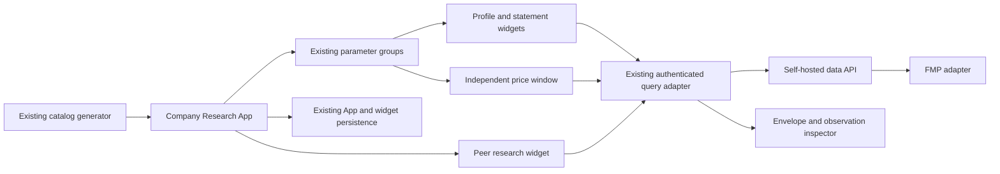

# Company Research dashboard design

Status: bounded design for owner review, 2026-11-13. Requirements approved; tasks and implementation require subsequent approval. This design delivers an incremental research workspace, not full IA-B financial readiness.

## Decision

Compose a curated App from existing FMP widgets and linking groups. Add a small peer-research widget and an observation inspector to the existing Workspace frame. Preserve the existing API envelope beside displayed rows, rather than creating another backend or calculating financial measures in the browser. Store research choices through existing App/widget persistence.

The separate financial-modeling workstream continues to own house methods and validated comparisons. A numeric provider multiple remains useful evidence, but never becomes a validated comparable merely because it appears beside another company.

## Boundary Commitments

- Own the predefined Company Research App, typed research configuration, peer editing, financial evidence inspection and same-context refresh presentation.
- Extend existing template export/import to preserve validated company identity and peer configuration without credentials or provider payloads.
- Keep source rows, missing values, duplicates, currencies and actual dates intact. Comparison labels report evidence limits; they do not implement a financial model.
- Bind acceptance to existing contract and native browser verification, source/image identities and retained-data persistence evidence.

## Out of Boundary

No new provider routes, model service, database, state framework, credentials flow, chart renderer or calculation library. No house ratios, denominator reconstruction, currency conversion, peer aggregates, rankings, valuation bridges, forecasts, DCF/WACC or point-in-time snapshots. News, transcripts, AI, Excel and broader provider coverage remain separate slices. Existing unrelated widgets and generic table/chart controls remain available.

## Allowed Dependencies

Use the accepted data API financial metadata envelope, current catalog endpoints and existing authenticated `src/lib/api.tsx` query adapter. Reuse Workspace App JSON, widget storage, parameter groups, React Query, existing table/frame/theme controls and template persistence. No new package is proposed. Root catalog generation may add the curated App and its renderer declaration; it must not absorb unrelated unaccepted renderer-generator changes.

Accepted discovery baselines: Workspace `e1a12c3a031a23598f41166a0f91b8fb24ac2387`; data API `a965f70c164fe477ce9c99654b9be48e2f1bc9fd`; root `d364d2fede419ae1ad528db2635d5e6b7d045bfc`.

## Revalidation Triggers

Re-review the affected design if metadata versions, parameter-group propagation, App import/export schemas or renderer registration change. A new backend, financial formula, dependency, persisted payload or claim of validated comparability requires its own reviewed scope. Rebase on changed accepted forks before implementation and remeasure all touched production files.

## Architecture and analyst flow



The catalog App opens with a company identity/profile section, a dated price section, Income/Balance/Cash tables and a peer-research section. Use the existing grid layout and section titles; the large statement tables remain reachable through normal scrolling and resizing. The initial company is an explicitly named example, AAPL / Apple Inc., not a hidden fallback. The analyst may clear or replace it using existing name/symbol selection.

Primary symbol linking includes only profile, price and the three statement widgets. The backend App group declaration is `{name, type: "param", paramName: "symbol", defaultValue: "AAPL"}`; each participating layout item names that group in `groups`. Import creates runtime IDs and `groupById`. Only exact eligible generated FMP table IDs join it; the peer controller never joins this whitelist. A separate statement-frequency group links Income/Balance/Cash `period`; their initial value is annual with a small explicit row limit. Price `start_date` and `end_date` remain price-widget parameters, independent of frequency and peer state. Do not create a broad group containing every parameter. Independent macro widgets and peers are outside the primary group. Reuse existing chart conversion for price; a table remains a usable price context without a new renderer.

The peer widget starts with no selected peers and explains how to add candidates. Its search reuses existing company search; the existing peers endpoint can offer candidates but never auto-accept them. Analyst-selected order and rationale are editable. Selected observations use periodic metrics and ratios, one request per listing and dataset, with `ttm=exclude`. Annual/quarter selection within the peer widget is independent of the primary statement group and visible beside its observations. Default display is the latest returned observation per dataset with an explicit observation selector that exposes all returned rows, including duplicates; selection is by source ordinal, never by fiscal label alone. Do not silently deduplicate or join unlike periods.

## State and persistence contracts

Existing widget params/group bindings remain authoritative for primary symbol, statement period and price dates. Existing `storage.companySelection` retains the readable identity. One peer-controller widget owns `storage.companyResearch`; there is no App-level duplicate of those values and no new global store.

```typescript
type ResearchListing = {
  provider: "fmp";
  sourceKey: string;
  listingId: string | null;
  issuerId: string | null;
  symbol: string;
  name: string | null;
  exchange: string | null;
};
type ResearchPeer = {
  identity: ResearchListing;
  rationale: string;
};
type CompanyResearchConfig = {
  version: 1;
  peers: ResearchPeer[]; // Array order is analyst-owned display order.
  period: "annual" | "quarter";
  limit: number;
};
type EvidenceStatus = "unverified" | "incompatible" | "not_meaningful";
type FinancialEvidence = {
  contextKey: string;
  originalRows: readonly Record<string, unknown>[];
  metadata: unknown; // Narrow against supported envelope versions before use.
  acquiredAt: string | null;
};
```

Use the existing `CompanySelectionV1` / `ListingChoice` contract through a typed adapter rather than introducing a competing search identity format. Preserve nullable listing/name evidence and show missing names as unavailable. Source-qualified request identity uses connector source key, provider and exact single provider symbol, retaining provider listing ID and other listing evidence when supplied. A null optional listing ID is allowed by the existing ListingChoice contract and does not itself make the selection unresolved. Missing/invalid source or symbol, unsupported saved identity, or known contradictory listing evidence remains unresolved. Neither null identifiers nor equal symbols establish cross-source, cross-exchange or issuer equivalence. Apply this rule to both primary and peer selections. Reject repeated source/provider/exact-symbol requests in peer configuration because the endpoint cannot discriminate such entries; this is a request constraint, not proof of security equivalence. Validate imported configuration: version exactly 1, nonblank source key and symbol, nullable provider listing/name fields consistent with the existing identity contract, unique source-qualified listing identities, maximum 20 peers, rationale at most 2,000 characters, and limit 1-20. UI explains limits before saving; imports with invalid/unknown versions report an unresolved configuration without discarding the original imported JSON or substituting Apple. Treat text as text, never HTML. Do not persist observations, metadata envelopes, authentication headers, tokens or query cache.

Export adds only validated `companySelection` and `companyResearch` fields to the existing storage allowlist. Import uses the existing loose storage schema and `createCustomTemplateTab` merge/remapping unchanged; validate research fields at the consumer boundary before execution. Primary table gating also checks imported `companySelection` against the current source/effective symbol. Safe export removes credential-bearing source URL components and refuses unresolved credential-dependent identity rather than serializing secrets. Import preserves coherent identities and symbols and remaps existing widget/group references through existing template creation. If an identity no longer resolves, display its saved name/symbol as unresolved and require explicit reselection before issuing its provider request. Add a narrow reconciliation guard in `useCompanySelection.ts`, backed by `selectionReconciliation.ts`: a saved foreign-source, ambiguous or unsupported identity must not enter the existing automatic exact-symbol resolver or overwrite saved metadata through `commitLocal`. Preserve its raw saved identity through save/reopen and display the unresolved reason through existing selector error presentation. Explicit selection from the current source replaces it and clears the unresolved state. Normal same-source group-symbol changes and initial default symbols with no saved metadata retain existing resolution behavior. The guard uses saved identity and current source to derive unresolved state; it introduces no second persistent flag or selection owner. Existing Apps without these fields remain unchanged. No database migration is needed because existing widget storage holds versioned JSON.

Saving persists research configuration, not a frozen valuation dataset. Show this distinction in the peer section's help and export description. Existing server data-directory persistence remains the storage mechanism; acceptance must recreate containers retaining that directory and reopen the same App in a fresh authenticated session.

## Data and evidence contracts

Read financial metadata from `extra.results_metadata.__qopenbb_financial__` in the same HTTP response as `results`. A parser checks supported schema versions and narrows nullable result/field/provenance structures; absent or unsupported metadata produces explicit unknowns, never an inferred default. Original rows and `row_index`/`source_ordinal` remain available separately from the grid's transposed or grouped view.

The inspector offers dataset/field selection and original-observation selection, independent of grid transformations. It displays source endpoint/documentation, definition, unit, scale, currency or referenced row currency, period basis, value origin, acquisition time, observation/valuation/publication dates and stated limitations. For statements, show actual period end, fiscal label, evidenced coverage/status, filing/acceptance dates and field-specific instant dates. Period start/duration and restatement/PIT availability remain unknown unless the supported contract explicitly supplies evidence. No per-cell HTTP calls are added.

The table's existing data hook is extracted cohesively so it can return the original envelope and lifecycle state alongside unchanged grid rows/columns. The inspector is a frame-level action, not an assumption that a transformed grid cell still maps one-to-one to a provider row. Selecting an original row explicitly resolves attribution. Missing values remain missing; zero and negative values remain signed; duplicate observations have distinct source ordinals.

Peer display uses existing table styling and consistent metadata-derived field labels. It exposes dataset/field choices from returned contracts rather than hard-coding a house P/E or EBITDA definition. Each observation retains company/listing, actual date, fiscal label, currency, unit, scale and provider-calculation origin. No cross-company join by period label, no computed ratios, no currency normalization, no sorting presented as a valuation ranking.

Eligibility is a presentation of supplied evidence only:

| Evidence | Presentation |
| --- | --- |
| Missing metadata, denominator, dates, claim scope or coverage | Unverified, with missing facts named |
| Explicit conflicts in supplied unit/currency/coverage/claim evidence | Incompatible for the stated comparison, with both facts inspectable |
| Explicitly evidenced zero/negative denominator for a multiple | Not meaningful; retain provider numeric value and signed denominator evidence |
| Apparently matching facts, or analyst approval/rationale | Unverified for aggregation; no valid-comparable state exists in this slice |

Never infer a denominator from the sign or reciprocal of a multiple. A matching field name, currency or fiscal label does not establish compatibility. Retain all existing generic table/chart aggregation controls; a persistent peer-section notice states that these are not validated peer valuations. A stale/failed observation never inherits a newer eligibility claim.

## Request lifecycle and failure behavior

Use the existing query adapter and cancellation signal. A research context key includes source-qualified listing, endpoint/dataset and normalized query parameters; refresh attempt identity is separate. Empty/unresolved symbols disable requests. Company change clears displayed evidence before starting the new context; late completion for an earlier context cannot populate the current view.

Keep at most one successful envelope per currently displayed context in component/query memory. On same-context refresh, mark it refreshing and clear prior comparison presentation. Success replaces it and recomputes evidence labels; failure may retain it with an explicit stale banner, acquisition/observation dates and separate failed-attempt timestamp. A context change discards this retained view. Cache update time is not a financial observation date. An initial failure has no retained evidence and shows the existing inline failure/entitlement state.

Peer fan-out runs at most two requests concurrently through the existing adapter, scoped to mounted selected peers, with no automatic polling. A manual refresh invalidates only participating contexts. Preserve the adapter's bounded retry behavior; count retries in acceptance request receipts. Removing a peer cancels/ignores its requests. One peer or dataset failure does not blank successful observations or discard rationale. Deactivate the scheduler when the widget unmounts; no background service is introduced.

## File Structure Plan

Workspace paths below are relative to `terminalpro/` in the owned fork. Root paths refer to QOpenBB. These are concrete ownership seams for subsequent task generation, not permission to edit now.

| Paths | Responsibility |
| --- | --- |
| Root `pipeline/qopenbb_ci/catalog_research.py`; `pipeline/qopenbb_ci/catalog.py` | Build the curated App and peer widget declaration from accepted widget IDs, append directly to generated catalog after validation |
| Root `pipeline/qopenbb_ci/catalog_cli.py` | Controller-only eventual generator hash registration; preserve unrelated dirty edits and reconcile only after their separate acceptance |
| Root `contracts/apps.json`, `contracts/widgets.json`, `contracts/catalog-report.json` | Regenerated artifacts, not hand-maintained business logic |
| `src/lib/companyResearch/selectionReconciliation.ts`; `src/components/General/Table/NavBar/useCompanySelection.ts` | Guard automatic identity resolution for unresolved saved/imported identity; preserve ordinary same-source group changes and explicit reselection |
| `src/lib/companyResearch/config.ts` | Versioned research configuration validation and safe export projection; adapt existing identity contract |
| `src/lib/companyResearch/financialEnvelope.ts` | Typed envelope narrowing, original-row attribution and unknown metadata states |
| `src/lib/companyResearch/eligibility.ts` | Evidence-only status/reason mapping; no financial formulas |
| `src/components/General/Table/useTableData.ts` and `tableQueryOptions.ts`; `AgGridTable.tsx` | Cohesive extraction of current query/options; expose envelope and inspector entry without changing row processing |
| `src/lib/companyResearch/useEvidenceLifecycle.ts` | Same-context success/attempt/stale state, no duplicate persistent state owner |
| `src/components/Widgets/CompanyResearch/ObservationInspector.tsx`; `observationPresentation.ts` | Accessible evidence panel using existing controls/theme and original row selector |
| `src/components/Widgets/CompanyResearch/PeerResearch.tsx`; `PeerEditor.tsx`; `PeerObservations.tsx`; `usePeerObservations.ts` | Existing-frame renderer, membership/rationale editor, provider observation table, bounded request orchestration |
| `src/components/Widgets/index.ts` | Small renderer registration using existing lazy component map |
| `src/components/General/ExportTemplatePopup.tsx`; `src/lib/utils/exportTemplate.ts`; `src/lib/utils/researchTemplateState.ts` | Extract pure template serialization into cohesive capped functions, add safe storage projection; import consumer validation uses existing loose storage transport unchanged |
| Root `tests/contracts/test_company_research.py`; `tests/e2e/financial-workspace.spec.mts`; `verification/financial-workspace.config.ts` | Focused catalog/contract cases and existing browser journey; retain existing bounded runner |
| Root `.kiro/complexity/workspace.json`, `.kiro/complexity-budgets.json`, `.kiro/breadth.toml` | Controller-owned maintained inventory, exact fork scope and evidence mapping |

Existing `src/lib/api.tsx`, `dataProcessors.ts`, `QueryParams.tsx`, `src/lib/utils/app.ts`, `src/lib/utils/createTemplates.ts`, `src/lib/types/app.ts`, global state modules and chart renderers should be reused unchanged. Reuse group helpers and current selector rather than adding a competing navigation UI. If inspection proves an additional integration edit indispensable, revise this file plan before assigning it.

## Complexity and dependency order

Apply 400 physical lines/file, 300 logical units/file and 50/function to all new or modified maintained production files, including generator and shared integration files. Existing measured physical counts: `AgGridTable.tsx` 347, renderer index 340, API adapter 310, `dataProcessors.ts` 970 and `QueryParams.tsx` 993. Do not extend the latter two oversized files for this feature. The selector hook has 311 physical lines; keep the reconciliation predicate in its focused module and measure the modified hook as a whole. ExportTemplatePopup has 384 lines and a long serializer: extract serialization and split by responsibility before extension. Existing app utils (1,954), createTemplates (919) and app schema (927) remain unchanged. Logical/function measurements and all export/import file baselines are required before task acceptance; physical counts alone are not compliance.

Before feature acceptance, extend the existing executable inventory/checker scope with explicit accepted base/head or changed-file manifests. Extract cohesive responsibilities from oversized integration files or request a measured, narrow design exception; no exception is granted here. Never split state owners or compress code to meet caps.

Freeze config/envelope/renderer contracts first. Then root catalog generation and Workspace evidence presentation can proceed as disjoint lanes. Peer editing depends on the frozen identity/config and evidence interfaces. Controller joins export/import, layout/groups and lifecycle acceptance after those lanes; independent financial review checks meaning before milestone publication. Shared files, generated contracts, inventories and commits stay controller-owned. Maximum controller + two implementers + one reviewer; serialize heavy builds and shared fixture mutations. This is dependency guidance; numbered tasks follow design approval.

## Verification and rollout

Use existing portable contract tests and native Podman Compose/Playwright flow. Add focused deterministic cases for malformed/unknown metadata, missing/zero/negative/duplicate values, context races, stale refresh, peer failures and safe export projection. Use real FMP observations for a primary company and two peers; observe company/frequency changes, independent price dates, editable rationale/order, source-matched displayed values, template roundtrip (including foreign-source identity, unresolved save/reopen, explicit reselection and normal same-source group changes), fresh-session reopen and retained-directory container recreation. Synthetic fixtures cover failure cases not safely reproducible with provider data and are labelled separately.

Do not introduce another harness or run unrelated exhaustive suites. No live requests or builds are needed for this design phase. After implementation and independent acceptance, run Dagger image publication once for the completed milestone, bind evidence to source/image identities and update README/docs checkboxes and breadth. Local candidate checks, published-image checks and owner-server deployment remain distinct claims. Roll back by restoring the prior image; existing Apps are untouched, and the new configuration remains versioned JSON for a later compatible image.

## Requirements traceability

| Criteria | Design owner and evidence |
| --- | --- |
| 1.1, 1.2, 1.3 | Curated catalog App, existing frame/theme/grid, independent section failures; browser layout and failure checks |
| 2.1, 2.2 | Existing selector/groups, nonblank gating and context lifecycle; change/clear/race checks |
| 2.3, 2.4, 2.5 | Separate symbol/frequency/date ownership and independent peers; group roundtrip and dated row checks |
| 3.1, 3.2, 3.3 | Envelope parser and original-row inspector; nullable metadata/duplicate/signed fixtures and source matching |
| 3.4, 3.5 | Provider origin/basis presentation and explicit unknowns; metadata consumer contract checks |
| 4.1, 4.2 | Peer config/editor and observation table; order/rationale and actual period/currency checks |
| 4.3, 4.4, 4.5, 4.6 | Evidence-only eligibility with no valid state, persistent unverified notice; financial review and failure fixtures |
| 5.1, 5.2 | Existing App persistence, versioned storage; fresh session and retained-data recreation |
| 5.3, 5.4 | Same-context lifecycle with separate attempt/acquisition times; refresh success/failure checks |
| 5.5, 5.6 | Configuration-only saving and safe template projection/import; roundtrip and unresolved identity checks |
| 6.1, 6.2 | Existing contract gate plus focused real-provider browser journey |
| 6.3, 6.4 | Qualified persistence evidence, independent financial review and source/image-bound milestone mapping |
