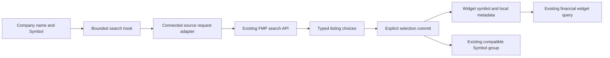

# Linked company selector: bounded design

Status: draft for independent review and subsequent owner approval. This amendment implements criteria1.1-1.5 in `company-selector-requirement.md`; it does not approve or implement the analyst umbrella. Requirements were confirmed by the owner's 2026-10-30 acknowledgement; added numbering is editorial. Design, tasks and implementation remain separate gates.

## Overview

Give financial engineers a Company name autocomplete next to Symbol inside the existing native FMP widget header. Both fields identify one explicit provider listing; neither is an independent hidden instrument store. Retain the current Workspace theme, grouping menus, manual symbols and multiple-symbol comparison behavior.

The bounded result is a useful instrument-selection control over the deployed technical baseline. Curated Bloomberg-inspired dashboard tiles, time linking, FRED name search, additional providers and valuation calculations remain outside this amendment.

## Boundary Commitments

### This amendment owns

- Remote name/ticker suggestions, linked visible fields and versioned local selection metadata for the eight existing native FMP company-data definitions: Profile, Income, Balance, Cash, Historical prices, Metrics, Ratios and Enterprise values.
- Eligibility and the exact compatible Symbol-group safety check, using existing group membership and persistence.
- One narrow QueryParams integration and the affected regression/real-data/retained-state acceptance.

### Out of Boundary

No new data API route, provider model, database, global identity registry, group schema or financial calculation. Search/Peers widgets, FRED, custom backends without the owned route/parameter binding, arbitrary forms and legacy ticker widgets retain their current controls. Do not relabel this as completion of IA-B or the larger analyst dashboard.

### Allowed Dependencies

Use the installed React, TanStack Query, Radix, design-system inputs, debounce tooling, GroupDropdown, CompareTermsParam, widget updates, source-request helper and existing group stores. Use only the connected widget's owned FMP search route and typed financial response contract. No package changes are required.

### Revalidation Triggers

Recheck the selector when search query/row/envelope contracts change, connector identity/authentication changes, grouping or storage serialization changes, the eligible definition's endpoint/provider/multiplicity changes, or request parameters start forwarding metadata. Widget/native generator and source pins must be coordinated for a meaningful release.

## Architecture and dependencies



Dependency direction is contracts -> source transport/pure group guard -> hooks -> selector UI -> existing renderer seam. Group storage and data acquisition remain existing owners. No direct mutation of the application store from a new selector service.

Do not expand AdvancedSelect or AdvancedSelectTicker. The former filters local options and the latter uses the wrong API/identity model. Compose the existing primitives into a bounded remote combobox and retain existing visual tokens.

## File Structure Plan

Production Workspace paths below are relative to `terminalpro/src/`; the two `tests/unit/` entries are relative to `terminalpro/` and use its existing Vitest entry point.

| File | Responsibility |
| --- | --- |
| New `components/General/Table/NavBar/companySelection.contract.ts` | Explicit selection type/versioned decoder, eight-definition binding map, provider/source/symbol guards and known-ambiguity rules |
| New `components/General/Table/NavBar/companySearch.ts` | Existing-route request construction and strict native results/metadata adapter; no UI state |
| New `components/General/Table/NavBar/useCompanySearch.ts` | Debounce, one active query mode, cancellation/late-result guard and bounded query state |
| New `components/General/Table/NavBar/companyGroupSafety.ts` | Pure exact-membership compatibility decision; no group writer or second store |
| New `components/General/Table/NavBar/useCompanySelection.ts` | Widget-local selection validity and compound commit adapter using supplied existing widget/group operations; eligibility and host-row props |
| New `components/General/Table/NavBar/CompanySymbolSelector.tsx` | Two fields, shared result presentation, keyboard/status behavior and preserved comparison editor |
| Modified `components/General/Table/NavBar/QueryParams.tsx` | Eligibility dispatch, compound commit callback, existing draft/execution/coplilot synchronization and layout integration only |
| Modified `components/Widgets/Helpers/useParamGroupBindings.ts` | Read the active local/shared dashboard's exact bound-group members; retain existing write semantics |
| New `tests/unit/company-selection.test.ts` | Version/identity/eligibility, response adaptation and group-safety contracts |
| New `tests/unit/company-selector.test.tsx` | Explicit commit, late responses, keyboard, errors and preserved single/multiple controls |

Root integration reuses `tests/e2e/financial-workspace.spec.mts` and its configuration rather than adding a harness per widget. Add coherent company-selector cases there; retain the original Income regression. Source-pin/inventory/catalog provenance joins remain controller-owned.

### Complexity and inventory

All new production files and the changed group hook must pass400physical/300logical/50per function. Tests/docs remain excluded. Add each maintained source path to the existing inventory and run its actual checker with explicit fork changes.

Proposed exception requiring owner approval: only QueryParams, baseline938physical/345logical/max38 at Workspacec652, ceiling1000physical/390logical/50per function. The62physical/45logical allowance covers imports, dedicated below-navbar placement and compound local-update plumbing; all search, decoding and safety logic belongs in new capped modules. Bind the approved exception to the exact candidate revision, its measured source and this design review, with expiry2026-11-30. If the change exceeds the ceiling, stop for a revised extraction design. No active inventory exception or production change is created by this draft.

## Components and interfaces

### Exact eligible bindings

All rows require the native table definition, effective provider`fmp`, a visible text `symbol` parameter, a resolved connected source, and effective `runButton=false` (the existing immediate-execution default). Custom/manual-run forms retain the original renderer. Never infer eligibility from a parameter name alone.

| Native widget ID | Exact endpoint | Symbol multiplicity |
| --- | --- | --- |
| `equity_profile_fmp_obb` | `/api/v1/equity/profile` | Multiple; retain CompareTermsParam |
| `equity_fundamental_income_fmp_obb` | `/api/v1/equity/fundamental/income` | Single |
| `equity_fundamental_balance_fmp_obb` | `/api/v1/equity/fundamental/balance` | Single |
| `equity_fundamental_cash_fmp_obb` | `/api/v1/equity/fundamental/cash` | Single |
| `equity_price_historical_fmp_obb` | `/api/v1/equity/price/historical` | Single |
| `equity_fundamental_metrics_fmp_obb` | `/api/v1/equity/fundamental/metrics` | Single |
| `equity_fundamental_ratios_fmp_obb` | `/api/v1/equity/fundamental/ratios` | Single |
| `equity_fundamental_enterprise_values_fmp_obb` | `/api/v1/equity/fundamental/enterprise_values` | Single |

### Typed ports

These are proposed new interfaces, not existing APIs. Use explicit types/unknown at external boundaries, without introducing `any` in the new modules.

```ts
type SearchMode = "name" | "symbol";
type ListingChoice = Readonly<{
  provider: "fmp"; symbol: string; name: string | null;
  exchange: string | null; exchangeShortName: string | null;
  currency: string | null; listingId: string | null; issuerId: string | null;
}>;
type CompanySelectionV1 = ListingChoice & Readonly<{
  version: 1; sourceKey: string; retrievedAt: string | null; selectedAt: string;
}>;
type SearchRequest = Readonly<{
  sourceKey: string; mode: SearchMode; query: string; limit: 20;
  generation: number; requestId: number;
}>;
type SearchFailure = Readonly<{
  code: "invalid" | "entitlement" | "rate_limit" | "network" | "contract";
  message: string; retryable: boolean;
}>;
type SearchOutcome =
  | { kind: "ready"; request: SearchRequest; rows: readonly ListingChoice[];
      retrievedAt: string | null }
  | { kind: "failed"; request: SearchRequest; failure: SearchFailure };
type SearchState =
  | { kind: "idle" }
  | { kind: "loading"; request: SearchRequest }
  | { kind: "ready"; result: Extract<SearchOutcome, { kind: "ready" }> }
  | { kind: "failed"; result: Extract<SearchOutcome, { kind: "failed" }> };
type CompanyMember = Readonly<{
  widgetId: string; sourceKey: string; provider: string;
  eligible: boolean; symbolBindingIds: readonly string[];
  hasCompetingTickerBinding: boolean;
}>;
type GroupSnapshot =
  | { kind: "ungrouped" }
  | { kind: "bound"; id: string; value: string; members: readonly CompanyMember[] }
  | { kind: "unavailable"; reason: string };
type CompanyContext = Readonly<{
  widgetUuid: string; dashboardId: string; sourceKey: string;
  provider: string; symbol: string; immediate: boolean;
  isPreview: boolean; dashboardMember: boolean; group: GroupSnapshot;
}>;
type CommitResult =
  | { kind: "applied"; scope: "widget" | "symbol_group" }
  | { kind: "blocked"; reason: string };
type CompanyBinding = Readonly<{
  widgetId: string; endpoint: string; multiple: boolean;
}>;
type GroupDecision =
  | { kind: "allowed"; groupId: string | null }
  | { kind: "blocked"; reason: string };
type CompanyRequestContext = Readonly<{
  sourceKey: string; searchEndpoint: string; requestInit: RequestInit;
}>;
interface CompanySearchPort {
  (source: CompanyRequestContext, request: SearchRequest,
   signal: AbortSignal): Promise<SearchOutcome>;
}
interface SelectionPorts {
  readContextNow(): CompanyContext;
  commitLocal(selection: CompanySelectionV1): void;
  writeBoundSymbol(groupId: string, symbol: string): void;
}
```

`companySelection.contract.ts` owns `decodeSelection(unknown): CompanySelectionV1 | null`, `matchBinding(unknown): CompanyBinding | null` and source/symbol validity. `companySearch.ts` owns `adaptSearchEnvelope(unknown, SearchRequest): SearchOutcome` and `CompanySearchPort`. Its materialized request context is private/ephemeral, never persisted or used as a query key. `companyGroupSafety.ts` owns `checkCompanyGroup(CompanyContext): GroupDecision`. `useCompanySelection.ts` owns `commitChoice(choice: ListingChoice, currentResult: Extract<SearchOutcome, {kind:"ready"}>, ports: SelectionPorts): CommitResult` and rechecks source/request/context immediately before any write. The group hook supplies the real snapshot and the existing bound writer; it does not create a new company-group schema. The UI consumes the hook's typed state/actions and does not write storage directly.

### Selection contract

`CompanySelectionV1` contains version1, provider`fmp`, source identity, exact returned symbol, name, nullable exchange/exchangeShortName/currency/listingId/issuerId, actual retrieval time when supplied and a separate selection time. Store it at `storage.companySelection`, never inside `storage.params`. No secrets, connector headers or raw response payload are stored there.

The source identity is the widget's sourceId plus normalized connector origin/path prefix, excluding userinfo, query credentials and fragments. A decoded selection is usable only when version, source, effective provider and effective single symbol match. Unknown optional identifiers remain null. This is a provider-qualified reference, not a globally unique issuer/security guarantee.

The existing loose storage schema preserves this sibling metadata. Add a strict local decoder rather than changing the oversized global schema. Legacy dashboards with no selection metadata continue to work. A single saved symbol can request one exact-symbol lookup to resolve its name; zero or multiple contradictory exact matches stay unresolved. Never choose the first fuzzy match.

### Search adapter

Use the validated connected endpoint's prefix, replacing only its known native path with `/api/v1/equity/search`. Preserve source path prefixes such as `/data`; do not hardcode a global backend or drop the prefix. Reuse `getEndpointParamRequestArgs` with a locally constructed option request to carry configured connector headers and safe encoding; do not change the stored Symbol parameter to type`endpoint`.

Requests use `provider=fmp`, trimmed query, `is_symbol=false` for names or`true` for symbols, and limit20. Name input requires2characters; Symbol supports1character for valid short tickers. Debounce250ms, no query for empty input, no automatic retries. Abort obsolete requests where supported and always check source/mode/query/request identity before showing their results. Cache successful results briefly by source/mode/query; do not give cache hits a new retrieval timestamp. Do not cache failures as empty result sets.

Decode the native `results` array and `extra.results_metadata.__qopenbb_financial__`, rather than treating the response as the bare option array expected by an endpoint parameter. Require dataset`equity/search`, provider`fmp`, and `effective_query.query`/`limit` matching the request. Validate mode against `source.endpoint`: `search-name` for name mode and `search-symbol` for symbol mode. The pinned metadata does not contain `effective_query.is_symbol`; do not invent that field. Retain the actual retrieved_at value. Project canonical row names to ListingChoice without symbol rewriting. A null name is allowed: display an explicit name-unavailable state beside its symbol rather than inventing a company name. Preserve returned alternatives/order and nullable fields. Bound lists honestly: show up to20matches, not a complete company universe. Render text normally, never as HTML.

Cache scope is per mounted selector, not a new credential registry. Keep an opaque mount ID and request-generation number in the query key, alongside source/mode/query. Compare the resolved connector request headers/configuration only in private in-memory refs. On a source or effective authentication/header change, increment the generation, cancel outstanding requests, remove this selector's old cache entries and clear its draft results before requerying. Never put header values in query keys, logs or persisted metadata. Cross-widget search coalescing is not promised; reuse valid saved selection metadata to avoid unnecessary resolution calls. Browser abort prevents obsolete UI results but does not promise cancellation or refund of upstream provider work.

### Selector UI and legacy behavior

Company name and Symbol are adjacent editable labelled controls. Suggestions show name, symbol and available exchange/provider/currency. Both query modes use the same explicit result-selection action. Keyboard interaction follows the W3C APG combobox reference in the research: arrows navigate, Enter accepts an actual option, Escape cancels the draft, and Tab does not silently accept a fuzzy first result. Expose expanded state, active option and loading/error/empty status to assistive technology.

Retain the GroupDropdown and original comparison editor, Period, Limit and all other controls. A manually entered multi-symbol Profile value has a visible multiple-company state and no single-company metadata. Keep its existing add/remove editor reachable beside Symbol. Choosing a single company from that state explicitly says it replaces the symbol list; do not silently truncate the list on typing or blur. This is not a new multi-security model.

Place the eligible two-field selector in a dedicated auto-height row returned through the existing `renderBelowNavbarRows`, before ordinary lower parameter rows. Remove only that eligible Symbol parameter from its old row rendering to avoid duplicate editors; move its GroupDropdown and comparison editor into the selector. Keep title/Period/Limit and all ineligible parameters in their existing locations. The dedicated host uses existing padding/gap/font tokens, `min-w-0`, automatic height and wrapping; it must not inherit the legacy row's fixed22px height or overflow-y-hidden. Do not modify DraggableCard or global layout classes. Result popups use the existing portal primitive outside the clipped row. On normal widths Company name is left of Symbol; on narrow widths the fields can stack with both labels visible.

Use existing colors/parameter sizing. Both labels, result choices, group menus and current financial values must remain reachable in both themes. No hidden feature flag, disabled original control or restyled dashboard counts as completion.

### Commit and group contract

An ungrouped explicit selection performs one functional widget update of symbol plus sibling selection metadata. The QueryParams integration extends `syncParams` with an optional typed selection patch. With a changed symbol, retain the existing currentParamsRef/localParams synchronization, stale-parameter notification, copilot draft/execution notifications and existing SSRM reset logic; add the sibling metadata in that same functional update and force the explicit selection into the existing widget store. Do not call updateParams separately for Company and Symbol. Ordinary raw-param updates retain their existing path.

Handle the unchanged-symbol branch explicitly: if selection metadata changes but executed parameters and mainTicker do not, perform a metadata-only functional update and persistence, update the displayed selection, and do not refresh the data query or emit a new copilot execution. The existing syncParams early return must test the selection patch rather than discard it. No patch means existing behavior exactly. Metadata never enters financial request params.

The eight canonical definitions are immediate-query widgets. A user-edited manual-run widget (`runButton=true`) uses the existing renderer/execution semantics in this slice, retaining its controls and drafts; this amendment does not implement a new pending-selection/run-button protocol. Retained metadata is not trusted while a raw draft differs from the effective executed symbol. Eligibility and fallback tests must cover this explicit boundary.

For a grouped selector, inspect the exact bound Symbol group before writing. All members must be the compatible immediate-query FMP equity definitions on the same connected source, with exactly that Symbol binding and no competing ticker/endpoint-symbol binding. Reject mixed FRED/equity, incompatible providers/sources or competing bindings inline, without changing membership. Leave original controls available. All writes use the existing widget/group callbacks and their existing local/shared permission behavior; no new `canEdit` accessor or direct setState bypass is assumed.

The group hook must reactively select the active local or shared dashboard's `data.widgets` AND `data.groups`, not just subscribe to a stable getter. Preserve stable empty references. It supplies `readContextNow` by re-reading the chosen store's latest dashboard/widget/group records at commit time. Validate every current member, not just the initiating widget. Membership/source/provider/binding changes while suggestions are open must affect the next commit immediately.

Group writes additionally require `!isPreview` and the current widget UUID to exist in that exact active dashboard. The existing contextOverride caller is WidgetsBuilder/WidgetPreview and supplies isPreview; overridden/preview/detached contexts must never call the live group writer. They retain their existing local/override editing path and controls. The new company-group path fails closed when an actual dashboard membership cannot be established. Any new contextOverride caller or changed preview invariant is a revalidation trigger; do not infer preview isolation merely from UUID shape.

The grouped commit order is: read latest context/membership; validate current search result/source and all member bindings; synchronously call the existing writer for that one group's symbol; then call the origin's compound local commit port directly. Do not call the ordinary updateParams grouped path again, which would write twice. Do not await work between guard and write. If the group write fails, do not change origin metadata. If the origin's local update cannot complete after a group write, show unresolved/error state rather than claiming rollback or atomic success; its name validity guard must follow the effective group symbol. Existing group subscriptions update other members' symbols; their old metadata becomes invalid before display and they resolve names only through an unambiguous exact lookup.

Local selection metadata is a guarded display record; there is no cross-widget atomic listing transaction. Independent groups, FRED IDs, period groups and comparison dashboards must not be touched.

Known contradictory listings sharing one native request symbol are unresolved because the financial API cannot accept an exchange discriminator. Show that limitation instead of pretending local metadata changes the request contract. Full authoritative shared instrument identity requires a later explicit group-contract amendment.

## Failure and persistence behavior

Typing/search failure does not alter the committed symbol or relabel existing data. Keep draft text visibly distinct from the last committed company. Only a valid explicit choice commits; loading, no matches, malformed results, entitlement/rate-limit and network failures have distinct inline states. Do not log credential headers, source secrets or raw provider bodies.

Manual, copilot, provider/source or group changes invalidate incompatible metadata before display. Corrupt/newer saved metadata does not break loading a legacy dashboard; show unresolved selection and retain the raw Symbol control. Clearing a required Symbol preserves the existing native validation behavior.

Persist the local selection through existing save/sync alongside parameters. Fresh authenticated reopen and retained-bind Workspace recreation must restore the same decoded record; this covers this selector, not every IA10 research context or infrastructure backup/restore. Provider data refresh remains separate from saved selection and must not imply a new acquisition timestamp for saved names.

## Requirements Traceability

| Criterion | Components/contracts | Observable verification |
| --- | --- | --- |
| 1.1 | Search adapter/hook, two-field UI, option contract | Real name query, visible name/symbol/exchange, missing optional fields and bounded results |
| 1.2 | Versioned selection, compound local commit | Same selected record fills fields; request carries only its symbol/provider; no intermediate false company |
| 1.3 | Symbol mode, exact group guard/writer, legacy comparison | Ticker selection, one compatible linked group, untouched independent/FRED groups, retained multiple-symbol editor |
| 1.4 | Decoder, source key and ambiguity guard | Duplicate/ambiguous listings retained, unknown identifiers honest, known unaddressable choices unresolved |
| 1.5 | Validity guard, existing save/update hooks | Late failures cannot commit; fresh reopen and retained-state recreation restore the selection |

## Verification and delivery plan

Use focused unit/interaction tests for contracts, group membership, stale replies, cancellation, empty/error states, keyboard and metadata invalidation. Check old dashboards without metadata and Profile's existing multiple-symbol behavior. No new test framework or broad upstream refactor is needed.

Reuse one isolated real-FMP journey for name->MSFT and symbol->AAPL, compatible Profile/Income group, independent comparison group and FRED sentinel. Compare actual response identities, visible selected names/symbols, fiscal dates/currencies and financial values within the clipped viewport. Save, fresh-login reopen and recreate the owned Workspace with retained state, then reopen again. Use a separate bounded intercepted failure/keyboard case for race/entitlement errors; label those fixtures as synthetic.

Keep Playwright headless/one worker/zero retries and existing CDP diagnostics. Capture one useful light/dark pair after animation/data settles. Budget logins under the existing rate limit and serialize heavy builds. The final controller joins source/fork hashes, inventory/caps, schema drift and affected regressions; updates README/docs/breadth checkboxes only to actual evidence. Build/publish both images once this meaningful feature is independently accepted, not for each source/doc commit.

Before implementation, obtain owner approval of this design and its explicit legacy-file exception, then generate bounded tasks with exclusive file ownership and dependency-aware fan-out. The contract/transport and pure group-safety tasks may be independent after interfaces freeze; UI integration and browser acceptance join afterward. Task generation is not part of this design approval.
