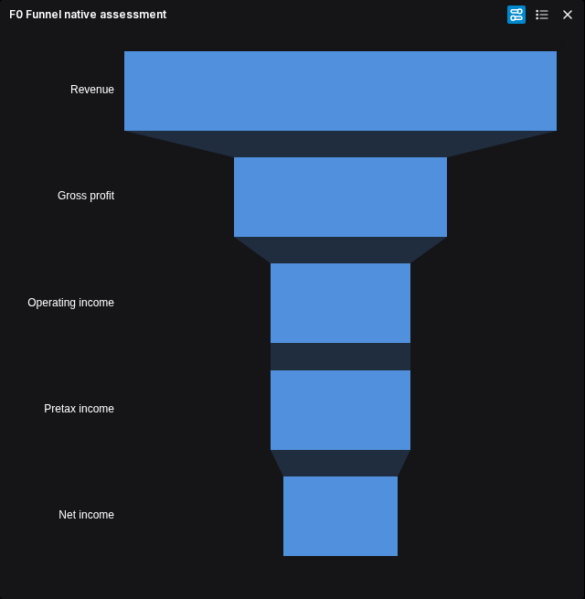
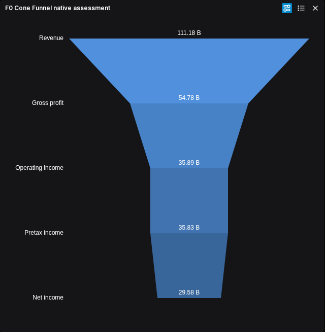
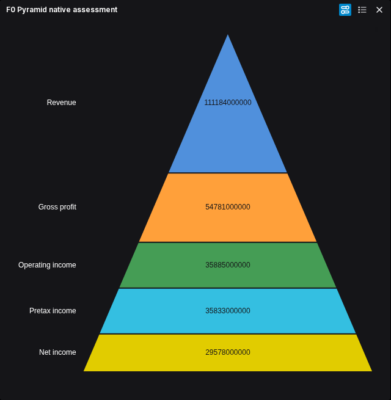

# Funnel-family parity

The inactive data adapter, renderer and controls for Funnel, Cone Funnel and Pyramid are independently accepted. Their combined ECharts/editor check passes. Application session integration, packaged-image parity and publication remain pending. The owner resumed this work on 2026-10-26 after Heatmap publication.

## Scope

Preserve the existing gallery, editor, themes, reachable controls and saved configurations. Reuse the existing ECharts host and session; do not introduce hidden flags, disabled controls or a second state owner. The current published alpha remains available throughout development.

The three gallery variants are `funnel`, `coneFunnel` and `pyramid`. Source declarations alone do not establish their visible behavior. Observe data assignment, stage order, duplicate labels, missing/zero/negative values and reachable controls before freezing the replacement contract. Other callers and table capabilities retain their separate obligations.

## Bounded sequence

- [x] F0. Observe the original variants with retained FMP data and a small edge-case discriminator; independently review the behavior matrix and implementation boundaries.
  - [x] Independently review retained FMP values and bounded native characterization.
  - [x] Owner approved the explicit missing/signed-input rules on 2026-10-26; see the [implementation contract](funnel-contract.md).
  - [x] Freeze and independently review the [F1 data interfaces and file ownership](funnel-data-design.md). Renderer/editor interfaces remain F2 work.
- [x] F1. Implement and independently accept the inactive [data adapter](funnel-data-design.md) with focused financial regressions and maintained-path inventory.
- [x] F2a. Freeze and independently accept the [renderer/editor declarations](funnel-renderer-design.md).
- [x] F2. Implement renderer and controls in the design's disjoint lanes with independent review and the inactive composition check.
- [ ] F3. Join the existing session, caller and editor under the [reviewed integration design](funnel-integration-design.md); verify saved-state transitions and affected families.
  - [x] Independently review the integration contract, including safe theme rejection and missing-value capture.
  - [x] F3a. Implement and independently accept the inactive stock/plain-color theme helper.
  - [ ] F3b. Connect capture, session, caller and editor atomically; retain correction controls for invalid Pyramid data.
- [ ] F4. Verify an identified packaged image against FMP values, original appearance, reachable controls, themes, refresh, save/reopen and export. Open uncertain visual comparisons in qView.
- [ ] F5. Publish selected FMP samples, reconcile README/docs/breadth, and run the image pipeline once for the accepted milestone. Verify the tagged release and anonymous pulls.

This sequence is an assessment agenda, not an approved implementation contract. F0 supplies the concrete interfaces, exclusive file ownership and acceptance checks needed for subsequent tasks. Each production task must pass the existing inventory-backed caps: 400 physical lines per file, 300 logical units per file and 50 per function. Research, documentation and tests are excluded from production caps.

## Financial fixture and verification

Prepare one retained AAPL income-statement quarter with reported USD levels for revenue, gross profit, operating income, pretax income and net income. Record the actual period, provider fields, retrieval provenance and source hash; independently reconcile the CSV with the retained response. These are income-statement levels, not additive expense movements, cash flows or customer-conversion observations. Do not silently sort or alter values to fit a funnel shape.

The independently reconciled fixture selects FY2026 Q2, ended 2026-03-28: revenue 111,184,000,000 USD; gross profit 54,781,000,000; operating income 35,885,000,000; pretax income 35,833,000,000; net income 29,578,000,000. Five source-field comparisons and four accounting identities pass. This quarter has nonincreasing levels; FY2026 Q3 instead has pretax income above operating income and was not altered. Monotonicity is not yet an input restriction for the replacement.

Use isolated background Playwright with strict CDP diagnostics, one worker and no retries. Record original errors honestly; they do not waive candidate failures. Preserve the separate first-login onboarding issue. No new provider request or production build is required for the original assessment.

## Work allocation

The native-browser lane owns its original-only probe and ignored run outputs. A separate fixture lane owns the retained-data CSV, provenance and reconciliation. The controller owns the milestone, shared contracts and integration; independent review checks the combined findings before implementation. Only one heavy suite or build runs at a time.

## Reviewed original findings

F1 source acceptance: Workspace `20bae47fe5e88620120c07c049907b092c3a046c` adds only the contracts, pure adapter and focused tests. Twenty-one tests, scoped lint and complete-file complexity checks pass; baseline-relative typing adds no diagnostics. The [independent source review](../../../artifacts/reviewed/chart-funnel/data-review.md) accepts identity, provenance, missing/signed inputs and stable normalization. Rendering and application integration remain pending.

Typing qualification: the initial F1 harness inherited `strict: false`. An [explicit strict follow-up](../../../artifacts/reviewed/chart-funnel/data-strict-followup.md), independently inspected against unchanged source, passes with 22 inherited diagnostics and no added or owned diagnostics. Both checks retain `skipLibCheck`; neither claims a clean full application compile.

F2a source acceptance: Workspace `b676e8f9057851ed7cb9e5dcf9200c40b51aff44` adds readonly render declarations and a compile fixture for the three variants. Independent strict compilation, lint and inventory-backed caps pass (88 physical lines, 60 logical units, no functions). The [review](../../../artifacts/reviewed/chart-funnel/render-types-review.md) accepts this inactive interface only. Geometry and controls can now proceed without editing the shared types; caller theme derivation remains F3 work and must not reintroduce commercial runtime dependencies.

F2 source acceptance is split into per-task Workspace commits: `5c7d7bb` for geometry, `a911ca8` for controls and `a3e1a86` for their composition check. Independent reviews accept [13 geometry/actual-engine checks](../../../artifacts/reviewed/chart-funnel/renderer-review.md), [24 compatibility and 3 component checks](../../../artifacts/reviewed/chart-funnel/controls-review.md), and [3 composed variant checks](../../../artifacts/reviewed/chart-funnel/join-review.md). Scoped typing, lint and complete-file caps pass. The composed tests preserve retained FMP values while independently toggling stage/numeric labels, changing direction and removing Funnel connectors through the existing option reducer. JSDOM uses fallback font metrics; no browser appearance, persistence or export acceptance is claimed.

The [native assessment](../../../artifacts/reviewed/chart-funnel/native-assessment.md) and [independent review](../../../artifacts/reviewed/chart-funnel/assessment-review.md) establish bounded original characterization. Three financial journeys passed rendering, export and visible reload checks. Follow-up observations cover duplicates, Sum, direction, labels and missing/signed values. Historical probe failures remain documented. Original CSV diagnostics were not clean; these are not candidate acceptance results.

Cone and Pyramid retain tested option values after reload but their reload screenshots visibly lose numeric labels. Selecting Reserve alongside Value leaves Value first; replacing the first selected field alone remains untested. These findings guide replacement acceptance rather than authorize copying native bugs. The owner approved the explicit financial admission rules in the [implementation contract](funnel-contract.md) on 2026-10-26; executable interfaces are next.

F3a source acceptance: Workspace `3cbd6c85f2ac09c943e53120a99e89bb7c636abf` adds the inactive stock/plain-color theme helper. Nineteen focused tests, scoped strict typing, lint and inventory-backed caps pass under [independent review](../../../artifacts/reviewed/chart-funnel/theme-helper-review.md). Advanced paints return explicit diagnostics without modifying settings; actual caller recovery and packaged appearance remain pending.

## Financial chart samples

Original reference only: AAPL FY2026 Q2 income-statement levels, reported USD, from the retained FMP response retrieved 2026-10-20. Original frontend `38dffc33389aca0e4a87e0e88d42f7067aa220df`, image `sha256:f48eb1c9b32e1f84d5199dafc943bc1fc10f3b1745ab29860975d002dc5c8a3f`; backend-only overlay identity is in the reviewed assessment. Screenshots follow control inventory with toggles restored; they are not untouched defaults or replacement renders. Pyramid allocates axial thickness by value/total, not equal-area slices or additive revenue composition.

