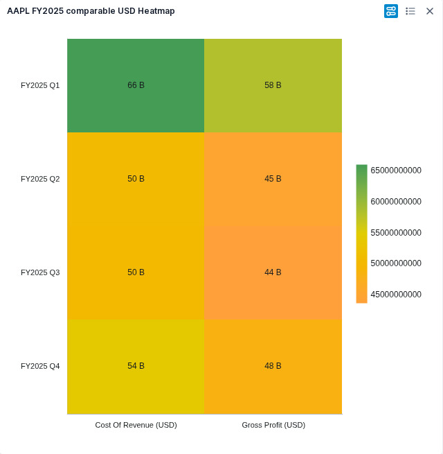
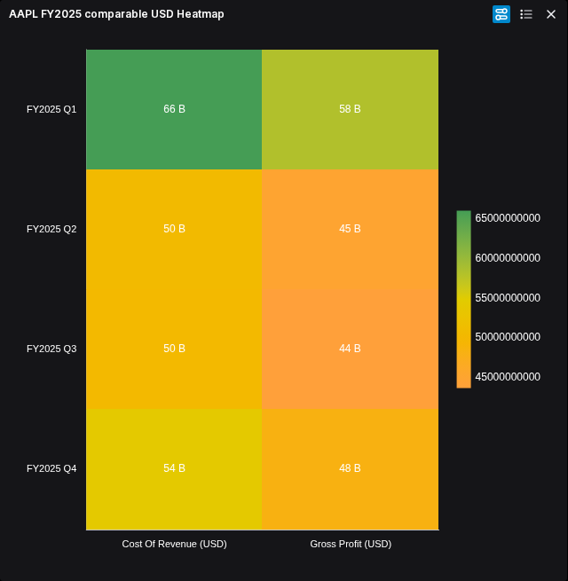

# Heatmap parity

Heatmap application acceptance is complete for the ordinary Table/File journey and onboarded users. Financial values, appearance, controls, refresh, persistence, recovery and PNG export are independently reviewed. The accepted milestone is published as [alpha-40228938438-1](https://github.com/norandom/QOpenBB/releases/tag/alpha-40228938438-1); public assets and image pulls are verified.

## Scope

Preserve the existing Table/File chart gallery, editor, themes, controls and saved state. Use the existing ECharts host and application session. No new toolbar, hidden feature flag, disabled control or second state owner is permitted. Keep the current published alpha available throughout development.

The first application acceptance target is the ordinary Table/File journey. Selected-range charts and other callers retain their existing obligations; this milestone must not claim those callers accepted without exercising them. Shared guard changes must preserve grouped, pivot, tree, pinned and remote-row restrictions.

## Original findings and reviewed contract

Pinned original frontend: `38dffc33389aca0e4a87e0e88d42f7067aa220df`. Candidate starting source: `33a81d387b62e962ecced465b78bf2d303530468`.

Two bounded original probes establish a wide matrix: one selected category labels row occurrences and numeric field names label columns. Duplicate labels remain separate with aggregation off. Negative and zero observations remain visible; a missing cell leaves its valid companion visible. Native Sum matches the existing ordinary aggregation owner. The [reviewed data contract](heatmap-data-contract.md) therefore reuses ordinary snapshots and setup projection; no third capture kind is planned.

Original probes inventoried Series, gradient Legend, Chart Style and both axes, then characterized constant values, an all-missing selected domain and zero-series recovery. The initial capture followed section inspection and is not an untouched appearance baseline; later retained-FMP light/dark references are prepared for comparison. Original observations do not establish candidate browser acceptance.

The reviewed data, renderer/control and integration contracts cover:

- Category/value field assignments, axis orientation, order and switch-category/series behavior.
- Duplicate-cell reduction with aggregation off and with supported aggregation choices.
- Missing categories and values, valid zero and negative values, equal color domains and empty data.
- Native labels, axes, tooltip, color scale, legend and reachable cell/layout controls, including saved option keys.
- Refresh, family transitions and persistence through the existing session and storage owners.

## Bounded sequence

- [x] Inspect pinned original wrapper and current integration seams.
- [x] HM0. Observe original behavior and independently review the data/control contract and exact task boundaries.
  - [x] Freeze the bounded matrix data contract from original observations with independent review. Renderer/control and integration boundaries are also independently reviewed.
- [x] HM1. Implement the inactive matrix adapter against existing ordinary setup projection, with focused regressions and maintained-path inventory.
- [x] HM2a. Freeze inactive [renderer/editor declarations](heatmap-renderer-design.md); independently reviewed at Workspace `216e8a296391e64f8e069602332caa09aafa9943`.
- [x] HM2. Implement the renderer and controls in disjoint lanes against frozen interfaces; independently review each lane.
- [x] HM3a. Extract ordinary transaction dispatch without changing behavior; [independent review](../../../artifacts/reviewed/chart-heatmap/dispatch-review.md).
- [x] HM3. Follow the reviewed [integration design](heatmap-integration-design.md): extract ordinary dispatch, then join session, guards, caller and editor atomically; verify affected families and saved-state transitions.
- [x] HM4. Verify an identified packaged image against real FMP values and the original appearance, controls, light/dark themes, refresh, save/reopen and export. Show uncertain differences in qView.
- [x] HM5. Publish selected FMP examples, reconcile README/docs/breadth, and build one accepted milestone through CI. Verify the release and public image pulls.

Every executable production task must name its exclusive files and public inputs/outputs before dispatch. Caps remain 400 physical lines per file, 300 logical units per file and 50 per function, enforced by the existing inventory/checker. The shared dispatch owner is already 362 physical lines at the starting source; plan a cohesive extraction if needed instead of squeezing additional branches into it. Research, documentation and tests are excluded from production caps.

## Verification and financial fixture

Reuse the existing isolated Playwright/CDP helpers with one worker and no retries. A small synthetic discriminator must establish actual original semantics before implementing the replacement. Preserve original diagnostics as observations; they do not waive candidate errors. New-account onboarding remains the [separate baseline follow-up](../openbb-self-service/first-login-diagnostics.md).

Verified real fixture: AAPL FY2025 quarterly cost of revenue and gross profit, both reported USD, from retained FMP `/stable/income-statement` observations retrieved on 2026-10-20. The same eight observations already reconcile to 416,161,000,000 USD in the [hierarchy milestone](hierarchy-milestone.md). The prepared fixture uses fiscal-quarter rows and two numeric columns; all eight values independently match the retained raw records. Do not mix percentages and USD on one color scale or convert missing observations to zero. This is retained provider evidence, not a fresh API request.

Accepted real-FMP examples and their source/image identities are below. Financial assertions and native tooltip checks accompany the images.

## Packaged findings and corrective scope

The first HM4 candidate, image `sha256:1aa5ad54ae5089a821397a21a414c9a3ad31008fb6112b9bf6eeaff7aa16e376` from Workspace `09947a2`, displays all eight retained FMP observations with matching tooltips in both themes. Its first-login run failed strict diagnostics on the separately tracked onboarding 404. The subsequent ordinary login had clean diagnostics, but controls verification stopped because Customize omitted both existing axis panels. These are partial observations, not application acceptance.

Two disjoint corrective tasks precede the next image:

- [x] Match native gradient tick density and raw numeric labels in `echarts/heatmapChrome.ts`, with regressions in `heatmapRenderer.test.ts`. Preserve financial values, cell colors, constant/empty domains and paired legend reversal.
- [x] Compose the existing horizontal and vertical `HeatmapAxisEditor` panels in `HeatmapCustomizeEditor.tsx`, with an editor interaction regression proving both axes remain reachable and dispatch the correct intent. Do not add a new state owner or change axis contracts.

The two implementers own only these respective production/test paths; the controller owns the join and commits. Independent review, focused tests, lint, baseline-relative typing and the existing inventory-backed caps apply. Rebuild the corrected source before claiming packaged acceptance. Keep the failed runs under local `artifacts/chart-heatmap/hm4/browser/default-1` and `controls-1`; do not suppress onboarding diagnostics or mark unexecuted persistence/export checks complete.

## Work allocation

Original behavior research and current integration research run independently. After HM0, data/capture work owns new data modules; renderer work owns new ECharts translation modules. Controls may run alongside the renderer only after appearance and command interfaces are frozen. The controller owns shared unions, routing, inventory, integration and selective commits. Independent review checks the joined financial semantics and public behavior. One heavy build or suite runs at a time.

Local source research is retained in `artifacts/chart-heatmap/original-research.md` and `integration-research.md`. These findings are source evidence, not completed browser checks. The [independent assessment-plan review](../../../artifacts/reviewed/chart-heatmap/plan-review.md) approves this research boundary only. The later original probes and independently reviewed renderer/integration contracts close this assessment; candidate application acceptance remains HM4.

## Accepted inactive foundation

HM1 is independently accepted at Workspace `0d343b00a5d168ced61a41dfbb931e4f6d4c59f9`. Eight focused tests pass; scoped typing adds no diagnostics to the inherited baseline. The 54-line adapter passes the inventory-backed caps. [Review](../../../artifacts/reviewed/chart-heatmap/data-adapter-review.md). HM1 itself introduced no routes or rendering. Subsequent source integration is recorded below; packaged application acceptance remains open.

## Accepted inactive renderer and controls

HM2b controls (`8fb06e58582c0baea15089fdbf4e03fa70dc0a87`) and HM2c renderer (`8b4426b9ca7f0b04ccfdfa05c495a415f7741ddf`) are independently accepted. Controls pass 21 resolver/intent tests and three editor interaction tests; the renderer passes 12 focused checks plus the eight existing data-adapter checks, including actual ECharts SVG. Both pass lint, baseline-relative typing with no added or owned diagnostics, and inventory-backed size caps. The inherited application type errors remain.

The owner approved effective tooltip suppression and reversal of legend colors and labels together. Review corrected multiline label overflow, axis-label space and a weak hover assertion. See [controls review](../../../artifacts/reviewed/chart-heatmap/controls-review.md) and [renderer review](../../../artifacts/reviewed/chart-heatmap/renderer-review.md). HM2 accepted these modules before activation; subsequent source integration is recorded below. Packaged real-FMP rendering, visual approval, refresh, persistence and export remain open. No image was built for the HM2 foundation work.

## Source integration accepted

HM3b is accepted at Workspace `09947a2d7bea7c93b71ad4dc74afcc1ae64f5033`: [review and qualified verification](../../../artifacts/reviewed/chart-heatmap/integration-review.md). The source now preserves empty selections on fresh capture/reopen, handles the native no-category single-series range and routes controls through the existing transaction owner. All 208 distinct planned checks pass with the documented configuration corrections; whole-project typing remains inherited-failure limited. Original retained-FMP light/dark, all-missing and zero-series recovery evidence is prepared locally. Candidate screenshots and financial/browser acceptance remain pending; the public alpha has not changed.

The HM4 corrective source is independently accepted at Workspace `c7a7633fd1b864647f55c08dd5ce0d4654fe93a0` (legend task `0558ccb`). All 14 renderer and four editor checks pass, with qualified scoped typing, lint and inventory-backed caps. See the [corrective review](../../../artifacts/reviewed/chart-heatmap/corrections-review.md). HM4 remains open until the packaged behavior checks finish.

## Candidate appearance accepted

On 2026-10-25 the owner accepted the corrected light/dark Heatmap appearance in qView, including the approximately 7 px wider plot and small legend offset. Candidate image `sha256:e47ef653049844fd77a7bfbd8c27d963400f0f946779f05d7109a9ecd1d36426` contains Workspace `c7a7633`. Its default browser check verifies all eight retained FMP cell/tooltips in both themes, the saved model and clean strict diagnostics for an ordinarily onboarded account. Local evidence: `artifacts/chart-heatmap/hm4/browser/candidate2-default`; exact comparison copies and hashes: `artifacts/chart-heatmap/hm4/qview-candidate2`.

This decision accepted appearance only. The subsequent independent application review below closes controls, persistence, export and File all-missing recovery. First-login onboarding still has its separately retained 404 failure; no diagnostic suppression or questionnaire seeding was used.

## Empty-series accessibility correction

Candidate2 controls verification passes distinct axis widths in saved state and actual paint, label visibility, tooltip off/on and paired gradient reversal. It then finds a missing accessible empty-state message: the renderer paints no-data text after removing every series, but `AgChartView.tsx` omits Heatmap from the existing DOM overlay eligibility. The original exposes that message as DOM text. Preserve this failed run at local `artifacts/chart-heatmap/hm4/browser/candidate2-controls-2`.

- [x] Extend the existing empty-series overlay eligibility to Heatmap in `AgChartView.tsx`, with a focused composed regression. An all-missing domain with a selected numeric series is distinct and must not acquire the no-series overlay.
- [x] Independently review the bounded change, run affected tests/lint/scoped typing and whole-file caps, then rebuild before completing the lifecycle check.

One implementer owns this production file and its existing composed test; another owns only the File all-missing browser test and evidence against the current image. No shared state or renderer changes are authorized. The controller serializes heavy checks, reviews and commits. Existing caps and inventory apply.

The independently reviewed correction uses one predicate, `ready?.kind === "heatmap" && ready.setupProps.value.series.length === 0`, for both the visible DOM message and `visibility: hidden` on the existing chart host. Visibility retains dimensions, chart lifecycle and the renderer's no-data graphic for PNG export while avoiding duplicate on-screen text. Keep Heatmap outside the other families' generic series-data-length predicate: selected series can have empty data because there are no rows or no plot space. All-missing selected series must retain the visible host and no no-series overlay. This bounded application presentation amendment supersedes the earlier no-overlay instruction for zero-series Heatmap only; renderer and export contracts remain unchanged.

The empty-series source correction is independently accepted at Workspace `5cae43a52317264067951b111048664292882ec2`: [review](../../../artifacts/reviewed/chart-heatmap/empty-state-review.md). All 31 caller tests pass, with lint and combined caps. Scoped typing retains 390 unchanged diagnostics, including eight inherited diagnostics in touched files. The current candidate also passes the actual File all-missing-to-finite journey with clean diagnostics; that differs from zero selected series. At source acceptance, rebuilt-image zero-series, export and persistence checks remained open; the HM4 review below closes them.

## Application acceptance and FMP examples

[Independent HM4 review](../../../artifacts/reviewed/chart-heatmap/verification.md) accepts three maintained journeys: retained-FMP light/dark values, controls/lifecycle, and actual File all-missing recovery. Final lifecycle checks use Workspace `5cae43a52317264067951b111048664292882ec2`, image `sha256:6dc3dbfef52cbaa16cdc062d672c63a114a2d6dc8a17daf32a148c915390d42d`. Both populated and empty saved selections reopen in fresh sessions, all eight financial observations recover, and PNG exports preserve the rendered content. Strict diagnostics pass for each active page. First-login onboarding remains a separate failed baseline check; no diagnostics were suppressed.

The two accepted browser files are committed at Workspace `68b1e41d414234c4e191d39207ca6f84347a5bf5`; that commit changes tests only. Publication uses this pinned source, while local image acceptance retains its actual production revision above. Selected-range callers, a fresh FMP request, native Windows, published-image browser testing and deployment are not established by this milestone.

Both figures show AAPL FY2025 quarterly cost of revenue and gross profit, reported USD: eight retained FMP observations totalling 416,161,000,000 USD. Rows are fiscal quarters; columns are the two components. Captured on Workspace `c7a7633`, image `e47ef653`; the later empty-selection-only repair is independently reviewed and verified in the final lifecycle image. These are the exact appearances the owner accepted on 2026-10-25, including the small plot-width and legend offset differences.

[Original light comparison](../../../artifacts/reviewed/chart-heatmap/heatmap-original-light.png).

[Original dark comparison](../../../artifacts/reviewed/chart-heatmap/heatmap-original-dark.png).

## Published alpha

[alpha-40228938438-1](https://github.com/norandom/QOpenBB/releases/tag/alpha-40228938438-1) publishes both prebuilt images from root `64c1cad70037449273475688b9668b895a129da4`. [Independent publication verification](../../../artifacts/reviewed/chart-heatmap/publication-review.md) confirms both CI jobs, the exact tagged source, three public assets, six anonymous image pulls and digest-pinned Compose parsing. CI image bytes were not browser-tested, and the installed Compose stack was not upgraded. The next queued family is Funnel/Cone Funnel/Pyramid; native-behavior assessment precedes its implementation contract.
