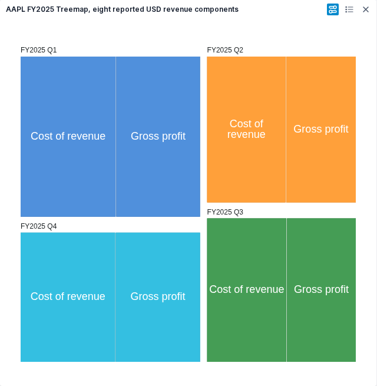
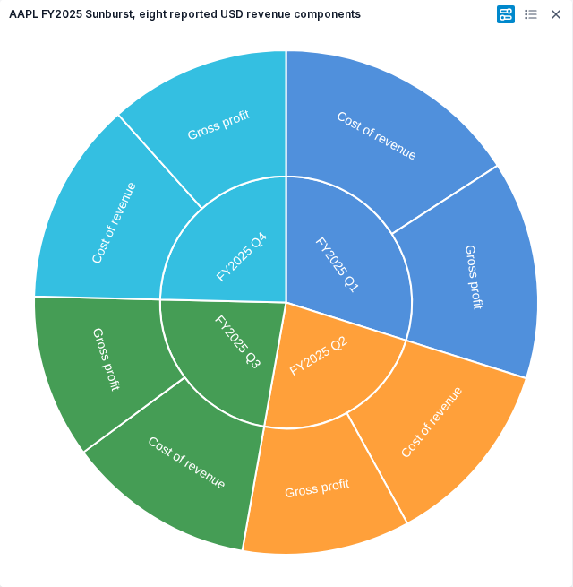

# Treemap and Sunburst parity

Treemap and Sunburst are locally accepted under UI-12 for onboarded users. Retained-FMP financial checks, controls, theme, refresh, fresh-session persistence, export and both owner appearance decisions pass. [Independent verification](../../../artifacts/reviewed/chart-hierarchy/verification.md) records exact source/image boundaries. H5 prebuilt image publication is verified; first-login onboarding is a separate baseline follow-up.

## Acceptance boundary

Reuse the existing ECharts host, session lifecycle, persistence and export. Hierarchy uses ordered category paths through the reviewed capture/setup extension. Do not weaken existing grouped, pivot, tree, pinned or remote-row guards or claim those paths are supported through an ordinary File chart.

The original source distinguishes size from color. The first numeric field supplies size, the second color; they are not two additive series. Multiple category columns define ordered levels. Source inspection also finds missing leaf size falling back to one, negative size clamped to zero and duplicate full paths retaining the last row before any explicit grid aggregation. Original application probes confirm missing-size area, negative/zero empty area and last-row duplicate behavior. The owner approved excluding missing sizes from area when a size field is selected; deliberate no-size count weighting is unchanged. Other semantics remain as observed/source-backed in the reviewed contract.

## Bounded sequence

- [x] Research pinned original source and current application reuse gaps.
- [x] H0. Observe original hierarchy behavior and freeze the numerical, capture, setup and control contract with independent review.
- [x] H1. Materialize reviewed shared interfaces and capture/setup foundation; add the maintained-path inventory and cross-family checks.
  - [x] H1a. Add the two inactive type owners and compile-only fixture defined in the contract; independent review and inventory-backed size checks required.
  - [x] H1b. Implement inactive hierarchy validation/displayed-row capture and verify shared guard regressions.
  - [x] H1c. Freeze prepared hierarchy/setup interfaces and implement full-path projection before the renderer/control join.
- [x] H2. Implement renderer and controls in disjoint reviewed lanes after H1; independently review each lane.
  - [x] Resolve the four bounded readiness items in the [renderer/control plan](hierarchy-renderer-plan.md), then freeze exact interfaces before dispatch.
- [x] H3. Follow the [reviewed integration design](hierarchy-integration-design.md): prepare inactive helpers, then join existing application owners atomically; verify stale commands, refresh, family changes and persistence.
  - [x] Independently accept inactive Set Up and Customize panels with existing controls.
  - [x] Accept inactive session/caller/lifecycle helpers and behavior-preserving extractions.
  - [x] Complete and independently review the atomic live join.
- [x] H4. Verify an identified packaged image with retained real FMP, original comparisons, visible control effects, theme, export and final fresh-session reopen. Obtain owner appearance decisions where needed.
  - [x] Repair Tile Padding effects in native composed-default rendering; packaged financial verification passes.
  - [x] Repair first-hover gradient marker visibility after appearance changes; the rebuilt interaction journey passes.
  - [x] Add independently reviewed owned-engine selection and verify an isolated export without replacing other projects' engines.
- [x] H5. Sync selected financial screenshots and reviewed evidence, reconcile README/docs/breadth, and publish one accepted milestone with verified release and image identities.

H0 research is documentation-only and outside production size caps. Before H1-H3 dispatch, freeze exact writable paths and exported interfaces. Every new or modified production file must pass 400 physical lines, 300 logical units and 50/function, with inventory-backed verification. The shared join owns any cohesive extraction needed by files near those limits. No implicit size exception or parallel edits to shared state owners.

## Original probe

Use the qualified pinned original frontend 38dffc33389aca0e4a87e0e88d42f7067aa220df and existing isolated browser helpers. Keep one browser worker and serialize it after the Radial build/verification queue.

A compact discriminator must distinguish ordered category levels, duplicate full paths, repeated leaf labels under different parents, size/color assignment, zero/negative/missing sizes, signed/missing color and aggregation off versus sum/average/count. Observe no-size behavior, parent/leaf tooltip meaning, continuous legend, category reorder, Treemap group/tile padding and gaps, and Sunburst tooltip controls. Record saved model paths and any drilldown behavior instead of adopting ECharts defaults. Source availability alone does not establish these controls work.

## Real FMP fixture and examples

Use retained AAPL FY2025 quarterly cost of revenue and gross profit as eight leaves: fiscal quarter -> revenue component, sized in reported USD. The two components reconcile exactly to each quarter's revenue; the four-quarter total is 416,161,000,000 USD. Revenue is a reconciliation reference, never an extra leaf or internal own amount. Preserve fiscal labels, reporting dates and source provenance; parent totals are derived.

The retained response is FMP /stable/income-statement, symbol AAPL, period quarter, limit 40, retrieved 2026-10-20T14:06:05.149732+00:00; SHA256 390dc8cbfc8302720a203bd9782d5e3b1f7363a4f762bdfcef079dbbe4c72f6b. H4 verifies this reshape against the retained response; no fresh provider request is claimed. A separate synthetic fixture covers color edge cases.

The verified examples below use retained FMP observations. Hierarchy is published as `alpha-40201437272-1`. The installed Compose environment is unchanged.

See the [original-source research](../../../artifacts/reviewed/chart-hierarchy/research-contract.md) and [independent plan review](../../../artifacts/reviewed/chart-hierarchy/plan-review.md). Source research is not a runtime pass.

## Earlier source checkpoints

These records describe acceptance at each source revision. Their pending-work statements are historical; the H4 result above supersedes them.

The [hierarchy contract](hierarchy-contract.md) defines observed semantics, source-backed canonical paths, owner-approved missing-size handling and H1a exact ownership/types. [Independent design review](../../../artifacts/reviewed/chart-hierarchy/design-review.md) approves this bounded freeze. [Original observations review](../../../artifacts/reviewed/chart-hierarchy/observed-contract-review.md) distinguishes completed probes from diagnostic limitations and deferred H4 checks. The replacement will honor the existing tooltip toggle intent; the original toggle is inert in both observed families. No hierarchy replacement or financial runtime acceptance is claimed.

H1a is accepted at Workspace `2e900d9965902a88adba3338732de2efb054248d`: two inactive declaration owners and one compile-only fixture. Independent strict checking retains exactly the four inherited baseline diagnostics with no new diagnostics; formatting and combined inventory caps pass. [Type-contract review](../../../artifacts/reviewed/chart-hierarchy/inactive-types-review.md). This is type-shape acceptance, not executable validation or chart rendering.

The [inactive capture design](hierarchy-capture-design.md) and [independent plan review](../../../artifacts/reviewed/chart-hierarchy/capture-plan-review.md) freeze H1b's six-file boundary. Inactive validation and capture are accepted; live session integration remains H3.

H1b is accepted at Workspace `61d1475205bd6bd18799309e674cb6d96494ff15`: dedicated hierarchy validation and displayed-row capture plus shared safe JSON/grid guards. Affected compatibility/application suites and independent review pass; strict inherited diagnostics remain documented. Combined caps pass for all six production owners. [Capture review](../../../artifacts/reviewed/chart-hierarchy/inactive-capture-review.md). The new capture API has no live application caller yet.

The [H1c setup design](hierarchy-setup-design.md) and [review](../../../artifacts/reviewed/chart-hierarchy/setup-plan-review.md) define the next inactive implementation. The owner approved keeping missing categories distinct from literal names during aggregation. H1c is independently accepted at Workspace `fb0113c78a9b143edd4df3957e84e13ee3b98647`. Thirteen focused tests cover aggregation, missing observations, retained FMP reconciliation and pure setup edits. Baseline-relative strict checking adds no diagnostics; combined complexity caps pass. [Setup review](../../../artifacts/reviewed/chart-hierarchy/inactive-setup-review.md). These functions have no live application caller yet.

H2.0 shared declarations are accepted at Workspace `fc0f02f0b01df8c5629849556b13db8b957fe808`: five inactive type owners and one strict compile fixture. Four inherited diagnostics remain unchanged; formatting, independent review and combined caps pass. [Declaration review](../../../artifacts/reviewed/chart-hierarchy/renderer-types-review.md). Renderer/control implementations and live integration remain open.

H2.0 dependency preparation is accepted at Workspace `ce91431ae371a6d33350ebde27c8d85ab4ceaea2`. Exact Culori4.0.2 and declarations4.0.1 were installed through the pinned Safe Chain/Bun workflow in an isolated stage; all preexisting lock records are unchanged. Strict typed imports, converter checks and combined caps pass. [Dependency review](../../../artifacts/reviewed/chart-hierarchy/renderer-dependency-review.md). This prepares color conversion; chart interpolation and rendering still require their own acceptance.

H2 controls are independently accepted at Workspace `1b7c3e7decd50ed197ce3c60470876ecdce9ab42`. 32 focused tests, baseline-relative strict checks and inventory caps pass for the inactive scope. [Review](../../../artifacts/reviewed/chart-hierarchy/inactive-controls-review.md). H3 live integration and H4 packaged financial/visual acceptance remain open.

The H2 renderer is independently accepted at Workspace `a4b0a7da0c47e63eafc7efa4c450cf73addf5f1d`. 26 focused tests, baseline-relative strict checks and inventory caps pass for the inactive scope. [Review](../../../artifacts/reviewed/chart-hierarchy/inactive-renderer-review.md). H3 live integration and H4 packaged financial/visual acceptance remain open.

H3 inactive ui are independently accepted at Workspace `a5112cb3312c85524b32fe6bba7c35e1bb23e0b9`. [Review](../../../artifacts/reviewed/chart-hierarchy/integration-ui-review.md) records the scoped checks and inherited diagnostics. Live integration and H4 packaged acceptance remain open.

H3 inactive helpers are independently accepted at Workspace `15db313febfda9d9a30b2b2f442daed54183d447`. [Review](../../../artifacts/reviewed/chart-hierarchy/integration-helpers-review.md) records the scoped checks and inherited diagnostics. Live integration and H4 packaged acceptance remain open.

H3 live application join is independently accepted at Workspace `2647c37f9dd1d84b1f41da28383ace73e0b10c15`. [Review](../../../artifacts/reviewed/chart-hierarchy/integration-join-review.md) records the scoped checks and inherited diagnostics. H4 packaged financial, visual and persistence acceptance remains open.

H4 preparation found default label boxing padding masking Tile Padding. The independently reviewed source repair is committed at Workspace `99e6878920cf586b94bcf9c59c3177373126d1cf`; native rendering checks preserve geometry and explicit active boxing. [Repair review](../../../artifacts/reviewed/chart-hierarchy/tile-padding-review.md). The initial `2647c37` image does not contain this repair; rebuilt financial and visual acceptance remains open.

The gradient-marker source repair is independently accepted at Workspace `432c26b93328b14b7a9d79d37bafe6203a738cfa`. It makes the seeded marker visible on the first valid hover after a full appearance repaint, including Tooltips Off. [Repair review](../../../artifacts/reviewed/chart-hierarchy/marker-visibility-review.md). Both financial journeys and owner appearance decisions passed on the preceding image; the final synthetic interaction case must pass on a rebuilt image before H4 closes.

H4 chart acceptance covers onboarded users with strict diagnostics observed before login. The pre-existing [first-login onboarding error](../openbb-self-service/first-login-diagnostics.md) remains a separate open baseline gap; failed first-login runs are retained and not counted as chart passes.

## Accepted FMP examples

Both figures show AAPL FY2025 quarterly cost of revenue and gross profit in reported USD: quarter -> component, eight leaves totalling 416,161,000,000 USD. Revenue is reconciliation only. Captured on Workspace `99e6878`, image `1ab9db4`; the later marker-only repair is separately verified on `432c26b`, image `21c08f38`. Owner accepted both appearances on 2026-10-25.

Treemap uses parent/child area allocations. [Original comparison](../../../artifacts/reviewed/chart-hierarchy/treemap-original.png).

Sunburst uses parent/child angular allocations. [Original comparison](../../../artifacts/reviewed/chart-hierarchy/sunburst-original.png).

## Published alpha

[alpha-40201437272-1](https://github.com/norandom/QOpenBB/releases/tag/alpha-40201437272-1) publishes both prebuilt images from root `3941cf8982919c6a5a468e1c0cebb1ee0b694c31`. [Publication verification](../../../artifacts/reviewed/chart-hierarchy/publication-review.md) confirms the tagged source, three public assets, six anonymous image pulls and digest-pinned Compose parsing. The published Workspace source adds only the five accepted browser files to the final local interaction source. CI image bytes were not browser-tested, and the installed Compose stack was not upgraded.
