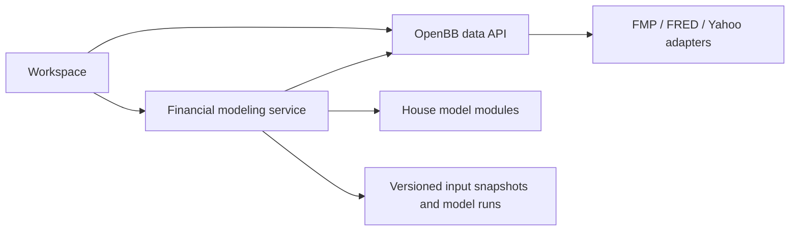

# House financial modeling: requirements reflection and architecture amendment

2026-10-28. Status: proposed requirements and architecture direction for owner review; no modeling implementation or numerical acceptance is claimed. The owner requires independent data-acquisition and financial-modeling concerns, loose module/plugin coupling, and eventually three historical years alongside five forecast years. A separate modeling container is an option, not a requirement to route every data request through it.

## Conclusion

Follow-up owner direction: broad FMP acquisition is first; modeling will live in a separate Git repository, with only a specification stub in this session. The [financial-modeling stub](../financial-modeling/brief.md) records executable validation, widget/API compatibility, cross-repository breadth and agent-first Kiro extension rules. Later FRED/EconDB work follows the same separation. Its requirements develop this reflection; implementation remains unstarted.

Keep the owned OpenBB provider framework as the data layer. Introduce a separately specified financial-modeling layer for house methods, assumptions, forecasts and verified calculations. Keep Workspace as their consumer. FMP DCF is an optional external comparator, never the authoritative house model or a shortcut for its sensitivities.

The existing requirements cover financial subject matter and data provenance well. They do not yet specify a complete house calculation contract, method governance or an independent modeling boundary. Close those gaps before implementing valuations. Continue the approved statement-acquisition work without embedding model logic in the adapters.

## Standard reviewed and authority

Reviewed [corporate-finance skill v1.3.1](https://github.com/norandom/Skills/blob/88b9528692ea4a96b3d65775dbf86cab3f62555c/corporate-finance/SKILL.md), including its intent, auditability, EBITDA, ratios, working-capital, three-statement, valuation, modeling-practice and spreadsheet references and corresponding model assets. The installed local skill was v1.3.0; the linked repository was checked at commit `88b9528692ea4a96b3d65775dbf86cab3f62555c`. The reference and asset content agreed; the newer skill corrects reference paths and description text.

Treat this as the owner's house standard, described by the owner as Rothschild standard. The supplied repository attributes its contents to personal notes and templates; this review does not establish external institutional accreditation. Preserve the owner's financial discipline while resolving contradictory examples explicitly.

This is a REFLECT deliverable: findings, proposed requirements and a fix sequence. It does not build a valuation or silently approve a new implementation plan.

## Separate responsibilities

| Concern | Owns | Must not own |
| --- | --- | --- |
| Data API / OpenBB provider modules | Acquisition, provider queries, identity, original values, documented schema normalization, timestamps, units, fiscal periods, source limitations and provider-calculated outputs | House EBITDA adjustments, forecast drivers, WACC choices, valuation scenarios or dashboard layout |
| Financial-modeling modules | Financial definitions, explicit input mapping, adjustments, ratios, forecast schedules, valuations, sensitivities, calculation trace and numerical checks | FMP credentials/endpoints, hidden network fetching, Workspace state or chart rendering |
| Modeling service / orchestration | Resolve explicitly requested input snapshots through the data API, validate model inputs, invoke modules, persist runs and return results | Duplicate provider adapters, duplicate formula engines or mandatory interception of ordinary data widgets |
| Workspace | Company/time selection, assumption editing, linked widgets, presentation, research context and inspection of results | Independent copies of financial formulas or implicit changes to model methods |
| Later AI / Excel | Consume the same data and model contracts, explain or display verified outputs | Reconstruct authoritative financial results ad hoc or bypass validation |

The service and modeling modules can share one deployable image. They remain separate code responsibilities. Logical layering does not require one container per plugin.

## Recommended deployment shape

Recommendation for owner decision: use a separate modeling container when the first model slice is delivered. Keep it on the Compose internal network; the existing gateway can expose its authenticated routes under the same public origin. Retain direct Workspace-to-data routes for prices, statements, news and provider exploration. An unavailable modeling service must not disable those views.

Do not build a generic proxy between every widget and the data API. Modeling is a separate capability, not an HTTP pass-through. The exact route names, authentication delegation, request limits, persistence layout and synchronous-versus-job execution belong in the modeling design. Start with synchronous bounded calculations if adequate; do not introduce a queue just for architectural appearance. Existing relative bind persistence and image-pull deployment remain the operating conventions.

The core calculation library must also accept supplied inputs without the service, a browser, network access or a running provider. This permits deterministic verification and future Python/notebook use without creating a Jupyter hosting requirement.

## Patterns and extension contract

Ports and adapters describes the overall boundary. GoF patterns help inside it:

| Pattern | Concrete use | Constraint |
| --- | --- | --- |
| Adapter | Translate supplied provider records into a model's declared financial input schema | Preserve original values and mapping provenance; no guessed classifications |
| Strategy | Select a versioned house method, such as a particular EBITDA definition or DCF timing convention | Name and persist the method; never silently change an existing run |
| Factory / registry | Resolve an installed model identifier and compatible version | Explicit registration and compatibility validation; no arbitrary uploaded code |
| Facade | Give consumers a small model-discovery and calculation interface | Keep detailed assumptions and trace inspectable rather than hiding them |

Prefer Python modules/packages with explicit registration initially. Package entry points can provide plugin discovery when independently installed extensions exist. A plugin descriptor should declare identity/version, input and output schema versions, parameter definitions, supported entity/period types, method description, validation rules and capabilities. These are proposed contract fields, not an approved implementation schema.

The modeling core depends only on its own domain contracts. Provider mappings and HTTP orchestration depend on those contracts; the core does not import either. Widget code consumes published results. Enforce dependency direction with a small import-boundary check, not a new framework. Plugins execute trusted installed code; container separation alone is not a sandbox for untrusted plugins.

## Requirements gap and proposed amendments

Existing references: [IA1-IA10](investment-analysis-contract.md) and [market-data requirements](../market-data-integrations/requirements.md). Coverage here means written requirements, not completed functionality.

| House obligation | Current coverage | Required amendment and owner |
| --- | --- | --- |
| Source-to-result audit trail | IA2 and MD4 cover definitions, source and basis | Modeling: formula identity/version, input IDs and values, substitutions, intermediate results, units, checks, independent verification and mismatch status |
| Named assumptions separate from facts | IA2, IA6, IA10 partially cover overrides | Modeling: immutable run input snapshot, named scenario, explicit override origin and rationale; Workspace displays/edit controls |
| Comparable financial periods | IA3 and MD4.3 cover annual/quarter/YTD/trailing distinctions | Modeling: validate period completeness before aggregation, define averaging and day counts; data retains supplied periods and unknowns |
| EBITDA and earnings quality | IA4 covers adjustment rationale | Modeling: reconcile chosen earnings basis, D&A and every adjustment; distinguish reported, provider and house EBITDA; reconcile to cash separately |
| Ratio interpretation | IA4/IA5 cover cash conversion and multiples | Modeling: versioned definitions, denominator and proxy rules; Workspace adds common-size, trend and comparison context, without inventing missing budget/peer data |
| WACC and macro | IA7 is directionally strong | Modeling: explicit beta/relevering method, debt definition, tax-shield treatment, risk-premium decisions and dated benchmark selection |
| DCF | IA6/IA8 cover consistency and real sensitivities | Modeling: FCFF schedule, discount timing, terminal reinvestment, EV/equity bridge, share basis and independently checked scenario surface |
| Provider DCF | MD2.2 and IA6 | Data preserves FMP output and available assumptions; modeling/Workspace label comparator and non-comparability; absence must not block house DCF |
| Repeatable calculations | Existing evidence strategy requires independent recalculation | Modeling: input/method versions, explicit tolerances, persisted comparison status, invalidation on changed inputs; no unresolved output labeled verified |
| Full forecast model | Not part of the approved data implementation | Separate modeling spec: schedule-driven forecast and reconciliations, bounded by the available inputs |
| Workbook convention | Separate Excel workstream | Later Excel: historical/assumption/formula semantics, audit sheet and protected formula flow; preserve Anthropic-before-Excel dependency |

## Proposed modeling acceptance clauses

- FM1: Given a valid supplied input snapshot and named method version, a model shall calculate without provider credentials, provider-specific fetching or Workspace runtime dependencies.
- FM2: Each material calculated output shall return its financial definition, formula version, input references and values, assumptions, substitution/intermediate trace, units, period basis and validation status. Unknown source conventions shall remain explicit.
- FM3: Historical inputs, provider-calculated values, analyst adjustments, estimates and locally modeled outputs shall remain distinguishable throughout a saved run and its presentation.
- FM4: Each supported method shall define input completeness, period/sign/currency rules, missing-value handling and invalid-result behavior. An unsupported entity type or incomplete prerequisite shall produce an actionable unavailable result, never an implicit zero or substituted method.
- FM5: Material model outputs shall be independently recalculated in Python using a separately expressed reference calculation and explicit unit-appropriate tolerance. Calling the same production function twice is not independent verification. Persist the compared values and mismatch status; results with unresolved mismatches or incomplete verification shall be withheld or explicitly downgraded as assumptions, estimates or open items, never presented as established facts.
- FM6: A saved run shall retain model/schema versions, source snapshot identity, valuation date, named assumptions, adjustments and check results. Refresh creates an explicit new input/run version and does not silently rewrite the earlier conclusion.
- FM7: Model discovery shall expose inputs, assumptions, outputs, methods and limits consistently to Workspace and later AI/Excel. Adding an installed compatible model shall not require editing provider-fetching code.
- FM8: The model shall distinguish mathematical invalidity, missing evidence and house-policy exceptions. Hard constraints, warning thresholds and permitted overrides shall be explicit, versioned and visible.
- FM9: Provider DCF shall be an optional comparison result. House DCF, its assumptions and its sensitivities shall be calculated independently; a provider valuation alone shall not satisfy model acceptance.
- FM10: Ordinary provider widgets shall remain usable when the modeling service is unavailable. Data API and modeling errors shall retain distinct, actionable meanings.

These clauses are a proposed requirements amendment. Formal design, task decomposition and implementation approval remain separate Kiro steps.

## Three historical years and five forecast years

Adopt this as the intended first complete company-model horizon, subject to sufficient source history. Do not manufacture missing historical years. Present the actual/forecast boundary explicitly and retain the fiscal calendar. Quarterly source history may support annual aggregation and diagnostics; it does not by itself establish a quarterly forecast model.

Historical observations establish the baseline. Named drivers produce revenue, costs, working capital, capex/depreciation, taxes and financing schedules. Those schedules feed the forecast statements and FCFF. The same forecast can support a valuation without embedding discount-rate assumptions into the provider layer.

Require cash-to-balance-sheet reconciliation, assets versus liabilities/equity, relevant debt/asset/equity roll-forwards and sign/period checks. Validate whether the explicit horizon reaches a defensible terminal state; five forecast years is a workflow target, not proof of steady state. Exact annual/quarterly forecast granularity, permitted alternative horizons and sector coverage need the modeling requirements decision.

Do not block the first historical-analysis slice on completion of the full forecast engine. First ship verified historical diagnostics and bridges; then driver schedules and the three-statement forecast; then house DCF/WACC/scenarios. Price comparison and provider DCF can be displayed earlier with their provenance.

## Method ambiguities to resolve before encoding the standard

The following are source-review findings, not authorization to replace the owner's preferred conventions with generic defaults.

1. **Working capital:** the notes contain liquidity NWC, operating NWC and AR + inventory - AP. Give these separate method identities. Select included operating accounts explicitly; preserve changes caused by acquisitions, FX or reclassifications rather than assuming every balance movement is operating cash flow.
2. **Ratios:** specify average versus closing stock balances, actual period length versus annual day count, credit sales versus total-sales proxy, and purchases versus COGS proxy. A common label is not a common method. Missing opening balances must not silently switch the averaging convention.
3. **EBITDA:** reconcile operating and net-income routes rather than assuming they agree in the presence of nonoperating items. Review SBC and other add-backs individually. A gap between EBITDA and net income can include D&A and other items as well as tax and interest. Capex belongs in the relevant investing/FCF bridge, not an unlabeled CFO deduction.
4. **Cash-flow and equity presentation:** the notes give conflicting dividend classifications and simplified equity roll-forwards. Preserve source accounting classifications, disclose normalized mappings and include relevant issuance, buybacks, OCI and other equity movements. Wiring a few statement links is not evidence that the complete model balances.
5. **DCF timing:** name the accumulation factor `(1 + r)^t` separately from the present-value factor `1 / (1 + r)^t`. Specify year-end, mid-year and stub-period treatment before comparing valuations.
6. **Growth rules:** retain `g < discount rate` as the mathematical perpetuity gate. The notes' historical/GDP/risk-free ceilings and terminal-value concentration thresholds need explicit house-policy interpretation, dated benchmark definitions and missing-benchmark behavior. Do not silently relax them or hardcode them as universal economic laws.
7. **WACC:** worked rates and optional size/company premiums are examples, not live defaults. Define gross/net debt in relevering, market-value weights and treatment of unavailable tax shields. The macro rate must match the financial purpose, currency and date; selecting a FRED series is not sufficient.
8. **EV to equity:** use a complete signed bridge for applicable debt, cash/nonoperating assets, minority interests, hybrids and other claims. Avoid repeating NWC already reflected in FCFF. Treat outstanding, diluted and weighted-average shares as different inputs.
9. **Forecasting:** a growth rate and a growth multiplier are different. Formula definitions must resolve expressions such as baseline times growth. Gross-margin assumptions imply a complementary cost ratio; do not interpret a margin directly as a cost ratio.
10. **Benchmarks and precision:** illustrative liquidity thresholds are not automatic investment verdicts. Persist comparison context and return ranges/sensitivities where appropriate. A WACC movement has no universal fixed effect on valuation.

### Confirmed arithmetic defect in the supplied example

Source: [DCF asset's worked EV/equity bridge](https://github.com/norandom/Skills/blob/88b9528692ea4a96b3d65775dbf86cab3f62555c/corporate-finance/assets/dcf-wacc.md). The stated bridge has EV 15,035 and deductions 700, 766 and 225, but states equity value 13,945.

Formula and substitution: `equity = EV - debt - claim adjustments - asset deduction = 15,035 - 700 - 766 - 225`. Steps: `14,335 - 766 = 13,569`; `13,569 - 225 = 13,344`. Units are the example's common monetary unit; currency and scale are unspecified. Python Decimal independently returned `13344` on 2026-10-28. Check: the displayed result does not reconcile. Mismatch status: source example remains unresolved; use the corrected arithmetic only for these stated signs, not as an approved real-company valuation or a test expecting 13,945.

This demonstrates why house methodology and worked-example correctness need separate review. No source skill files were modified.

## Bounded delivery and specification ownership

1. Continue approved market-data tasks for balance sheets, cash flow and subsequent datasets. Preserve source semantics; do not add house valuation logic.
2. Create a separate `financial-modeling` specification from FM1-FM10. Freeze the input/result and method-version boundaries before assigning parallel implementers. Keep financial methods independent of deployment packaging.
3. Amend analyst-workspace to own the user journey and presentation of model outputs. Transfer formula/scenario execution ownership into the modeling specification, preserving existing IA acceptance obligations rather than deleting them.
4. Start modeling with historical normalization, EBITDA/cash bridges, ratios and peer inputs. Then add the historical/forecast model and DCF/WACC. Keep FMP comparator work optional to house valuation acceptance.
5. If the proposed container boundary is approved, deliver the modeling image and Compose service with the first accepted model capability. Use the existing Dagger publication and bounded browser/numerical verification workflow; no additional orchestration platform.
6. Map each accepted method to actual tests and evidence in the breadth record. Keep planned checks open. Apply existing production size limits and maintained-file inventory; separate modules by financial responsibility, not arbitrary line splitting.

Minimal verification is meaningful numerical coverage plus one real-data analyst journey for each delivered slice. Include incomplete periods, missing inputs, invalid denominators and reconciliation failures. Independently verify formulas and selected real-data outputs; do not replace numerical review with screenshot comparison or build a duplicate test framework.

Budgeting, 13-week liquidity forecasts, transaction comparables and specialist sector models remain future candidates. Their presence in the skill's template catalog does not automatically expand the current implementation batch.
