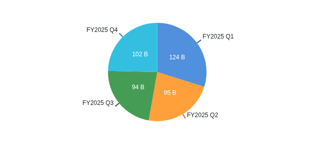
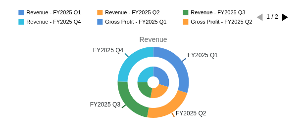
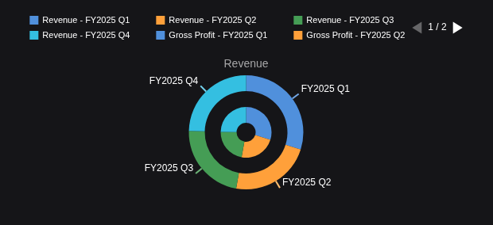

# Pie and donut chart milestone

Restore Pie, Donut and saved `doughnut` configurations in the ordinary Table/File journey. Build on the accepted histogram release, Workspace `ae45e30`. Preserve the existing gallery, editor, dashboard shell and saved-state owner. This milestone is authorized by the owner's continuing autonomous chart-port instruction; the prototype-first workflow retains bounded design and independent implementation reviews.

## Actual FMP chart samples

AAPL FY2025 Q1-Q4, reporting dates 2024-12-28 through 2025-09-27, from the retained FMP income-statement capture. Input values remain USD; chart labels abbreviate billions. Pie uses Revenue only. Donut shows Revenue and Gross Profit as separate quarterly distributions, with independent totals of USD 416,161,000,000 and USD 195,201,000,000.

Pie, light: Revenue is the first selected numeric field; each quarter is divided by the Revenue total.

Donut, light: outer Revenue and inner Gross Profit retain separate denominators; the visible legend is page one of two.

Donut, dark: the same observations, units and independent ring distributions.

Tested Workspace `9d1883849f480f45c89c53867554590d45b12428`, image `sha256:2459fc315b735cb2f66083bb11a10bacaed2b0fdad7f11f46191937661591d81`. These chart-only captures come from the accepted final FMP run. Exact capture/CSV and image hashes, commands and reviewed provenance are in the [verification record](../../../artifacts/reviewed/chart-pie/verification.md). No new provider request was made.

## Acceptance contract

1. Pie uses the first selected numeric field. Donut uses all selected fields in selection order as concentric rings. Each ring has its own denominator; revenue and gross profit must never be summed into one shared denominator. Keep the saved `doughnut` spelling while mapping its renderer family to donut.
2. Use the original category selection and aggregation contracts. Preserve observation order, missing/invalid/zero/negative handling, legend selection, normalization and raw-value tooltips as established from the original engine. Freeze those numerical rules before the rendering task; ECharts defaults are not evidence.
3. Preserve the original reachable title, legend, series, label, callout, stroke, fill and shadow controls and their saved option paths. Preserve saved radius/rotation options; the inspected original pie panels expose no rotation or generic polar hole slider. Retain the original family-specific panel visibility, without adding a flag, disabling a button or introducing a second editor.
4. Keep theme, selection changes, family switches, refresh, empty recovery, save/reopen and export within the existing session/host. Do not route pie through Cartesian axes or invent Cartesian navigation.
5. Verify captured FMP fiscal-2025 quarterly revenue through the application. A second donut ring can compare gross profit's quarterly distribution using its separate total. Derive the four rows from the retained 40-quarter capture with provenance and raw USD values. Synthetic checks cover cases that the positive FMP observations cannot establish.
6. Compare matched original/replacement views and working controls in both themes. Keep numerical and lifecycle checks focused on this family, run affected prior-family regressions, then publish one completed-feature alpha and verify both public images.

## Bounded tasks

All production paths are relative to `vendor/workspace/terminalpro/src/components/General/Table/Chart/`. Every modified production file must pass 400 physical lines, 300 logical units and 50 units per function using the existing explicit-scope inventory checker. Tests/docs are exempt. Parent owns shared records, inventory, commits and builds.

- [x] P0. Independently review the [assignment design](pie-design.md) and freeze the P1 interface. Record original source evidence and candidate financial fixture. Later numerical/rendering and integration decisions retain their own review gates.
- [x] P1. Implement inactive `compatibility/pieAssignments.ts` and `tests/unit/chart-compatibility/pieAssignments.test.ts`. Preserve first-field pie, ordered donut rings, saved alias and exact original ring-offset metadata. Reject malformed inputs without partial output or mutation. Require RED/GREEN, scoped strict typing, caps and independent review. No production routing, editor edits, dependencies, builds or provider calls.
- [x] P2. Implement the independently reviewed [inactive ECharts mapper](pie-renderer-design.md), with original value/legend/label semantics and actual-engine geometry assertions. Reuse existing appearance, formatting and host primitives. Inactive mapper independently accepted 2026-10-21; identified-image acceptance is recorded under P4 below.
- [x] P3. Connect the existing session, caller, gallery and editor under the reviewed [integration design](pie-integration-design.md). The integration owner and separate label-control lane have disjoint file ownership. Preserve saved options, selection and all reachable controls; source acceptance does not close application acceptance.
- [x] P4. Run the identified image with captured FMP values and synthetic edge cases, compare original appearance, exercise lifecycle/export and run affected regressions. Reuse the existing isolated browser harness.
- [ ] P5. Complete independent feature review, reconcile README/docs checkboxes, breadth and sanitized evidence, push the task commits and dispatch one image build. Close publication only after the release and anonymous image pulls are verified.

## Boundary and sequencing

P1 is inactive foundation work. Its acceptance does not establish a visible chart or a completed family. P2 depends on P1 and its own frozen numerical contract; P3 depends on accepted P2. Browser preparation may overlap P3 only with explicit disjoint ownership. Serialize shared edits and heavy checks.

Box plot, other polar/distribution families, standalone/AI callers, provider expansion and broader analytical workflows remain open. Preserve unrelated Perspective/catalog work. Use Sol for bounded implementation and Astra for financial/integration review, following [delegation](../../steering/delegation.md).

## P4 acceptance and remaining publication

P4 passed on Workspace `9d1883849f480f45c89c53867554590d45b12428`, image `sha256:2459fc315b735cb2f66083bb11a10bacaed2b0fdad7f11f46191937661591d81`. The final seven browser journeys cover retained FMP raw values and separate ring proportions; native mouse and keyboard legend paging; title, label, callout, stroke, fill and shadow controls; theme/refresh retention; passive initial save/reopen; noninitial-page PNG export; synthetic duplicates, signed/missing observations, aggregation, empty recovery and saved `doughnut`; and ordinary/combo, XY and histogram regressions. Diagnostics remain unfiltered. See the [reviewed evidence](../../../artifacts/reviewed/chart-pie/verification.md).

The first final XY batch passed one journey and hit login HTTP 429 on the other because of batch scheduling. Only the blocked scatter journey was rerun after the limiter window. The failed batch is retained; seven distinct journeys passed after that scheduling correction, with no production or test change.

The owner accepted the disclosed default appearance differences on 2026-10-21: a smaller Pie diameter, shifted outer callouts and absent thin slice separators. This is acceptance of the reviewed appearance, not a claim of exact pixel equality. Default samples retain the matched canvas size; styled-control checks use a normal saved widget-height increase.

The [appearance repair design](pie-appearance-repair-design.md) records the accepted source boundaries:

- [x] V1. Restore effective legend defaults and retain title/legend appearance through immutable admission.
- [x] V2-P. Prove native multi-component legend selection and freeze renderer metadata.
- [x] V2-L. Implement measured paging layout, field titles and surrounding-ring label fitting.
- [x] V2-H. Implement lifecycle paging, keyboard access, cleanup and export retention.

The title/legend transaction, automatic side-width and tooltip-replacement repairs are included in the tested source. Earlier failed runs and their diagnoses remain in the verification history. Independent feature review is approved. P5 publication and verification of both public image identities/pulls remain open; the published alpha is unchanged.
