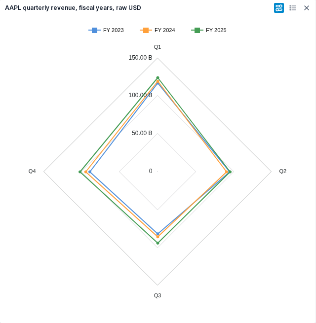
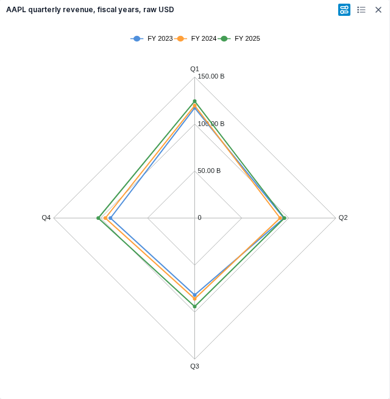
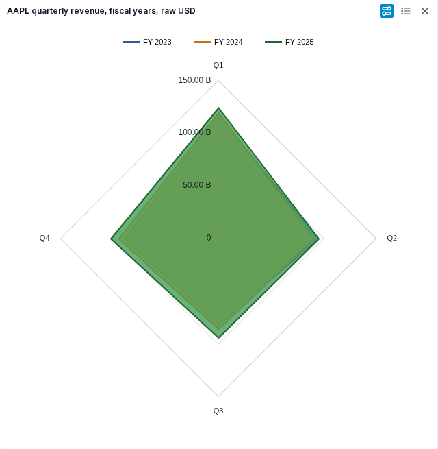
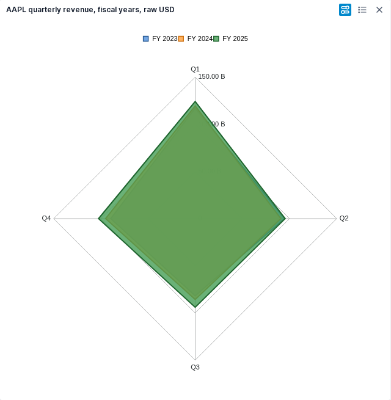

# Radar Line and Radar Area

Restore Radar Line and Radar Area inside the existing Table/File chart editor. The owner approved this next milestone on 2026-10-24. Radar is published in the current alpha. Radar packaged behavior has independent acceptance; the owner approved the current Line/Area appearance on 2026-10-24. RD4 is complete for the bounded Table/File journey; RD5 publication is verified as alpha-40086673952-1.

The [independent task-plan review](../../../artifacts/reviewed/chart-radar/plan-review.md) and RD0 [contract review](../../../artifacts/reviewed/chart-radar/rd0-review.md) passed on 2026-10-24. The frozen [adapter contract](radar-contract.md), declarations and fixture now support RD1/RD2 fan-out. Inactive renderer/editor adapters and RD3a capture/setup have independent acceptance. Source integration (RD3/RD3b) is independently accepted at Workspace `af226971c53922de5925d9b068fbfbd81df02527`. Packaged behavioral checks (RD4) are independently accepted with test source `194691e589ad75afb74d227574402dfb43ba6aea`; owner appearance approval completes RD4. Publication (RD5) is verified as [alpha-40086673952-1](https://github.com/norandom/QOpenBB/releases/tag/alpha-40086673952-1); see the [release evidence](../../../artifacts/reviewed/chart-radar/verification.md#published-radar-alpha). See the [verification record](../../../artifacts/reviewed/chart-radar/verification.md).

## Acceptance contract

1. Preserve the original `radarLine` and `radarArea` choices, gallery, Set Up, Customize, themes and widget framing. No new editor, hidden flags, disabled controls or artificial analytical scores.
2. Preserve selected categories and fields, their order, filtering, aggregation, inversion and saved settings wherever the original Radar journey supports them. Freeze the original engine's negative, missing, duplicate-category and radial-domain behavior before translating it; do not infer Cartesian behavior.
3. Preserve the applicable label, line, fill, marker, legend, tooltip and axis controls, including their defaults and persistence. Record baseline reachability separately from schema or menu presence. Original navigator controls are exposed, but their actual Radar effect still needs observation.
4. Verify financial values against retained FMP responses in an identified packaged application. Cover both families, refresh, fresh-session reopen, PNG export and observed console/network diagnostics. Compare light/dark appearance against the original. Ask the owner about concrete uncertain visual differences.
5. After independent acceptance, publish representative FMP screenshots, update README/docs and breadth, commit and push, then dispatch one image publication run. Verify the tagged release and both public images. Keep local browser acceptance distinct from CI image identity verification.

## Source and financial boundary

Original Workspace `38dffc33389aca0e4a87e0e88d42f7067aa220df` maps these names to `radar-line` and `radar-area`. Its `AgChartView.tsx` forwards selection, inversion and aggregation to AG Grid. `hooks/useChartOptions.tsx` strips generated Cartesian marker and connect-missing options for polar charts; `utils.tsx` leaves Radar tooltip content to AG Charts. The retained AG Grid 34.1.1 / AG Charts 12.1.1 contract and an original-runtime probe must settle delegated behavior.

At planning baseline `ba03b1289f60a06269fb1a97900e61474475464f`, Workspace had gallery names but no accepted Radar adapter or application family. RD3 subsequently integrated both families at `af226971c53922de5925d9b068fbfbd81df02527`. Reuse the ordinary capture, theme, editor and lifecycle owners. Pie's ring geometry, percentages and layout are not Radar contracts. Standalone and AI-chart callers, other radial families and analyst theme redesign remain separate work.

Use the retained FMP quarterly AAPL income data documented in [Range verification](../../../artifacts/reviewed/chart-range/verification.md). Verified principal example: quarters Q1-Q4 as spokes, FY2023-2025 as revenue series, raw reported USD. Align fiscal periods explicitly, reject duplicate year/quarter records rather than silently combine them, and keep absent quarters missing. RD0 froze all 15 exact amounts and hashes; RD4 reconciled them against the retained response. Partial FY2026 exercises missing Q4. No new provider retrieval was needed.

## Bounded tasks

- [x] RD0. Freeze the original Radar contract and shared adapter interfaces.
  - Observe both families in the running original using the existing isolated browser helpers. Resolve negative/zero/missing values, duplicate categories, ordering, domain, markers, axes and navigator behavior through a small discriminating fixture.
  - Freeze the FMP example and independently check values, units and fiscal-period alignment. Record original failures honestly.
  - Specify mapper input/output, option precedence, family keys and session selection responsibilities. Assign exact new file paths and focused commands before workers write production code.
  - Before fan-out, provide reviewed inactive shared declarations and fixtures required by both lanes. Neither lane may import unfinished peer output. The controller registers each lane's production scope in the maintained inventory before that lane's acceptance, preserving unrelated inventory changes.
  - Done when an independent reviewer accepts these contracts and the two lane boundaries. No production activation belongs to RD0.
- [x] RD1 (P). Implement the inactive Radar assignment and renderer.
  - Depends on RD0. Own new Radar-only files under Chart `compatibility/` and `echarts/`, plus their focused tests. Do not edit shared dispatch or application/editor files.
  - Implement both families against the frozen numerical/domain/missing-value contract and existing theme tokens. Verify geometry and raw tooltip values, not only generated options.
  - Done when focused financial/edge-case checks, scoped static checks and whole-file complexity pass independent review. The gallery remains inactive until the join.
- [x] RD2 (P). Implement inactive Radar editor/session adaptation.
  - Depends on RD0; independent of RD1 after the interface is frozen. Own new Radar-only files under Chart `application/` and `editor/`, plus their focused tests.
  - Preserve original controls, selection, saved overrides and family transitions through existing state owners. No duplicate persistence or new toolbar.
  - Done when control-to-option and saved-state checks pass independent review and complexity checks. Do not edit shared type unions or family dispatch.
- [x] RD3. Integrate the two reviewed lanes into the existing journey.
  - Depends on RD1 and RD2. One controller-assigned worker owns shared family types, capture/setup selection, session dispatch, view routing and transition edits. Keep one owner for each shared file.
  - Extend the maintained inventory with integration-only changes before their acceptance. Reuse the host and lifecycle; any necessary extraction must preserve existing families.
  - Done when both families work through the real editor, affected prior-family regressions pass, and the combined change scope meets the caps and independent review.
- [x] RD3a. Accept Radar capture and setup before live routing.
  - Depends on RD1/RD2. Own `compatibility/snapshotTypes.ts`, `compatibility/snapshot.ts`, `application/histogramCapture.ts`, `application/gridCapture.ts`, `application/setupProjection.ts` and new `application/radarCapture.ts`, with focused capture/setup tests. Additional helpers require a reviewed ownership adjustment.
  - Register the named Radar observation policy; preserve finite/wrapped/date/missing values, duplicate categories, aggregation-before-inversion, selected field order and empty selection. No application family union, renderer/editor routing or caller edits in this subtask.
  - Done when scoped regressions establish those contracts without changing previous policies, whole-file caps pass and independent review accepts the change.
- [x] RD3b. Connect the live session, editor and caller paths.
  - Depends on RD3a. One worker owns the remaining shared routing and new Radar session projection. Preserve existing state/stamp/persistence owners; use the accepted RD1/RD2 adapters.
  - Done when the real ready/session path supports both families, existing editor controls reach their renderer/state effects, relevant family transitions pass, and combined caps and independent review pass. Packaged visual/FMP acceptance remains RD4.
- [x] RD4. Accept the packaged FMP and visual journey.
  - [x] Independently accept packaged behavior: two candidate tests and one original retained-FMP comparison pass; both families cover refresh, fresh reopen and PNG export.
  - [x] Owner approved the pictured current Line/Area appearance and disclosed differences on 2026-10-24; no further UI changes were requested.
  - Depends on RD3. Build one identified candidate and use the maintained isolated Playwright/CDP flow with one browser worker. Put owner-run startup commands in ignored `run_this.sh` when required.
  - Verify contract items 2-4, including real data and saved settings after fresh reopen. Reuse existing helpers; add only Radar-specific assertions. Repair concrete failures without widening the milestone.
  - Done when independent review accepts the bounded evidence and any uncertain visible differences have an owner decision. Publish a small set of exact-byte reviewed chart samples.
- [x] RD5. Publish and close the milestone.
  - Depends on RD4. Reconcile README, docs, spec state and breadth; sync reviewed artifacts before per-task commit/push.
  - Dispatch the Dagger image pipeline once for the accepted milestone, then verify release assets and anonymous digest/tag/latest pulls for both images.
  - Done when publication evidence is independently reviewed and linked. Ordinary task pushes do not rebuild images.

## Execution limits and evidence

Paths above are relative to `vendor/workspace/terminalpro/src/components/General/Table/Chart/`. Proposed new renderer boundary: `compatibility/radarAssignments.ts` and `echarts/radar*.ts`; new session boundary: `application/radar*.ts` and, if needed, `editor/radar/`. RD0 freezes exact filenames and interfaces, not overlapping wildcard ownership. RD2 can verify state independently, but its final renderer projection is accepted only at RD3 against RD1's actual output.

The shared join must explicitly examine `application/comboSessionTypes.ts`, `application/histogramCapture.ts`, `gridCapture.ts`, `setupProjection.ts`, `application/applicationSetupSelection.ts`, `application/useApplicationChartSession.ts`, `application/applicationSessionDispatch.ts`, editor routing, `AgChartView.tsx`, family transitions and caller theme/input defaults. This is a seam checklist, not permission to edit every file. Freeze a minimal changed-file list at RD0, measure whole-file baselines and decide required cohesive extractions before editing; split RD3 into sequential capture and routing tasks if that list exceeds one cohesive review unit. Do not reuse Cartesian coercion or Pie percentages implicitly.

Use Sol 6.1 for the two bounded implementation lanes and Astra for independent financial/interface review. At most four active agents including the controller; one heavy build/suite at a time. RD1 and RD2 may run together only after RD0 freezes disjoint writable paths. Production caps are 400 physical lines/file, 300 logical units/file and 50/function, measured on whole modified files with the existing [combined checker](../../../docs/complexity.md). Tests and this plan are excluded from production caps. Preserve unrelated catalog, Perspective and inventory work.

Reuse the existing Vitest, Playwright and non-mutating scoped Biome commands; compare scoped typing against the documented inherited baseline rather than claim a clean application compile. Record exact executed commands, source/image identities, test counts and limitations in one concise milestone report. Planned tests are not passing evidence. Runtime startup recovery on 2026-10-24 establishes availability only, not Radar behavior.

## FMP samples

These exact light-theme captures show retained FMP AAPL quarterly revenue in raw USD, FY2023-2025 with Q1-Q4 spokes. Axis and tooltip labels abbreviate billions; the fixture retains exact reported amounts. The owner accepted this current appearance on 2026-10-24.

Original source `38dffc33389aca0e4a87e0e88d42f7067aa220df`, image `sha256:f48eb1c9b32e1f84d5199dafc943bc1fc10f3b1745ab29860975d002dc5c8a3f`, used the historical backend overlay. Replacement application source `af226971c53922de5925d9b068fbfbd81df02527`, image `sha256:da46760094b602464e9adefa6caae2b100f34307a486076fa9cec4625125a760`, ran image-only. The later test-only commit is `194691e589ad75afb74d227574402dfb43ba6aea`.

| Radar Line: original | Radar Line: replacement |
| --- | --- |
|  |  |

| Radar Area: original | Radar Area: replacement |
| --- | --- |
|  |  |

The owner approved the current Radar Line/Area appearance, including added spokes, right-side radial labels, legend symbols/spacing and lower plot placement. Line uses compact circle symbols; Area uses square symbols where the original uses lines. This accepts the bounded appearance as shown, without claiming pixel identity with the original or changing the application image. RD5 is complete: release assets and all six anonymous digest/tag/latest pulls match alpha-40086673952-1. Local browser acceptance remains separate from execution of the published CI bytes and owner-server deployment.
