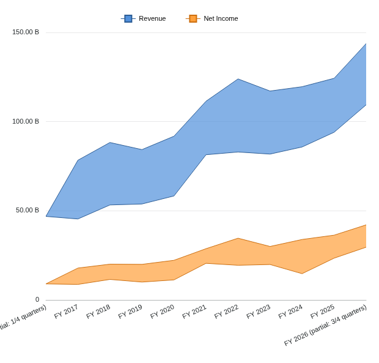
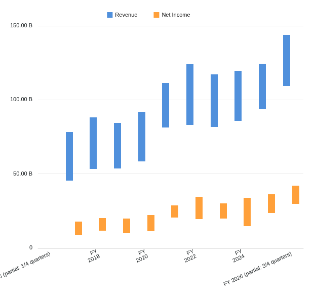
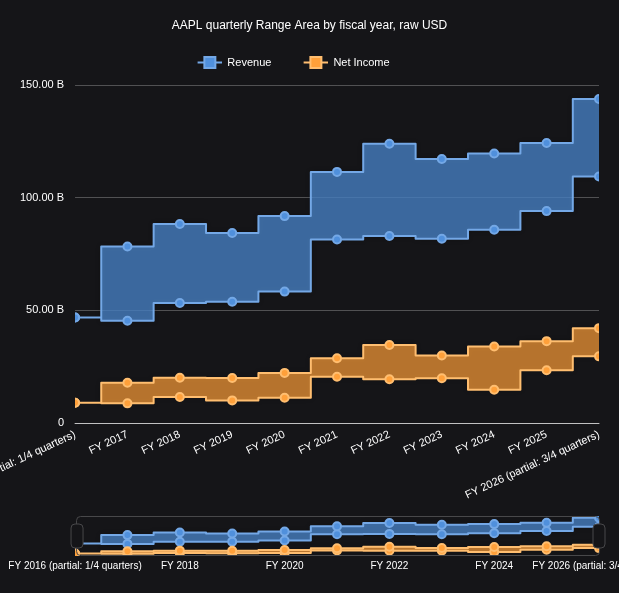

# Range chart foundation plan

Range Bar/Area are accepted in the ordinary Table/File journey on the identified local image: retained-FMP extrema, controls, navigation, fresh reopen and export pass. Image publication is the remaining delivery gate; the published alpha is unchanged until that gate passes.

The R1-R4j sections retain the staged contracts and historical acceptance boundaries; their source-only caveats describe those checkpoints. The current application acceptance is recorded at the end of this document. Workspace baseline: `95188eb3ac92188e62f32b8ba9d4897a6c8cc176`. The [renderer inventory](../../../docs/renderer-capability-matrix.md) and [open checklist](../../../docs/echarts-status.md) still own the wider caller boundaries. Raw source findings and exact hashes are retained in ignored `artifacts/chart-range/source-contract.md`.

## Original assignment contract

Retained Grid 34.1.1 dispatches both `rangeBar` and `rangeArea` to `RangeChartProxy` (G9112-9123). It creates one series for each selected measure in field order, using the first category and that measure's display name. It supplies generated `min:<seriesIndex>` / `max:<seriesIndex>` keys and tooltip endpoint names Min / Max (G9723-9749). It does not pair adjacent selected columns as low/high coordinates. Selecting revenue and net income yields two independently summarized ranges.

For each category/measure, the proxy omits values failing `typeof value === 'number' && !isNaN(value)`, then calculates `Math.min(...values)` and `Math.max(...values)`. An empty retained set emits null endpoints (G9777-9796). Category insertion order is preserved; missing categories group under an empty string, Date categories use epoch identity, and the default category groups all rows under 1 (G9798-9820). Existing configured aggregation precedes these statistics and may collapse a category to a singleton (G9846-9864, G10024 onward). R1 owns neither grouping nor aggregation.

The original raw proxy admits infinities. QOpenBB capture already normalizes observations to finite numbers or null. R1 deliberately accepts that finite domain and diagnoses nonfinite inputs; it makes no parity claim for original nonfinite or argument-spread limits. It must not call the Box helper: Box interpolates quartiles and can reject overflowing intermediate arithmetic even when min/max are finite.

## R1 frozen task contract

After independent architecture/numerical review, a fresh bounded implementer owns only these new paths under `vendor/workspace/terminalpro/`:

- `src/components/General/Table/Chart/compatibility/rangeSummary.ts`
- `tests/unit/chart-compatibility/rangeSummary.test.ts`

The worker is not alone in the checkout. Preserve all other edits. Do not change Box files, shared snapshot policies, registries, imports in existing runtime files, editor/capture/state modules, dependencies or build configuration. The controller owns inventory, evidence and breadth updates. No activation, commits, builds, browser work or provider requests belong to R1.

```ts
import type { SnapshotDiagnostic } from "./snapshotTypes";

export interface RangeSummary {
  readonly min: number;
  readonly max: number;
}
export type RangeSummaryResult =
  | { readonly status: "resolved"; readonly count: number;
      readonly summary: RangeSummary | null }
  | { readonly status: "invalid";
      readonly diagnostics: readonly SnapshotDiagnostic[] };
export function calculateRangeSummary(values: unknown): RangeSummaryResult;
```

Accept a dense array containing only finite numbers or null. Validate every entry before returning a resolved result. Null omits an observation; count includes repeated numeric observations. Empty/all-null input resolves to count 0 and summary null. Otherwise return a fresh min/max summary without mutating or sorting the input. A singleton has equal endpoints. Preserve `Math.min`/`Math.max` signed-zero behavior: a sample containing both signs of zero has min -0 and max +0. A finite extreme must remain an endpoint without arithmetic on the endpoint difference.

Invalid array shape, holes, undefined, strings, booleans, NaN, infinities or throwing reads return `status: "invalid"` with no partial summary. Reuse `SnapshotDiagnostic`, code `invalid-input`, root path for unreadable/invalid shape and `[index]` for an invalid observation. Catch failures at the public boundary using the existing defensive helper style. Do not add statistical options, resource limits or another validation framework.

R1 completion requires focused tests for signed/zero/decimal/unsorted values, duplicates, singleton, null omission, empty/all-null, extreme finite values, immutability and each invalid/throwing case. Assert the min/max oracle independently of the implementation, including `Object.is` for zero signs. Confirm that importing/calling the helper has no renderer or application side effects. R1 does not test grouping or controls that it does not implement.

Run the existing one-worker Vitest configuration from `vendor/workspace/terminalpro` with the pinned WSL Node toolchain:

```sh
node node_modules/vitest/vitest.mjs run \
  --config tests/unit/chart-compatibility/vitest.config.mjs \
  tests/unit/chart-compatibility/rangeSummary.test.ts
```

Capture a meaningful missing-helper RED and passing GREEN. The controller prepares ignored `artifacts/chart-range/r1-tsconfig.json` following `artifacts/chart-box/b1-tsconfig.json`, with exactly the two R1 paths and unchanged strict ES2022/Bundler/noEmit settings. Run `node vendor/workspace/terminalpro/node_modules/typescript/bin/tsc --project artifacts/chart-range/r1-tsconfig.json` from the root. Run scoped Biome using the installed configuration. Record actual commands, revision, exits and outputs rather than treating proposed commands as evidence.

Foundation enforcement already exists. Before acceptance, the controller adds the production path to `.kiro/complexity-budgets.json` and supplies explicit current manifests for both forks to the [combined checker](../../../docs/complexity.md):

```sh
pipeline/.venv/bin/python -m tools.quality.complexity --check \
  --changes workspace=artifacts/chart-range/workspace-changes.json \
  --changes data_api=artifacts/chart-range/data-api-changes.json \
  --output artifacts/chart-range/r1-complexity.json
```

The whole production file must pass 400 physical lines, 300 logical syntax units and 50 units per callable. Tests/docs are excluded by policy. Do not rebuild the checker or borrow stale Box manifests. Independent review, fresh scoped verification, controller-owned breadth/status reconciliation and selective commit precede task acceptance. R1 acceptance leaves Range family completion unchecked.

## Subsequent dependency and activation gate

Share the numerical helper between Range Bar and Range Area, then use separate renderer mappers: Range Bar draws grouped intervals with saved direction; Range Area draws a band with two boundaries, markers and missing-data spans. Those responsibilities differ enough to avoid one conditional geometry implementation. Freeze their exact new-file ownership and input/output contracts in the next bounded design. Do not extract or modify Box's grouping, axis or tooltip modules during parallel work; source similarity alone does not authorize a shared-file change.

Later source/application review must preserve the original category/field ordering, pre-statistics aggregation, missing groups, financial names, controls and saved options. Source differences already identified: Range Bar supports horizontal direction and excludes category-axis type/tick selectors; Range Area has distinct axis eligibility and missing-data/interpolation semantics. Exact effective defaults, axis nicing and control transactions remain an activation prerequisite, not an R1 dependency. See the local source note for the bounded evidence.

Use retained `artifacts/chart-box/fmp/quarter.csv` with its `provenance.json` and original `raw.json`: 40 AAPL quarterly revenue/net-income observations, raw reported USD, grouped by fiscal year, partial years explicitly labelled. For each field the intended range is the minimum and maximum quarterly amount observed within that fiscal year, not an annual total, OHLC price range or forecast interval. Keep fields separate and preserve dates/currency/period provenance. FY2017 revenue endpoints are USD 45,408,000,000 and 78,351,000,000; the independent fixture provenance records those source extrema. Do not rename revenue/netIncome to low/high or alter values for chart fitting. No provider capture or fixture rewrite is needed for R1.

Before activation, independently verify expected extrema against the unchanged raw capture and exercise both originals and replacement in an identified application image: selected ordering, aggregation, null/singleton gaps, supported direction/axes, tooltip/labels/legend, theme, navigation, refresh, save/reopen and export. Use isolated headless browser/CDP and one browser worker; serialize heavy gates with Box. Selected real-FMP samples remain pending until verified and reviewed. No screenshot or visual-parity claim exists for Range in this plan.

R1 is disproved if the source assignment requires low/high field pairing, if its helper changes observations or endpoint signs, or if its allowed files cause application activation. Any such finding stops acceptance and returns the contract to review. Standalone and AI callers remain outside this bounded ordinary Table/File plan.

## Delivery status

- [x] R1: independently accept the inactive finite min/max helper, focused tests, strict typing and complexity checks.
- [x] R2: independently accept the inactive [Range Bar renderer core](range-renderer-design.md).
- [x] R3: independently accept the inactive [Range Area renderer core](range-area-renderer-design.md).
- [x] Integrate existing controls and saved state.
- [x] Accept real-FMP application behavior and appearance.
- [ ] Publish images and verify public pulls.

R1 source: Workspace `0bc5109671c3ca1af43b863a0da3616ab78ae968`. See [verification](../../../artifacts/reviewed/chart-range/verification.md). This preparation lane does not activate Range or delay the current Box Plot release.

R2 inactive Range Bar is independently accepted at Workspace `1732847552a762c38e1cb1408d1efebccdeb0e6a`. Seventeen focused tests pass (nine unit and eight actual ECharts SVG); Biome passes 11 files and combined complexity has zero errors/violations. Scoped strict typing retains only inherited typography.ts TS2578; canonical strict baseline/candidate each retain 3,427 identical diagnostics, compiler exit 2. Range Area, application integration, real-FMP image/browser acceptance and publication remain open. Box Plot remains the active delivery milestone; the published alpha is unchanged. See [verification](../../../artifacts/reviewed/chart-range/verification.md).

R3 inactive Range Area is independently accepted at Workspace `c6d4329960a5176775a47aba2bfefcac36d0cd8e`. Sixteen focused tests pass (10 unit and six actual ECharts SVG); Biome passes 10 files and combined complexity reports zero errors/violations. Scoped typing retains only inherited typography.ts TS2578, exit 2. Final canonical baseline/candidate each retain 3,427 identical inherited diagnostics, exit 2, with no added/removed diagnostics. Application integration, real-FMP image/browser acceptance, visual comparison and publication remain open. Box Plot remains the active delivery milestone; the published alpha is unchanged. See [verification](../../../artifacts/reviewed/chart-range/verification.md).

## R4a capture/setup integration

The next bounded task is the independently reviewed [capture/setup contract](range-capture-design.md). Reuse the original shared statistical grouping path through a neutral Range policy; retain accepted Box behavior and keep both Range families inactive.

- [x] Verify source equivalence and independently approve the bounded R4a contract.
- [x] Implement the five-file capture/setup extension and focused Range regression.
- [x] Pass affected Box/capture/setup checks, whole-file complexity and no-new-diagnostic typing; independently review and commit.

Appearance, axes, editor/session activation and real-FMP image acceptance follow this source slice. No new release is required for an inactive capture helper.

R4a source accepted at Workspace `102b53ad677f057903af50ea315c3c790ee67789`; see [verification](../../../artifacts/reviewed/chart-range/verification.md#r4a-inactive-capturesetup-accepted). Range application activation remains open.

## R4b series appearance

The independently reviewed [series appearance contract](range-series-appearance-design.md) resolves original Range field styling in isolation. It preserves generated/saved/theme precedence and independent marker paint without changing the editor or activating the renderers.

- [x] Independently verify defaults, source conditional options and the normalized generated-input contract.
- [x] Implement the inactive field-style resolver and generated-series helper.
- [x] Accept focused tests, size/typing checks and independent source review; update evidence and pins.

Next axis/layout work must preserve both families' inferred time/numeric categories. Range Bar hides some axis selectors but is not category-only; Range Area exposes additional type/tick controls. Coordinate geometry, tick formatting and tooltip hit lookup must be extended together before activation. Do not substitute Box's hardcoded editor eligibility or an ordinal-only mapper for these original behaviors.

R4b source accepted at Workspace `912f97e1732bfd1b8d91c110e8e37b19a559233c`; see [verification](../../../artifacts/reviewed/chart-range/verification.md#r4b-inactive-series-appearance-accepted). Axis/layout and application integration remain open.

## R4c numeric value axis

The [numeric axis contract](range-value-axis-design.md) extracts the accepted linear tick algorithm for shared use and supplies raw Range bounds and ticks. It preserves equal-value data and keeps Box callers on the same algorithm.

- [x] Freeze the neutral tick and Range raw-scale contract.
- [x] Implement and independently accept the value-axis planner with Box regression and actual Range renderer handoff checks.

Continuous category geometry, calendar ticks and application/editor layout follow; this slice does not activate either Range family.

R4c source accepted at Workspace `491d6caaf0653a52675d54756eb642e65cc0c443`; see [verification](../../../artifacts/reviewed/chart-range/verification.md#r4c-inactive-numeric-value-axis-accepted). Both Range families remain inactive in the application.

## R4d category geometry

The [category geometry contract](range-category-design.md) fixes one shared coordinate interface, then separates Bar and Area consumers into disjoint implementation lanes. Supplied number/time domains must produce actual uneven spacing while retaining observation identity.

- [x] Accept the shared coordinate foundation before fan-out.
- [x] Independently accept both existing renderer integrations and their joined SVG checks.

Caller Date inference, calendar tick planning, hierarchy labels and source-exact pointer interaction remain application integration requirements. They are not established by the supplied-plan renderer checks.

R4d source accepted at Workspace `c348a497451df7d876ee127a0a0463f66807c95d`; see [verification](../../../artifacts/reviewed/chart-range/verification.md#r4d-continuous-category-geometry-accepted). Both Range families remain inactive in the application.

## R4e category capture

The [capture contract](range-category-capture-design.md) retains raw Date evidence and actual column metadata before normalization. Capture resolves the source category kind; existing statistical setup preserves those facts.

- [x] Accept capture provenance and its regression checks. Calendar planning and session activation remain open.


R4e capture accepted at Workspace `5e85724c93701d86024dce2e3587a83510542c14`; see [verification](../../../artifacts/reviewed/chart-range/verification.md#r4e-category-capture-accepted). Calendar planning and application activation remain open.

## R4f composed application mapping

- [x] Accept continuous numerical/calendar planning and saved interval policies.
- [x] Compose both Range cores with measured axes, captions, legend, theme and existing styling.
- [x] Independently review reverse geometry and the joined rendering/typing/complexity evidence.
- [x] Connect the live session, existing editor, navigator and pointer lifecycle (R4g source accepted).
- [x] Verify real-FMP application behavior, appearance and save/reopen/export.
- [ ] Publish the completed milestone and verify the public images.

R4f accepted at Workspace `9f5a9c2d22d99fcd72d7721705c6e2fe0a6dfd43`; see the [application contract](range-application-design.md) and [verification](../../../artifacts/reviewed/chart-range/verification.md#r4f-composed-application-mapping-accepted). Session direction changes must transfer semantic axis preferences without retaining a stale physical position. This slice supplies the composed renderer; it does not establish that live lifecycle.

## R4g live integration

Workspace `1a692c8fe1e78825aded85d4fa0b905eef77eddc` connects both Range families to the existing editor and renderer host. The [live contract](range-live-design.md) and [reviewed evidence](../../../artifacts/reviewed/chart-range/verification.md#r4g-live-range-integration-accepted) define source acceptance. The next gate is an identified packaged image with retained-FMP financial checks, original-runtime comparison, save/reopen/export and selected screenshots. The published alpha is unchanged.

R4h follow-up `6188a1f651f2c29f3bfa5ea16f9b91749856a465` restores integrated Range zoom defaults below explicit overrides; [source verification](../../../artifacts/reviewed/chart-range/verification.md#r4h-integrated-zoom-defaults). Browser/FMP and publication gates remain unchecked.

## R4i visual refinement

Owner comparison on 2026-10-22 requests closer original appearance before Range acceptance. Keep the verified quarterly min/max meaning and existing controls; adjust presentation within the Range renderer.

- [x] Match original Area year-label density and unwrapped partial-year labels, including Bar label formatting.
- [x] Match Area endpoints at the plot edges and outlined legend markers with their line samples; preserve grouped Bar spacing.
- [x] Independently review scoped source regressions, formatting, typing delta and complexity.
- [x] Compare the updated packaged image with the original using retained FMP data, including legend paint/export; owner accepts default Area appearance.

At the first packaged checkpoint, Bar and Area behavior passed while visual acceptance and publication remained open. The corrected application is now accepted; publication is pending. These refinements must preserve navigation, selected field identity, financial values and saved options.

R4i source accepted at Workspace `07b91c8163f9b502c1188fd56bcab052e6ab9a40`; [source verification](../../../artifacts/reviewed/chart-range/verification.md#r4i-original-appearance-refinement). Refined default Area appearance is owner-accepted; publication remains pending.


## Packaged checkpoint and FMP samples

- [x] Verify Bar and Area behavior in the identified R4i image, including fresh reopen and PNG export; preserve the separate run outcomes in the [evidence](../../../artifacts/reviewed/chart-range/verification.md#r4i-packaged-checkpoint-2026-10-23).
- [x] Obtain owner acceptance of the default Area appearance.
- [x] Move the navigator below the main axis labels and verify the corrected packaged layout/export.
- [ ] Publish the accepted milestone and verify both public image identities and pulls.

These default light views show 40 historical AAPL quarters grouped into 11 fiscal years. Each band/bar is the quarterly minimum-to-maximum revenue or net income in raw USD, not an annual total. Application source `07b91c8`; publication remains pending.






R4j navigator spacing source repair is independently accepted at Workspace `8047c09`: 16 focused tests pass, scoped typing has zero additions and complexity meets all caps. This source checkpoint was superseded by the correction and passing packaged gate below; see [evidence](../../../artifacts/reviewed/chart-range/verification.md#r4j-navigator-label-spacing).


The `8047c09` packaged run rejected both Range families in the hidden-navigator/default-zoom state. Correction `e2b87ed` is independently source-reviewed with 18 passing focused tests; both corrected rebuilt-image journeys now pass, as recorded below. See [failure and correction](../../../artifacts/reviewed/chart-range/verification.md#r4j-packaged-rejection-and-hidden-miniature-correction).


## Accepted Range application milestone

Both journeys pass in one run on source `e2b87ed98cd5ef18fb9ca6ddf888802d71fc685e` and image `sha256:1ff9d136027b0e0ae0f55b89f3faae5892602b2aeb3cee5482f408dc3a3bb0b0`. The [acceptance record](../../../artifacts/reviewed/chart-range/verification.md#range-packaged-acceptance) retains the earlier failed candidate and its correction. Original default Area appearance is owner-accepted; no blanket pixel-equivalence claim is made.

The saved/reopened Area export below uses the same retained AAPL quarterly min/max observations in raw USD, with step interpolation and markers enabled. The navigator now sits below the main fiscal-year labels.


