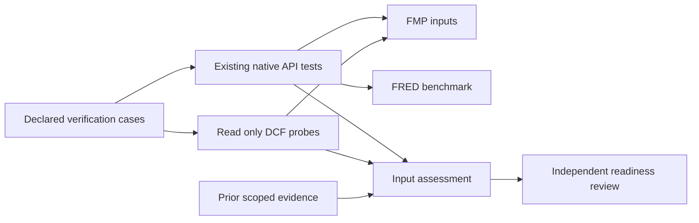

# Company Research input-readiness design

## Overview

Produce one evidence-backed IA-A assessment for Microsoft (`MSFT`) and two candidate software peers, Oracle (`ORCL`) and Adobe (`ADBE`). These are a verification sample, not a curated valuation recommendation. Resolve names and source-qualified listings through the existing FMP discovery/profile contracts before using their financial records. Different business mixes and fiscal calendars remain explicit comparison limitations.

Requirements are owner-approved on 2026-11-06. This design extends existing verification, not the deployed application. The output is a compact coverage/semantics matrix and a justified readiness decision for the first Company Research dashboard. Production adapters, widgets, service topology and house calculations remain unchanged.

### Goals

- Establish which quarterly/annual inputs actually work for the declared sample and retain the limits of earlier acceptance.
- Separate raw-field preservation from financial comparability, provider DCF feasibility and house-method prerequisites.
- Give the next dashboard slice concrete input and presentation obligations without building a new verification framework.

### Non-Goals

No dashboard, metadata pane, provider restoration, financial formula, model repository, new service, renderer, UI redesign or image release. This assessment does not produce investment advice, multiples, forecasts, sensitivities or point-in-time valuations.

## Boundary Commitments

### This Spec Owns

The declared company/candidate sample, bounded verification cases, interpretation of the existing input evidence, gap ownership and IA-A/IA-B readiness decisions. The assessment owns no provider or model schema and does not change any existing API response.

### Out of Boundary

Acquisition repairs belong to market-data-integrations. House metric definitions, recalculation and valuation execution belong to financial-modeling. Quarterly/peer presentation, saved analyst rationale/assumptions and a full financial metadata view require a later analyst-workspace contract. Infrastructure and the currently deployed alpha remain untouched.

### Allowed Dependencies

- Existing native routes and metadata on data API pin `28423762e8cc3faae978e770899834b41e7cde99` and root catalog contracts.
- `tests/providers/test_live_financial.py` and `live_financial_support.py`, their in-process ASGI app fixture, original provider callbacks, scoped environment-key loading and ignored evidence output.
- Existing FMP transport for direct, read-only DCF feasibility probes. These are provider observations outside the native API, never installed route acceptance.
- Existing FRED `DGS10` contract and recorded benchmark semantics; no new macro adapter.
- Existing pytest/Python locks and protected uv execution. No dependency additions or upgrades.

### Revalidation Triggers

Changes to query defaults, source pins, data/metadata schemas, financial conventions, account entitlement, sample identities or probe parameters require rechecking the affected observations. A later dashboard must independently verify visible values and saved research state; this assessment cannot certify it. New house calculations require the separate model contract and numerical validation. App template export/import must check company identity because existing export omits `storage.companySelection`.

## Architecture

Reuse the installed service in-process for provider inputs and observe the original upstream callbacks. A direct DCF probe is deliberately separate because no DCF model is installed. Both produce observations for an independently reviewed assessment, not a new runtime data interface.

Dependency direction: case data and existing schemas -> existing test helpers -> opt-in checks -> sanitized assessment -> review. No provider imports assessment policy; no widget imports test code or house formulas. The diagram describes verification, not a new service deployment.

| Layer | Existing choice | Change |
| --- | --- | --- |
| Native input checks | Pinned Python/pytest, existing ASGI fixture and source capture | Add bounded research cases and assertions |
| Acquisition | Owned OpenBB FMP/FRED contracts and transport | Read only; no production edits |
| Assessment | JSON receipt and concise Markdown review | One new scoped output, preserving historical receipts |
| UI and deployment | Released Full Workspace, ECharts and two-service Compose | No change |

## File Structure Plan

| Path | Responsibility and disposition |
| --- | --- |
| `tests/providers/research_input_cases.py` | New test-only case table: sample identity, route, parameters, source-field mappings and expected semantic checks; no fetching |
| `tests/providers/test_live_financial.py` | Extend existing opt-in parametrization/semantic assertions for research cases while preserving original node IDs and behavior |
| `tests/providers/live_financial_support.py` | Reuse capture, API calls, equality and receipt writing; add the explicit shared research-run state below, preserving baseline behavior |
| `tests/providers/test_live_dcf_feasibility.py` | New opt-in pytest cases using existing transport; separate direct observation status from native integration and custom-parameter verification |
| `docs/reference/research-input-readiness.json` | New sanitized assessment with source identities, evidence references, coverage, semantic findings and readiness states |
| `.kiro/specs/analyst-workspace/research-input-assessment.md` | New concise analyst-facing matrix, interpretation, next scope and independent financial review outcome |
| `artifacts/reviewed/research-inputs/accepted.md` | New concise acceptance/review receipt only after execution; no raw response archives |
| `artifacts/reviewed/sync-manifest.json` | Add only completed reviewed public evidence, with exact source/published hashes |
| `.kiro/breadth.toml`, `README.md`, `docs/roadmap.md`, `docs/provider-coverage.md`, `docs/index.md`, analyst `spec.json` | Reconcile only the scope actually established and link its evidence |

Raw query captures and run outputs stay under ignored `artifacts/research-input-readiness/`. Do not overwrite `docs/reference/live-financial-acceptance.json` or earlier acceptance records. No production file, source pin, dependency lock or catalog change is permitted by this file plan.

## Components and Interfaces

### Research cases and native input checks

Coverage: 1.1-1.4, 2.1-2.4, 3.1-3.4, 5.1-5.4. Contract: existing pytest batch inputs and source-preserving results, not a new API.

The case table declares one record per request: `case_id: str`, `dataset: str`, `company_symbol: str`, `route: str`, `parameters: dict[str, str | int | bool]`, `field_mapping: dict[str, str]`, `expected_checks: tuple[str, ...]`. Case IDs are unique and separate from original baseline IDs. Use descriptive financial names in Python; avoid generic dataframe variables. No dataframe engine is needed for acquisition assertions; Polars remains the selected engine for later house modeling.

The existing signatures remain the integration seam: `call(app, path, parameters)` returns status/body; `SourceCapture(monkeypatch, provider)` observes the unchanged original callback; `pairs(rows, source_rows, mapping, date_field)` checks source/API field equality. `metadata(...)` validates the native financial envelope, units, query bounds and acquisition provenance. Use a separate dataset identifier for semantic dispatch: appending company/period to the current exact case-name checks would otherwise silently bypass them. Preserve original baseline node IDs.

Added comparisons distinguish an absent source key from explicit null, retain source ordinal and bind duplicate observations by company/date/ordinal rather than choosing the first date match. Financial numeric values remain exact; documented schema normalization (such as integer fiscal years and serialized dates) is compared explicitly, with its rule recorded separately from source values. Current `fiscalYear` and `filingDate` aliases take precedence over legacy `calendarYear` and `fillingDate`. Do not convert provider values to assumed house definitions.

For each company, assess Profile and six financial datasets (Income, Balance, Cash, Metrics, Ratios, Enterprise Values) in annual and quarter modes where the installed query contract supports them. Limit annual results to two and quarter results to four; these are row bounds, not fiscal-date filters or completeness guarantees. Metrics/ratios retain `ttm=exclude`. Compare available source aliases for the required earnings, cash, debt, share and EV inputs. A missing field is a finding, not zero or an assertion that a model input exists. Quarter labels alone do not establish duration or cumulative-flow conventions: preserve declared `discrete_quarter` metadata alongside unknown actual start/duration/YTD/restatement facts.

Discovery resolves the three listings; retain provider peer suggestions for MSFT as suggestions. Fetch one bounded daily price window per company around the latest observed EV date when that date is available: date minus seven calendar days through that date, `interval=1d`, `adjustment=splits_only`, without an unsupported query `limit`. A date window is a query bound, not a valuation transformation; it does not prove actual share/price/debt/cash alignment. If EV dates are unavailable or unusable, record the unavailable alignment and do not substitute an undated price. No currency conversion, quarter derivation, matching to an invented trading date or reconciliation calculation is performed.

Classify each input dimension independently: source/API equality, period/duration compatibility, currency/unit compatibility, market/share timing and adequacy for a stated house-method input. Equal raw values do not imply all five dimensions pass. Provider share counts and statement weighted-average shares remain different measures. Do not force different fiscal quarters to represent the same calendar interval.

### DCF and macro feasibility

The native batch uses one shared `ResearchRunState` test fixture, defined in `live_financial_support.py` and explicitly passed to research captures/probes only. Its fields are `attempts: int`, `blocked_providers: dict[str, str]` and `enterprise_dates: dict[str, str | None]`. `before_request(provider)` checks provider-stop state and the 51-attempt ceiling before incrementing; `block_provider(provider, reason)` handles authentication/throttling; `record_enterprise_date(symbol, date)` stores the latest valid returned date across that company's two EV modes. Baseline tests receive no research state and retain their original budgets. Run baseline regressions separately from the research invocation so they cannot consume or bypass its budget.

Each company's research journey executes discovery/profile and financial cases before its dependent price case, without relying on pytest parameter ordering. Unresolved listing identity prevents its dependent financial queries. The explicit company journey calls the existing assertion helper for each case and stores EV dates in the shared state. Retain the selected EV case/receipt reference and source-qualified listing alongside the date; select the latest valid date among that listing's successful annual/quarter responses, without refetching. A missing EV date emits an unexecuted dependent-price finding; it must not issue a substitute request. All journeys and DCF probes share the session fixture in one serial pytest invocation. A blocked-provider check prevents subsequent network calls while recording each required unexecuted case. Individual entitlement failures block that endpoint branch, while authentication/throttling blocks the provider. The observer enforces the timeout on research requests only. Shared helper changes are controller-owned before parallel native/DCF work begins.

The DCF module runs its three requests sequentially in one test function with separate capture contexts. The custom baseline result is a local prerequisite for the beta request; an unusable baseline records that variation unexecuted. No module-order assumption or cross-test response cache is required. Initialize the shared research state once at session-fixture creation; count failed attempts as well as successful calls, and deny the next upstream call before transport when the ceiling is reached.

Coverage: 4.1-4.4, 5.1-5.4. Contract: bounded read-only provider observation plus explicit feasibility states.

Assess FMP standard and custom DCF separately. Neither is installed in the current fork or present in the inspected retained `openbb_fmp-1.6.1` archive; generic FMP transport exists. Record that source scope without claiming all OpenBB history was searched. Official documentation checked on 2026-11-06 identifies GET `/stable/discounted-cash-flow` and `/stable/custom-discounted-cash-flow`.

Use `openbb_fmp.utils.helpers.get_data_many` with the complete stable URL, `with_provenance=True`, `typed_errors=True`, `method="GET"`, `timeout=15`, `headers={"apikey": configured_key}` and `allow_redirects=False`. Do not use the legacy-version URL builder. The FMP-only probe has its own opt-in key prerequisite; it must not depend on the native app fixture's additional FRED key. A fresh monkeypatch context/capture wraps each probe; do not nest capture wrappers. Source compatibility of this invocation is inspected, not yet execution-verified.

Capture only status class, response fields, supplied date/currency, available assumptions and acquisition time; omit request headers, full URLs and unsafe exception text. Keep provider `date`, custom forecast `year` and acquisition time distinct. Missing currency is not inferred from Profile. The direct receipt uses `kind="direct_provider"`; native evidence uses `kind="native_api"`. It does not call native metadata validation or `success()`, whose required-route semantics must remain strict. A direct success never establishes an installed OpenBB DCF route or widget.

At most three DCF requests for MSFT: standard, custom defaults, and custom with the documented dimensionless `beta=1.0` test input. Attempt the variation only if the documented parameter is still applicable and a baseline response is usable. Do not add another comparison scenario in this slice. Never guess a parameter, treat every numeric custom input as the same percentage scale, or infer sensitivity support from a changed or unchanged price. Record accepted/echoed custom inputs only where issuer/year identity and returned fields establish that specific binding; otherwise leave customization unverified. No DCF is calculated locally.

Reuse FRED DGS10's observation and series-metadata checks for its name, maturity, percent units, frequency, observation dates and source. Missing observations remain missing. The record may cite earlier scoped evidence without rerunning it; a new access claim requires actual current observations. Neither DGS10 nor a provider beta establishes WACC or issuer borrowing cost.

### Assessment and readiness review

Coverage: 1.2-1.4, 2.4, 3.4, 4.4, 5.1-5.4, 6.1-6.4. Contract: versioned static evidence record, not a runtime schema exported to widgets or AI.

`docs/reference/research-input-readiness.json` has `schema_version: 1`, `assessment_id`, `created_at`, `source_revisions`, `companies`, `input_observations`, `feasibility`, `findings` and `readiness`. Records retain the query parameters without credentials, acquisition/observation dates, unit/currency/period basis, value origin, original evidence reference/hash and owning follow-on spec. Keep native response/metadata schemas authoritative; this record references them and does not redefine financial fields.

Each company record includes `name`, `symbol`, `listing_id`, `exchange`, `trading_currency`, `reporting_currency`, `candidate_basis` and `rationale`; nullable fields retain an explicit missing reason and source reference. Profile currency is not substituted for reporting currency. Each input observation includes `dataset`, `native_route`, `widget_ids`, `query`, `evidence_ref`, `evidence_sha256`, `source_identity`, `semantic_findings` and dimension statuses; `widget_ids` are exact current catalog IDs or an empty list with a missing-widget reason. This binds the coverage matrix to reusable consumers without claiming their UI acceptance.

The assessment also contains `next_slice`, with `proposed_scope`, `provider_dependencies`, `modeling_dependencies`, `presentation_gaps`, `controls` and `saved_context_acceptance`. Controls explicitly retain paired company identity, separate observation-date/fiscal-period meanings and independent FRED groups. Saved-context acceptance names company/listing, period, peer membership/rationale, assumptions, layout and linking through fresh login and retained-container recreation, plus template identity round-trip if an App is packaged. These are downstream obligations, not completed tests. This record is a reviewed static contract; no runtime schema or general report framework is introduced.

Observation status is one of `verified`, `historical_only`, `unverified`, `unavailable`, `access_blocked`, `semantically_unsuitable` or `failed`. Each nonverified required dimension has a reason and missing proof. Feasibility records carry separate `source_integration`, `documented_capability`, `observed_access`, `assumption_coverage` and `custom_input_behavior`; they cannot collapse into a single supported boolean.

`readiness` separates `assessment_complete`, `ia_b_inputs_ready`, `ia_b_workflow_implemented` and `ia_c_findings`. A completed, independently reviewed gap assessment may set the first true while leaving the others false. IA-B input readiness requires usable verified Balance/Cash/price/share/EV inputs for the entire declared sample and resolved mandatory compatibility findings. Unknown conventions remain explicit blockers to the affected analytical result. This slice always leaves `ia_b_workflow_implemented` false. A raw/provider-data App is a possible separately approved interim delivery, not IA-B completion.

The Markdown assessment gives one matrix and a short next-contract proposal. It identifies house calculation dependencies (cash conversion, adjusted earnings, peer aggregates and valuation bridges) without choosing or implementing the methods. DCF feasibility can be concluded as blocked/unsupported with evidence; required input failures cannot become successful live tests merely to finish the assessment.

## Error Handling and Security

No automatic retry, alternate-provider fallback, key logging or authentication-state capture. Live checks are opt-in and unavailable credentials remain skipped/unverified, never passing evidence. Use local ignored environment configuration; standard PR checks receive no provider keys. The existing safe-error classifications distinguish authentication, entitlement, throttling, timeout, missing data and invalid responses.

Stop further requests for an affected provider on authentication failure or throttling and record unexecuted dependent cases as blocked. Stop an individual failing case without rewriting its failed receipt; retain its exit code. An unchanged failure may establish access-blocked feasibility, not a usable native input. Do not change transport limits, API behavior or financial conventions to make this assessment pass; route any required repair to a separately approved provider slice.

One live worker, no xdist parallelism. At most 46 native FMP requests (three discoveries, one peer query, three profiles, 36 financial queries and three price windows), three direct DCF requests and two FRED requests: 51 upstream requests in a complete fresh run. Reused historical evidence reduces that count. The shared test-only observer enforces the run-total 51-call ceiling and a 15-second per-operation timeout; its current `setdefault` timeout alone is not proof of that ceiling. FRED retries are disabled as in the original check. No unbounded traversal, pagination, bulk endpoint, scheduler or background server is introduced. Source capture retains its one-FMP/two-FRED per-case budgets; direct probes have a separate explicit one-request limit.

## Requirements Traceability

| Requirement | Design coverage |
| --- | --- |
| 1.1 | Sample discovery, source-qualified identity and case table |
| 1.2 | Candidate rationale and limitations in assessment |
| 1.3 | Historical-only records with original queries, dates and identities |
| 1.4 | Dimension status, missing proof and follow-on ownership |
| 2.1 | Annual/quarter statement matrix for all three listings |
| 2.2 | Explicit flow/instant, quarter/YTD, restatement and vintage findings |
| 2.3 | Source-alias mapping of earnings/cash/working-capital inputs |
| 2.4 | Unresolved financial definitions become modeling prerequisites |
| 3.1 | Dated prices and explicit share/market-time checks |
| 3.2 | EV component availability and missing-claims findings |
| 3.3 | Provider metric labels and unmodified calculation limitations |
| 3.4 | Unsuitable currency/period/denominator comparisons excluded from readiness |
| 4.1 | Separate DCF source, documentation, access and assumptions |
| 4.2 | Provider-only DCF dates/currency and missing detail |
| 4.3 | Existing named DGS10 observations and series metadata |
| 4.4 | Separate IA-B/IA-C consequences of unknowns |
| 5.1 | Value-origin categories and authoritative native schema references |
| 5.2 | Explicit house-method follow-on contract; no local formulas |
| 5.3 | Missing/blocked states and no fallback or substitution |
| 5.4 | Sanitized receipts and excluded private captures |
| 6.1 | One coverage matrix joining inputs, widgets and evidence |
| 6.2 | Sample-wide input-readiness gate independent of workflow implementation |
| 6.3 | Failed/unknown required dimensions keep IA-B open |
| 6.4 | Next dashboard/provider contract and saved-context obligations |

## Testing Strategy and Acceptance

After design and task approval, use the existing pinned provider environment and pytest entry point with one worker. Run only selected research cases for new evidence; preserve and run affected baseline cases when shared semantic/evidence helpers change. Task generation must name the discovered executable command and actual selected node IDs; no invented broad command is part of acceptance.

- Verify every configured case uses an installed explicit-provider route and matches actual upstream field values and financial metadata. Record required input failures rather than replace them with fixtures (1.1, 1.3, 2.1-2.3, 3.1-3.3, 5.1).
- Independently review mismatched periods, unknown share/EV conventions, null/signed inputs and denominator validity. These checks classify suitability and perform no derived finance arithmetic (2.4, 3.4, 5.2-5.3).
- Check DCF feasibility against source/docs and permitted actual observations, preserving unattempted/blocked states and keeping direct probes distinct from native integration (4.1-4.4).
- Check the sanitized assessment against the private receipts and original acceptance references; unknown mandatory inputs cannot produce an IA-B-ready decision (1.4, 5.4, 6.1-6.4).

No browser rerun, model numerical suite or image build is warranted because this slice changes no runtime consumer or calculation. Existing browser/CDP, save/reopen and retained-state checks remain required for the later dashboard implementation. Documentation and test-only files are outside production complexity caps; any proposed production edit stops this slice for a reviewed scope amendment with the existing inventory/checker and 400/300/50 completion criteria.

## Delivery and Parallel Work

Freeze the case and assessment contracts before fan-out. One bounded worker owns the case table and existing native-test changes; another owns the disjoint DCF pytest file and documentation/source feasibility notes. They do not both edit shared capture helpers. The controller owns the assessment, serializes any shared helper change, live-provider run, review join and commits, and requests independent financial review. Follow the project's Sol implementer/Astra difficult-review model policy.

Task completion updates the spec, breadth map, README and docs together. Publish one concise reviewed assessment/receipt after verifying hashes and absence of secrets. A documentation/test-only IA-A completion does not dispatch Dagger or publish unchanged images. The next meaningful runtime/dashboard feature keeps the normal reviewed milestone build/publication gate.

## Supporting References

External pages checked on 2026-11-06 establish documentation only, not account access or financial correctness: [FMP DCF](https://site.financialmodelingprep.com/developer/docs/stable/dcf-advanced), [custom DCF](https://site.financialmodelingprep.com/developer/docs/stable/custom-dcf-advanced), [authorization catalog](https://site.financialmodelingprep.com/developer/docs) and [FRED DGS10](https://fred.stlouisfed.org/series/DGS10). The default DCF example lacks model assumptions/currency; the custom example's forecast year is not a valuation date. Preserve the actual observed fields if they differ from these examples.
