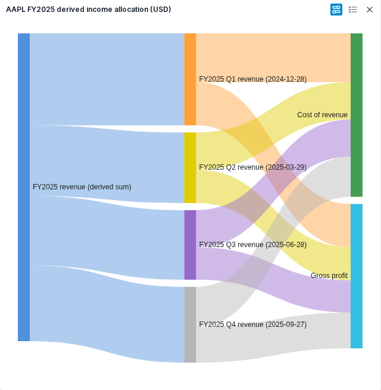
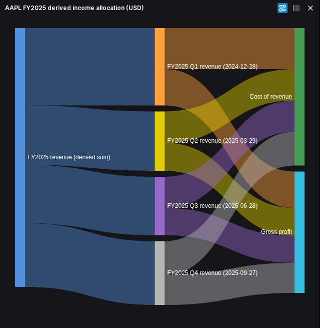

# Sankey: queued Table/File milestone

Status: SK0 accepted on 2026-10-27. The [shared contract](sankey-contract.md), inactive declarations and retained FMP allocation fixture are independently reviewed at Workspace `c8503a1d1facc3d2ea31966f09acf70bd0f754d1`. [Review](../../../artifacts/reviewed/chart-sankey/sk0-review.md). SK1 and SK2 are independently accepted at Workspace `5190f5f`; [source review](../../../artifacts/reviewed/chart-sankey/source-review.md). The serial application join is source-accepted. Packaged application and owner appearance are accepted; completed-milestone publication remains open.

Financial engineers should be able to select source, target and value columns in an ordinary Table/File widget and inspect an allocation without losing its units, period or provenance. This additional chart type belongs to [analyst-workspace](requirements.md); it follows the current prototype onboarding/catalog delivery and reuses the chart editor, theme, lifecycle and export infrastructure. It does not expand provider coverage or modify unrelated Perspective/catalog work.

## Proposed data and financial contract

- Each displayed input row supplies a source identifier, target identifier and finite numeric value. Source and target must be nonblank identifiers; preserve their raw identity separately from display labels.
- A graph has one declared unit, currency where applicable, and scale. Do not aggregate mixed units, currencies, incompatible periods or incompatible financial measures. Missing unit metadata remains explicit and cannot support a financial reconciliation claim.
- Aggregate duplicate directed source/target pairs by Sum, retaining contributing row identities and value provenance. Do not sum formatted strings or rounded display values.
- Missing identifiers or values, nonfinite/negative values, self-links and directed cycles produce visible, actionable diagnostics tied to affected rows or columns. Preserve mappings and the editor for correction; do not silently discard invalid rows or reverse negative links.
- Zero-valued links contribute no width. A zero-only or genuinely empty graph remains an editable empty state with an explanation.
- For each internal node, report incoming total, outgoing total and residual: residual = incoming - outgoing. Source-only and sink-only nodes are identified separately, without implying missing counterpart values are zero-valued economic observations.
- Show internal-node imbalance rather than silently creating a balancing link. Incomplete flows can be legitimate; do not reject an otherwise valid graph solely for imbalance. Freeze numerical comparison tolerance and the exact warning/tooltip treatment before implementation.
- Labels and tooltips identify value units and distinguish reported amounts from derived allocation structure. Node widths or totals must not double-count internal transfers as additional economic value.

## Retained financial example

Reuse the retained AAPL FY2025 quarterly revenue, cost of revenue and gross profit records exercised by [the hierarchy fixture](../../../vendor/workspace/terminalpro/tests/e2e/live-chart/hierarchy-fixture.ts). Its source SHA256 is `390dc8cbfc8302720a203bd9782d5e3b1f7363a4f762bdfcef079dbbe4c72f6b`; preserve the existing endpoint, retrieval and record provenance when preparing the Sankey input.

The proposed graph links a FY2025 revenue root to the four quarterly revenue nodes, then each quarter to cost-of-revenue and gross-profit sinks. Quarter links use reported USD amounts; each quarter must satisfy revenue = cost of revenue + gross profit before this example is admitted. The fiscal-year root total is the sum of the selected quarterly revenues, not an independently reported observation. Keep fiscal-quarter labels and statement dates visible in provenance.

This is a derived income allocation, not cash flows and not links supplied by FMP. A fixture mismatch or failure of the reported quarterly identity disproves acceptance of this example; do not manufacture totals or substitute balancing values. General Sankey input remains the explicit three-column edge table, not an automatic interpretation of arbitrary income statements.

## Shared interfaces to freeze first

- Persisted chart type and source/target/value column IDs, unit/scale identity, style precedence and save/reopen migration behavior.
- Immutable Sankey edge snapshot with raw node identity, labels, row provenance, capture revision and selected range; ordinary snapshots currently retain only one category column.
- Validation result, aggregated graph and reconciliation diagnostics, including zero-only state, invalid-row recovery and numerical tolerance.
- Renderer input/output and setup edit intents, including theme inputs, tooltip metadata and ordinary export ownership.
- Exact writable files for each lane and the controller join; the examples below name responsibilities, not implementation authorization.

## Bounded implementation queue

| Task | Ownership and prerequisite | Observable completion |
| --- | --- | --- |
| SK0: freeze contract | Controller; independent financial/interface review | Shared declarations, financial fixture transformation and disjoint file lists accepted; no runtime routing changed. |
| SK1: inactive data lane | Implementer A; new Sankey capture, snapshot validation, aggregation and reconciliation modules only; depends on SK0 | Reported fixture identities reconcile; duplicates, incomplete flows and invalid/zero states follow the frozen contract. No gallery/session integration edits. |
| SK2: inactive presentation lane | Implementer B; new Sankey renderer and isolated setup-control modules only; depends on SK0 | Frozen graph inputs render through existing ECharts infrastructure; labels, tooltips, supported plain-color themes and edit intents work. No capture/data modules or shared integration edits. |
| SK3: application join | Controller; depends on independently reviewed SK1/SK2 | Integrate existing gallery, setup, session capture/projection/transactions and saved mapping; preserve prior families. |
| SK4: bounded acceptance | Controller and independent reviewer; depends on SK3 | One meaningful real-FMP application journey establishes the criteria below; appearance approval and later publication remain explicit. |

At most two implementers work concurrently, after SK0. Shared integration files stay controller-owned: the gallery catalog/thumbnail, setup panel, application session capture/types/projection/transactions/recapture and persisted chart vocabulary. Reuse `EChartsHost` and lifecycle export instead of introducing another host or verification framework.

Every production task must register maintained files in the existing inventory and pass its executable checker: at most 400 physical lines/file, 300 logical syntax units/file and 50/function. Whole modified files count. An oversized existing integration module needs a cohesive split or a separately reviewed narrow exception. Worker handoffs carry these limits, exact paths and the exercised checker command. Documentation-only SK0 drafting has no production size measurement requirement.

## Task progress

SK3 ownership clarification, 2026-10-27: the serial integration worker may also add `application/sankeySessionTypes.ts`, `editor/sankey/SankeyCustomizePanel.tsx` and `caller/SankeyChartEditor.tsx` under Table/Chart, plus `tests/unit/chart-application/sankeySession.test.ts` and `sankeyCaller.test.tsx`. These keep editable state separate from graph validity and reuse the existing dock and common appearance controls. SK1/SK2 files remain outside that worker's ownership. Implementation starts only after both lanes are independently accepted.

- [x] SK0: freeze and independently review shared contracts and retained financial fixture.
- [x] SK1: implement and review inactive capture and financial validation (Workspace `b146da6`; 27 graph and 6 capture checks, including observed-zero reconciliation).
- [x] SK2: implement and review inactive rendering and setup controls (Workspace `5190f5f`; 16 native-renderer and 5 setup checks, including compact and extreme-value recovery).
- [x] SK3: integrate the ordinary Table/File application (source accepted at `138d041`; [review](../../../artifacts/reviewed/chart-sankey/integration-source-review.md)).
- [ ] SK4: accept real-FMP behavior, appearance and completed-milestone publication.

SK4 checkpoint, 2026-10-27: the first image exposed clipped terminal labels. The [source correction and browser-test repairs](../../../artifacts/reviewed/chart-sankey/labels-source-review.md) are independently reviewed; the corrected packaged journey and appearance are accepted below.

## Application acceptance

- [x] Select source, target and value columns in the ordinary Table/File journey; compare displayed links, units and internal-node reconciliation with the retained FMP records and independently computed sums.
- [x] Correct an invalid mapping and inspect a legitimate incomplete-flow warning without losing editor access; retain focused edge-case checks beside the owning modules.
- [x] Refresh, save and reopen the same graph with mapping, values and supported theme/style preserved; verify actual PNG output and strict isolated browser diagnostics.
- [x] Add the accepted real-FMP diagram sample here, labelled with its reporting period, units and derived-allocation semantics; synchronize the reviewed artifact before committing.
- [ ] Independently review source and identified-image behavior, obtain owner appearance acceptance, then publish once for the completed milestone and reconcile the owning summaries/breadth records.

Advanced image, gradient and pattern palettes remain the separate [shared-theme follow-up](advanced-palettes.md). Standalone/AI/theme-preview callers, broader provider work and other chart families are outside this bounded milestone. No skipped, planned or fixture-only check establishes application completion.

## Accepted financial sample

The [packaged application review](../../../artifacts/reviewed/chart-sankey/application-acceptance.md) records the identified image, full journey and remaining scope. The owner accepted both appearances on 2026-10-27. These AAPL FY2025 USD diagrams allocate a derived annual revenue sum through quarterly reported amounts; they are not cash-flow diagrams.

