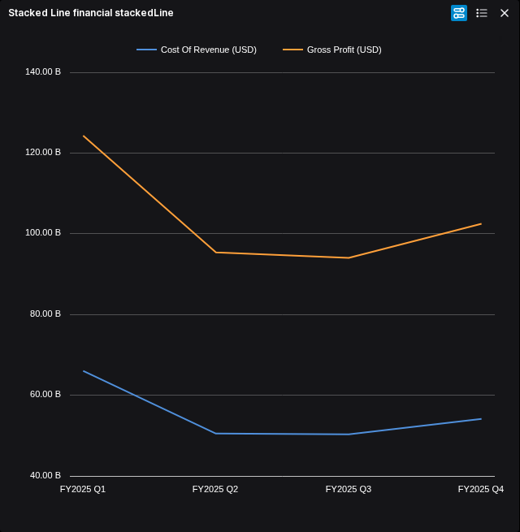
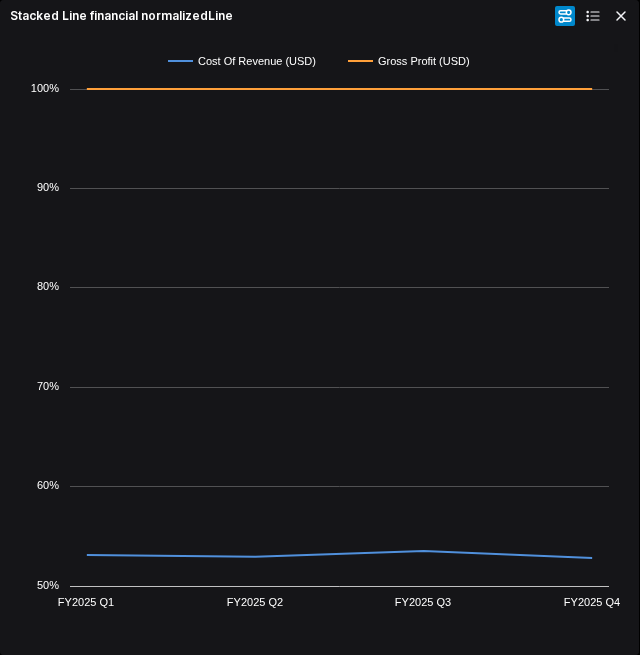
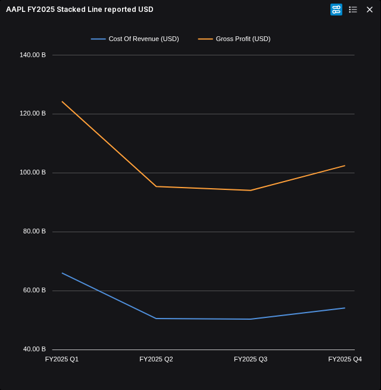
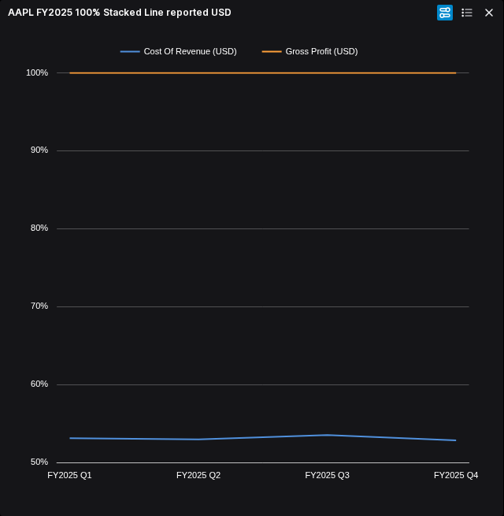

# Stacked Line and 100% Stacked Line

Source integration is accepted at Workspace `94d09d1380c787a27c7c369f54213dd625275859`. Stacked Line and 100% Stacked Line use the existing Cartesian renderer, controls and session. All 231 affected checks pass; strict typing retains the specifically reviewed inherited Zod diagnostic. [Source review](../../../artifacts/reviewed/chart-stacked-line/join-review.md) and [verification](../../../artifacts/reviewed/chart-stacked-line/integration-verification.md) identify the evidence. Packaged FMP browser comparison and publication remain open.

## Bounded delivery

- [x] SL0. Establish the bounded original stacking, normalization, missing/signed/zero observations, controls and saved-state semantics; independently review the assessment. Numerical implementation decisions and candidate acceptance remain SL1-SL3.
- [x] SL1. Freeze the [reviewed implementation contract](stacked-line-contract.md), affected file inventory and disjoint task ownership; inactive foundation accepted at Workspace `21b3515`.
- [x] SL2. Implement and independently review the scoped renderer, editor and session changes; verify affected financial and persistence regressions.
- [ ] SL3. Verify an identified packaged candidate with retained FMP data, original comparison, reachable controls, light/dark themes, refresh, save/reopen and export. Ask the owner about material appearance differences.
- [ ] SL4. Publish representative financial samples, reconcile README/docs/breadth and run the image pipeline once after milestone acceptance. Verify release assets and public image pulls.

The reviewed contract now freezes the numerical behavior and task boundaries. Inactive foundation acceptance does not establish renderer or application acceptance. Keep the existing gallery, native option paths, session and theme. No hidden flags, disabled controls, fallback to ordinary Line or second state owner.

## Financial evidence

The retained AAPL FY2025 quarterly cost-of-revenue and gross-profit fixture is a suitable candidate: its two components reconcile to reported revenue in each quarter. Reuse `artifacts/chart-heatmap/fmp/fy2025-heatmap.csv` and its provenance after checking the raw response and hashes. Amounts are reported USD; normalized plotted positions are cumulative percentages. For this positive additive fixture, individual component shares are differences between adjacent cumulative levels. Do not stack overlapping revenue/profit levels or prices of unrelated instruments and describe the total as an economic aggregate.

Use a small synthetic discriminator for signed, zero, missing and duplicate-category behavior. Keep raw observations separate from cumulative plotted coordinates and normalized values. Original behavior is evidence for a compatibility decision, not automatic permission to copy a financial bug.

Original diagnostic samples: AAPL FY2025 quarterly cost of revenue and gross profit, retained FMP income-statement data retrieved 2026-10-20, reported USD. Source `38dffc33389aca0e4a87e0e88d42f7067aa220df`, image `f48eb1c9b32e1f84d5199dafc943bc1fc10f3b1745ab29860975d002dc5c8a3f`, with the backend-only overlay identified in the review. The second stacked line is cumulative revenue; the normalized second line is 100%. These screenshots are original references, not replacement acceptance or a new provider retrieval.

The owner accepted both replacement appearances on 2026-10-26. Three bounded candidate journeys pass: both retained-FMP variants in light/dark with legend, navigator, refresh, reorder, save/reopen and export; signed/missing/zero geometry and empty-series recovery. The recovery failure was a test double-toggle of an already-open editor, resolved without production changes. [Independent progress review](../../../artifacts/reviewed/chart-stacked-line/candidate-progress-review.md) retains the remaining axis, Set Up and topology work. SL3 and publication remain open.

Candidate image `sha256:580475f5f7cde1948508e31bcba59fb70fbcf6d8fef9ac42454f584d38ba7afb`, production source `94d09d1380c787a27c7c369f54213dd625275859`, no source overlay. Maintained browser test committed at `9a3c0fa45209bc68b4bfc3e71d0808a0ab4468d3`; test-only commit changes no production code. Both views below use the same retained FMP AAPL FY2025 reported-USD fixture described above. The normalized plot shows cumulative percentages while tooltips retain raw USD.

 Original CSV diagnostics remain recorded. The native Series panel has no Connect Missing Data switch; Workspace's theme sets `line.series.connectMissingData: true`, overriding the dependency's false default. Preserve the existing UI rather than inventing a control.

## Ownership and limits

Parallel assessment lanes own original-source semantics and replacement integration inventory respectively. The controller owns the joined contract and milestone. Independent review checks the financial interpretation and remaining unknowns before implementation.

Every modified maintained production file must pass the inventory-backed 400 physical lines/file, 300 logical units/file and 50 logical units/function caps. Documentation and tests are excluded from production caps. Use one heavy build or suite at a time; browser checks remain isolated, headless, one worker and zero retries. Retain original diagnostics separately from candidate acceptance.

Sankey, advanced palettes, other callers and table capabilities remain separate. The published Funnel alpha stays available during this work.

## Repeated-date tooltip repair

Workspace `64b7fecea1619547b439cb4a7fbcbfcf431ed904` preserves separate raw observation blocks at repeated continuous coordinates. The repair passes 13 focused and 91 Cartesian tests and independent source review, with the inherited compiler qualification retained in the [review](../../../artifacts/reviewed/chart-stacked-line/tooltip-repair-review.md). A rebuilt candidate must pass the existing Time journey before SL3 closes; publication remains pending.
