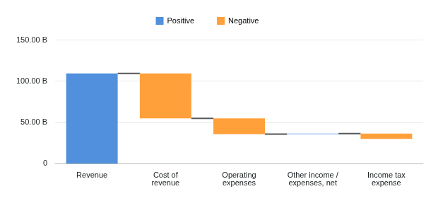
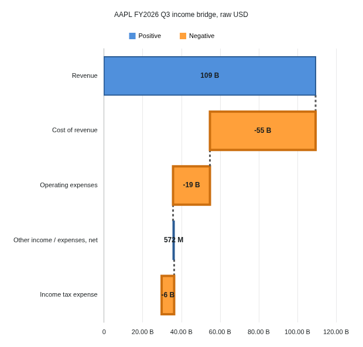

# Waterfall in the existing chart editor

Waterfall is accepted for the bounded ordinary Table/File journey, with retained-FMP financial verification and owner-approved appearance. Application and test sources are recorded below. The accepted image pair is published as [alpha-40002594897-1](https://github.com/norandom/QOpenBB/releases/tag/alpha-40002594897-1); both image identities and six anonymous pulls are verified separately from local browser acceptance.

## Original behavior to preserve

Original Workspace `38dffc33389aca0e4a87e0e88d42f7067aa220df` uses the first selected category and first selected value field. The retained Grid 34.1.1 `WaterfallChartProxy.getSeries` selects `categories[0]` and `fields[0]`; it does not draw a bridge across all numeric columns. Preserve the existing row order, filtering and aggregation owners. Do not rewrite the saved selection merely because only its first value contributes to the chart.

Each ordinary numeric row is a signed movement. Start at zero; a bar spans the previous cumulative value to the new cumulative value. Positive and negative movements use their original theme styles; zero belongs to the positive style. Missing values do not advance the balance. A category labelled Total is still an ordinary movement: there is no automatic closing total. Standalone engine totals/subtotals are not a new editor feature. Preserve unknown saved settings without claiming that unsupported engine-only settings have been verified.

The original exposes direction, tooltips, connector stroke/width/opacity/dash and positive/negative item borders, opacity and label fonts. Preserve `waterfall.series.direction`, nested `line`/`item` styles, and chart-level `waterfall.tooltip` enable/mode. Saved `waterfall.series.tooltip` remains a separate engine option. Category/series inversion and axis tick controls are not originally exposed for Waterfall; do not borrow different eligibility rules from Bar. The original sign legend is fixed rather than series-toggleable. Resolve colors from the existing theme, not an independently chosen financial palette.

Source research is retained in `artifacts/chart-waterfall/original-contract.md` and `integration-scope.md`. Retained engine hashes and exact symbols/lines are recorded there. The bounded original-runtime probe passed on 2026-10-23 (`reference/capture-4`, one browser test, 16.3 seconds, clean diagnostics). Zero has no visible default bar; a missing value retains its category and breaks the connector without advancing the balance. Tooltips show raw movements. The enabled mixed-sign legend is fixed; the original negative-only chart has no legend entries. Preserve that observed quirk rather than silently changing behavior. This probe does not establish replacement or real-FMP acceptance.

## Financial example

Use the retained FMP AAPL quarterly income statement dated 2026-06-27, FY2026 Q3, reported USD. Its raw capture is `artifacts/chart-box/fmp/raw.json`, SHA256 `390dc8cbfc8302720a203bd9782d5e3b1f7363a4f762bdfcef079dbbe4c72f6b`, retrieved on 2026-10-20. No new provider response is claimed.

| Row | Signed movement from provider fields | USD | Ending balance USD |
| --- | --- | ---: | ---: |
| Revenue | `revenue` | 109,417,000,000 | 109,417,000,000 |
| Cost of revenue | `-costOfRevenue` | -54,647,000,000 | 54,770,000,000 |
| Operating expenses | `-operatingExpenses` | -19,075,000,000 | 35,695,000,000 |
| Other income / expenses, net | `totalOtherIncomeExpensesNet` | 572,000,000 | 36,267,000,000 |
| Income tax expense | `-incomeTaxExpense` | -6,478,000,000 | 29,789,000,000 |

Independently check the intermediate balances against gross profit, operating income, pretax income and net income in that record. These rows are derived signed movements: the raw cost fields remain positive. Do not also subtract R&D/SG&A or append reported subtotal/net-income values as movements. This identity is checked for the chosen record, not assumed for every issuer or provider record.

## Bounded delivery tasks

- [x] W0. Independently review the W1 contract, source assignment and financial example; resolve the original-runtime zero, missing-value, tooltip and legend ambiguities. W2 interfaces still require their own frozen contract.
- [x] W1. Implement the small cumulative-movement projection below, with meaningful numerical regressions. This prepares rendering and does not activate the gallery route.
- [x] W2. Join the renderer, Waterfall appearance and existing editor/session paths. Independently accepted source and packaged journey reuse ordinary capture, Set Up, persistence, layout, host and navigation/pointer lifecycle.
- [x] W3. Pass the identified packaged application journey with the FMP bridge, original comparison, relevant controls, navigation, refresh, save/fresh reopen and PNG export. Owner accepts the appearance; reviewed samples are below.
- [x] W4. Reconcile README/docs checkboxes and breadth, commit the accepted milestone, dispatch one image publication run and verify the tagged release and both public images.

All modified production files must meet 400 physical lines, 300 logical units and 50 units per function through the existing explicit inventory/checker. Existing `echarts/lifecycle.ts` is near its cap and must remain unchanged unless a separately reviewed cohesive extraction is necessary. Tests/documentation are exempt from production caps. Preserve unrelated catalog, Perspective and inventory work.

## W1 numerical boundary

The implementer owns only new `compatibility/waterfallTotals.ts` and `tests/unit/chart-compatibility/waterfallTotals.test.ts` under `vendor/workspace/terminalpro/` (production prefix `src/components/General/Table/Chart/`). No family membership, capture, editor, dependency, renderer or state edits belong to W1. The controller owns inventory, evidence and source pins.

Export `projectWaterfallTotals(values: unknown): WaterfallTotalsResult`. Input is a dense array containing only finite numbers or null, representing the already selected and ordered value field. Return a discriminated result:

- `status: "resolved"`, immutable `points`, `extent: readonly [number, number]`, and `count` of non-null observations.
- Each point retains `index`, `delta: number | null`, `start`, `end`, and `kind: "positive" | "negative" | "missing"`. Missing points have equal start/end and retain their position; the renderer later decides missing-value paint/connector behavior from the original observations.
- Start at zero and add finite deltas in supplied order using ordinary JavaScript addition. Preserve the raw delta separately; do not round, scale, sort, group, infer totals or change input. Classify zero, including negative zero, as positive. Extent includes zero and all finite endpoints; empty/all-null input has `[0, 0]`.
- Reject sparse arrays, undefined, nonnumbers, nonfinite observations and cumulative overflow with `status: "invalid"` and existing `SnapshotDiagnostic` records identifying the failing index. Do not return partial resolved geometry on failure.

Tests independently verify signed movements, zero crossing, negative zero, missing/empty/singleton input, unchanged order/input, invalid inputs and cumulative overflow. Include the five explicit signed FMP-derived movements above and independently specified balances; fixture/provenance validation in W3 must read the retained response rather than trusting production output.

## W2 join constraints

Project only the first effective selected numerical field before ordinary unit compatibility checks, while retaining the full saved range and selection. Extra selected fields must not alter financial values, formatting or unit admission. Preserve upstream aggregation witnesses and displayed row order.

Use source row identity for bars, connectors and tooltips. Navigation crops full precomputed totals; it must never reset the visible window to zero. The miniature retains the full series and uses the engine-provided coordinate system. Keep the default hidden-navigator/zoom-enabled route functional as well as the visible miniature, including space for main axis labels.

Keep Waterfall's appearance resolution and editor patches under its own option namespace. The existing ordinary family membership must not activate Waterfall before a supported renderer and editor join exists. A new geometry or appearance helper must own a coherent responsibility rather than forwarding calls to satisfy the size caps.

## Evidence and fan-out

Read-only original-contract and integration tracing are independent lanes. The controller freezes shared interfaces before assigning renderer and appearance/control files to separate implementers. Use Sol for bounded implementation and Astra for numerical/integration review. One heavy suite/build at a time; isolated browser checks use one worker. Record actual tests and source/image identities, not planned checks as passed.

Reviewed real-FMP samples are below. Standalone, AI artifact and theme-preview caller acceptance remain separate work; this milestone does not claim those routes are complete. The checkpoint history below precedes the final W2/W3 acceptance.

W1 source: `59e49e8cecf5dad5add5dfe215d0f8f91da57c5f`. Independent review accepts 34 focused regressions, scoped lint/strict typing and 66 physical / 47 logical / 26 maximum function units. The scoped compiler configuration overrides an inherited deprecation-version mismatch; this is not whole-application type acceptance. See [verification](../../../artifacts/reviewed/chart-waterfall/verification.md).

W2B appearance and disconnected controls are independently accepted at `d03cc33399ec93c32ba6d3c864b35621f713fc8a`: 27 focused tests, scoped lint and combined complexity pass; scoped typing retains the same inherited typography diagnostic. The [integration design](waterfall-integration-design.md) owns the editor/session join, whose W2C source acceptance is recorded below. W2 overall remains open.

W2A renderer source is independently accepted at `923fc4c6007b8b96b5b85e427206f4e7b4f1be45`: 30 focused tests, three independent financial/native-engine probes, scoped lint and combined complexity pass. Numeric/time categories, full-prefix navigation, source identity and separate chart/series tooltip settings are covered at this source boundary. Scoped current/baseline typing retains identical inherited `typography.ts:122` TS7031; no clean whole-application compile is claimed. The renderer test now uses explicit captured movements instead of an ignored CSV dependency and was normalized to LF after review; production hashes are unchanged. The independent local probe reconciles native geometry with the retained raw FMP response. This does not establish packaged Waterfall, connected UI, persistence/reopen or publication acceptance. See the [verification report](../../../artifacts/reviewed/chart-waterfall/verification.md).

W2C renderer/editor/session source join is independently accepted at `077d557f64dd3bc46f6679e404319ab0ad4ce796`: the shared gate passes 155 tests in 16 files; prior UI and transaction reviews pass six and 19 respectively. Parent production maxima are 308 physical / 143 logical / 39 function units across 17 files; final combined caps pass. Legend reset, short-palette fallback, projection context and Histogram guard are resolved. Four inherited Pie legend-array assertion failures were reproduced against baseline and corrected only in tests at `afb9d4f6ba18ab3a95471f3994fd13ca5d0d8cd5`. Both compiler programs retain 2,753 diagnostics; independent review of 63 message variants found no added semantic diagnostic. No clean compile is claimed.

Initial source/browser-preparation revision `c6cd70fa0c071439464155617d80035fddc7f760` includes two independently approved browser test/fixture files. Its first real-FMP packaged run exposed last-series removal hiding the editor. The [empty-selection repair](waterfall-empty-selection-repair.md) is independently accepted at `7ae71f1af11efdb5a39733bc7ac01bbef9107f37`: 120 affected checks, 25 independently rerun checks, combined complexity pass and exact unchanged 2,753 strict compiler diagnostics. Matcher correction `7cd5a309b9b7316d8a6de4c9a0247c186f893e0f` preserves the correct 0.4939px movement geometry and checks actual stroke alpha; 26 pure probes are independently approved. At that checkpoint, rebuilt packaged recovery, W2/W3 application acceptance and W4 publication were still open. See the [verification report](../../../artifacts/reviewed/chart-waterfall/verification.md).

Category-label wrapping is independently accepted at `b127a144359c820bde304650b18b3e4ce3fa2c62`: 79 worker checks and 71 independent checks pass, all four whole production files meet 400/300/50 caps and the combined checker exits 0. Scoped typing has zero owned/added diagnostics and one inherited diagnostic. Multiline observer and four bounded wheel corrections are independently approved at `3ca78b7a37036e12d00f8620871dc96aba5f7756`: 36 pure probes pass (eight valid, 28 rejected); navigation assertions completed in diagnostic runs 8/9 without full application acceptance. The packaged `c6cd70f` candidate failed the first Revenue tooltip because legend binding copied away WeakMap pointer metadata. Local transient-metadata repair `541961d8de287b1658255234509727b047b63118` is independently accepted: 26 worker checks and 10 independent pointer checks pass, Biome passes three files and combined caps pass. Scoped typing retains inherited typography TS7031. Rebuilt full packaged acceptance, reviewed screenshots and publication remain pending.

The maintained candidate-run-3 journey at test revision `c6d8ef606f4252ffa88a7424af8d2cfac7a9bfb0` passes one test in 37.8 seconds, exit 0, against application `541961d8de287b1658255234509727b047b63118` and image `sha256:33d4ec70226a017e56474c34cf8eb20f2435dd79285b01cb8be9d920ec48eaca`. Independent evidence review accepts the bounded financial, navigation, tooltip, refresh, fresh-reopen, export and observed diagnostics results. The reviewed reset test preserves crop on exact-node double-click and resets from blank plot, matching the retained original. That candidate lacked the original Positive/Negative legend, so W2/W3 acceptance, visual samples and publication were still open. A new default painted-legend assertion fails before repair; local session-runtime repair `789d93f87e99d6bdd51a37d9e387cdd934e4e38a` is independently accepted (14 worker and 14 independent checks, Biome three files, combined caps pass; whole runtime 270/81/27). Strict baseline/current retain 2,755 diagnostics with zero owned additions; 27 inherited wording variants are independently reviewed for semantic equivalence, not exact-message equality or clean compilation. Rebuilt packaged legend/full-journey verification was pending at that checkpoint; the accepted result follows below. See `artifacts/chart-waterfall/candidate-run-3/review.md` and `w3-browser-preparation/reset-target-review.md` for limits.

## Accepted application and samples

Candidate-run-5 passes one maintained test in 41.4 seconds, exit 0, on application `789d93f87e99d6bdd51a37d9e387cdd934e4e38a` and image `sha256:46ec7b9edc92ed20deb59d6f4f011bb10c94b934aa9c8faae4c6d5ce5739769b`. Test-only revision `ba03b1289f60a06269fb1a97900e61474475464f` explicitly toggles legend false before true to persist the choice; application code is unchanged. Independent review approves the bounded financial/control/navigation/tooltip/refresh/fresh-reopen/export and observed diagnostics evidence; the owner accepts the appearance. The default legend is present. Parent Docker inspection confirms the running image, sole /data mount and no source overlay. W2/W3 and W4 publication are complete. See the [verification report](../../../artifacts/reviewed/chart-waterfall/verification.md) for limits.

Both samples use AAPL FY2026 Q3, statement date 2026-06-27, raw USD displayed in billions, from the retained FMP capture retrieved 2026-10-20. Signed movements retain financial row order; ending balances reconcile to reported income subtotals.

## Published milestone

Workflow [40002594897](https://github.com/norandom/QOpenBB/actions/runs/40002594897) publishes [alpha-40002594897-1](https://github.com/norandom/QOpenBB/releases/tag/alpha-40002594897-1) from root 15b2e782f71011a79b4ed1351386aa01133fb14c, Workspace ba03b1289f60a06269fb1a97900e61474475464f and data API cab81b16bb9ef49272a6f3b0bf04cf9f34bde0ba. Release assets, image identities and all six anonymous digest/tag/latest pulls are verified. The accepted browser image used application 789d93f plus test ba03; CI rebuilt ba03 separately. This establishes source continuity, not browser execution of CI image bytes, assembled Compose or owner-server acceptance. See [release verification](../../../artifacts/reviewed/chart-waterfall/verification.md#published-waterfall-alpha). Finish this milestone and stop today; no next-family work was begun.
