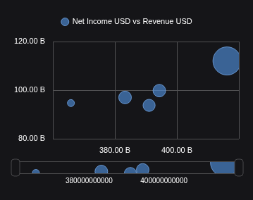

# Scatter and bubble chart milestone

Restore scatter and bubble in the ordinary Table/File journey, preserving the existing Workspace controls, themes and saved options. This follows the published combination-chart milestone under the owner's autonomous chart-port direction. Standalone and AI callers remain open separately.

## Actual FMP chart sample

**Label refinement verified (2026-10-20):** the updated sample matches the original's sparse numeric labels, uses raw numeric miniature labels and clips main/miniature markers at their plot edges. The same FMP observations and EPS sizes pass through save/reopen and export. Legend-icon and minor spacing differences remain; full pixel parity is not claimed.

AAPL FY2021-FY2025 FMP annual statements: X revenue (USD), Y net income (USD), bubble diameter linear in EPS (USD/share), saved minimum 10 / maximum 40 pixels. Five unchanged observations, no aggregation; B formats billions. Verified production source `9185c5f`; `8aeecf4` adds only the reviewed browser synchronization fix.

See the [label-refinement evidence](../../../artifacts/reviewed/chart-xy/bubble-label-refinement.md) and [matched original reference](../../../artifacts/reviewed/chart-xy/bubble-label-original.png). The [earlier spread correction](../../../artifacts/reviewed/chart-xy/bubble-correction.md) remains recorded separately.

[Application and release evidence](../../../artifacts/reviewed/chart-xy/verification.md); [Image and source provenance](../../../artifacts/reviewed/chart-samples/provenance.json). Captured FMP data through File Table; live data API routing is not established.

## Acceptance

Selected numeric columns must retain their original X/Y/size assignment, order and observations. Both axes are numeric. Pairing, labels, marker appearance and applicable navigator/editor controls must work through the existing widget state owner. No hidden controls, replacement editor or silent data transformation counts as parity.

Verify the application with captured FMP annual data: revenue as X (USD), net income as Y (USD), EPS as bubble size (USD/share), fiscal period as label. Check actual coordinates, sizes, tooltips, both themes, refresh, save/reopen and export. Synthetic regressions cover incomplete groups, multiple series, missing values and size-scale edge cases. Publish images once the complete milestone passes independent review and application acceptance.

## Tasks

- [x] X1. Freeze and implement the inactive numeric-field assignment contract, with focused tests for paired/unpaired scatter/bubble, selected order, incomplete groups, defaults, malformed input and immutability. Own `compatibility/xyAssignments.ts` and its unit test only. No gallery activation, state writes or geometry. Independently accepted at `e343e16`; see [evidence](../../../artifacts/reviewed/chart-xy/verification.md).
- [x] X2. Implement the [independently reviewed numeric mapper contract](xy-mapper-design.md), including bubble-size, marker, axis and appearance behavior, and focused real-engine checks. Ownership is new `echarts/xy*.ts` and focused XY mapper tests; no shared helper or production routing edits. Independently accepted at `7e509d3`; the documented excluded-bound diagnostic remains an X4 parity obligation.
- [x] X3. Connect pairing and XY field roles to the existing editor/session through the [reviewed production join](xy-production-join.md). Preserve option paths and inactive settings. Source accepted at `ea740ce`, with independently reviewed empty-selection recovery at `e64ce8c`; packaged-image behavior remains under X4.
- [x] X4. Complete that same cohesive join: family routing, caller defaults, appearance, navigator and refresh behavior. Preserve original empty geometry for one-sided bounds that exclude all observations; the inactive mapper's safety diagnostic is not final parity. Verify captured-FMP application journeys and prior-family regressions.
- [x] X5. Independent feature review, breadth and README/docs checklist reconciliation, reviewed evidence sync, commits/push and one tagged alpha publication with anonymous pull verification.
- [x] X6. Correct the reported bubble spread: compare original automatic bounds, preserve explicit user bounds and EPS diameter mapping, and clip miniature marker geometry to its track. Verify the same captured FMP observations, navigation/reset, resize and export; independently review, replace the sample and publish one corrected image milestone. Production changes retain the existing complexity caps.
- [x] X7. Resolve remaining axis-label density/cropping and slight main-marker edge overlap against the original appearance. Owner requested closer label matching after the qView comparison on 2026-10-20; preserve explicit bounds, observations and EPS sizes while automatic rounding follows available plot space.

X1-X5 record the earlier delivered scope. X6 source and packaged-application checks passed at `72bdc11`; published as [alpha-39470157459-1](https://github.com/norandom/QOpenBB/releases/tag/alpha-39470157459-1). The earlier coordinate and diameter checks did not establish painted containment. X7 source and packaged checks are independently accepted; its hosted publication is pending.

### X7 refinement contract

Keep explicit user bounds and financial observations unchanged. Automatic rounding uses available plot space after legend, navigator and axis labels; a matched 359×284 original with its legend enabled uses Y 80–120B, while the earlier legend-disabled reference uses 90–120B. Retain the computed numeric tick interval, then thin horizontal ticks when measured, formatted labels overlap. Suppress endpoint labels only where their boxes overflow; keep vertical endpoints that fit. The miniature uses its own sparse raw-number labels. Extend the existing XY-owned plot clip to main markers without changing their centers or EPS diameters.

Independent design review approved this bounded approach on 2026-10-20. Ownership is the existing XY domain, navigation, axes, series and clipping modules, with one small tick helper if needed. Shared Cartesian modules, editor controls and saved-state ownership remain unchanged. No new rendering loop or feature flag.

Acceptance uses matched-size original/replacement captures, one wider view and the existing captured-FMP lifecycle/export journey. Focused engine checks cover intervals, endpoint overflow, rotated labels, explicit bounds and actual clipping. Check the existing production caps and update README/docs checkboxes only after independent source and application review.

Task X1 is independent of the unresolved geometry questions in [source research](xy-chart-research.md). X2 and X3 may run in parallel only after an independently reviewed interface and exclusive file ownership are recorded. Shared production integration and commits remain serialized.

X2 is now accepted. Independent review approved one cohesive X3/X4 implementer because session, editor and caller wiring share contracts. Source review and focused tests precede the packaged-image application gate; neither alone closes X4.

Each production task must pass the existing whole-file complexity gate: 400 physical lines, 300 logical units per file and 50 per function. Extend maintained inventory for additions; tests and documentation are excluded. Keep per-task independent review and commits. Retain unrelated Perspective work.
