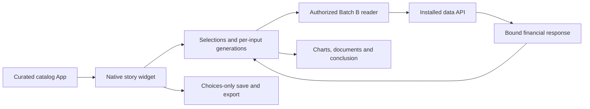

# Events and Documents App design

Open one native Workspace story for one selected listing. The analyst reads FMP earnings figures beside their source rows, inspects filings, a transcript and news under separate queries, then reads a conclusion computed from currently usable evidence. Each chart mark and availability claim resolves to the response that supplied it. [Approved requirements](requirements.md) · [Integration findings](research.md)

## Boundary commitments

**This spec owns** the curated App declaration, listing and query choices, four transient evidence slots, chart and document views, conclusion, choices-only persistence and composed browser journey.

**Out of boundary.** Batch B owns normalization, entitlement and provider limits. Modeling, fiscal-period inference, earnings surprises, document retrieval from external sites and storage of licensed results remain outside this App.

**Allowed dependencies.** Use the generated Batch B catalog, installed data API, current Workspace permission and session transport, financial envelope parser, document renderer and ECharts host. Use the existing React/TypeScript shell and its validated layout. No additional service, database or library is required.

**Revalidation triggers.** Changes to a dataset ID, route, envelope or error semantics require the affected installed contract and browser checks. Changes to the native type, saved schema, renderer, source binding or Workspace pin require catalog, import, persistence and browser regression checks.

## Architecture and system flow

Declare a dedicated endpointless native type and ID, `events_documents_story`, when all four Batch B declarations resolve to their expected types, policies and FMP source. Keep the existing Apps and individual widgets. Reject aliases, endpoint overrides, missing bindings and stale cached declarations using the normal catalog admission path. The widget renders the question, calendar, filings, transcript, news and conclusion in that order, inside the dashboard frame.

### Selection and transport

Use a versioned selection with a listing symbol, calendar date pair, filing dates/page/limit, transcript year/quarter, news dates or neither plus page/limit, and a chart display setting per measure. Seed each set of query bounds from its generated catalog defaults. The initial App listing comes from the transcript example (currently AAPL), so its fiscal period and issuer agree. The standalone filings and news widgets retain their own example listings. Expose the initial transcript period as its own selector. Use a keyboard-operable company picker with local labeled AAPL and MSFT choices and an explicit validated listing-symbol entry for other companies. The custom choice identifies the company by its listing symbol. Preserve exchange suffixes and show the exact query symbol. A choice requires explicit selection or Apply, so edit keystrokes do not send requests.

Resolve four fixed dataset declarations on the installed connection. Do not accept user URLs or serialize headers. Explicitly check access to the dashboard and each underlying source/widget before dispatch or reuse, using Workspace's normal permission and origin-bound session header logic. Permission revocation clears affected evidence immediately. Validate each tuple against its own generated query policy, including date validity, inclusive lengths, ordering, scalar types and numeric bounds. Show the offending field and actual limit. Suppress only the invalid input. All four story routes receive the selected listing. The earnings adapter requests the market window from FMP using dates alone. Route paths below are relative to the installed `/data/api/v1/` mount.

| Input and route | Effective choices and response |
|---|---|
| Calendar, `equity/calendar/earnings` | Required date pair, 1–7 days. Validate all market rows, select the canonical listing, then return up to 250 matching rows in source order. Omitting the listing on the standalone endpoint returns the market slice. |
| Filings, `equity/fundamental/filings` | Required date pair, 1–365 days, page 0–99, limit 1–100. Preserve filing date, supplied precision of acceptance time, form, string CIK, report_url as document link and filing_url as index link. Metadata only. |
| Transcript, `equity/fundamental/transcript` | Selected year 1900–2100 and quarter 1–4. Bind one exact row, normalize returned Q1–Q4 only for comparison, retain its supplied timestamp and original text. |
| News, `news/company` | Both dates absent or 1–31 days inclusive, page 0–99, limit 1–50. Show publication time, title, site (source), publisher, URL and partial excerpt. A headline with no text is metadata only. |

The reader accepts a discriminated query union and AbortSignal and returns a typed success envelope, empty receipt or safe failure. Inspect HTTP status before parsing JSON. A 204 supplies a confirmed empty result for the dispatched query. Label provider retrieval time unavailable and distinguish any local response time. For 200 read the response body once as text before the generic JSON callback. Decode `results` and the reserved financial metadata using `parseFinancialEvidence`. Require known metadata with matching provider, dataset, canonical effective parameters (normalize installed defaults and omitted optional dates), source endpoint, retrieval time, returned count and bounds. Reject malformed or foreign evidence before publishing. Keep genuine 200 empty envelopes with their own metadata. Classify non-success by allowlisted installed code and status, including entitlement, validation, transport and unavailable service. Unknown failures get safe generic copy. Keep raw bodies and credential-bearing request details out of errors and logs.

### State and evidence

Each story instance owns a slot per input, keyed by source, route, canonical tuple and generation. A scope change clears the affected display, drill-down and contribution synchronously. Increment the slot generation for every dispatch or invalidation, abort superseded work where possible and compare generation, scope and current permissions before committing either success or error. This covers A to B to A and retries. A listing change invalidates all four slots and issues a calendar query for the new listing, even when the dates stay the same. Each document changes independently. Coalesce unchanged choices. Automatic retries, polling, focus and reconnect fetches are disabled. Explicit retry replaces only that slot. Clear its prior display while pending. A failed slot offers the retained choices and retry. This design exercises the optional stale-display policy by clearing superseded evidence completely.

A calendar row reference is the receipt generation and ordinal within the returned listing rows. Preserve every match, including duplicate report dates. Distinguish empty market response, nonempty market with no issuer match, and matching rows with no figures. Expose the returned listing count, 250-matching-row limit and `bounds.truncated === true` for observed local clipping. A null truncation flag or full page leaves wider coverage unknown. Use each row's `eps_actual`, `eps_consensus`, `revenue_actual`, `revenue_consensus`, report_date and last_updated. Label consensus as estimate. Preserve zero, read missingness from that row, and use supplied field units, currency and scale. Label unknown currency, scale, timezone, fiscal period and confirmation. Display EPS per share and revenue as a monetary amount. Do not derive currency from the listing or treat last update as a report date.

Pair each matching row with independent EPS and revenue charts when their measure has a supplied figure. Use separate axes and textual actual/estimate values accessible by keyboard. The mark carries its receipt, ordinal and field. Use the supplied numeric value without additional display scaling and expose its source representation in the drill-down. Missing fields have text and no mark. A zero has a zero value and accessible label. The renderer may use an approximate plotting coordinate only if the exact installed value remains available in text. For the four calendar fields, parse JSON text with a reviver that captures each numeric primitive's original token from the reviver source context. Validate support with the candidate browser before admitting the renderer. Retain the token by row ordinal and field in the transient receipt alongside the parsed envelope. Use the token for the exact source text and the finite number for plotting. If raw tokens cannot be recovered, fail that projection explicitly. This preserves precision present on the installed wire; earlier adapter rounding remains a separate provider comparison. Allow bar/point display per measure. Chart labels and focus include ordinal when dates repeat.

For documents, validate issuer and applicable period against the dispatched tuple. A duplicate or mismatched transcript or blank required content is a validation failure. Preserve verbatim content including whitespace, source timestamps at supplied precision and the adapter's content status. Attribute each item to its own effective query, source, retrieval time and fresh receipt. A full page leaves later coverage unknown. Reuse literal text rendering and validated HTTP(S) link actions with no prefetch, embeds or HTML evaluation. Retain delivered metadata when a link fails presentation validation. Where the adapter rejects an entire response, surface the typed failure. Selecting a calendar row never changes document bounds or asserts an event relationship.

Derive the conclusion from the current slots on every transition. Calendar contributes with at least one supplied figure on a matching row; filings/news contribute with valid metadata; transcript contributes with valid exact-period text. Four usable inputs give **Evidence available**, one through three give **Partial evidence**, none with an outstanding request gives **Pending**, otherwise **Insufficient evidence**. Include each limiting condition and missing field, clipping or content qualification even when all four contribute. Cite the slot and source row/field or the scoped empty/failure result. Announce status changes politely, name FMP at each step, and return keyboard focus from details to the invoking row or to its section heading if that row disappears. Use the existing theme tokens and visible focus states.

### Saved state

Encode a positive allowlist of version, symbol, independent validated choices and chart display enums under the story storage key. Wrap it in the ordinary layout with validated geometry and view order. Use the same encoder for writes, dashboard save, template export and import/hydration. Reject malformed or incompatible choices with a visible reset action before fetching. Exclude provider payloads, links, cached queries, free-form content, errors, conclusions and credentials even if injected into widget storage or layout extras. Reopen in a fresh authorized session by reacquiring all four inputs. Preserve the serializers of other widget types.

## File structure plan

The pipeline, contracts and verification directories belong to the QOpenBB root. Paths beginning with `src/` and tests labeled Workspace are relative to `vendor/workspace/terminalpro/`. New names below describe planned ownership.

| Files | Responsibility |
|---|---|
| `pipeline/qopenbb_ci/catalog_events_documents.py` (new), `catalog.py` and `catalog_cli.py` in the same folder | Declare and gate the App, register generation and generator hashes. Regenerate the affected `contracts/` catalog artifacts. |
| `src/utils/zodForms.ts`, new sibling `nativeStorySchema.ts`, `src/lib/utils/backendValidation/{catalog,nativeWidget}.ts`, `src/lib/types/app/widgetTypes.ts`, `src/components/Widgets/index.ts` | Extract bounded catalog schema logic before extending the near-cap module. Admit, validate and dispatch the exact native identity including cached launches. |
| New `src/lib/eventsDocuments/{selection,reader,controller}.ts`, existing `src/lib/utils/financialQuery.ts`, `src/lib/api.tsx` | Validate choices, acquire through permission-aware installed transport, isolate per-slot state. Extract a reusable status-aware transport seam if needed while preserving existing callers' error behavior. |
| New `src/lib/eventsDocuments/{evidence,calendar,conclusion}.ts`, existing `src/lib/companyResearch/financialEnvelope.ts` | Decode and bind receipts, project exact fields and derive cited availability. |
| New `src/components/Widgets/EventsDocuments/{Story,Controls,Earnings,Documents}.tsx`, existing `src/components/Widgets/CompanyDocuments/CompanyDocuments.tsx` | Compose ordered native views, ECharts marks and accessible drill-down. Reuse safe document presentation and source labels. |
| New `src/lib/eventsDocuments/state.ts`, `src/lib/utils/{documentDashboardState,exportTemplate}.ts`, `src/lib/types/app/templates.ts`, `src/components/LayoutAuth/DropdownSubs/DashboardPopup.tsx` | Apply the shared choices encoder across ordinary persistence, schema admission and the reopened App export menu. |
| New `tests/contracts/test_events_documents_catalog.py` (root), Workspace `tests/unit/events-documents.test.ts` and `tests/integration/eventsDocuments.test.tsx`, root `tests/e2e/events-documents-workspace.spec.mts` and new `tests/e2e/events_documents_oracle.py` (independent raw-response numeric verifier), `verification/financial-workspace.config.ts` | Cover generated catalog, state races, presentation, persistence and installed browser journey. Reuse the Batch B browser harness and acquisition ledger. |

Freeze the selection/receipt contracts and catalog declaration before parallel UI and acquisition work. Join at the native widget. Update the maintained scope inventory, check all changed production files including shared modules against 400 physical lines, 300 logical units per file and 50 per function, and run the combined checker on an explicit fork range. Reconcile breadth with executable evidence only. Integrate the reviewed Workspace revision through the source lock before building the candidate. [Complexity checks](../../../docs/complexity.md)

## Requirements traceability and verification

| Criteria | Verification at the named boundary |
|---|---|
| 1.1, 1.2, 1.3 | Launch from the generated catalog, inspect company and effective tuples, change each independently. Verify invalid dates, pagination or period name the bound and dispatch zero affected requests. |
| 1.4, 4.5 | Delay success and error through A/B/A, change one tuple, revoke access, retry. Assert affected evidence clears immediately and independent slots remain inspectable. |
| 2.1, 2.2, 2.5 | Compare selected rows with the full market response, including a match beyond market position 250. Check clipping against matching rows. Exercise empty 204, empty 200, no matching issuer, duplicate dates and clipping with a match. |
| 2.3, 2.4, 2.6 | Compare both charts, text and drill-down against the same source ordinal and field for actual, estimate, zero, null and large values; check dates, separate units and unknown labels in both themes. |
| 3.1, 3.2, 3.3 | Compare filing dates/CIK/both links, exact transcript period, whitespace and timestamp, and news attribution and excerpt against their own responses. Exercise invalid transcript and full pages. |
| 3.4, 3.5, 4.4 | Inspect current provenance, safe typed failures, empty receipt and disclosure for every input. Supply literal markup, missing/unsafe links and absent document text. Verify click-only external navigation and no embedded or prefetched requests. |
| 4.1, 4.2, 4.3 | Drive the reducer through all usable-input counts with pending, empty, invalid and missing-value slots. Resolve every claim to its current receipt; change a row selection and verify document tuples stay fixed. |
| 5.1, 5.2 | Run the keyboard journey in both themes including focus restoration, save, fresh-session reopen and export. Parse persisted dashboard and template, including injected nested fields, and verify the allowlist, safe values, layout and four fresh reads. |
| 5.3, 5.4 | Record separate real and controlled journeys. Controlled suites cover races, clipping, malformed content, input failures, denial and recovery. Only the live browser journey qualifies the composed App on its tested image. For each live calendar field record whether a mark or a missing label was observed. Leave the live missing-value check open if every acquired figure is populated. |

Run Playwright headless with one worker in an isolated, disposable authenticated context. Freeze live tuples and request allowance before the run, selecting a witnessed issuer/window with a matching earnings row and document evidence. A successful minimal journey plans four sends on launch, four on company change with unchanged market window, one per input-bound edit and four on reopen (16 total). Search-free local selection, export and invalid edits add zero. Count actual provider sends including failures and unexpected background traffic separately from browser requests; stop on a budget breach. Add an independent verifier using Python JSON parsing with Decimal for fraction tokens and arbitrary-precision integers, reading raw response bytes before any JavaScript JSON conversion. Exercise 9007199254740993 as a numeric wire token alongside zero and null in a controlled response, and assert the exact rendered drill-down text. Use the established guarded capture to compare the rendered facts and marks to each send's own provider response through the installed normalization. Record build revisions/images, browser, effective tuples, counts, coverage and safe discrepancies. A missing live case or denied entitlement remains open for that scope. Keep licensed content and secrets out of reviewed artifacts. Dagger builds images; portable checks own verification. [Verification policy](../../steering/testing.md)
