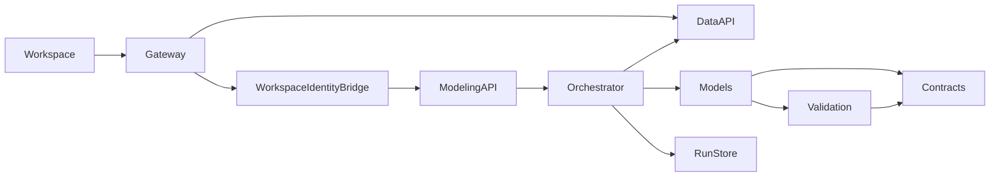
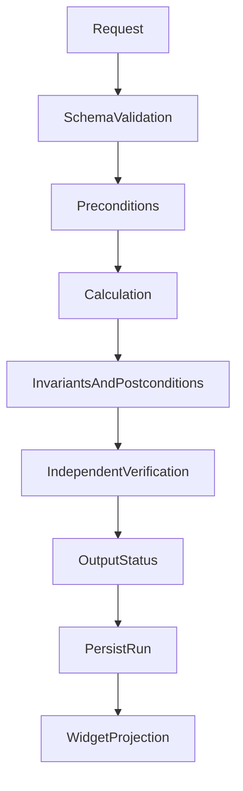

# Financial modeling contract foundation design

## Overview

Financial engineers will maintain house calculations in a separate repository and release them independently of OpenBB. The foundation provides supplied-input models, executable financial contracts and a stable consumer boundary. This session produces design documents only; the repository, validators, models and service remain unimplemented.

### Goals

- Make financial correctness an executable, inspectable contract rather than a spreadsheet convention alone.
- Keep provider acquisition, financial methods and Workspace presentation independently maintainable.
- Make model additions predictable for agents through approved specs, bounded modules, independent review and evidence.

### Non-Goals

No DCF, WACC or forecasting formula implementation, provider expansion, new UI framework, arbitrary plugin uploads, task queue or contract broker. The future three-history/five-forecast workflow receives its own financial specification. FMP remains the active implementation priority.

## Boundary Commitments

### This Spec Owns

The separate repository's domain contracts, installed-model registration, validation lifecycle, model-run envelope, service boundary and extension process. The repository owns method/rule versions and numerical evidence. QOpenBB owns the Workspace consumer contracts, integration verification and Compose adoption.

### Out of Boundary

Provider credentials/endpoints and acquisition logic remain in OpenBB. Widgets do not calculate financial results. Provider DCF is an optional comparison, not an input required to execute house DCF. EconDB and expanded FRED analytical methods are later extensions; no equivalence between their series is assumed.

### Allowed Dependencies

Within the modeling package, imports flow from contracts to validation/model modules, then to orchestration, then HTTP routes. Model modules can use contracts and pure numerical helpers; they cannot import HTTP, provider clients, storage or Workspace code. Orchestration uses explicit input and run-store interfaces. QOpenBB and the modeling repository exchange published contracts over HTTP and immutable artifacts, not source imports into each other's domain code.

### Revalidation Triggers

Input/output fields or nullability; units/scale/period meaning; method or rule version; exception policy; numeric encoding; widget bindings; authentication or persistence behavior; and supported contract-version changes. A changed endpoint that still returns HTTP 200 is not evidence of compatibility.

## Architecture

### Existing Architecture Analysis

QOpenBB already exposes provider widgets using endpoint definitions, parameter mappings, `dataKey: results` and configured columns. Existing profile/income/FRED queries use the owned OpenBB provider framework. Reuse those data routes and controls. Custom backends already discover `widgets.json` and `apps.json`, and widget endpoint contracts support GET/POST. The current `/data/` proxy does not enforce Workspace session authentication or forward a verified principal. The modeling API needs its own result and check envelope; its Workspace projection adapts that envelope without moving formulas into the UI.

### Architecture Pattern and Boundary Map



Ports and adapters govern deployment boundaries. Adapter maps explicitly supplied records to a model schema. Strategy selects a named model method. A registry resolves trusted, installed modules; no dynamic downloads or user code execution. A single modeling container hosts these modules. Separate deployment does not require separate containers per method.

### Technology Stack

| Layer | Choice | Role |
| --- | --- | --- |
| Domain | Typed Python; initial candidate Python 3.13 family | Pure supplied-input execution and Decimal-based financial values |
| Financial tables | Polars; exact version pinned at repository bootstrap | Typed table schemas, expression-based transformations and bounded materialization |
| Contracts | Pydantic 2 family; candidate 2.14.1 from current data runtime lock | Boundary validation and generated JSON Schema |
| HTTP | FastAPI; candidate 0.143.0 from current data runtime lock | OpenAPI 3.1 contract and thin routes |
| Verification | Existing pytest style and independent Python references | Financial, contract and import-boundary checks |
| Packaging | Independent uv lock; existing protected package workflow | No runtime dependency on the OpenBB Python installation |
| Deployment | Independently versioned image in existing Compose | Same-origin access and relative bind state |

Candidate package versions are reuse inputs, not a new verified lock. Repository-bootstrap tasks resolve and verify supported exact pins before installing. If Node tooling is needed, the existing minimum 24.22.1 requirement applies. Dagger builds only; portable commands run checks and publication.

### Financial Python conventions

Owner-selected Polars is the table engine for the modeling repository. Follow [Polars and financial Python conventions](python-finance-conventions.md) for domain names, explicit table grain and joins, missing values, precision, idiomatic functions and useful financial comments. Keep API contracts independent of Polars; scalar calculations and independent Python reference checks remain explicit. These are model-repository conventions, not a provider-layer rewrite.

## File Structure Plan

Paths below are relative to the future repository; `qfm` is a local package identifier, not a reserved repository name. Exact remote and registry coordinates remain bootstrap inputs.

| New path | Responsibility |
| --- | --- |
| `AGENTS.md`, `.kiro/steering/`, `.kiro/specs/` | Agent entry point, inherited policies and model-specific approval flow |
| `src/qfm/contracts/inputs.py` | Input snapshot references, typed observations and financial context |
| `src/qfm/contracts/trace.py` | Formula, substitution and intermediate-value evidence types |
| `src/qfm/contracts/results.py` | Model-run and per-output status envelopes |
| `src/qfm/contracts/checks.py` | Rule descriptors, outcomes, tolerances and policy-exception records |
| `src/qfm/models/protocol.py`, `registry.py` | Model interface and explicit installed-model lookup |
| `src/qfm/models/<method>/` | A later approved method's inputs, calculations and local financial rules |
| `src/qfm/validation/runner.py`, `status.py` | Execute declared checks and resolve dependent-output status |
| `src/qfm/verification/` | Separately expressed numerical reference implementations; no calls to production formulas |
| `src/qfm/service/orchestrator.py`, `ports.py` | Snapshot preparation, model invocation and store/input interfaces |
| `src/qfm/service/routes.py`, `widget_projection.py` | API and presentation projection; no financial formulas |
| `src/qfm/service/run_store.py` | Immutable run persistence and owner-scoped retrieval |
| `contracts/`, `tests/`, `docs/index.md` | Generated/public schemas, behavior tests and navigation |
| `tools/`, `pyproject.toml`, `uv.lock` | Portable quality/contract export commands and independent dependencies |

QOpenBB integration later modifies the existing gateway/Compose configuration and adds consumer manifests under `contracts/consumers/financial-modeling/`. It adds a bounded authenticated modeling bridge beside Workspace backend routes, using the existing `GetCurrentUser` session validator. It extends existing `tests/contracts/` and isolated application tests, plus source/image locks and breadth mapping. No speculative runtime files are added now.

Planned QOpenBB-side ownership (all paths are new unless marked modified):

| Path | Owner and responsibility |
| --- | --- |
| `vendor/workspace/backend-api/backend/routers/modeling.py` | QOpenBB integration lane: authenticate with GetCurrentUser and forward only allowlisted modeling routes |
| `vendor/workspace/backend-api/backend/api/modeling_identity.py` | QOpenBB integration lane: create dedicated signed service assertions; no financial logic |
| `vendor/workspace/backend-api/backend/main.py` (modified) | Register bridge in existing router list; measure whole-file caps and obtain a scoped reviewed exception or cohesive extraction before modifying this upstream file |
| `vendor/workspace/terminalpro/src/lib/modeling/evaluationClient.ts` | QOpenBB consumer lane: typed evaluation request and result handling with current session transport |
| `vendor/workspace/terminalpro/src/lib/modeling/runBindings.ts` | QOpenBB consumer lane: bind returned run IDs to selected result widgets; preserve saved parameters and stale states |
| `vendor/workspace/backend-api/backend/tests/test_modeling_bridge.py` | Authentication, spoofed headers, expired session and safe forwarding cases |
| `vendor/workspace/terminalpro/tests/unit/modeling/runBindings.test.ts` | Explicit evaluation, run binding, failure/stale behavior |
| `contracts/consumers/financial-modeling/`, `tests/contracts/test_modeling_consumers.py` | QOpenBB integration lane: published consumer expectations and contract checks |
| `vendor/workspace/lite/qopenbb-routes.conf.template`, `compose.yaml`, `pipeline/qopenbb_ci/configuration.py` (modified) | Controller: gateway route, service topology and frozen-runtime inventory |

The existing widget control call site is selected in the first consumer integration task from the actual widget type; it must invoke the typed adapter without introducing a second widget framework. That UI task freezes its exact changed paths before implementation. The adapter and bridge are separate bounded tasks from model-core work.

Every maintained production file is measured in full against 400 physical lines, 300 logical units and 50/function. Bootstrap includes the scope inventory and executable checker before model tasks. Modules split by responsibility; tests and generated schemas do not conceal production logic.

## Components and Interfaces

### Component summary

| Component | Intent | Requirements | Critical dependency / contracts |
| --- | --- | --- | --- |
| Contracts and registry | Describe compatible installed methods | 1.1-1.4, 6.3-6.4 | Inbound model descriptor P0; Service |
| Rule runner | Evaluate prerequisites, invariants and output validity | 2.1-2.7 | Model rules P0; Service |
| Evidence and run orchestration | Trace calculations and preserve immutable evaluations | 3.1-3.6 | Registry/reference calculation/store P0; Service, State |
| HTTP and widget adapter | Expose results without recomputing them | 4.1-4.5, 6.5 | Authenticated principal and consumer manifest P0; API |
| Contract delivery gate | Map and verify cross-repository changes | 5.1-5.4, 6.1-6.2 | Immutable artifacts and actual tests P0; Batch |

### Model and validation service interfaces

Conceptual typed interfaces, to be implemented after task approval:

```python
Model.describe() -> ModelDescriptor
Model.calculate(inputs: InputSnapshot, assumptions: AssumptionSet) -> CandidateResult
Rule.evaluate(context: RuleContext) -> CheckOutcome
Reference.verify(inputs: InputSnapshot, assumptions: AssumptionSet,
                 candidate: CandidateResult) -> VerificationEvidence
Registry.resolve(model_id: str, method_version: str) -> Model
Orchestrator.evaluate(request: EvaluationRequest, principal: Principal) -> ModelRun
```

The descriptor binds exact input/output schema IDs, method version, rule-set version, allowed entity/period types, parameter definitions and supported reference-verifier version. Each output declares required inputs/checks. Foundation uses explicit dependency lists, not a generic calculation graph or formula language. Missing referenced rules and cycles in output dependencies fail registry validation.

The rule runner uses explicit validation and typed outcomes, never removable bare `assert` for production guards. It distinguishes schema validity, financial preconditions, invariants, postconditions, independent verification and house-policy warnings. Reference calculations are independently authored/reviewed Python implementations and may share input types, never production formula helpers.

### HTTP contract

The proposed public base path is `/modeling/v1`; all operations below are authenticated. The future gateway integration must enforce the same Workspace user identity for authorization. Browser clients never receive an internal Docker hostname or provider credentials.

| Method and endpoint | Input | Output | Errors |
| --- | --- | --- | --- |
| `GET /models` | None | Installed descriptors and supported contracts | 401, 503 |
| `POST /evaluations` | Model/version, supplied snapshot or explicit supported data request, assumptions, optional permitted policy exceptions | Persisted ModelRun | 401, 413, 422, 503, 500 |
| `GET /runs/{run_id}` | Opaque run ID | Authorized saved run | 401, 404, 503 |
| `GET /runs/{run_id}/outputs/{output_id}` | Run and output ID | Workspace projection with `results` plus validation metadata | 401, 404, 503 |

Malformed or unsupported input returns 422 with safe field-level failures. A schema-valid evaluation that fails financial checks returns a run envelope with withheld/partial states, not a fabricated successful valuation. No content-free 204 for failed financial checks. Infrastructure failures return a safe error code, correlation ID and retryability without provider response bodies or secrets.

Read endpoints never calculate or refresh data. Repeated evaluation requests create distinct audit runs; equal input fingerprints may be recorded but do not imply cached verification. No automatic model version selection. Refresh is a new explicit evaluation.

The service also exposes authenticated `widgets.json` and `apps.json` through the same bridge for backend discovery. Their definitions are generated from accepted consumer mappings. A bounded Workspace parameter adapter creates an evaluation explicitly and binds returned run IDs to read-only result widgets. Discovery is not evidence that complex assumption editing already works; that integration is a later tested task.

### State contract

`RunStore.save(run, principal) -> run_id` and `RunStore.get(run_id, principal) -> ModelRun` own append-only records. Start with atomic JSON files in `./data/modeling`, an opaque server-generated ID and ownership stored inside each run. Write to a temporary file and atomically rename after complete validation; incomplete writes are not discoverable runs. No SQLite or PostgreSQL component is introduced for this foundation.

Store only bounded inputs actually used, provenance and trace, not entire provider response archives. Persist Decimal values as canonical decimal strings; reject NaN/infinity. Timestamps are UTC and financial dates retain their period meaning. Canonical content hashes identify snapshots/assumptions/contracts; authorization is never inferred from knowing a hash or run ID. Backups/retention policy is separate operational work; this design does not claim disaster recovery.

## Data Models

| Type | Required content and invariants |
| --- | --- |
| InputSnapshot | Schema/version, source record IDs, values, financial context, query/retrieval and available publication/vintage dates; preserved raw/provider/estimate category |
| AssumptionSet | Named typed assumptions and adjustments, origin/rationale, version and author where user supplied; separate from provider observations |
| ModelDescriptor | Exact method/schema/rule/reference versions; financial applicability and supported outputs |
| CheckOutcome | Rule ID/version, applicable inputs/outputs, observed/expected condition, tolerance/units, severity, `pass/fail/unknown/error/not_applicable`, explanation |
| PolicyException | Failed rule reference, authenticated author, permitted scope, rationale and policy version; cannot overwrite the check |
| TraceEntry | Stable trace ID, formula identity/version and readable expression, source/input/assumption references, value substitutions, ordered intermediate unrounded values with units/periods, result reference and check IDs; no executable formula strings |
| OutputResult | Nullable value, semantic definition, trace references, and `verified/unverified/withheld` status with affecting check IDs |
| ModelRun | Opaque ID, authenticated owner, source/input/assumption/model/rule/reference fingerprints, results, checks, verification evidence and immutable creation time |

Each ModelRun persists its TraceEntry collection; OutputResult references the applicable entries. The run API exposes the trace, and the widget projection supplies authorized detail references into that same run rather than copying or recalculating it. Missing required trace prevents verified status.

Financial context includes currency/scale, flow versus stock, fiscal period/date basis, and supplied accounting/consolidation conventions. Economic observations additionally retain frequency, seasonal adjustment and vintage limitations. Mapping creates an explicit transformation record; unsupported semantics remain unknown. No silent provider substitution, interpolation, currency conversion or default fiscal alignment. Caller-supplied snapshots are labeled user-supplied with asserted provenance; they cannot self-attest provider authenticity or verification. Service-acquired snapshots record the actual acquisition identity. Numerical verification establishes calculation correctness for the supplied inputs, not the truth of a caller's source claim.

Unrounded Decimal values remain authoritative. Widget projections may convert supported finite values to JSON numbers for existing renderers; record the presentation transformation and precision loss bounds. If safe display precision cannot be met, expose formatted text or an unavailable chart field. Never verify calculations against rounded chart values.

## System Flows



Failure branches are part of the contract: schema rejection prevents model invocation; blocking precondition failure prevents dependent calculations; invariant/postcondition failures withhold affected outputs. Failed or missing required checks cannot produce verified output. Optional warnings remain visible. `not_applicable` requires a recorded reason. A policy exception can permit use only under the declared policy; it does not change the original failed result and the output remains marked with the exception.

A reference mismatch withholds affected outputs; absent reference evidence makes eligible non-invalid outputs explicitly unverified. A saved run is never marked verified solely because the model's CI fixtures passed: verification uses that run's actual input snapshot. New inputs or versions create new evidence; previous verification does not transfer.

## Requirements Traceability

| Requirement | Summary | Components | Interfaces / flows |
| --- | --- | --- | --- |
| 1.1, 1.2, 1.3, 1.4 | Independent methods and compatible versions | Contracts, registry, delivery gate | describe/resolve/calculate; version acceptance |
| 2.1, 2.2, 2.3, 2.4 | Executable financial checks and honest outcomes | Rule runner | evaluation lifecycle and CheckOutcome |
| 2.5, 2.6, 2.7 | Withholding, policy exceptions and tolerances | Rule runner, output status | dependent-output state resolution |
| 3.1, 3.2, 3.3 | Trace and independent verification | Reference, orchestration | actual-input comparison and output states |
| 3.4, 3.5, 3.6 | Immutable runs and origin distinctions | Contracts, run store, projection | save/get; explicit refresh |
| 4.1, 4.2, 4.3, 4.4 | Structural and semantic consumer compatibility | HTTP adapter, delivery gate | pinned schemas and consumer manifests |
| 4.5, 6.5 | Correct display and service isolation | Projection, Workspace integration | partial/failed/stale rendering; direct data route |
| 5.1, 5.2, 5.3, 5.4 | Cross-repository impact and evidence | Delivery gate | immutable contract bundle and breadth mapping |
| 6.1, 6.2 | Agent extension governance | Repository steering and specs | approval, independent review, per-task acceptance |
| 6.3, 6.4 | Provider and economic meaning | Input adapter, contracts | explicit source mapping and provenance |

## Contract Delivery and Migration

Each modeling release exports a contract bundle: OpenAPI 3.1 document, JSON Schemas, method/rule descriptors and a manifest with source revision and file hashes. The authored typed boundary models generate structural schemas; financial semantics and rules remain explicit reviewed contracts. Generated drift fails CI. OpenAPI/schema dialect compatibility is tested against the actual export before publication.

QOpenBB owns consumer manifests containing widget ID, operation ID, supported version, parameter bindings, response paths, required types/nullability, semantic IDs and supported validation states. The model repository pins the accepted QOpenBB consumer-contract revision; QOpenBB pins the adopted model-contract revision. CI checks candidate provider behavior against pinned consumers and candidate consumers against pinned API contracts. Publish a hash-addressed bundle as a release asset; no broker or mutable-main retrieval is required.

Compatibility checks combine structural changes with actual positive and failure response cases. Required/optional, nullability, enum and parameter changes are assessed in the consumer's direction. Added fields are not assumed safe for closed consumers. Semantic-ID or unit/period changes require explicit acceptance even when types match. Unknown compatibility blocks promotion until reviewed; do not claim a complete JSON Schema subsumption solver.

The breadth map links criteria to method/rule/operation/widget IDs and executable test selectors with source revisions. Changed IDs select affected tests; unresolved impact invokes the broader relevant contract suite and reports incomplete mappings. Planned or skipped checks remain unverified. Breaking API versions coexist until saved consumers migrate; a method's changed financial meaning always receives a new immutable method version. Image rebuilds are limited to changed components, while the integration gate tests the exact image/contract combination.

At repository bootstrap, transfer authoritative modeling specs with a recorded commit and leave integration pointers here. Retain the house-standard source revision and corrections ledger. Model-specific requirements/design/tasks must be approved before formulas are implemented. No generic "add a model" task bypasses that gate.

## Error Handling, Security and Operational Limits

Authentication and per-run ownership are required for deployment; Cloudflare Access alone is not a model authorization contract. Never trust a caller-supplied owner field or identity header. Gateway/service integration must derive an authenticated principal and prevent header spoofing before real model routes are exposed. Use a Workspace backend bridge that validates the existing session with `GetCurrentUser`, then forwards a short-lived signed assertion to the internal modeling service. All public `/modeling/v1` routes terminate at this bridge, never directly at the modeling container. The bridge strips caller identity headers and creates an HS256 assertion with pinned algorithm, issuer `qopenbb-workspace`, audience `qfm`, subject equal to the validated user ID, issued-at and expiry no more than 60 seconds apart, and key ID, plus explicit token type `qfm-identity`. Use a dedicated random secret with at least 256 bits of entropy and an allowlisted key-ID lookup. The modeling service validates signature, token type, issuer, audience, time bounds and subject before setting Principal. A dedicated secret is shared only by the bridge and modeling service, not the browser or data API; current/previous keys permit bounded rotation. Revalidate the session on every forwarded request. Missing configuration or invalid assertions fail closed. A maintained JWT library must be pinned and tested at bootstrap; do not implement cryptography locally. The existing unauthenticated data proxy remains unchanged by this bounded design.

Use a configured data-API base URL and an allowlisted dataset mapping for acquisition, never caller-supplied fetch URLs. Log run/correlation/model/rule IDs and safe error categories; exclude raw assumptions, data and credentials from ordinary logs. Runs are private to their owner initially; shared research is a separately authorized extension.

Start with synchronous bounded evaluation. Each model descriptor declares maximum input rows, horizon and supported scenario size; service configuration supplies request-body, acquisition and evaluation timeouts. Reject oversized inputs before calculation. The service returns 503 for exhausted/failed execution rather than a partial run labeled complete. Evaluation executes in a bounded spawn-based child process with a configured Polars thread budget so its configured wall-time deadline can terminate computation; no detached job continues after a failed request. Default service admission limits are 2 MiB request bodies and one active evaluation process; requests over capacity receive 503. The initial evaluation timeout is 60 seconds and data acquisition timeout is 30 seconds; descriptors may tighten, never bypass, configured limits. Concrete measured limits are acceptance inputs for each model slice; no throughput claim or worker queue is introduced here.

## Testing Strategy

All paths below are future checks, not completed tests.

| Future checks | Acceptance covered |
| --- | --- |
| `tests/contracts/test_registry.py`, `tests/architecture/test_imports.py` | 1.1-1.4: resolve exact versions; no network/UI/provider dependency in model execution |
| `tests/validation/test_lifecycle.py` | 2.1-2.7: missing inputs, failed postconditions, unknown/error/not-applicable, exception limits and unit-aware tolerances |
| `tests/verification/test_run_evidence.py` | 3.1-3.6: independent comparisons on actual inputs, withheld mismatch, origin labels, changed inputs invalidate prior status |
| `tests/service/test_runs.py` | 3.4-3.5: owner-scoped immutable save/get, incomplete write, explicit refresh, wrong-user access |
| Contract bundle export and compatibility checks in both repos | 4.1-4.4, 5.1-5.4: schema drift, nullability, units-only breaking change, unmapped change, pinned cross-repo evidence |
| Existing QOpenBB isolated browser journey extended for a real model | 4.5, 6.5: assumptions/run selection, failure display, saved reopen and data views when model service is unavailable |
| Model-specific mapping/reference tests and independent review | 6.1-6.4: financial semantics, real-provider inputs, incompatible frequency/vintage and explicit transformation evidence |

Foundation tests may use a clearly labeled synthetic contract fixture that is not registered as an analyst model or published as a placeholder service. Actual model acceptance later requires real input evidence and independently verified calculations. Reuse bounded xdist and browser runners; no parallel test framework or exhaustive screenshot matrix.
