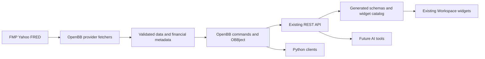
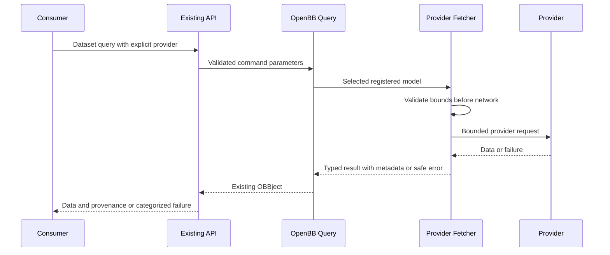

# Market data integration design

## Overview

Extend the owned OpenBB platform into a reusable research-data service for financial engineers. Keep its standard models, Provider registry, Fetcher lifecycle, Query execution, routers and OBBject. Restore compatible provider implementations from retained history and expose the same identified contracts to exploratory widgets and later AI consumers.

The first batch supplies financial statements, named discovery, peer candidates and valuation inputs. Broad FMP coverage remains staged scope; a starter dashboard is a verification case, not the data interface. This design introduces small schema/catalog/error extensions, not another query framework or deployment service.

### Goals

- Preserve financial identity, periods, units, provenance and explicit provider selection across consumers.
- Reuse retained provider code after adapting core/API compatibility and correcting known semantic defects.
- Produce independently verifiable coverage and generated consumer definitions from installed commands.

### Non-Goals

No database implementation, general SQL language, new ORM, automatic provider fallback, Jupyter host, AI execution, Excel, valuation engine, dashboard redesign or new renderer. Analyst-workspace owns peer choices, financial calculations and saved research scenarios.

## Boundary Commitments

### This Spec Owns

Provider query/data adaptations; financial metadata; bounded sanitized upstream access; supported dataset discovery; generated widgets and API compatibility; coverage and real-provider evidence. FMP values remain provider values, not analyst-approved valuations.

### Out of Boundary

Shared company/date UI, dashboard layouts and research-state persistence belong to analyst-workspace. Its existing UI is used for a representative data acceptance journey, not rewritten. AI tool invocation and authorization belong to workspace-ai. Future database providers belong to custom-data-source.

### Allowed Dependencies

Owned OpenBB core 2.0.1, equity/economy 2.0.0, FRED 2.0.0 and adapted FMP 1.6.1+qopenbb.1; current locked Pydantic/FastAPI/aiohttp and catalog generation. Retain uv/Safe Chain and Dagger-only image builds. No new third-party library is proposed. Later yfinance restoration requires a separately locked compatible dependency set before activation.

### Revalidation Triggers

Provider API/field semantics, core schema generation, route/provider identity, query bounds/defaults, metadata/error versions, source pins or generator changes invalidate affected consumer contracts and checks. A status change from implemented to accepted requires fresh evidence, not just schema regeneration.

## Architecture

The diagram shows data flow. Code dependency direction is core model definitions → provider implementations → installed command/API assembly → catalog generation → consumers. Provider code cannot import QOpenBB UI/catalog modules. Catalog descriptors describe installed commands; they never dispatch requests or become another provider registry.

Existing `AnnotatedResult.metadata` reaches `OBBject.extra.results_metadata`. Preserve that outer location and the ordinary `results` array. Put the new common model under the reserved `__qopenbb_financial__` member of that metadata dictionary so existing FRED per-series metadata keys remain unchanged. Keep OpenBB execution metadata at `extra.metadata` separate. Validate financial metadata before serialization; expose its JSON Schema explicitly because unrestricted `extra` alone is not a usable consumer schema.

## File Structure Plan

Paths starting `core/`, `providers/` or `extensions/` below are inside `vendor/data-api/openbb_platform/` and are committed to the owned data fork. Root files belong to QOpenBB.

| Files | Change and single responsibility |
| --- | --- |
| `core/openbb_core/provider/standard_models/financial_metadata.py` | New typed result/field/provenance/completeness metadata, without runtime fetching |
| `core/openbb_core/provider/utils/financial_errors.py` | New safe categorized provider failures and bounded retry information |
| `core/openbb_core/provider/utils/financial_validation.py` | Sanitize adapter result-model validation without exposing provider rows |
| `providers/fmp/openbb_fmp/models/{equity_search,balance_sheet,cash_flow,equity_historical,equity_peers,key_metrics,financial_ratios,enterprise_values}.py` | New/restored dataset-specific query/extraction/transformation modules; one standard contract per module |
| `providers/fmp/openbb_fmp/models/{equity_profile,income_statement}.py` | Preserve baseline behavior while adding bounds, alias compatibility and metadata |
| `providers/fmp/openbb_fmp/models/{balance_sheet_data,cash_flow_data}.py` | Companion field declarations if restored models exceed whole-file caps; no duplicate normalization owner |
| `providers/fmp/openbb_fmp/utils/{helpers,errors,definitions}.py` | Existing sanitized transport, failure classification and period definitions; close unsafe multi-request bypass before reuse |
| `providers/fmp/openbb_fmp/provider.py`, `provenance.json` | Register accepted fetchers and record source recovery/adaptation notices |
| `core/openbb_core/provider/standard_models/enterprise_values.py` | New standard enterprise-value bridge input contract; historical source lacks this model |
| `extensions/equity/openbb_equity/{equity_router,fundamental/enterprise_router}.py` | The small equity composition root mounts the enterprise child under the existing fundamental router; the oversized legacy fundamental file stays untouched. Other restored models use existing routes |
| `providers/fred/openbb_fred/models/series.py` | Preserve legacy per-series metadata, add common metadata and retain available vintage/transform facts |
| `providers/fred/openbb_fred/utils/{rate_limiter,cache,acquisition}.py` | Preserve cache behavior with versioned timestamped acquisition envelopes; acquisition is a new bounded helper |
| `services/data-api/qopenbb_data/{financial_catalog,financial_errors,financial_openapi,financial_policy}.py` | Small discovery, safe HTTP errors, schema projection and pre-execution provider policy modules |
| `services/data-api/qopenbb_data/{app,config}.py` | Mount discovery, install handlers on the upstream app and keep server-side configuration |
| `pipeline/qopenbb_ci/{catalog,catalog_runtime,catalog_upstream}.py` | Preserve generated financial descriptors/schema references and detect consumer drift using existing generation flow |
| `pipeline/qopenbb_ci/catalog_financial.py` | Descriptor projection and validation extracted from catalog orchestration, no provider I/O |
| `contracts/{datasets,openapi,routes,widgets,apps,provenance}.json` | Reviewed generated proposal; datasets retain selected route/example inventory, not an execution registry |
| `docs/reference/provider-coverage.json` | Machine-readable coverage evidence index for documented/retained/adapted/installed/verified states, no credential values |
| `services/data-api/pyproject.toml`, `services/data-api/uv.lock`, `sources.lock.json`, `.kiro/complexity-budgets.json` | Dependency/source pin and maintained-scope updates at joins |

Later FMP families follow `providers/fmp/openbb_fmp/models/<standard_model>.py` using retained definitions; new standard models/routes require explicit contracts. Yahoo restoration owns `providers/yfinance/` and its dependency declaration. These later families receive concrete endpoint/file task briefs before implementation, not blanket restoration of the old tree. Existing unrelated catalog renderer edits are not part of this work.

## System Flows

No new automatic retry or cross-provider fallback is added; existing finite FRED retries are preserved and checked. Request validation precedes I/O. A successful empty response retains existing empty-data behavior, distinct from malformed response or entitlement denial. Partial results must identify completeness as partial or unknown.

## Components and Interfaces

| Component | Intent | Dependencies | Contract |
| --- | --- | --- | --- |
| Provider fetchers | Standard typed queries and dataset transformations | Core models P0; provider APIs P0 | Existing Fetcher/AnnotatedResult |
| Financial metadata | Stable semantics without changing result rows | Pydantic/core P0 | Metadata schema v1 |
| Financial failures | Safe categories across provider transports | Existing OpenBB errors P0 | Python error attributes and HTTP detail extension |
| Financial catalog | Discover installed capabilities and evidence limits | Installed OpenAPI/registry P0; coverage index P1 | GET discovery and operation extensions |
| Catalog generation | Reuse native widget generation and compare schemas | Existing portable pipeline P0 | Reviewed generated artifacts |

### Provider fetchers and first-batch surface

Retain `transform_query(params) -> QueryParams`, `extract_data(query, credentials)` and `transform_data(query, raw) -> AnnotatedResult[list[Data]]`. Use existing provider-specific standard-model subclasses and alias validation. Transport stays in the maintained FMP helper; do not revive legacy direct request paths.

| Standard model | Existing command or proposed addition | FMP stable endpoint |
| --- | --- | --- |
| EquityInfo | Existing equity/profile | profile |
| EquitySearch | Existing equity/search | search-symbol or search-name |
| EquityPeers | Existing equity/compare/peers | stock-peers |
| IncomeStatement | Existing equity/fundamental/income | income-statement |
| BalanceSheet | Existing equity/fundamental/balance | balance-sheet-statement |
| CashFlowStatement | Existing equity/fundamental/cash | cash-flow-statement |
| EquityHistorical | Existing equity/price/historical, initial daily EOD only | historical-price-eod/full |
| KeyMetrics / FinancialRatios | Existing equity/fundamental/metrics and equity/fundamental/ratios | key-metrics / ratios |
| EnterpriseValues | New equity/fundamental/enterprise_values | enterprise-values |

The enterprise-values response supplies provider-reported price/shares/market-cap/cash/debt/EV components. It is not a substitute for analyst adjustments or a claim that market and financial dates coincide. Provider peers are suggestions, not an approved comparable universe.

Initial new queries use one nonblank symbol (preserve separately accepted multi-symbol profile behavior), annual/quarterly statements and bounded daily history. Initial bounds are application policy: statement/metric/EV records 1–1000, search results 1–100, daily history dates mandatory and spanning at most five calendar years, response cap 5000 observations. Defaults are five statement periods and twenty search results. Preserve the existing income `limit=0` behavior through characterization or an explicitly reviewed compatibility amendment; never silently reinterpret zero as five. Unsupported TTM/intraday modes remain explicit errors until their dedicated contracts pass. Dates must be ordered; rows are deterministically sorted with documented duplicate treatment.

For endpoints lacking a native limit/continuation guarantee, cap returned rows and mark `truncated=true` when observed, otherwise `completeness=unknown` unless completeness can be demonstrated. Do not promise arbitrary filters, field projection or generic cursors. Price zero changes remain zero; percent/fraction conversion is field-specific. Statement aliases accept verified legacy/current spellings without fabricating fiscal periods. No TTM record is dated with today's date to fill a missing reporting date.

### Financial metadata contract

`FinancialResultMetadata` is a Pydantic model serialized into `AnnotatedResult.metadata["__qopenbb_financial__"]`; `OBBject.extra.results_metadata.__qopenbb_financial__` is its public location. The surrounding metadata dictionary retains existing legacy provider entries, including FRED series IDs; no legacy key is renamed. The reserved key is excluded from valid series identifiers. Existing rows and envelope remain compatible.

| Field | Type and invariant |
| --- | --- |
| schema_version | Literal 1 |
| dataset, provider | Stable command/model identity and actual selected provider |
| retrieved_at | Timezone-aware UTC timestamp of retrieval; cache hits retain original retrieval time |
| source | Safe endpoint identifier and public documentation reference, never credential-bearing request URL |
| effective_query | Allowlisted validated nonsecret parameters only |
| fields | Map of field name to definition, unit/scale, currency/period basis, value origin and availability |
| bounds | Requested/effective limit, returned count, truncated boolean or null, completeness complete/partial/unknown, optional native continuation |
| limitations | Explicit unavailable vintage, adjustment, date or financial-basis information |
| transformations | Ordered named transformations with affected fields and source basis |

Row-varying currency/fiscal/observation dates remain in typed result fields; metadata references those fields rather than assigning one invented global value. Preserve nulls and signed financial values. Data definitions remain provider-specific where semantics differ. FRED keeps source/frequency/seasonality/units and available observation/release/vintage fields; no implicit resampling. Symbol/name search returns stable provider-qualified identity plus issuer/security attributes; cross-provider joins require verified identifier mapping, not ticker-string equality.

### FRED compatibility and acquisition provenance

This batch updates the installed generic FRED series contract only; additional FRED routes remain later batches. Retain `extra.results_metadata[series_id]` and existing wide result columns. Add common metadata under `__qopenbb_financial__`; consumers of the legacy map continue to work. Before pivoting observations, retain supplied `realtime_start`/`realtime_end` in a per-series, observation-date provenance map inside the new metadata. These intervals alone do not prove a point-in-time query; expose vintage-query capability separately.

Keep original series units/frequency in legacy metadata. New field metadata distinguishes source units/frequency from effective units/frequency, requested FRED transform and aggregation. Map documented transforms to their resulting measures; if semantics are not established, effective units are unknown with a limitation, never silently copied from the source. Preserve existing transform options, and verify representative level, percent-change and aggregated outputs.

`utils/acquisition.py` defines `FredAcquisition(payload, retrieved_at, cache_state)` with cache states network/memory/disk/coalesced. `fred_get` in rate_limiter.py gains an opt-in `with_provenance` argument; default callers still receive the unchanged raw payload. Internally, cache entries and in-flight results carry the acquisition envelope, stamped after successful network receipt, and all hit paths reuse that timestamp. Version cache keys/records; old unversioned entries are treated as misses, not assigned a new fake retrieval time. `cache.py` owns disk serialization and rate_limiter owns memory/in-flight propagation. Do not delete unrelated cache contents.

The series fetcher opts in for observation and series-metadata requests, retains each acquisition record and uses the oldest component acquisition as conservative result freshness. FMP extraction similarly retains a timestamp alongside the raw response in its internal extraction result; transformation cannot create a new fetch time. No FMP response cache is introduced. Existing finite FRED retries remain bounded and characterized; the no-new-retry rule does not remove them. Tests cover memory, disk-disabled runtime, opt-in disk, coalesced and bypass paths, plus non-opt-in payload compatibility.

### Discovery and generated consumer contracts

Add read-only `GET /datasets.json` beside existing widget/App discovery. It returns `schema_version`, source/generation identity and dataset descriptors. Each descriptor contains command path/operation ID, parameter and row-schema references, provider choices, metadata schema reference/location, bounds/filter semantics and separate coverage states. It exposes no raw OpenBB user settings or account keys. Account entitlement is unknown unless a separately recorded verification exists; a public catalog must not publish subscription/account details.

Source and generation revisions identify the installed native OpenBB source and schema-generator snapshot. The maintained QOpenBB wrapper is separately bound by its runtime-input SHA256. Image builds bake these identities and the coverage index; a process does not invent its final OCI image digest. Runtime discovery projects annotated installed variants only, leaving broader unannotated FRED routes intact. Each factory isolates the native ASGI container so handler installation remains safe after earlier requests.

Generate `x-qopenbb-financial` operation extensions and the metadata schema component from the same Python query/data declarations used by fetchers. Required sidecar semantics are field schema extras/class metadata on those declarations, not a handwritten parallel schema registry. Catalog generation resolves installed registry model/route associations, validates descriptor references and reuses upstream `widgets.build_json`. Compatibility comparison includes the extension and referenced metadata schemas. Proposal output is isolated until review, then snapshots and provenance advance together.

`financial_openapi.py` supplies the additive projection at runtime and during generation; `catalog_financial.py` owns snapshot validation/diff, not a second projection implementation. OpenAPI extensions explicitly document the nested metadata location; they do not claim that the existing unrestricted `extra` response field enforces it. Fetcher validation plus serialization tests enforce that boundary.

The native widget bridge derives a disposable inline results view from the projected response schema. This lets unchanged upstream utilities recognize the composed financial envelope and generate column definitions with `dataKey=results`. The served OpenAPI and frozen route contracts retain their original financial projection. Generator provenance includes the financial validator as well as the bridge; consumer proposals do not certify live access or the packaged Workspace journey.

Generated widgets continue using native endpoint/params/results contracts and explicit provider values. Dataset discovery supports exploration beyond these example widget defaults. Consumers call the published command, not a newly invented generic query endpoint. The advertised non-baseline operations equity/search, equity/compare/peers, equity/fundamental/balance, cash, metrics, ratios, enterprise_values and equity/price/historical require explicit `provider`. Existing profile, income and economy/fred_series defaults are retained and exposed. `financial_policy.py` installs an outer service ASGI request guard before the upstream mount: it resolves the exact installed path/method descriptor, checks the provider query parameter before forwarding, and returns safe 422 missing-provider details if omitted. This guard applies to restored existing paths as well as the added enterprise-values path; it never dispatches provider queries. Its path set is generated from installed operation descriptors, not handwritten separately. OpenAPI marks the same parameters required; tests assert actual omitted-provider rejection before I/O and unchanged baseline defaults. Python acceptance calls select providers explicitly; notebook-wide alphabetical defaults are not presented as the service policy. No second AI fetch path or running agent is introduced.

### Financial failures and HTTP compatibility

Extend fixed safe failure categories with typed attributes: `code`, `provider`, `retryable`, optional bounded `retry_after_seconds`. The exception stores no upstream body, credential-bearing URL or unsafe chained exception. The existing FMP classification helper remains the source of protocol/payload classification. A small typed unwrapping helper follows recognized OpenBB `original` wrappers only; it does not parse arbitrary error strings.

Register handlers on the mounted upstream FastAPI app, not only the outer QOpenBB app. Responses retain a human-readable `detail` and add safe category fields. Preserve existing baseline status codes unless a separately reviewed compatibility change is needed: input validation 422, OpenBB provider failures 400, upstream authentication/entitlement 502, empty data 204. Differentiate failures by stable category rather than promising new 401/403/429 semantics. Publish these response schemas through the additive OpenAPI projection. Retry-After is forwarded only after validation; no retries are automatically scheduled. Python consumers observe the same typed category through OpenBB wrappers.

FRED's existing protocol failures, including an unavailable series, retain HTTP 400. Its provider-owned canonical error classifier supplies the shared typed category; the service does not infer categories from arbitrary exception text. Human-readable detail follows the common provider-independent messages. Annotated operation responses reference that same public error schema.

For advertised dataset operations, `financial_errors.py` also handles FastAPI request validation, provider-model Pydantic validation, response validation and unexpected exceptions on the upstream app. Request errors return 422/invalid_parameters with allowlisted field locations and fixed messages, never supplied values. Invalid provider rows/response schemas return 502/invalid_response; unexpected failures return 500/internal_error with an opaque correlation ID. Fetcher query validation versus result validation is identified by explicit typed context, not by echoing validation inputs. Add a small shared validation helper in `core/openbb_core/provider/utils/financial_validation.py` for adapters to wrap result-model failures safely; query validation remains pre-I/O. Preserve core dispatch and legacy routes outside the advertised scope.

These handlers do not call upstream logging helpers on advertised failures: log only code, provider, operation ID and correlation ID, never exception repr, body, request URL, traceback locals or input values. Original/cause traversal is bounded to recognized wrappers, and unknown exceptions fail closed to the safe internal category. The outer policy guard uses the same safe formatter. Secret-canary tests cover malformed rows, user inputs, wrapper nesting and unexpected exceptions through the mounted API, not just helper outputs.

## Data Models and Coverage State

There is no new persistent database. A versioned metadata model describes each result; generated descriptors describe commands; a checked-in coverage index records evidence separately from executable schemas.

Coverage states are independent fields: documented, retained-source, adapted, installed, account-access verification, real-data verification, widget verification and future-AI exposure. Each verified field carries source/image identity, evidence path and date. A changed source/contract invalidates only affected verification; untested compatibility is not assumed. Public evidence omits credentials and private account identity. Unimplemented catalog families remain visible in the coverage index, not runnable widgets.

Later family sequence: first financial-input batch → DCF/estimates/segment inputs → narrative news/transcripts/filings → funds/ownership/cross-market → remaining agreed FMP families and supplementary Yahoo/FRED exposure. Every batch must name endpoints, standard models, bounds, source recovery and live checks before tasks. FMP custom DCF accepts only verified provider parameters; missing assumptions remain unknown and model recalculation belongs to analyst-workspace. Broad coverage is an eventual delivery obligation, not completed by the first batch.

## Requirements Traceability

| Requirements | Components and concrete realization | Verification |
| --- | --- | --- |
| 1.1, 1.2, 1.3, 1.4 | Catalog descriptors and independent coverage index | Installed-schema/status consistency |
| 2.1, 2.4, 2.5 | First-batch fetchers, typed bounds and completeness metadata | Responses, pre-I/O rejection, truncation |
| 2.2, 2.3, 2.6 | Staged family contracts, DCF provenance and entitlement evidence | Named batch gates; blocked is not passed |
| 3.1, 3.2, 3.3 | Search/profile identities and issuer/security fields | Ambiguous-name and listing cases |
| 3.4, 3.5 | Instrument/series semantics and independent IDs | Futures/spot/COT and macro identity fixtures |
| 4.1, 4.2, 4.3, 4.4 | Typed metadata, statement aliases and transformations | Numeric/period/provenance comparison |
| 4.5, 4.6, 4.7, 4.8 | Nulls, unknown vintages, valuation inputs and FRED semantics | Missing/negative/mixed-period cases |
| 5.1, 5.2, 5.3 | Explicit provider on new queries, disclosed baseline defaults, no fallback | Selection/missing-provider/failure tests |
| 5.4, 5.5, 5.6 | Existing standard models and provider extensions | Common meanings and supplementary-source identity |
| 6.1, 6.2, 6.3 | Generated OpenAPI/widget descriptors and compatibility diff | Python/API/widget agreement and drift |
| 6.4, 6.5 | Future text family typed rows, existing service independence | Partial text/provenance; no browser/AI dependency |
| 7.1, 7.2, 7.4 | Safe typed failures and credential isolation | Secret-canary/error/retry fixtures |
| 7.3, 7.5 | Query bounds and retrieval/cache metadata | Limits and freshness tests |
| 8.1, 8.2, 8.5 | Owned forks/pins, portable release and breadth evidence | Exact source/image/generated identities |
| 8.3, 8.4 | Real-provider and relevant edge/failure acceptance | Focused tests plus integrated journey |

## Testing Strategy

- Extend existing FMP provider and core Fetcher/OBBject tests: aliases, typed metadata survival, null versus zero, negative values, dates, per-query pre-I/O bounds and typed safe errors. Financial calculations are independently recomputed where introduced; importing provider ratios is not proof of our own valuation.
- Extend `tests/contracts/test_catalog.py` and `test_catalog_runtime.py`: generated operation descriptors and metadata references, parameter validation, drift detection and proposal/source provenance. Add `tests/providers/test_financial_contracts.py` for service errors, explicit provider policy and schema/runtime agreement; reuse current fixtures.
- Mark real-provider checks separately. Retain request parameters, retrieval time and sanitized result evidence; missing credentials/entitlement is unverified/blocked. Verify FMP financial periods, bridge inputs and actual historical prices on a representative nonfinancial company plus a small peer set.
- Reuse the existing isolated Workspace browser workflow for discovery, parameter change and visible financial values. Analyst-workspace owns new linked-dashboard persistence acceptance. Keep source metadata visible through available table fields/catalog descriptions; no new UI is inferred from API metadata alone.
- Run affected checks once per source change, one integrated join, independent review, then Dagger publication at a meaningful accepted milestone. Playwright starts at one worker; xdist at most two; one heavy suite/build at a time. No new harness.

## Migration, Complexity and Parallel Delivery

Do not enable all recovered provider files at once. Begin with characterization of baseline profile/income and selected historical source; freeze metadata/errors/query bounds before provider work. Preserve existing routes/widget IDs and schema meanings. Generate proposals, compare compatibility, then atomically advance fork pins, installed routes and catalogs. Only verified routes get runnable widgets; preserve unavailable family status in the coverage index.

Foundation lane owns shared metadata/errors and scope inventory. After its reviewed contract freezes, provider restoration and catalog/runtime integration may proceed in disjoint lanes; controller owns shared provider registration, source pins, dependency locks, generated snapshots and joins. Financial/core integration review uses Astra; bounded implementation uses Sol; no more than four active agents. These are design boundaries, not generated executable tasks.

All changed production files must pass 400 physical lines/file, 300 logical units/file and 50/function. Large retained field definitions split by cohesive data-model responsibility; oversized routers use small mounted subrouters. Do not modify giant core dispatch/schema machinery to solve a local metadata problem. A required whole-file exception or broader core change reopens design. Existing unrelated catalog renderer edits must be reconciled before touching the same files, never overwritten or included accidentally.

## Risks and Open Evidence

Stable endpoint documentation is not subscription acceptance. Legacy TTM code fabricates dates, price code loses zero values and multi-request helpers bypass safe transport: each is a restoration hazard, not an approved implementation. Name-search support, endpoint pagination and rate limits must be verified for the selected account. Cross-provider field meanings and historical vintages remain explicit unknowns until checked. No deployment rollback or backup/restore claim is added.

Official endpoint references and retained source recovery points are recorded in research.md. No library upgrade, live request or production mutation occurred during design discovery.
