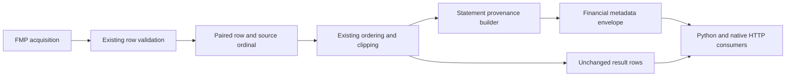

# Statement period provenance: bounded design

## Overview

Add typed, row-attributable period provenance to the existing FMP Income, Balance and Cash financial envelope. Consumers can distinguish a requested quarterly view from proven discrete-quarter coverage. Preserve the existing rows and controls; unsupported duration remains unknown.

Requirements are owner-approved. This design extends the accepted provider/core contract; it introduces no service, dependency, financial calculation or additional dashboard. It does not establish IA-B analytical readiness.

## Boundary Commitments

### This Spec Owns

- Statement period metadata, its source attribution, Python/HTTP projection and consumer compatibility for existing Income, Balance and Cash routes.
- Preservation of existing values, query choices, clipping, ordering, duplicate rows, safe errors and widget behavior.
- Honest unknown/conflicting states and the bounded acceptance evidence.

### Out of Boundary

No flow derivation, annualization, period synchronization, revised-filing selection, market/share/EV alignment, provider expansion or house calculation. FRED provenance and completed periodic-query/sanitizer work remain unchanged. No generic provenance framework or new transport is introduced.

### Allowed Dependencies

Reuse owned OpenBB Fetcher, AnnotatedResult, FinancialResultMetadata, Pydantic, existing FMP acquisition/validation and generated financial OpenAPI/catalog. Use native Compose and Playwright; Dagger builds only. Root vendor/data-api is inspected at `2e60c0a7aff039eda5f14a9d494beaec822fb9c4`; implementation uses an isolated owned-fork checkout of that pin. Preserve unrelated root catalog edits.

### Revalidation Triggers

Changes to aliases, sorting/clipping, financial annotations, metadata models, response projection or consumer parsing require affected contract and runtime checks. New source evidence that supports a coverage convention requires explicit review before replacing unknown classifications. Calculations and UI additions need separate contracts.

## Architecture and reuse

Core owns types and validation; the FMP helper depends on core and supplies provider-specific facts. Fetchers compose existing row transforms with that helper. Root service/catalog consumes the resulting core schema. No dependency points from core into FMP or widgets.

Existing `observation_provenance` is FRED-specific, indexed by series and dates with only realtime interval keys. It must not be reused for statement rows. A dedicated optional `statement_provenance` member preserves that boundary.

## Data contract

Add core `StatementProvenance` and `StatementPeriodRow` models in a separate module. The new module depends only on Pydantic and standard-library types, avoiding an import cycle with financial_metadata. Its models reject extra fields, hide validation inputs and use the existing finite/strict validation conventions. The optional envelope member is absent for unmodified providers, not serialized as a new null field on every response.

| Member | Contract |
| --- | --- |
| `statement_provenance.version` | Literal 1, independent of the outer financial envelope version |
| `rows` | Ordered list, exactly one entry per returned statement row |
| `row_index` | Zero-based index in returned results; contiguous and unique |
| `source_ordinal` | Zero-based ordinal in the acquired payload before sorting/clipping; unique in this response |
| `fiscal_year`, `fiscal_period`, `period_end` | Validated values matching the corresponding result row; nullable only where its existing model permits |
| `requested_frequency` | Validated query value, kept separate from reported fiscal labels |
| `flow_coverage` | annual, discrete_quarter, year_to_date, trailing or unknown; unknown for rows with no supported flow classification |
| `coverage_status` | supported, unavailable or conflicting; known coverage requires supported evidence |
| `period_start`, `duration_days` | Supplied validated values only, otherwise null; never inferred by subtraction or calendar heuristics |
| `filing_date`, `accepted_date` | Existing normalized source values, if available; no historical-availability assertion |
| `restatement_status` | unknown initially; do not infer original/unrestated from a single latest row |
| `facts` | Bounded source-fact records described below, retaining supplied alias values for audit/conflict evidence |
| `instant_dates` | Mapping of declared instant financial field names to supplied dates or null; beginning cash stays null without an explicit supported date |

`facts` records contain semantic key (fiscal_year, fiscal_period, period_end, filing_date or accepted_date), the actual allowlisted source field name, a safe scalar value (string/integer/boolean/null), presence (null or value), and evidence kind `observation`. Absence is represented by no record for that alias; a supplied null has a record with presence null. Cap record strings at 200 characters and fact count at the recognized alias count; enforce semantic-key/alias/value-type agreement. Documented conventions use a separate bounded `conventions` list with semantic key, supported coverage and a public documentation reference validated at the FinancialResultMetadata envelope boundary by the existing FinancialSource rules. The statement module holds the reference as a bounded string and never imports financial_metadata; the envelope validator validates each convention reference before serialization, avoiding a reverse import. No convention is enabled in this initial implementation without reviewed documentary support. A nonempty conventions entry must cite a public HTTPS documentation reference and the bounded semantic key flow_coverage; its source kind is provider_convention. The provider helper emits none initially. Version 1 rejects known observation-derived coverage: its allowlisted fiscal/date facts cannot prove actual duration. Known coverage is valid only when linked to a supported documented convention; fixture cases exercise that typed path without enabling any convention for live FMP responses. Adding direct observation-derived coverage requires a separately reviewed source mapping and contract change. Provider query choice or fiscal label alone is not such support.

Use only existing source aliases inspected for these models: date, fiscalYear/calendarYear, period, filingDate/fillingDate and acceptedDate. Preserve both supplied aliases when present, including null, with existing model precedence unchanged; differing alias values make the applicable provenance conflicting without rewriting result rows. Dates are ISO dates/datetimes as appropriate; reject unsafe or malformed metadata through existing sanitized validation. Do not copy entire provider records, URLs or arbitrary new keys into facts. Missing start/duration/restatement support is represented explicitly as null/unknown, not fabricated from unrecognized fields. Adding new recognized evidence requires a reviewed provider mapping.

The requested frequency is already present in effective_query; each row additionally retains it so standalone row provenance stays interpretable. Bounds.returned_count must equal provenance length. The FMP builder validates contiguous indices and the identity fields against the returned rows before wrapping AnnotatedResult; mismatches fail through the existing safe response-validation path rather than emit misattributed evidence.

### Financial classification rules

- Annual/quarter labels remain reported labels. For the currently established source evidence, actual flow coverage is unknown, including annual rows; an annual request alone does not prove duration. Preserve the requested/declared distinction in descriptions.
- Update runtime flow field `period_basis` to unknown where coverage is unsupported. Never leave a contradictory blanket discrete_quarter assertion alongside unknown row coverage. Static field/query descriptions distinguish requested frequency from verified coverage.
- Balance stocks and Cash instant fields retain instant semantics. Closing stocks use the existing supplied period-ending association; beginning cash must not inherit period end. Instant date rules derive from existing field declarations, with a named beginning-cash exception and explicit rationale.
- Any future known common flow field basis requires every returned row to have the same supported coverage. Mixed, missing or conflicting rows leave the common flow basis unknown while preserving per-row facts.
- Filing/acceptance/retrieval timestamps stay distinct. `point_in_time_safe` remains false and vintage-query knowledge remains unavailable. This metadata does not resolve restatement history.

## Transformation and error behavior

Capture allowlisted facts without mutating the acquisition payload; existing before-validators can overwrite legacy aliases. Pair each acquired row with its original ordinal and captured facts before validation. Apply the existing route's ordering and clipping to pairs, then emit rows and provenance in lockstep. Income retains its current provider order and overflow behavior; Balance and Cash retain their stable descending-date order and clipping. No matching by symbol/date dictionary is allowed because repeated dates are valid observations.

Build metadata from the same acquisition object and final paired rows, retaining the original retrieved_at. Unknown evidence is a successful result with explicit limitations; malformed supported facts or internally inconsistent attribution use the existing safe validation error. Existing empty-result and provider error behavior remains unchanged. Do not fetch extra endpoints to populate missing metadata.

## Compatibility and migration

The outer envelope retains schema_version 1 and adds an optional typed member; its existing contract already evolves by coordinated core/provider releases. This is not compatible with old strict Python validators that forbid extra fields. Ship matching core/provider packages, regenerate the financial schema and consumer snapshots together, document the minimum pinned revision, and explicitly test that the old strict model rejects the extension. Do not claim transparent compatibility or create dual response formats.

New validators continue reading old envelopes without the optional member. Serializers omit this absent member for unrelated providers. Existing widgets consume unchanged result rows/dataKey; verify generated columns and actual rendering rather than assuming the sidecar is ignored. FRED-specific fields and payloads must remain unchanged. The financial schema graph adds referenced definitions through the existing OpenAPI generator, not a hand-maintained schema registry.

## File Structure Plan

Paths under openbb_platform belong to the owned API fork; remaining paths are root-owned.

| Path | Responsibility |
| --- | --- |
| `openbb_platform/core/openbb_core/provider/standard_models/statement_provenance.py` (new) | Typed statement provenance and consistency validators |
| `openbb_platform/core/openbb_core/provider/standard_models/financial_metadata.py` | Optional member, convention-reference validation via FinancialSource and absent-member serialization; FRED untouched |
| `openbb_platform/providers/fmp/openbb_fmp/utils/statement_provenance.py` (new) | Allowlisted FMP facts, field time bases and row provenance construction |
| `openbb_platform/providers/fmp/openbb_fmp/models/income_statement.py` | Pair preservation and truthful Income metadata |
| `openbb_platform/providers/fmp/openbb_fmp/models/balance_sheet.py` | Pair preservation through existing stable sorting/clipping |
| `openbb_platform/providers/fmp/openbb_fmp/models/cash_flow.py` | Pair preservation and flow/instant classification |
| `openbb_platform/providers/fmp/openbb_fmp/models/income_statement_data.py`, `balance_sheet_data.py`, `cash_flow_data.py` | Correct misleading period/date descriptions and static field semantics only; retain aliases and financial fields |
| `openbb_platform/core/openbb_core/provider/utils/financial_validation.py` (reuse) | Validate the typed extension through existing safe INVALID_RESPONSE conversion; no new service validator |
| `services/data-api/qopenbb_data/financial_openapi.py` and existing generated contract snapshots | Reuse schema projection; change only if required to include referenced typed definitions |
| `tests/providers/test_statement_provenance.py` (new), existing `test_financial_metadata.py` and `test_service_financial.py` | Meaningful source/contract regression cases and native equivalence |
| `tests/e2e/financial-workspace.spec.mts` | Extend existing financial journey to affected statement widgets without a new runner |
| `.kiro/complexity-budgets.json`, owning fork inventory and breadth mapping | Register maintained new modules and actual acceptance coverage; preserve unrelated edits |

Task generation must inventory the named source and generated contract files before dispatch, enforce 400 physical/300 logical/50 per function, and split any oversized responsibility without thin forwarding modules. No exception is preapproved.

## Requirements traceability and testing

| Criteria | Evidence required |
| --- | --- |
| 1.1, 1.4 | Source fiscal aliases and requested frequency remain distinct; missing start/duration never inferred, including 52/53-week and mixed-label fixtures |
| 1.2, 2.1, 2.2 | Query-only labels produce unknown coverage; unsupported observation-derived coverage is rejected and synthetic documented-convention cases require evidence; conflicting aliases retain facts and unknown coverage |
| 1.3 | Balance and closing-cash stock dates; beginning-cash date unavailable; no accidental flow classification |
| 2.3, 2.4 | Filing/acceptance/null/absent facts, unknown restatement history and false point-in-time safety |
| 3.1, 3.2 | Exact values and row equality, stable duplicate ordering and clipping, one-to-one ordinal binding; malformed binding rejected |
| 3.3 | Native Python/HTTP metadata equivalence, old-envelope reading, old strict validator incompatibility, generated schema references and unchanged FRED envelope |
| 4.1 | MSFT/ORCL/ADBE annual and quarterly Income/Balance/Cash source comparisons; retain unsupported facts as unknown |
| 4.2 | Existing native image-backed discovery and affected widgets: values, controls, refresh and fresh-login save/reopen; focused CDP diagnostics |
| 4.3 | Evidence and roadmap explicitly leave broader financial compatibility and IA-B open |

Use retained successful source receipts for deterministic source replay where their integrity is established. Final installed-provider acceptance uses bounded live requests through existing capture/accounting, with no automatic reruns. Do not repeat unrelated infrastructure suites. After source/contract review and acceptance, build the candidate pair once, run affected native browser checks and publish only on milestone acceptance under existing delivery policy. Credentials/raw receipts remain private; selected evidence is sanitized. No owner-server deployment is claimed.

## Risks and sequence

Freeze the typed contract first. Provider integration and root contract fixtures may then be delegated to separate owners after the core dependency is accepted; shared source pins, catalog regeneration, image builds and browser joins remain controller-owned. Main risks are duplicate-row misattribution, false certainty from labels, old strict consumers and field-level metadata contradicting row evidence. Each has an explicit acceptance case above.
