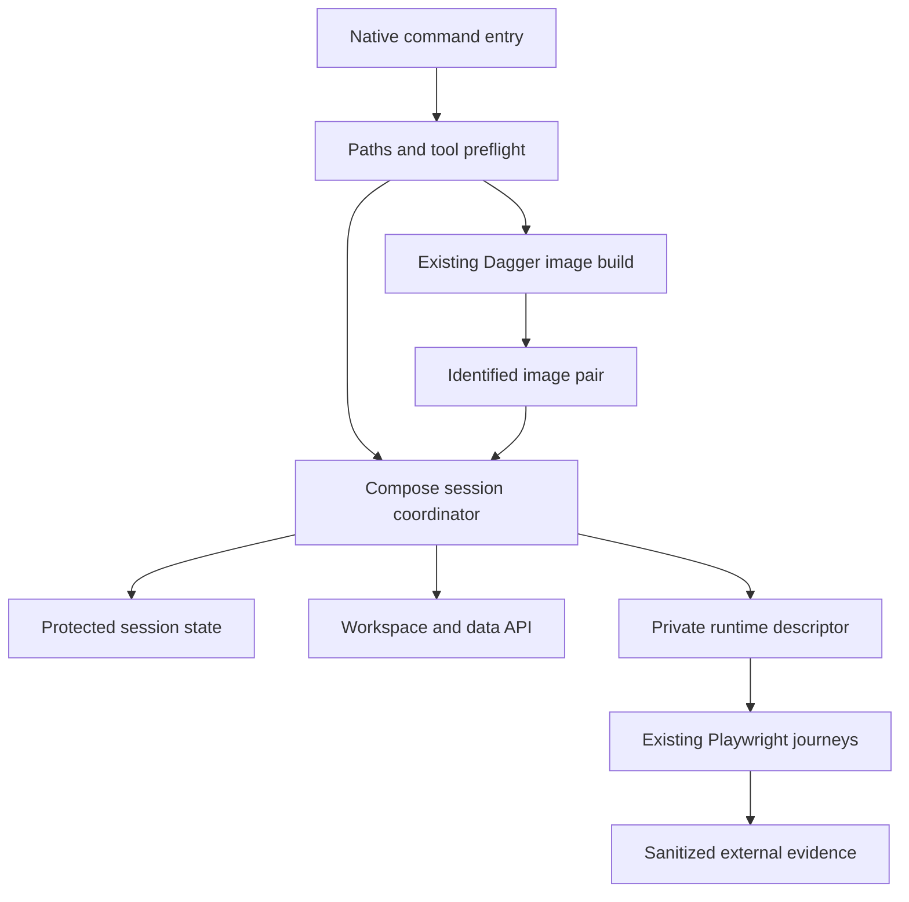

# Native development workflow design

## Overview

Run QOpenBB's existing build and verification commands from Windows with Podman's Docker-compatible interface, Compose-managed application services and isolated native Playwright. Reuse application journeys and image recipes. This is a portability change, not a new verification framework or an application release.

Requirements were approved on 2026-11-10. Integration-focused discovery found concrete Windows path, subprocess, private-state and browser-launch incompatibilities. Native Compose parsing and Dagger 0.21.11 connectivity are observed; application and pinned-build qualification remain implementation work.

### Goals and non-goals

- Make setup, image export/load, packaged runtime, browser checks, recreation and owned cleanup usable without a WSL shell.
- Preserve financial assertions, login budgets, exact source/image identity and private configuration.
- Do not change financial providers, application UI, server topology, the owner's VM backend or workstation tool wrappers. Do not introduce live provider calls into ordinary infrastructure checks.

## Boundary Commitments

### This Spec Owns

The native command entry point, portable subprocess/path adaptations, local Compose lifecycle, versioned private runtime descriptor, platform browser resolution, artifact roots, and evidence for migrated commands.

### Out of Boundary

Application changes, financial-model logic, provider expansion, publishing an application release solely for this migration, automatic VM restart/reconfiguration, and replacing historical WSL evidence. Server state remains `./data/workspace` as a bind mount; no deployment volume migration.

### Allowed Dependencies

Existing Python pipeline modules, frozen uv/pnpm locks, protected package tooling, Docker Compose, Podman, Windows security APIs, Playwright and existing financial tests. Dagger owns builds only. Verification may inspect and load built images outside Dagger. Linux CI continues to invoke the same Python modules through its shell wrapper.

### Revalidation Triggers

Changes to runtime descriptor fields, private-file protection, Compose resource identity, image IDs, browser/package versions, build CLI/engine/SDK pins or output-root semantics require their consuming checks to rerun. Financial expectations do not change with host platform.

## Architecture

Use small platform adaptations around existing commands. The runtime coordinator depends on private storage and a Compose adapter; browser tests consume a validated descriptor and never own container lifecycle. No generic runtime plugin system is needed.

Dependency direction: typed configuration and path primitives -> private storage and subprocess adapters -> build/runtime coordinators -> command entry points. Browser fixtures depend only on descriptor/output contracts. Adapters never import test-specific financial assertions.

### Technology stack

| Layer | Selection | Qualification |
| --- | --- | --- |
| Native entry | PowerShell and existing Python CLI modules | No profile aliases or WSL shell required |
| Python and JavaScript | Existing locks; Node at least approved 24.22.1, pinned pnpm/uv/Safe Chain | Noninteractive protection verified before restores |
| Runtime | Podman Desktop Docker API and Docker Compose | Record executable, daemon and Compose versions; validate effective config |
| Dagger | Preserve project CLI/SDK/engine 0.21.8 | Explicit native executable and locked engine; no wrapper substitution |
| Browser | Existing locked Playwright package and its bundled Chromium | Native platform resolution and project browser cache |

The globally installed Dagger 0.21.11 wrapper replaces the runner environment. Project builds therefore receive an explicit native 0.21.8 executable under the project artifact tool directory. Provision it with verified release checksum through the existing protection policy. A coordinated Dagger upgrade is separate; do not disable version checks. No global tool configuration is edited.

## File Structure Plan

| Files | Responsibility and ownership lane |
| --- | --- |
| `pipeline/dev.ps1` (new), `pipeline/qopenbb_ci/native_environment.py`, `container_command.py` (new) | Native command dispatch, validated artifact/tool inputs and explicit container executable; foundation lane |
| `pipeline/qopenbb_ci/session_files.py`, `windows_private_files.py` (new) | Cross-platform private storage and Windows handle/ACL implementation; foundation lane |
| `pipeline/qopenbb_ci/compose_runtime.py`, `runtime_descriptor.py` (new) | Compose orchestration and typed descriptor validation; runtime lane |
| `tests/delivery/compose.runtime.yaml` (new) | Reviewed local override template; runtime lane |
| `tests/delivery/workspace-runtime.ps1`, `workspace_runtime.py`, `task25_runtime.py` | Route current lifecycle to coordinator while retaining existing readiness and packaging assertions; runtime lane |
| `pipeline/qopenbb_ci/build_cli.py`, `image_cli.py`, `sources.py` | Explicit executable/engine/SDK parameters, Windows child environment, filesystem-normalized source identity; build lane |
| `pipeline/qopenbb_ci/images.py`, `catalog_runtime.py`, `publication.py`, `tests/delivery/test_data_runtime_image.py` | Use the shared explicit container command selection in existing load/inspect/verification/publication paths; build lane, publication behavior unchanged |
| `pipeline/tools.lock.json` | Verified native download metadata, existing version pins retained; controller-owned |
| `sources.lock.json`, `contracts/sources.json`, `.kiro/complexity-budgets.json` | Reviewed test-only Workspace fork pin and maintained-file scope promotion; controller-owned |
| `verification/runner.ts`, `runner.py`, `evidence.ts`, `playwright.config.ts`, `financial-workspace.config.ts` | Native browser resolution, entry detection, external evidence/cache paths; browser lane |
| `tests/e2e/financial-workspace.spec.mts`, `verification/runtime-descriptor.ts` (new) | Validated private descriptor bridge and external checkpoint root; preserve all behavioral assertions; browser lane |
| Owned Workspace fork `terminalpro/tests/e2e/live-chart/fixtures.ts` | Replace the shared login fixture's unchecked descriptor read with the same checked-reader contract; browser lane, isolated checkout at the accepted source pin |
| `tests/delivery/test_native_environment.py`, `test_session_files.py`, `test_compose_runtime.py` (new) | Focused portability and ownership regression tests |
| `tests/delivery/test_image_builds.py`, existing verification infrastructure tests | Extend existing image/path/browser tests; no duplicate harness |
| `.kiro/complexity-budgets.json`, `.kiro/breadth.toml`, `docs/development.md`, `docs/verification.md`, `docs/image-builds.md`, steering/testing/CI | Controller-owned inventory, commands and acceptance status |

Root `compose.yaml` remains the deployment source. Owned fork application files remain unchanged. The shared login test fixture currently reads private JSON directly and requires one explicit test-only fork delta. Apply it in an isolated checkout based on the accepted Workspace revision, review it independently, and promote its source pin through the existing controller-owned source lock and inventory process; do not overwrite the unrelated root vendor checkout. Existing live-chart configuration already accepts external package, origin and evidence paths. A test-only pin update does not claim a new application release or trigger publication.

Production helpers remain capped at 400 physical lines/file, 300 logical units/file and 50/function. Use the existing checker/inventory, not a new one. Establish native execution of that gate before accepting feature code. Test location does not exempt hand-maintained runtime logic from inventory. Preserve unrelated dirty inventory/catalog-renderer changes; controller stages only reviewed scope.

## Components and Interfaces

### Native entry and environment

Proposed entry: `pipeline/dev.ps1 -Action doctor|build|start|verify|recreate|stop -SessionPath <private descriptor>`, with explicit image references and build selection where applicable. Command help rejects arguments irrelevant to an action. It invokes real resolved executables, not profile functions, and returns the child exit code. `verify` selects existing bounded test suites; it does not rebuild images or call providers implicitly.

`resolve_environment(repository: Path, artifacts: Path) -> NativeEnvironment` validates canonical repository and output paths, rejects drive roots, and resolves tools before mutation. Windows scratch defaults to `D:/BuildArtifacts/QOpenBB`; explicit cache/temp settings are honored only when compliant with workstation rules. Conflicting settings produce a diagnostic rather than silent relocation. Subdirectories separate tools, caches, builds and per-session state/evidence. Linux CI retains its Linux filesystem paths.

The subprocess environment is an explicit allowlist: required Windows system variables, selected daemon connection variables, tool paths, configured cache/temp roots and action-specific nonsecret settings. Secrets enter only the private runtime configuration. Build children receive isolated home/config paths and no provider credentials. Python/Node subprocesses hide helper consoles; process-tree termination targets only owned children.

Container command selection is explicit: `QOPENBB_CONTAINER_CLI` identifies a resolved real executable, with Docker as the Linux default and the installed `podman.exe` as the native Windows input. Compose argv is `[container_executable, 'compose', ...arguments]`; native preflight resolves a real `docker-compose.exe` and supplies it through `PODMAN_COMPOSE_PROVIDER`. Record its version/path and preserve that setting in child environments. Do not depend on PowerShell functions or `.cmd` shell quoting in Python subprocesses. Preserve argument arrays and inspect the selected daemon connection. Existing image load/catalog/packaged helpers use this same selection rather than hardcoded `docker` commands. Dagger's container exec transport is selected explicitly for that backend (`container+podman` for native Podman); qualify the pinned CLI's support before export and reject unsupported combinations.

### Private session storage

Service contracts: `create_session(root: Path) -> SessionPaths`, `read_private(path: Path) -> RuntimeDescriptor`, `replace_private(path: Path, descriptor: RuntimeDescriptor) -> None`, `remove_private(path: Path) -> None`.

Create the Windows directory with a protected DACL at creation, owned by the current user SID with that SID as the sole allowed principal. Verify the resulting owner and DACL before writing credentials. Use Windows handle-based APIs to reject reparse points, validate final resolved paths and read the checked object without a path replacement gap. Create files exclusively; update by atomic replacement inside the protected directory. Revalidate protection on reads and removals. POSIX retains owner and 0600 semantics. Unsupported filesystems, broad/null/inherited ACLs and unknown schema versions fail closed. Privileged administrative takeover is outside this protection claim.

The storage module owns path safety; lifecycle code cannot bypass it with direct JSON reads or recursive deletion. Descriptor stdout is a sanitized projection excluding credentials, environment contents and tokens.

The sole private-data exception is an internal captured-pipe interface for browser fixtures: `session_files read --private-ipc --path <descriptor>` on the resolved Python interpreter. It performs the same handle/ACL/schema validation and returns the checked descriptor to a piped stdout, never a terminal or evidence log. `verification/runtime-descriptor.ts` invokes it with argument arrays, `shell: false`, `windowsHide: true`, captures the response in memory, validates the typed shape and exposes it only to the fixture. Error output is sanitized. Tests and shared login fixtures replace direct JSON file reads with this bridge; no second TypeScript ACL implementation is introduced. Public CLI commands continue to emit only the sanitized projection.

The controller supplies `QOPENBB_RUNTIME_READER` as the absolute path of that reviewed TypeScript module and `QOPENBB_RUNTIME_PYTHON` as the resolved native Python interpreter. The root financial test and owned-fork shared login fixture import the reader through a file URL and call `readRuntimeDescriptor(path): Promise<RuntimeDescriptor>`. Both Windows and Linux entry points supply this contract. Missing reader configuration fails before login; there is no fallback to unchecked file reads. The descriptor is not reopened by consumers after validation.

### Compose session coordinator

Service contracts: `start(request: StartRequest) -> RuntimeDescriptor`, `status(session: Path) -> RuntimeStatus`, `recreate(session: Path) -> RuntimeDescriptor`, `stop(session: Path, remove_state: bool = False) -> CleanupReport`.

Inputs include explicit Workspace/data image references, repository root, private environment path, session root and an optional loopback port. Resolve immutable image identities before startup. Compose uses explicit project name, project directory, files and environment file; ambient Compose variables and implicit `.env` selection cannot select another deployment.

The checked-in override template uses Compose `!override` to replace ports and mounts, not append them. Generated effective configuration must contain only the requested services, no build directives, a single `127.0.0.1` Workspace binding, no data API host port, and one owned bind mount at `/data`. It must not retain `0.0.0.0:23003` or repository `./data/workspace`. Require a Compose implementation supporting the template and reject unexpected merged configuration before `up -d --no-build`.

Use an owned Windows session bind directory for `/data`, preserving deployment parity and the owner's bind-mount preference. Because the daemon sees VM paths, verify translation using a nonsecret random sentinel created in the protected host directory and read through the expected container mount. Record both resolved host path and inspected daemon mount identity; do not compare spelling or trust a prefix alone. Failure to map the path blocks that run; do not switch silently to a named volume.

Readiness checks data API `/readyz`, Workspace health, Full configuration and the existing disposable account login without querying providers. Synthetic infrastructure uses clearly labeled placeholder configuration and does not claim entitlement acceptance. Existing real-data journeys retain their separate explicit provider budget/configuration.

Before side effects, persist a `prepared` descriptor with session/project identity and generated-file hashes. Transitions are `prepared -> starting -> ready -> recreating -> ready` or `failed`; cleanup ends `stopped`. Record exact discovered resource IDs as they become available. Interrupted startup can rediscover only resources matching the recorded random session label and project; fail on mismatches or unexpected resources.

Recreation preserves session name, origin, immutable image pair and the same bind state; it changes inspected container IDs and updates the descriptor only after readiness. Cleanup validates daemon connection, resource IDs, service/project/session labels and mount identity. Never run unqualified `down --volumes`, global prune or removal based on a name prefix. Stop preserves state by default; explicit state removal repeats filesystem ownership checks. Already-removed owned resources make cleanup repeatable, not a reason to target replacement resources.

### Runtime descriptor and browser adapter

Private schema version 1 includes:

| Field | Contract |
| --- | --- |
| `schema_version`, `session_id`, `backend`, `phase` | Validated version, random identity, `compose`, lifecycle phase |
| `name`, `origin`, `container` | Stable `qopenbb-browser-` session name, reachable loopback URL, current Workspace container ID |
| `credentials.email`, `credentials.password` | Disposable account, private only |
| `images.workspace`, `images.data-api` | Inspected immutable local image IDs, with manifest/config distinctions recorded separately |
| `packaged_image_only`, `source_overlay`, `release_image_verified` | Packaged acceptance requires true/null/false; local execution never asserts release verification |
| `project`, `connection`, `resources`, `state`, `compose` | Project and daemon identity, exact resource IDs/labels, verified bind mapping, config paths/hashes |

Task 4 freezes the nested version-1 contract in `pipeline/qopenbb_ci/runtime_descriptor.py`. Every field is explicit and unknown fields are rejected. `project` equals `name`; `name` is `qopenbb-browser-` followed by the 32-character hexadecimal session ID. `connection` contains `endpoint` and `identity`. `resources` contains service-keyed `containers` and a `networks` list; each resource has a full hexadecimal `id` and labels matching the session/project (and container service). `container`, when present, matches the Workspace resource ID.

`state` records an absolute `host_path`, nullable `daemon_path` and `mount_identity`, and `verified`. A verified mapping requires both identities. `compose` records an absolute `project_directory`, at least one file `{path, sha256}`, and an `environment_file` with the same shape. Paths are checked lexically by the schema; filesystem and daemon ownership remain the coordinator's responsibility.

Both `images` and `image_metadata` contain exactly `workspace` and `data-api`. Each metadata entry has a `config_digest` agreeing with its local image ID and a nullable `manifest_digest`; these facts do not assert registry verification. Before readiness, origin/container/credentials may be null. `ready` requires a canonical HTTP loopback origin, credentials, both container resources, a network and verified state mapping. Lifecycle transitions remain the coordinator's responsibility.

Private IPC uses `python -m qopenbb_ci.session_files read --private-ipc --path <descriptor>`. The storage layer reads checked bytes; the descriptor module validates them before output. Private mode requires a pipe, rejecting terminals and regular-file redirection. Public mode returns only version/session/backend/phase/name/origin, image IDs and the packaged/source/release flags. It omits credentials, paths, connection details and resource/configuration contents. Typed replacement validates the complete descriptor before the atomic storage update. Legacy descriptors receive no unchecked fallback.

The browser receives `WORKSPACE_FRONTEND_ORIGIN`, the private descriptor path, `WORKSPACE_EVIDENCE_ROOT` and the resolved Playwright package/browser-cache settings. Existing fixtures retain their loopback restriction. Checkpoints stay within the owned external evidence root and preserve exclusive initial creation and image/name/container-change assertions. Historical legacy descriptors are not silently upgraded; recreate a disposable session with the new producer. Historical read-only evidence remains available.

Playwright uses its installed package's browser resolution instead of a Linux executable suffix. Keep Chromium CDP diagnostics, one worker initially, zero retries in application journeys, fresh contexts and existing login budget. No automatic screenshots/traces during credential entry. Explicit financial chart screenshots occur after authentication. Preserve failure signals and mask sensitive headers/query values before evidence export.

### Build adaptation

`build_cli` forwards `--dagger-cli`, `--engine-container` and existing `--sdk-python` to `image_cli`. The same resolved executable serves version checks and execution. Native invocation supplies a real pinned `dagger.exe`, bypassing the workstation `.cmd` wrapper; Linux defaults remain compatible.

Use the existing owned engine-container path with exact locked engine-image checks through the Podman Docker-compatible API. Qualify CLI/SDK/engine identity before and after export; if unsupported, fail with evidence instead of substituting an unpinned engine. Source validation compares normalized filesystem identities while retaining origin/revision/dirty-tree guards. Frozen dependencies and existing image recipes remain authoritative. Source staging, archive inspection/loading and publication remain portable commands outside Dagger.

## Requirements Traceability

| Requirement | Components and interface | Acceptance flow |
| --- | --- | --- |
| 1.1, 1.2, 1.3 | Native entry/environment, explicit tool inputs | Doctor, native command success/failure |
| 2.1, 2.2 | Compose coordinator/config validation/descriptor | Start exact image pair, readiness and loopback |
| 2.3, 2.4, 2.5 | Recreate/stop, protected storage, resource identity | Retained state, interrupted startup, owned cleanup |
| 3.1, 3.2, 3.3, 3.4 | Browser adapter and existing journeys | Isolated Chromium, meaningful UI assertions and sanitized failures |
| 4.1, 4.2, 4.3, 4.4 | Build adapter, locked engine, Compose runtime | Exact export/load identities; Linux CI and pull-only compatibility |
| 5.1, 5.2, 5.3 | Environment and output contract | Root rejection, compliant caches, secret-free logs |
| 5.4, 5.5 | Private storage and typed descriptor | Owner/ACL/handle validation and fail-closed mutations |
| 6.1, 6.2, 6.3, 6.4 | Controller verification/evidence/inventory | Native evidence, breadth links, docs, independent review and caps |

## Error Handling

Preflight failures report the missing tool/version/path with no service mutation. Configuration, ACL or ownership failures stop before unsafe writes/deletes. Service failures retain a protected descriptor and sanitized logs with exact exit codes. Browser failures preserve evidence and fail the job. No unbounded retry, automatic VM restart, rate-limit bypass or silent backend substitution is permitted. Partial cleanup reports remaining owned resources without touching uncertain ones.

## Testing Strategy

- Foundation: native command invocation without profile, safe-chain verification before frozen restores, required environment preservation, paths containing spaces, root/outside-root/junction rejection, exclusive create, wrong owner/broad ACL rejection and interrupted atomic update. Extend existing source identity/build tests rather than copy them.
- Compose: inspect effective config for accidental public binding/state merge, wrong daemon or labels, changed images/resources, partial startup, repeatable cleanup and retained-state recreation. Run real Podman mapping/ACL checks in addition to mocked regressions; mocks cannot certify host behavior.
- Browser: reuse synthetic infrastructure success/failure and diagnostic cases, then existing financial Workspace name/symbol selection, displayed values, linked refresh, independent comparison, save/reopen and fresh-login recreation assertions. Update path guards, not assertions. Separate provider-backed cases from offline infrastructure.
- Build: first one foundation export/load qualifies the pinned native CLI/SDK/engine and provenance path; then build the actual Workspace/data pair once for complete migration acceptance. Verify exact image/module identities with existing packaged smoke checks. No publication is required for this infrastructure migration.
- Linux compatibility: run affected portable tests and the existing Linux verification entry point in CI without changing application deployment. A local Windows pass alone cannot establish Linux compatibility.

One heavy build or suite at a time; bounded xdist at two, browser workers initially one. Independent reviews inspect fresh evidence. Retain one concise public acceptance record and only useful sanitized screenshots; raw downloads/logs/private state remain external. Check actual test paths in breadth and inventory before claiming completion.

## Migration Strategy and Parallel Boundaries

1. Foundation freezes descriptor/output/CLI contracts and establishes native protected tools and complexity checks.
2. Sol runtime and browser workers implement disjoint paths against those contracts. Controller owns shared schema/lock/inventory edits.
3. Sol build worker performs native build adaptation; serialize its heavy qualification with runtime acceptance. Astra reviews integration and private-state ownership; routine focused tasks receive independent Sol review.
4. Controller joins existing packaged and browser checks, updates docs and breadth, syncs sanitized evidence and makes per-task commits. Luna may audit links/checklists but cannot accept complex behavior alone.

Design approval precedes executable task generation. Task approval precedes implementation. Keep historical scripts/evidence identifiable; current native entry points cannot fall back to WSL. Qualification failures remain explicit blockers for the affected lane, not permission to weaken checks or widen scope.
