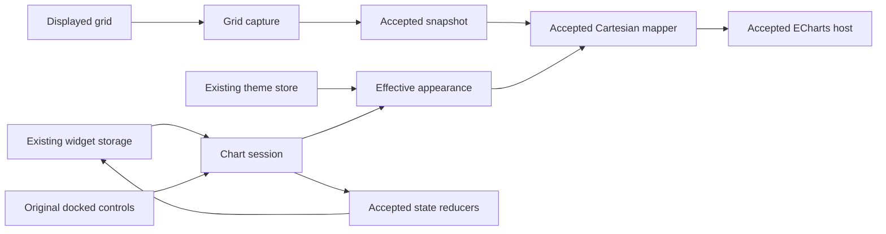

# Connect charts to the existing Workspace journey

## Overview

Proposed next design for human review, 2026-10-17. Connect the accepted chart modules to a real ordinary table journey: select observations, enter chart view, edit through the original docked settings surface, change theme, export, save, reopen and return to the same table. This is an intermediate integration milestone toward the complete original Workspace experience. It does not establish three-family release parity or approve implementation tasks.

Requirements 4.8 and 4.9 remain the controlling scope. The original reference is Workspace `38dffc33389aca0e4a87e0e88d42f7067aa220df`; inspected candidate HEAD is `f23cb786a946a6a996deedbe87be9c7ca86b221e`. Task generation must record the actual working-tree manifest as well as HEAD, because concurrent repair work can change that tree. [spec.json](spec.json) owns approval state. No approval fields are changed by this document.

## Goals and boundary commitments

The next cohesive implementation boundary owns actual displayed-grid capture, effective appearance for the admitted ordinary Cartesian journey, existing entry/action wiring, the docked Chart/Set Up/Customize compatibility surface and existing state persistence composition. It reuses ECharts 6.0.0 and the accepted snapshot, reducers, option-state helpers and host. It adds no package, service, feature flag, toolbar, storage envelope or second state owner.

The first acceptance fixture exercises groupedColumn, stackedColumn and line with one category and homogeneous explicitly identified numeric units. This bounds the evidence; it does not bound the product menu. All original chart choices, controls and original visibility predicates remain obligations. A partially implemented editor must not be promoted or accepted by hiding choices, disabling buttons, rendering an unavailable result, silently falling back to another family or gating functionality behind a new flag. Integration work remains unreleased until the full capability matrix passes, or the owner explicitly approves a concrete deviation. Any selection outside the admitted mapper must preserve its original state and be recorded as an unfinished parity defect. It cannot count as successful behavior.

Detached charts, AI chart artifacts, other chart families, aggregated/pivot/transpose/remote-page journeys, advanced table capabilities and the entity theme preview replacement retain their existing acceptance obligations in [the capability matrix](../../../docs/renderer-capability-matrix.md). This boundary does not replace their contracts or claim them complete. Existing Plotly widgets retain their current path. SQLite repair is independently accepted through task 4.9; this design neither repeats it nor treats its CRUD evidence as browser persistence evidence.

## Evidence and design-freeze prerequisites

Accepted [snapshot](chart-snapshot-design.md), [option-state](chart-option-state-design.md) and [appearance](chart-appearance-design.md) designs establish pure data/state contracts and explicit three-family rendering. Their isolated fixtures do not exercise the application. Current source still has `createChartData = undefined`, `ChartViewButton` returning null, an unavailable `ChartViewElement`, empty settings hooks, forced `chartView = false` callers and saved-chart rejection in `communityBoundary.ts`. Removing just one guard cannot establish a working journey.

The [original editor contract](echarts-editor-contract.md) establishes one dark column panel and selected real edits. [Theme findings](chart-theme-runtime-findings.md) establish settled effective defaults for one dark grouped-column fixture only, including separate fill/stroke colors, Verdana labels, 20px padding and legend geometry. Seven outgoing payloads establish stored field paths, not reopen behavior. An original screenshot with two HTML-as-JavaScript errors is not clean application acceptance.

Subsequent [stock matrix captures](chart-theme-matrix-findings.md) cover dark/light grouped-column, stacked-column and line through original UI transitions. They close the six stock-default observations, while custom themes, expanded editor fields and range effects remain open. Per-case attempt mapping preserves earlier selector/projection failures; original script-route diagnostics remain recorded. These captures do not establish candidate parity or backend persistence.

Before freezing runtime tasks, obtain the following finite original-reference evidence in the controller's exclusive heavy queue. This document supplies the capture contract; it does not claim the captures ran.

| Required observation | Record and design consequence |
| --- | --- |
| Three families in stock dark/light, plus one saved valid custom theme in both modes | Theme inputs, generated common/family overrides, finite settled effective leaves, screenshots and series IDs. Freeze exact precedence and palette assignment; never substitute a generic JSON merge for AG inheritance. |
| Chart/Set Up/Customize in each family | Actual labels, defaults, ordering, conditional fields, keyboard focus, scroll/close/reopen behavior and original payload deltas. Existing public enum declarations do not establish rendered field completeness. |
| Set Up category/series selection, reorder, Aggregate and Switch Category / Series | Source/destination ranges, visible results and stored model. Identify which effects need later transformations; no control can be accepted as inert. |
| Title off/on with retained text, four legend positions, separate fill/stroke, marker toggle and details | Both drawn effect and outgoing original state; distinguish column `bar` and line namespaces. Enabled marker shapes beyond circle need implementation or remain a blocker. |
| Filter/sort/selection, widget refresh, family switching and return to table | Original displayed range, order, column widths and selection, including repeated categories and duplicate labels. |
| Export and save/reopen | Actual menu action, downloaded content, saved model, reopen state and theme; a request body alone is insufficient. |

Capture source/image identities, fixture digest, viewport, original flags, console/network diagnostics and sanitized outgoing state. Use the established reference-only processed-options projection after `waitForUpdate`; never import private AG APIs or commercial editor internals into production. Explain the two known original script errors by route before claiming a clean journey. If captures contradict the proposed contracts, return the affected seam for review before worker fan-out. Missing light/custom inheritance, nested controls and formatter behavior are explicit design-freeze risks, not assumed defaults.

## Architecture

Dependency direction is legacy types and accepted pure contracts -> capture/style adapters -> session composition -> existing React entry and editor. Pure adapters do not import stores or React. Only grid capture imports GridApi. Only session composition reads widget/theme contexts and invokes storage actions. Host and mapper do not fetch data or write state. Adopt existing primitives and state paths; build only the compatibility seams that the removed enterprise renderer/editor previously supplied.

## Components and interfaces

All proposed interfaces use explicit types; unknown external models enter validation as `unknown`, never `any`. The contract-freeze task defines these in `Chart/application/types.ts` with imports from accepted types. P0 dependencies are grid readiness, captured address, provider/column unit metadata, original capture evidence and accepted reducer semantics. Accepted SQLite tasks 4.6-4.9 satisfy the storage prerequisite for the persistence join; actual application save/restart/reopen remains unverified.

### Displayed-grid capture: 4.8, 4.9

`captureDisplayedChart(input: GridCaptureInput): GridCaptureResult` returns `{status:"captured", input:ResolvedSnapshotInput}` or `{status:"invalid"|"unresolved", diagnostics:readonly SnapshotDiagnostic[]}`. GridCaptureInput contains the actual grid API, captured stateAddress/dataRevision, ordered selected column IDs, resolved category ID, original model/range and column semantic descriptors. It is not a bag of raw provider rows.

Capture snapshots the displayed filtered/sorted leaf observations in original selected-range bounds after pending column state is flushed. Read raw numeric values through the original grid value semantics, never formatted strings or DOM text. Do not use `rowData:null` from createRangeChart as data. Duplicate category labels retain distinct stable row IDs; display labels never key series. Hidden columns, selected order and original range resolution follow the reference path. A refresh invalidates the old capture; results from an earlier address/revision cannot overwrite the current session.

The [source range contract](chart-grid-range-contract.md) distinguishes integrated and detached inputs. The ordinary integrated path keeps the existing grid and forwards ordered displayed columns plus addressed stored ranges to AG Grid; it does not run the detached extraction pipeline. Detached percent formatting, date re-sorting and recreation omissions cannot be imported into this adapter as integrated behavior. Numeric-only selection, multiple candidate categories, value getters and tool-panel reorder/aggregation still require original runtime observations before freezing capture semantics.

Preserve zero, null, missing, negative and fractional values without rounding or conversion. Unit and positive scale come from explicit widget/column provenance; currency symbols in labels do not establish them. Missing or mixed units cannot be guessed as USD/dimensionless or certified by a synthetic same-unit fixture. The current mapper rejects such input; production unit inference and mixed-axis support remain explicit release blockers until evidenced. Group/pivot/transpose and remote-page data must retain sourceMode truth rather than be relabelled flat. Ordinary filtered/sorted flat observations remain flat with their range/filter provenance retained in existing snapshot JSON metadata.

### Effective appearance: 4.8, 4.9

`resolveApplicationAppearance(input: AppearanceInput): AppearanceResult` returns `{status:"resolved", style:ResolvedCartesianStyle}` or `{status:"invalid"|"unresolved", diagnostics:readonly SnapshotDiagnostic[]}`. Input contains active mode, selected original stock/custom theme, validated stored baseline, generated original defaults, family, ordered stable series IDs and formatting context. Store addresses are not decoded inside the resolver.

Freeze a source-and-capture-backed finite precedence table before implementation: original base theme and custom theme parameters, generated defaults/common replacement, then effective common/family/per-series leaves in the original order. Keep default AG palette, distinct-category palette and global theme-editor palette separate. Do not copy AG's resolver, execute arbitrary saved callbacks or claim getOptions supplies inherited defaults. Unknown valid stored fields are retained; unmapped effective fields remain explicit evidence gaps.

The existing mapper lacks padding, detailed legend geometry, axis titles/grid/crosshair, tooltip formatting, subtitle and other visible control projections. Add only the explicit typed fields required by captured controls, in cohesive appearance/formatting modules, with provenance and ECharts public projection. A mapper-only style change cannot certify panel behavior. Financial formatting preserves original fiscal dates, magnitudes, precision and units for display without altering observations. A precision integer alone is insufficient. Background images, distinct-datum colors, navigator and mini-chart remain required features; default-off fixtures do not verify their enabled behavior.

### Session, editor and original state: 4.8, 4.9

`useApplicationChartSession(input: ChartSessionInput): ChartSession` composes the current widget partition, grid capture, resolved appearance, existing reducers and host handle. ChartSession exposes validated current view, captured address, pending/error status and typed original actions; it does not create a parallel persistence store. Event envelopes capture address and render generation at event creation. A monotonically increasing render revision orders data, theme, family and settings updates independently of dataRevision. Async stale work is discarded before rendering or writes. Unmount disposes the host and closes owned listeners.

Original family switching resolves destination range/model before capture and reducer invocation; it cannot simply change the ECharts series type. Integrated options use accepted merge/root-theme-stripping semantics. Detached full-event replacement remains separate and is not accidentally fed a patch. Option baselines preserve inactive family fields and the populated-to-empty partition behavior already accepted. Stored schema and save scheduling stay unchanged; use the verified explicit save action for bounded acceptance.

ChartViewButton and ChartViewElement remain the existing entry points. Reconnect useTableContext and existing table/file callers together with their settings/close/export actions. The docked compatibility editor uses the original three tabs, geometry and existing design-system inputs, switches, colors, spacing and font controls. It has no ECharts toolbox. Keep originally suppressed internal toolbar/save icons suppressed, and keep external widget exports working. Preserve existing conditional predicates, including forecast-specific settings visibility, rather than introducing capability predicates.

Editor events produce narrow original-model patches through typed family field modules. Existing column patch helpers remain authoritative for their four captured leaves; new fields require an observed namespace and complete tests. Control render state and rendered chart use the same effective baseline. The close chevron, persisted chartSettingsOpen, focus restoration and reopen scroll/selection follow the captured original path. Runtime failures preserve saved data and permit retry/return to table using existing application error conventions; a retained last-good render must identify stale data and cannot count as successful current output.

The control ledger below distinguishes exact known work from missing contracts. A field cannot be marked complete merely because its parent group opens.

| Original surface | Required editable behavior | Current contract status |
| --- | --- | --- |
| Chart | All original family thumbnails, active selection, destination range and model | Group tokens inventoried; complete family mappings remain outside first journey acceptance and block release. |
| Set Up | Categories, Aggregate, numeric series selection/order, Switch Category / Series | Dark controls observed; edit payloads, ranges and aggregate effects require capture before corresponding field tasks. |
| Chart Style | Four paddings, background enabled/color | Dark values observed; mapper fields and event patches missing. |
| Titles | Chart title, subtitle, horizontal and vertical title enabled/text/font/weight/size/color/spacing | Column title text/enabled patches accepted; line text/enabled captured. Remaining exact patches, font-weight representation and projections require freeze. |
| Legend | Enabled, font/weight/size/color, four positions, spacing, marker size/stroke, item/horizontal/vertical spacing | Column position patch accepted; other fields need captured patches and explicit geometry projection. |
| Series | Tooltips and mode, stroke width, dash, fill/line opacity, labels, shadow; line markers and missing-data semantics | Column width patch and selected line marker evidence exist; remaining conditional fields and namespaces require capture. No invented Connect Missing Data control. |
| Horizontal and Vertical Axis | Full original nested field list, labels, titles, formatting and grid effects | Expanded reference inventories exist, but nested exploration is incomplete. Attach a flattened visible/conditional-field ledger before editor tasks; group headings are insufficient. |
| External actions | Chart settings, close, quick fills, export, table return and original conditional actions | Current hooks stubs; actual visibility predicates and resulting state/export effects must be restored and tested. |

Each ledger row expands into captured field ID/label, family condition, value domain, original patch path, effective render leaf and concrete test ID at contract freeze. This is the minimum executable handoff for lane C; no guessed nested field list is authorized here.

## File structure and complexity disposition

Paths below are relative to `vendor/workspace/terminalpro/src/components/`. Counts were measured on 2026-10-17 using direct physical counts and the existing syntax-units parser under WSL pinned Node 24.22.0. The first Windows attempt could not resolve TypeScript; switching to the already installed WSL toolchain succeeded without installation. This is read-only size evidence, not a fresh full complexity scope gate. Existing checker/inventory foundations are reused.

| Existing file | Current physical | Original physical | Cohesive disposition |
| --- | ---: | ---: | --- |
| General/Table/hooks/useTableContext.tsx | 256 | 796 | Keep context composition; extract chart-session hookup into Chart/application/useApplicationChartSession.ts. Never paste the original 796-line file back. |
| General/Table/Chart/hooks/useChartOptions.tsx | 143 | 517 | Retain public hooks; session state, action construction and field decoding have separate responsibilities/modules. |
| General/Table/Chart/utils.tsx | 292 | 690 | Preserve formatting semantics in application/financialFormatting.ts; capture/range resolution belong in application/gridCapture.ts and application/chartRange.ts. |
| General/Table/Chart/themes.tsx | 310 | 373 | Keep existing theme selection; resolve finite effective leaves in application/effectiveAppearance.ts. |
| General/Table/Chart/AgChartView.tsx | 47 | not measured | Existing entry composition only; editor fields live under Chart/editor/. |
| General/Table/communityBoundary.ts | 155 | not measured | Integration owner removes chart-specific rejection only with joined behavior; unrelated table guards remain separate parity gaps. |
| General/Table/AgGrid.tsx | 79 | not measured | Existing grid setup; no copied enterprise registration. |
| ThemeSettings/ChartSettings.tsx | 31 | 1185 | Already extracted into controls/state/preview modules. Do not restore the original monolith; preview replacement is a later owned join. |

Current physical/logical/maximum-function counts are: context 256/97/16; chart utils 292/111/33; themes 310/103/15; option hooks 143/41/12; chart entry 47/20/4; community boundary 155/65/23; AgGrid 79/21/3; AgGridTable 333/101/17; AgGridFile 279/106/21; ThemeSettings entry 31/14/4; Cartesian mapper 223/72/14; style projection 278/112/17. Declaration-only hooks/types.d.ts is 146/78 and cartesianTypes.ts 108/76, with no measured callable body. Detailed callable records and input paths are retained in `artifacts/chart-application-design/syntax.json` and `paths.json`. None of these current files exceeds a cap; blindly restoring original monoliths would.

Before task acceptance, run the existing pinned checker against the actual changed-file manifest and updated inventory as whole files. New and modified production files must pass 400 physical, 300 logical and 50/function. No new exception is proposed. If extraction cannot achieve these caps without a broader change, return a specific measured exception for review; do not assume upstream grandfathering. Controller updates inventory ownership before adding files and runs the final shared-module audit.

## Dependency fan-out and joins

This is a design sequence for later task generation, not an approved task list. Freeze exact contracts, captures, fixtures, changed-source baseline and complexity scope first. Give each worker one bounded task, frozen input hashes, the exercised command from [complexity checks](../../../docs/complexity.md), caps and original/candidate acceptance criteria. At most controller plus two Sol implementers and one Astra reviewer; one heavy check at a time.

| Lane | Exclusive writable production paths | Prerequisite and output |
| --- | --- | --- |
| Controller contract freeze | Chart/application/types.ts; root inventory/breadth/spec records; shared test configuration | Reference captures and size inventory; freeze signatures, event namespaces, fixture semantics and source hashes. |
| A: displayed observations | Chart/application/gridCapture.ts, chartRange.ts; corresponding new unit files | Frozen contracts; validated snapshots from real GridApi with financial/range tests. No edits to context hooks. |
| B: effective appearance | Chart/application/effectiveAppearance.ts, financialFormatting.ts; corresponding new unit files | Frozen captured theme/formatter contract; explicit resolved styles. No mapper/type edits during fan-out. |
| Controller mapper join | Chart/echarts/cartesianTypes.ts, cartesianStyle.ts, cartesian.ts and any reviewed cohesive extracted projection module | A/B independently reviewed; add frozen explicit projections without breaking accepted observations. |
| C: docked fields | Chart/editor/** and new editor unit/component files only | Captured complete field inventory and frozen event contracts; working original field groups. Sequential bounded family/group tasks, not one unbounded editor rewrite. |
| D: application composition | Chart/application/useApplicationChartSession.ts; Chart/AgChartView.tsx; Chart/hooks/useChartOptions.tsx; General/Table/hooks/useTableContext.tsx, hooks/types.d.ts; General/Table/AgGridTable.tsx, AgGridFile.tsx, communityBoundary.ts | Reviewed A/B and mapper join; C may overlap only after props/events freeze. This lane alone removes chart stubs/guards and reconnects current callers. |
| Controller real-app join | tests/e2e/chart-application/**; root test registration, evidence mapping and source pins | C/D independent reviews plus accepted SQLite repair; real application verification and selective commits. |

Do not concurrently assign a path to two lanes. Freeze workers before shared joins/commits; stop affected lanes on interface drift. Table/file caller growth may require additional cohesive extraction after measured inventory. Entity theme preview, detached charts and other families receive their own explicit later writable paths and joins rather than being swept into D. No Excel lane starts before Anthropic acceptance.

## Requirements traceability and acceptance

| Requirement | Contribution | Observable boundary |
| --- | --- | --- |
| 4.8, 4.9 | Original ordinary table chart UX, controls and themes | Reference/candidate real-app comparisons and actual outcomes; full matrix remains open. |
| 4.2, 4.7 | Original chart state persisted without schema migration | Actual save, dashboard reopen and disposable environment restart, using the accepted SQLite repair. |
| 10.1-10.4 | Isolated bounded application verification | Owned headless profile, one browser worker, CDP evidence and controlled heavy queue. |
| 10.5, 10.6 | Evidence traceability | Actual implemented tests and revision/image/artifact links in breadth; planned paths remain unverified. |

Proposed new maintained tests live in `tests/unit/chart-application/` and `tests/e2e/chart-application/` under terminalpro; these are planned paths, not present passing tests. Controller registers actual runners only after implementation. Retain existing accepted chart units/browser fixtures; run strict TypeScript, lint and whole-file complexity with explicit fork scope. Application acceptance must target the real Full Workspace route and actual contexts, not a synthetic standalone React mount.

The real-app case creates a disposable ordinary table/dashboard with independently specified USD-million Revenue and Operating Income observations, repeated category labels, zero/negative/fractional values and an interior null. Assert displayed rows and exact mapper arrays before and after selection, filter/sort, refresh and family changes. Add a separate missing-cell case and explicit unit-unknown/mixed-unit contract checks. Synthetic provenance must be labelled; it does not certify production FMP/FRED metadata or live results.

At fixed viewport compare original/candidate light and dark captures for shell, padding, typography, legends, axes, tooltips, focus and docked controls. Add saved custom-theme edit/preview/save/reset checks when that existing surface is joined; an ordinary chart theme switch alone does not certify theme-editor preview replacement. Every exercised control must change the expected rendered result and exact stored fields. Assert title retention, independent colors, series reorder identity, marker/null behavior and chart-to-table column/selection restoration. Download/export assertions inspect resulting content and image, not a toast or successful handler.

Save through the existing explicit action; inspect the response, close/reopen the dashboard, then restart the disposable environment and sign in again. Assert selected range, family, inactive-family options, theme and settings-open state according to the original path, together with displayed values. Engine recreation and outgoing POST alone are insufficient. Test failed save, render failure and recovery without lost state or duplicate listeners. Record console/network failures by route, source/image digest, command, exit status and artifact hashes; sanitize account/provider material.

## Decision and remaining risks

The next useful change is an integrated journey, rather than another disconnected mapper foundation. The design adopts the accepted host/state contracts and existing UI primitives while making actual grid observations and effective original appearance explicit. It is disproved if selection changes financial observations, controls require altered visibility predicates, saved options cannot round-trip, or matched original/candidate captures reveal unexplained visible differences.

Human review can assess this boundary now. Runtime task freeze still requires the finite reference captures and complete whole-file logical/function inventory above. Full nested editor compatibility and remaining families may exceed a single implementation wave; they must be decomposed without shrinking the final UX. No claim of application, release, new design approval or task approval is made here.

Supporting findings: [grid discovery](chart-next-discovery.md), [effective styles](chart-effective-style-discovery.md), [theme runtime](chart-theme-runtime-findings.md), [editor contract](echarts-editor-contract.md), [completion plan](../../../docs/completion-plan.md). Design follows the local kiro-spec-design extension, boundary, synthesis and dependency rules. Core product.md, tech.md and structure.md steering files are absent; the applicable workspace, complexity, testing, delegation, documentation and CI policies were read instead. Research synthesis is kept in this owned design because the shared research.md is outside this lane's writable scope.
