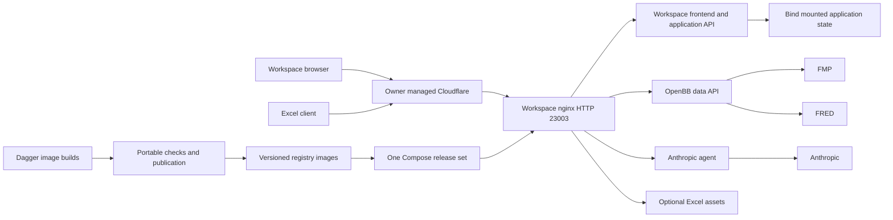
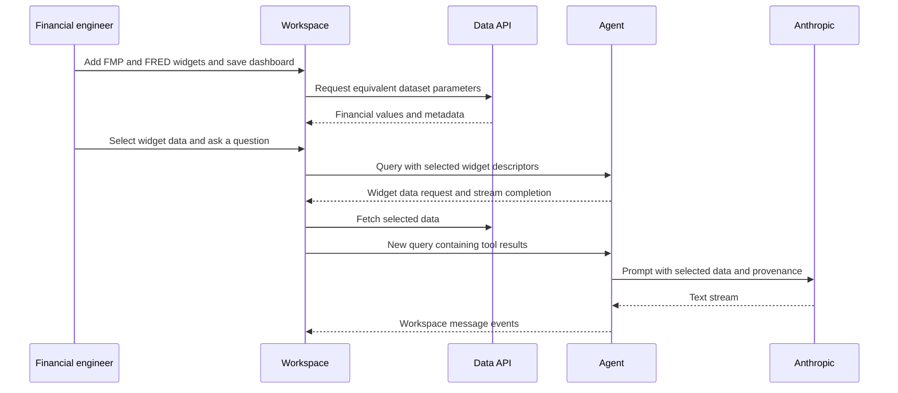

# QOpenBB technical design

## Overview

Owner-approved design, 2026-10-17: [explicit Cartesian appearance](chart-appearance-design.md) passed independent Astra review. It adds resolved fill/stroke, title visibility, typography and line gap/marker semantics without changing numerical mapping or activating application callers. [Original line findings](chart-line-appearance-findings.md) explain the evidence and limits. Tasks 2.28-2.33 passed independent task-graph review and received owner implementation approval.

Current slice: the [original option-state design](chart-option-state-design.md) passed independent Astra review and received owner approval for autonomous implementation. It specifies baseline initialization/partition transitions and captured column-editor patches with existing reducers. See [verification status](chart-option-state-verification.md). Effective styling, editor UI and application activation remain outside this bounded slice.

Next slice, 2026-10-16: the [snapshot and Cartesian mapping design](chart-snapshot-design.md) passed independent Astra review after one repair pass and received owner design approval. It is isolated development scope, with no application activation or reduction of final parity requirements. [Discovery findings](chart-next-discovery.md) separately record the grid and SQLite contracts.

Bounded foundation approval, 2026-10-16: the owner approved only the [state-reducer and ECharts lifecycle foundation](echarts-integration-proposal.md#first-production-boundary-for-separate-review). That section is the authoritative design for its scoped tasks and overrides conflicting earlier renderer clauses within that boundary. Application call-site/guard changes, editor UI, chart mappings and full renderer/release acceptance remain excluded. The rest of the renderer amendment remains in discovery.

Owner parity amendment, 2026-10-16: requirements 4.8-4.9 supersede the reduced-capability renderer design below. Perspective remains the selected candidate library, but exposing its native UX or hiding unsupported OpenBB actions is not an accepted integration design. Preserve the original interface, feature flags and working outcomes through compatibility adapters. Renderer implementation is paused for source capability inventory and design/task reconciliation; prior task evidence remains historical. See [Workspace experience](../../steering/workspace-experience.md). No parity implementation or feasibility acceptance is implied by this amendment.

QOpenBB gives financial engineers an owned Full Workspace with FMP and FRED dashboards, then Anthropic assistance and Excel functions using the same self-hosted data API. This design turns the feasibility findings into one versioned integration and release contract. It does not claim that the proposed images, adapters, tests or deployment already exist.

The owner approved requirements and progression into design on 2026-10-16. Core `product.md`, `tech.md` and `structure.md` steering files are absent; the approved requirements, documentation, complexity, testing, CI and delegation steering provide the project constraints used here. Design approval, task generation and implementation acceptance remain separate gates.

On 2026-10-16 the owner selected "Use Perspective baseline". Perspective becomes the primary analytical viewer for the accepted FMP/FRED datasets inside the existing Full dashboard. This amendment authorizes that integration direction; independent amendment review precedes renderer feature work, and implementation/runtime acceptance remain unverified. The [renderer assessment](../../../docs/chart-replacement-assessment.md) records the source findings and alternatives.

### Goals

- Prove the financial journey: discover widgets, build a mixed FMP/FRED dashboard, save, restart, reopen and refresh without changing financial meaning.
- Build from owned, pinned sources through Dagger image builds; install the same images on WSL and Linux through one Compose entry point.
- Accept a streamed Anthropic answer grounded in selected dashboard data before any Excel implementation work.
- Preserve consumer contracts, state recovery and honest passing/failing/untested evidence across releases.

### Non-Goals

No Jupyter, wheel-distribution service, PostgreSQL connector, data warehouse, replacement frontend or recreation of unavailable hosted OpenBB services. Cloudflare Access, cloudflared, origin network restrictions and client-facing TLS are owner-managed inputs. Origin TLS and tunnel lifecycle are not application responsibilities.

## Boundary Commitments

### This Spec Owns

- One baseline release set: Full Workspace adaptation, maintained FMP integration in the data API, stateless Anthropic agent, and later Excel artifacts.
- API-to-widget-to-Excel compatibility, origin routing, application state persistence, build provenance, acceptance evidence and recovery instructions.
- Small changes to the owned forks; QOpenBB owns orchestration and new agent/runtime glue. Upstream financial schemas and application storage remain authoritative in their respective components.
- A reusable Perspective explorer, Community-compatible residual tables, and removal of all AG Enterprise and Highcharts runtime/dependency paths. Existing Plotly widgets remain complementary; QOpenBB does not recreate every legacy grid feature or chart model.

### Out of Boundary

Provider subscription entitlements and data publication schedules, Office installation and licensing, third-party chart entitlements, public DNS and Cloudflare policy management are external inputs. A later PostgreSQL connector must consume the published data-connector seam and must not change this baseline's application-state database.

### Allowed Dependencies

Only recorded owner-controlled source revisions supply Workspace and OpenBB application code. Public registries supply locked dependencies, with retained licenses/notices. Runtime outbound calls are to configured FMP, FRED and Anthropic services, plus resources required by the selected Office client. No dependency on former hosted OpenBB credentials or private split repositories is accepted silently.

Local dependency direction is schema/types -> configuration -> provider/client adapters -> service handlers -> process entry points. UI consumers call published APIs; data-provider code does not import Workspace or Excel logic. Dagger depends only on the source and image-build contracts. Portable CI commands own checks and publication; runtime code never imports delivery code. The agent receives selected data through the Workspace protocol, not direct access to application SQLite or provider keys.

### Revalidation Triggers

Changing source revisions, dependency locks, API routes, widget identifiers, financial metadata, authentication, model ID, origin paths, image topology or state format invalidates the relevant evidence. Schema/widget changes require consumer compatibility checks; application schema changes require restore/rollback checks; agent contract or model changes invalidate Anthropic acceptance. An Excel change does not require changing the provider contract merely to suit a generator.

All components share one end-to-end baseline and release acceptance boundary. Separate ownership lanes are implementation seams, not independently accepted products. PostgreSQL remains a separate future spec.

## Architecture

### Existing Architecture Analysis

Retain the Workspace monorepo's Full variant of the combined frontend, application backend, nginx, Redis and SQLite image. Full frontend flags do not imply available hosted catalogs or AI services. The supplied frontend recipe references an absent npm lock although `bun.lock` exists; replace that install step with a pinned Bun frozen-lock installation. Preserve pinned backend dependencies without a build-time lock rewrite. Assemble from the owned monorepo rather than fetching unavailable split repositories.

The current data acquisition snapshot declares OpenBB 5.0.0/core 2.0.1. It is not yet a validated release. Select the latest release available at the implementation foundation gate, port FMP against it, and lock the complete dependency set. FMP 1.6.1 cannot resolve unchanged with core 2. Keep its license and upstream provenance when restoring/adapting it in the owned data fork. Do not interpret a dependency constraint edit as runtime acceptance.

### Architecture Pattern & Boundary Map

Local development accesses the same origin directly at `http://localhost:23003`. Only Workspace publishes a host port. The data API and agent are internal services; Excel is an optional profile. The agent is independent of application health: its failure must not prevent dashboard use. Retain the existing gateway rather than add a separate proxy service or authentication product.

### Technology Stack

| Layer | Choice and version contract | Role |
| --- | --- | --- |
| Workspace | Owned Full monorepo; Node compatible with its locked Vite; pinned Bun and Python 3.13 base digests | Existing frontend/application backend and state |
| Analytical viewer | Compatible exact Perspective release and plugins under `@perspective-dev/*`, eligible under Safe Chain's package-age policy; Community AG Grid and existing Plotly retained where supported | Browser worker/WASM exploration, residual flat tables and complementary charts |
| Data API | Latest validated OpenBB release, compatible locked FRED and maintained FMP | Installed provider routes and generated metadata |
| Agent | Python, FastAPI, `openbb-ai` schema/SSE helpers, Anthropic SDK, all locked | Translate selected-data conversation into streamed model output |
| Excel | Owned add-in, existing npm lock and Office SharedRuntime contract | Generated compatible functions and assets |
| Delivery | Docker Compose, Python Dagger SDK/engine, GitHub Actions, GHCR | Portable build definitions, thin replaceable CI runner and pull-only releases |
| Verification | pytest, bounded xdist, Playwright with isolated Chromium | API/data, real dashboard and delivery acceptance |

Exact tool versions and base digests are foundation outputs before feature builds, recorded with the selected release. The existing acquisition pins remain unchanged until validation selects their replacements. No new broker or persistent database is introduced.

Owner refinement during implementation: maintained JavaScript tooling and rewrites prefer pnpm with Aikido Safe Chain where compatible; maintained Python tooling and FMP/FRED integration use uv/uvx with Safe Chain. Preserve and validate upstream frozen locks when a package-manager migration would alter the baseline. Noninteractive development and CI installs must exercise the protection; installing a shell alias alone is insufficient.

## File Structure Plan

Paths below are planned, not existing runtime assets. `workspace:` and `data:` refer to the owner forks in `sources.lock.json`; QOpenBB paths are relative to this repository. Local checkouts may live under ignored `vendor/`, but committed source ownership remains in the forks.

| Component | New or modified paths | Responsibility |
| --- | --- | --- |
| Release control | New `compose.yaml`, `schemas/release.schema.json`, `releases/<release-id>.json`; modify `sources.lock.json`, `.env.sample`, `.dockerignore` | Service topology, immutable image/source set and configuration contract |
| Runtime control | New `scripts/runtime/preflight.py`, `scripts/runtime/backup.py`, `scripts/runtime/restore.py` | Validate configured release, safe stopped-state snapshot and restore |
| Workspace packaging | Modify `workspace:lite/Dockerfile`, `lite/entrypoint.sh`, `lite/nginx.conf.template`, `lite/render-frontend-config.full.sh`; new `lite/qopenbb-routes.conf.template` | Frozen Full build, secret-safe bootstrap, external route rendering |
| Workspace request boundary | Modify `workspace:terminalpro/src/lib/api.tsx`; new `terminalpro/src/lib/utils/backendOrigin.ts` and its focused test | Match application origin and path boundaries before attaching session credentials |
| Community rendering boundary | Modify `workspace:terminalpro/package.json`, frozen lock, `src/main.tsx`, `src/components/Widgets/index.ts`, `src/components/General/Table/AgGrid.tsx`, `AgGridUtils.tsx`, `hooks/useTableContext.tsx`, chart/theme imports and their audited callers; new `src/components/Widgets/UnsupportedRenderer.tsx` | Remove Enterprise/Highcharts modules, initialization keys and actions; keep supported residual grids and explicit unsupported imports |
| Perspective runtime | New `workspace:terminalpro/src/components/Widgets/perspective/runtime.ts`, `PerspectiveHost.tsx`, `lifecycle.ts`; modify frontend asset configuration only if required | One owned browser runtime, same-origin WASM/worker assets, React lifecycle and resize/theme integration |
| Perspective data and widget | New `workspace:terminalpro/src/components/Widgets/perspective/schema.ts`, `rows.ts`, `aggregations.ts`, `PerspectiveWidget.tsx`; modify widget renderer registry and supported widget schema | Typed financial rows, permitted operations and ready endpoint-bound explorer rendering |
| Perspective state and context | New `workspace:terminalpro/src/components/Widgets/perspective/state.ts`, `refresh.ts`, `selection.ts`, `aiData.ts`; modify widget storage typing and existing selected-widget registration seam | Versioned viewer configuration, safe refresh/reopen and configured-view AI data |
| Data API runtime | New `.dagger/src/qopenbb/data_api.py`; `services/data-api/pyproject.toml`, `uv.lock`, `qopenbb_data/config.py`, `qopenbb_data/app.py`, `qopenbb_data/catalog.py` | Install owned packages, inject server credentials, expose API and regenerate catalog; task 3.6 implements image assembly directly in the single Dagger catalog instead of a second Dockerfile |
| Maintained FMP | Restore/adapt `data:openbb_platform/providers/fmp/pyproject.toml`, `openbb_fmp/provider.py`, `openbb_fmp/models/equity_profile.py`, `income_statement.py`, `openbb_fmp/utils/helpers.py`; add `LICENSE`, `provenance.json` | Provider registration and required dataset fetchers, with provenance |
| Consumer contracts | New `contracts/datasets.json`, `contracts/routes.json`, `contracts/widgets.json`, `contracts/apps.json`, `contracts/openapi.json`, `contracts/renderers.json`, `contracts/excel-functions.json`, `schemas/acceptance.schema.json`; portable `pipeline/qopenbb_ci/catalog*.py` with catalog-report, compatibility, provenance and hash snapshots | Explicit acceptance inventory, Perspective bindings/schema/config versions and generated contract snapshots; task 3.7 generation runs outside the data service against its identified image; Excel snapshot begins only after agent acceptance |
| Anthropic agent | New `services/agent/Dockerfile`, `pyproject.toml`, `uv.lock`, `qopenbb_agent/config.py`, `app.py`, `conversation.py`, `anthropic_client.py` | Discovery/query handlers, selected-data continuation and provider streaming |
| Excel adaptation | Modify `workspace:excel-add-in/src/functions/generator/spec_generator.py`, `ts_generator.py`, `src/functions/fetcher/platform.api.ts`, `src/backend/auth.api.ts`, `vite.config.ts`; new `src/functions/generator/schema_inputs.py`, `compatibility.py`; new QOpenBB `services/excel/Dockerfile` | Local schema inputs, compatible function generation, origin/auth URLs and static hosting |
| Dagger image builder | `.dagger/pyproject.toml`, `.dagger/uv.lock`, `.dagger/src/qopenbb/images.py` and SDK export entry point; portable `pipeline/qopenbb_ci/sources.py`, `staging.py`, `image_cli.py` | Portable locked acquisition/staging before upload; Dagger SDK image builds and export only |
| Portable CI commands | New `pipeline/tools.lock.json`, `pipeline/pyproject.toml`, `pipeline/uv.lock`, `pipeline/qopenbb_ci/cli.py`, `contracts.py`, `generate.py`, `checks.py`, `images.py`, `release.py`; new `.github/workflows/verify.yml`, `release.yml` | Typed runner-independent generation, verification, image load/push and promotion |
| Verification | New `tests/contracts/`, `tests/providers/`, `tests/agent/`, `tests/delivery/`, `tests/e2e/dashboard.spec.ts`, `perspective.spec.ts`, `agent.spec.ts`, `playwright.config.ts`, `verification/package.json`, lockfile, `verification/compose_runner.py`, `verification/evidence.py`; owned Workspace `terminalpro/tests/unit/components/Widgets/perspective/` and renderer fixture browser tests | Tests, owned browser diagnostics, actual Compose lifecycle and evidence |
| Complexity and breadth | New `tools/quality/complexity.py`, `syntax_units.ts`, `.kiro/complexity-budgets.json`; modify `.kiro/breadth.toml` | Scope inventory, deterministic counters, feature/spec/test/evidence joins |
| Documentation | Modify `README.md`, `docs/index.md`, `docs/roadmap.md`; new `docs/development.md`, `deployment.md`, `recovery.md`, `compatibility.md`, `licenses.md` | Exercised procedures, financial semantics and unavailable capability inventory |

Each production file has the steering limits of 400 physical lines, 300 logical syntax units where applicable, and 50 per function. Changes to oversized upstream bootstrap/generator/configuration files require cohesive extraction or a measured reviewed exception before acceptance. Generated contracts, dependency locks and unchanged imported source have recorded exclusions; generator logic is maintained production code. All documentation and rationale comments follow the COBESY project policy.

Renderer removal starts with an import/caller inventory, including lazy widgets, theme previews and type-only imports. Expand that inventory before editing an additional caller; it is not permission for an unrelated frontend rewrite. Whole modified files are measured. Known oversized candidates include `AgGrid.tsx` (840 physical lines), `hooks/useTableContext.tsx` (796) and `ThemeSettings/ChartSettings.tsx` (1,185) at the acquired revision. Plan cohesive extraction or a narrowly reviewed measured exception rather than treating unchanged portions of a modified file as excluded. Controller owns shared locks, renderer/catalog snapshots and breadth entries; renderer workers propose those changes at serial joins.

Owner clarification, 2026-10-16: chart replacement should change OpenBB only subtly. Preserve the dashboard shell and existing widget framing, controls and styling; keep necessary renderer interactions local. Code adaptations and complexity-driven extractions must not become an unrelated frontend redesign. Integrated light/dark visual review follows [Workspace experience steering](../../steering/workspace-experience.md).

## System Flows

The agent continuation is a new request, not a suspended server process. It must distinguish initial selection from tool results to avoid repeated retrieval loops. Browser-rendered financial results and the equivalent API response are compared independently before AI acceptance.

```mermaid
flowchart LR
    Inputs[Pinned sources and locks] --> Build[Build and deterministic checks]
    Build --> Dash[Dashboard acceptance]
    Dash --> AI[Anthropic acceptance]
    AI --> ExcelWork[Excel implementation]
    ExcelWork --> Candidate[Publish complete candidate]
    Candidate --> Accept[Office Linux and restore acceptance]
    Accept --> Release[Release promotion]
    Release --> Install[Install accepted release]
```

Candidate images may be published to a non-promoted namespace for acceptance against exact digests. An internal dashboard/agent checkpoint is not a complete baseline release. Full release promotion requires Excel evidence for the same release set; the earlier Anthropic gate additionally controls when Excel work can begin.

## Requirements Traceability

Every active acceptance criterion maps to a component contract and an observable check. Requirement 7 remains retired.

| Requirement | Summary | Components | Interfaces | Flows |
| --- | --- | --- | --- | --- |
| 1.1, 1.2, 1.3, 1.4, 1.5 | Owned source provenance and adaptations | Release control, Dagger image builder, documentation | Source lock, release and license inventories | Acquisition and build |
| 2.1, 2.2, 2.3, 2.4 | One control point, persistence and optional Excel | Runtime control, Workspace | Compose, health, bind state | Start, restart, profile enable |
| 3.1, 3.2, 3.3 | Rebuild and deployment parity | Dagger image builder, portable CI commands, runtime control | Candidate/release digest set | WSL rebuild and Linux pull |
| 3.4, 3.5, 3.6, 3.7, 3.8 | URL, HTTP origin and bind topology | Workspace packaging, documentation | Route table, deployment preflight | Local and public client access |
| 4.1, 4.2 | Account and saved dashboard | Workspace | Existing auth and application state | Sign-in, save and reopen |
| 4.3, 4.4, 4.5, 4.6, 4.7 | Supported widgets and editing | Workspace, data API, consumer contracts | Generated widget/app catalog | Discover, edit, save, refresh |
| 5.1, 5.2, 5.3 | FMP result, failure and credential boundary | Maintained FMP, data API | Provider adapter and secret config | Request and failure cases |
| 5.4, 5.5, 5.6, 5.7, 5.8, 5.9 | Financial fidelity and FRED | Data API, consumer contracts | Dataset inventory and API envelopes | Mixed-source refresh and comparison |
| 6.1, 6.2, 6.3, 6.4, 6.5 | Office lifecycle and compatibility | Excel adaptation, Workspace | Manifest, app auth, generated functions | Load, sign-in, calculate, reopen |
| 8.1, 8.2, 8.3, 8.4 | Evidence and recovery | Runtime control, verification | Acceptance and backup manifests | Restore and rollback |
| 9.1, 9.2, 9.3, 9.7 | Portable CI and gated publication | Dagger image builder, portable CI commands | Separate build/check/publish commands | Candidate and promotion |
| 9.4, 9.5, 9.6 | Pull-only install and secret-safe delivery | Dagger image builder, portable CI commands, runtime control | Release manifest and filtered contexts | Install and rollback |
| 10.1, 10.2, 10.3, 10.4 | Isolated browser and bounded verification | Verification | Playwright, owned CDP, Compose runner | UI checks and diagnostics |
| 10.5, 10.6 | Traceability and truthful completion | Complexity and breadth, verification | Breadth and evidence schema | Closing gate |
| 11.1, 11.2 | Latest validated API and FMP adaptation | Release control, maintained FMP | Locked release and provider tests | Version selection |
| 11.3, 11.4, 11.5 | Regenerated compatible consumers | Consumer contracts, Excel adaptation | Schema/widget/function diff | Regenerate and jointly accept |
| 11.6, 11.7 | Ignored local configuration | Release control, Dagger image builder | Empty sample and source exclusion | Local config and image inspection |
| 12.1, 12.2, 12.3 | Streamed selected-data AI and failure | Anthropic agent | QueryRequest and SSE | Data continuation and response |
| 12.4, 12.5 | Excel dependency and independent dashboards | Verification, runtime control | Agent acceptance record | Block Excel and stop agent |

## Components and Interfaces

| Component | Intent | Requirements | Dependencies | Contracts |
| --- | --- | --- | --- | --- |
| Workspace and origin | Existing UI/state/auth plus common routes | 2.1, 3.5, 4.1, 4.7 | Inbound clients P0; outbound data API P0; agent P1 | API, State |
| Perspective and Community rendering | Ready financial exploration and supported residual grids | 4.3, 4.5, 4.6, 4.7, 5.4, 5.7, 12.1 | Existing widget/query/state contracts P0; browser worker/WASM P0 | State, Data |
| Data API and maintained FMP | Supported financial results and catalog | 5.1, 5.4, 5.6, 11.2 | External FMP/FRED P0; owned API P0 | API, Batch |
| Anthropic agent | Selected-data conversation | 12.1, 12.2, 12.5 | Inbound Workspace P0; external Anthropic P0 | API |
| Excel adaptation | Workbook-compatible functions | 6.1, 6.4, 11.4 | Inbound Office P0; data/application APIs P0; accepted AI prerequisite P0 | API, Batch |
| Dagger image builder and portable CI commands | Build images; separately verify and publish exact release set | 1.1, 9.1, 9.2, 9.7 | Owned Git inputs P0; public registries P0; acceptance evidence P0 | Batch |
| Runtime and verification | Lifecycle, recovery and evidence | 8.1, 8.2, 10.1, 10.6 | Docker/Compose P0; owned browser P0 | Batch, State |

### Workspace and origin

Keep upstream authentication and dashboard storage. Local account/bootstrap configuration persists under `/data`; suppress credential printing during bootstrap and use the existing credential file through a documented operator-only retrieval path. Preserve the upstream login/logout/validation semantics rather than write another identity service.

| External route | Internal target and path handling | Contract |
| --- | --- | --- |
| `/` and frontend assets | Workspace static frontend | Existing SPA fallback only for frontend routes |
| `/api/` | Existing bundled application backend | Preserve existing rewrite and WebSocket behavior |
| `/data/` | `data-api:6900/`, remove exactly the external prefix | OpenAPI, widgets/apps and data paths use the same public base |
| `/agent/` | `agent:7777/`, remove external prefix | Discovery and query stream; buffering disabled |
| `/excel/` | `excel:80/`, only while enabled | Static assets/manifest; no SPA fallback on failed API routes |

Render advertised URLs from validated `PUBLIC_URL`; do not emit Docker hostnames or duplicate prefixes to clients. Preserve external HTTPS via trusted forwarded scheme while the origin remains HTTP. Missing Excel DNS or an unavailable agent must not stop nginx or Workspace. Render the Excel location only when enabled; use runtime DNS resolution/retry for optional upstreams. Bound streaming idle timeout and emit disconnect diagnostics without bodies or tokens.

Use the validated configured public scheme for backend forwarded-protocol headers, rather than trusting arbitrary inbound headers or overriding HTTPS with origin `$scheme`. Set `FRONTENDURL` and `PROURL` to `PUBLIC_URL`, and `SELFURL` to `PUBLIC_URL/api`. Register absolute connector/agent bases `PUBLIC_URL/data` and `PUBLIC_URL/agent`; a bare relative connector URL is incompatible with the current URL constructor.

Cloudflare protects the public origin; the owner controls direct origin reachability. The baseline does not require an additional data-service password or distribute provider credentials to clients. Application login protects Workspace state. Any supported internal backend requests use configured service addresses, avoiding a dependency on a Cloudflare browser session. Verify the browser/backend discovery paths in the actual frontend; do not assume application bearer tokens authenticate the data API.

This is an explicit single-owner trust choice: set `OPENBB_API_AUTH=false` and apply the same owner-managed origin boundary to the stateless agent. Workspace sessions are opaque database-backed UUIDs, not portable JWTs. Do not share application signing secrets with these services. The optional upstream data API Basic authentication is not enabled in this baseline. If independent service authentication is later required, revalidate both consumers rather than silently add credentials to generated clients.

Fix the frontend's substring backend match before dashboard acceptance. `/data/api/v1/...` must not match the application backend merely because it contains `/api`. Resolve URLs against the current origin and compare normalized origin plus complete `/api` path segment; preserve unrelated connector headers and never attach the application session to a provider or agent request. Regress `/api/pro/user`, `/data/api/v1/equity/profile`, a different origin and lookalike path prefixes.

### Perspective and Community rendering

Use one reusable Perspective widget renderer for the supported FMP profile/income and FRED series catalog entries. The Full shell continues to own dashboard layout, authentication, parameters, persistence and the chat pane. Existing endpoint/query handling fetches the data; a typed adapter supplies the browser table and the native viewer supplies grouping, splits, filtering, aggregation and chart selection. Do not add Perspective's own workspace shell, embedded AI, server, database or Jupyter integration. Origin routes and Compose services stay as defined above.

Adopt an exact compatible package set only after Safe Chain eligibility, React/Vite compatibility and frozen-lock installation are verified. The researched current stable release is 5.6.0; it is evidence, not an unconditional version pin. Package publication timestamps and the configured age window govern install eligibility. The sibling's Angular `@finos/*` 3.3.3 adapter and patched d3fc charts supply lifecycle lessons, not reusable current-version assets or acceptance. Initialize same-origin WASM and worker resources once; bound worker ownership and dispose viewers, tables, subscriptions and workers according to ownership on removal/logout. Validate repeated mount/unmount, hidden tabs, resizing and light/dark transitions with the actual pinned release.

Commercial dependency removal is a separate prerequisite. Remove all `ag-grid-enterprise`, `ag-charts-enterprise`, Highcharts and Highcharts wrapper imports, registrations, initialization keys and package/lock entries, including lazy and theme-preview paths. Residual tables use Community-supported options and ordinary filters. Hide unsupported Enterprise actions and resolve unsupported imported widgets to an explicit unavailable state without deleting their saved content. Legacy grouping/pivot state, range-generated AG chart models, SSRM/tree/master-detail widgets, Enterprise clipboard/XLSX actions and arbitrary Highcharts configurations do not become compatible by installing Perspective. Grouping and pivoting are available through the new explorer. Keep supported standalone Community charts only where an inventoried widget requires them. Do not claim removal from a missing watermark; inspect source, dependency graph, production chunks and image contents.

| Contract | Required behavior |
| --- | --- |
| Dataset input | Validate endpoint results against explicit column types and stable financial field identifiers. Keep nulls, provider, retrieval time, currency, period, units and frequency; distinguish date-only observations from UTC timestamps. Unknown/nested fields need an explicit mapping, not lossy stringification or inferred numeric coercion. |
| Financial exploration | Catalog defaults select useful columns and chart/table views. Aggregations are field-specific: do not sum EPS, ratios, prices or incompatible currencies/frequencies. Reject an unsupported combination or identify an explicitly selected derived aggregation. Profile defaults remain tabular; income/FRED defaults preserve periods and missing observations. |
| Widget/catalog binding | Stable widget IDs bind accepted operation IDs, parameters, renderer ID, dataset schema version and supported view defaults in `contracts/renderers.json`. Provider implementation remains renderer-independent. The controller joins these bindings to canonical widget/app generation after installed routes are known. |
| Saved state | Existing widget storage holds a versioned envelope containing renderer/config version, schema identity, validated viewer configuration and source parameters. Viewer configuration covers columns, filters, grouping/splits, aggregation, plugin settings and theme policy. Persist configuration changes without saving credentials or treating cached rows as the authoritative dataset. |
| Refresh and recovery | Fetch a complete result with current parameters, then replace rows while retaining compatible viewer settings. Incremental updates require declared stable row keys and are not required for this baseline. Reject stale responses after parameter changes. On failed refresh retain clearly marked last-success data and its timestamp; never show it as newly refreshed. A schema change validates/migrates compatible settings or shows a recoverable incompatibility without overwriting the saved config. |
| Selected-widget context | Export the current configured view with schema, filters, groups, splits, aggregations, parameters and financial metadata through the existing Workspace agent protocol. Identify derived totals and the explicit selection scope: configured view or selected rows. Enforce size bounds, reject unavailable/oversized context and prevent a stale selection from referring to refreshed rows. No silent truncation or raw full-table substitution. |
| Exports and unsupported states | Accept CSV of the configured view and supported chart-image download with values/labels checked. Enterprise XLSX/range behavior is unavailable. Unsupported imported renderer state remains recoverable and clearly identified; it is not silently translated to an unrelated visualization. |

The runtime is the only owner of Perspective vendor types; application boundaries validate `unknown` data into concrete interfaces. Schema/row helpers feed the widget, state helpers depend on validated config and the AI adapter consumes a captured view plus metadata. The agent service must not import browser/Perspective types. Capture config and exported view against the same data revision; handle viewer reconfiguration/removal during asynchronous export as cancellation or explicit retry.

Keep existing Plotly widgets as complementary presentation views. Perspective and Plotly support financial charts, but an OHLC data endpoint and new provider coverage are outside this amendment. Do not enable browser-side Perspective AI or place the Anthropic key in frontend configuration.

Tasks 2.1-2.5 may establish a provisional packaging checkpoint with unresolved commercial inputs; that image cannot be published or accepted as the dashboard baseline. Renderer tasks 2.6-2.12 produce a new identified image after removal and explorer verification. Data tasks progress alongside the renderer lane where declared: 3.7 supplies installed-route catalog inputs to 2.9, and 3.8 waits for the controller's 2.9 renderer bindings before final data/catalog identity verification. The real dashboard join requires both 2.12 and 3.8. Serialize central builder and lock operations. Full restart/reopen, live-provider fidelity and later Anthropic checks remain their existing acceptance gates.

### Data API and consumer contracts

Use the selected owned OpenBB packages and supported shared routers. Explicitly initialize server-side FMP/FRED credentials from the service environment into the selected API's settings interface; generic environment names alone are not proof of injection. Do not persist keys into generated OpenAPI or widget metadata. The data container has no custom database and needs no persistent data volume.

`contracts/datasets.json` starts with FMP company profile and annual income statement for AAPL and FRED GDP observations plus available series metadata. These are representative acceptance parameters, not a restriction on user-selected symbols/series. Explicitly install the owned `openbb-equity`, `openbb-economy` and FRED packages to stabilize the shared route namespace:

| Dataset | Internal GET path | Representative query |
| --- | --- | --- |
| Company profile | `/api/v1/equity/profile` | `provider=fmp&symbol=AAPL` |
| Income statement | `/api/v1/equity/fundamental/income` | `provider=fmp&symbol=AAPL&period=annual&limit=1` |
| GDP observations | `/api/v1/economy/fred_series` | `provider=fred&symbol=GDP` |

`contracts/routes.json` binds these to actual operation IDs and parameter schemas from the chosen release. Freezing this inventory is a foundation dependency before concurrent consumer work; reject unknown/duplicate operations and revalidate if a newer selected release changes these paths. Public requests prepend `/data`. Register and accept the two FMP fetchers first; advertise only tested supported mappings, then expand the catalog deliberately. Adapt the FMP response helper so rate limits and entitlement errors are not all mislabeled unauthorized and raw provider error bodies cannot expose credentials.

Preserve the OpenBB response envelope and provider metadata, including units, currency, period and dates where supplied. Missing observations remain missing; null values never become zero. Preserve the distinction between quarterly GDP frequency and any annualized units in metadata. Compare like-for-like parameters and retrieval times, using deterministic fixtures where live revisions make exact repeat comparisons unsuitable.

Generate `/openapi.json`, `/widgets.json` and `/apps.json` from the installed route inventory. Give generated artifacts stable hashes and check that every app references existing widgets, every widget references an actual route and every supported provider option is registered. Use existing FRED app metadata; provide a small mixed FMP/FRED starter dashboard from the accepted inventory. Do not claim the historical hosted catalog is reproduced.

Bind the required ready widgets to the Perspective renderer contract at the controller-owned catalog join. Keep provider routes and financial response schemas independent of viewer options. Any previously generated catalog that references removed renderers must be regenerated and revalidated before the final data image/catalog identity is accepted.

The generation job accepts the selected API schema, widget inventory and public path configuration; it outputs canonical JSON snapshots and a compatibility diff. Sort serialization and exclude timestamps from content hashes. Repeat generation must yield identical contracts for identical inputs. Path/argument/response changes invalidate the relevant consumer evidence.

### Anthropic agent

Expose `GET /healthz`, `GET /agents.json` and `POST /query`. Discovery returns the stable agent ID `qopenbb-anthropic`, the external query URL and capabilities for streaming and user-selected widgets. Dashboard-wide search, code execution, external URL fetching and autonomous tools are disabled for this baseline. Configure the existing custom-agent selector as the default rather than pretending to restore hosted Copilot.

Disable built-in hosted Copilot and `AI_COPILOT_AI_ENHANCEMENTS`; otherwise title/prompt enhancement paths can still call unavailable hosted-style endpoints. Lock an SDK release whose request and event models match the pinned frontend; the inspected SDK source at `9a2f0991002cd48d2d0bc5606498b52167a1c6fc` declares 2.2.0, but the foundation must establish the installed artifact and its compatibility rather than resolve a moving branch.

Use locked `openbb-ai` request/event models. On an initial selected-widget request, emit the SDK widget-data call and end the stream; on the continuation, consume the tool-result data and stream Anthropic text through SDK message events. Validate role transitions and tool-result identifiers, bound the conversation/context size, and report unavailable or oversized data explicitly. Never silently truncate financial observations or claim an answer used data that was not supplied.

`ANTHROPIC_MODEL` is an explicit runtime setting. The authenticated model-discovery candidate is `claude-sonnet-5-5`; accept that exact configured ID through a real inference test before recording it as the default. No silent fallback to another model/provider. The agent holds only its own API key, keeps the conversation stateless, and does not log prompts, selected datasets or response bodies by default. Cancelling a browser stream cancels the upstream request. Do not retry after partial output as if the new stream were the same answer.

Anthropic powers the Workspace chat pane; Excel calls the application backend and data API directly. The ordering gate below implements the owner's earlier workflow preference, not a technical dependency between Excel and the agent.

Live acceptance must demonstrate that the answer refers to a known selected observation and its period/unit, not just plausible financial prose. An agent outage leaves dashboard construction and refresh operational. `contracts/excel-functions.json`, Excel source changes, generation and build tasks remain blocked until the reviewed agent acceptance record matches the current agent, Workspace and API contracts.

### Excel adaptation

After Anthropic acceptance, adapt the existing generators to consume local pinned schema/widget artifacts instead of fetching a separate repository with a PAT. Preserve the supported functions' namespace, names, argument order, defaults and spill shape; publish a machine-readable diff for removed or changed contracts. Keep a compatibility alias or wrapper for an existing supported signature where the underlying API changed. Do not declare compatibility based only on regenerated TypeScript compiling.

Use the same public origin for add-in assets, application login and data requests. Keep the existing application authentication flow. Remove assumptions that the data API accepts a hosted Workspace bearer token; route data requests according to the accepted private-origin contract. Neither provider nor Cloudflare service secrets enter JavaScript. HTTPS and Office trust come from the public hostname, not an origin certificate.

The add-in must render public URLs at runtime or through a generated deployment configuration so changing `PUBLIC_URL` does not require a different application image. Manifest/assets must agree on path, namespace and allowed domains. Verify this with the supported Windows Excel client, including SharedRuntime behavior, login, function calculation, refresh and reopen. Record Office version and manifest hash with evidence. Browser tests supplement this test; they do not replace it.

### Dagger image builder and portable CI commands

Implementation refinement for task 1.8: invoke the pinned Python SDK through `dagger run` using a sanitized environment and the locked engine digest. One maintained `build(service, ...)` implementation owns image construction. Portable commands acquire and verify sources, stage an explicit filtered tree, and inspect/load exports. Only that tree is supplied to the engine. This avoids automatic module-source upload; no `dagger.json`, generated module bootstrap or untested `dagger call` interface is required. The build/export boundary and portable CI contract remain unchanged.

Dagger owns image builds and exports only. The same pinned build definitions run in WSL, GitHub Actions and later Gitea Actions. Testing, consumer generation, image publication, promotion and deployment remain outside Dagger. GitHub Actions is a thin wrapper for checkout, tool setup, credentials, command invocation and artifact retention. Core commands take explicit files/options, not GitHub event payloads or API calls.

Choose stable engine/SDK and tool revisions in `pipeline/tools.lock.json`; do not adopt beta API examples as executable pins. Registry host, namespace, source revisions, run/release IDs and artifact paths are explicit inputs. Initial image defaults are under `ghcr.io/norandom/qopenbb-*`; changing registry/runner does not change application or build logic. Gitea hosting and a Gitea workflow are later work, not a baseline prerequisite.

| Owner and planned command | Inputs | Result and invariant |
| --- | --- | --- |
| Dagger `build(service)` | Source/tool/dependency locks and clean filtered source | Container/archive with source/revision labels; no runtime provider credentials |
| Portable `generate --stage` | Loaded data API image, dataset inventory and accepted contract baseline | Canonical OpenAPI/widgets/apps and diff; Excel stage requires valid agent acceptance |
| Portable `check --scope` | Source locks, changed-file manifests and check selection | Structured results; required absent/skipped/failed checks cannot pass closing gate |
| Portable `compose-acceptance` | Candidate image set, absolute host run root and unique run ID | Actual Compose lifecycle, browser/data and recovery evidence |
| Portable `publish-candidate` | Checked image archives, registry and release inputs | Exact pushed repository digests; no promoted manifest yet |
| Portable `promote` | Published digests, matching complete acceptance and release ID | Validated immutable manifest and digest-only image settings |

Load and publish the Dagger-exported images without rebuilding them. Then pull and verify the published digests through the acceptance harness. Candidate manifests identify exact digests and permit pre-promotion Linux and Office testing; they are explicitly unpromoted. Only matching complete acceptance allows promotion. A partially pushed image set is not a complete candidate or release. Full promotion requires Office/live-provider/Anthropic evidence as well as automated fixture checks. The portable release command validates separately recorded Office evidence for exact manifest, image and schema identities; Linux CI does not pretend to run desktop Excel.

Use a standard registry CLI with ephemeral credential configuration or an existing owner-managed Docker login; CI passes the registry password through stdin, never command arguments or image layers. Dagger receives no publication credential. Repository commands expose stable exit codes and JSON report files. Both GitHub and a later Gitea wrapper can invoke them unchanged after platform-specific checkout, secrets and artifact setup.

### Runtime and verification

The runtime Compose file has image references only, no build instructions. Production preflight requires immutable digests for selected services and a real Excel image when enabling its profile; inactive Excel must not require one. Generate secret-free image settings from a validated release manifest, then use Compose pull and `up -d --no-build`. Local development builds through Dagger, then portable image commands load/use explicitly identified candidate images; it does not create a second service topology. For an incomplete development checkpoint, explicitly start only the implemented services from this same definition. Preflight validates that selected set; inactive parser-only references are never pulled, started or published. The complete baseline requires real Workspace, data and agent images, plus Excel when selected.

Real Compose acceptance runs directly through the pinned host Docker/Compose CLI on WSL or a disposable Linux CI runner. The verification runner receives authority to that daemon; application/browser containers never receive the Docker socket. Dagger is not involved in test orchestration. No Compose translation, nested dockerd or privileged container is needed.

The Compose gate validates an absolute disposable root on the Docker daemon host and a unique project name. It creates `data/workspace` there and uses the unchanged Compose file with `--project-directory` set to that root. Relative state binds therefore refer to the actual deployment directory. The supported runner uses a local Docker daemon/context; a remote daemon is rejected unless its explicit bind-root mapping is validated. Load candidate image archives, start with `--no-build --pull never`, then inspect mounts and ports. Foundation acceptance first demonstrates archive loading and path behavior in WSL and CI.

Run owned headless browser tests on the Compose network at `http://workspace:3000`, with `PUBLIC_URL` set consistently for that test client; also probe the published HTTP origin on port 23003. A port collision fails with diagnosis rather than changing topology. Each run has private test configuration and outputs. Always collect sanitized evidence and stop only that run's services in cleanup. Live-provider checks are separate from fixture-only PR checks; missing keys mean skipped/unverified. Cleanup checks absolute ownership boundaries and never uses global Docker pruning.

The portability check invokes the same commands in a clean Linux environment without GitHub-specific variables. Assert that registry/source/run settings are supplied inputs and that build/verification/release modules do not import CI-platform APIs. This demonstrates the command boundary; actual Gitea runner behavior remains untested until migration.

## Data Models

No new application-state schema is introduced. Workspace remains authoritative for accounts, dashboard layouts, widget parameters, connector settings and chat state according to its existing persistence behavior. Bind the whole upstream `/data` tree, including SQLite, storage, Redis state and generated secrets.

| Artifact | Required fields and invariants |
| --- | --- |
| Source lock | Repository, exact commit, upstream provenance, selected release/version, package/tool lock hashes; never a branch name as an executable pin |
| Release manifest | Schema version, release ID, QOpenBB/workspace/data revisions, per-service image digest and architecture, lock/contract hashes, enabled profiles, required configuration names, state compatibility and acceptance references |
| Dataset contract | Provider, operation ID, parameters, result schema, available metadata fields, fixture provenance and entitled live-check marker |
| Renderer contract and widget state | Stable widget/renderer IDs, operation/parameter bindings, dataset schema and configuration versions, permitted aggregation/defaults, validated viewer settings and selection scope; no credentials or authoritative cached dataset |
| Acceptance record | Capability and numeric requirement IDs, status `passed`/`failed`/`skipped`/`unverified`, input revisions/digests/contract hashes, command or manual procedure, timestamp, exit/result and sanitized artifact references |
| Backup manifest | Release and image set, UTC capture time, source state format, archive checksum, stopped-service confirmation, required private configuration reference and restore compatibility |

Evidence never contains credentials. Release artifacts contain configuration names, not `.env` contents. A matching `passed` record is required; missing, stale or skipped records cannot promote a release. Tool schemas validate unknown fields and required identifiers at file boundaries. Python handlers have type annotations and boundary validation; maintained TypeScript uses concrete interfaces and `unknown` with validation where necessary, never `any`.

## Error Handling

| Failure | Behavior and evidence |
| --- | --- |
| Missing runtime configuration | Preflight identifies missing variable names without values; no partial release startup claimed |
| Invalid provider key, entitlement or throttling | Preserve meaningful provider failure category; no substitute provider/data; redact URLs and credential-bearing text |
| Invalid dataset parameters or missing observation | Return supported validation/not-found result; display absence explicitly |
| Application or data process unavailable | Health/logs identify the component; proxy returns failure rather than frontend HTML |
| Viewer schema/configuration incompatible or refresh fails | Preserve saved configuration and explicitly marked last-success observations; reject stale response/selection revisions and provide visible recovery without substituting data |
| Unsupported legacy renderer or Enterprise action | Hide unavailable controls; preserve imported configuration behind an explicit unsupported state, without loading removed packages |
| Agent discovery, model access or stream failure | Visible failed/cancelled result; no fabricated completion; dashboards stay available |
| Excel incompatible signature/response | Generation diff and Office acceptance fail; keep prior supported contract or stop release |
| Failed checks or stale evidence | Withhold release promotion; retain sanitized diagnostics |
| Restore/version incompatibility | Refuse destructive in-place restore; require matching release and backup or reviewed migration |

Health probes are local and do not spend provider/LLM quota. Workspace checks nginx and critical application processes; data/agent readiness checks configuration and initialization, not live inference. Log component, request correlation, sanitized error class and duration. Do not retain Authorization/Cookie headers, credential query strings, bootstrap passwords or full financial conversation payloads in browser traces or CI reports.

## Testing Strategy

Tests are derived from the journeys above and become actual paths in `.kiro/breadth.toml` only when implemented. No test runner or command in this design is claimed to exist yet.

| Planned check | Observable assertions | Requirements |
| --- | --- | --- |
| `tests/contracts/test_catalog.py` | Installed routes match metadata; no dangling app/widget IDs; repeated generation identical; changes produce compatibility diff | 4.3, 4.5, 11.3, 11.4 |
| `tests/providers/test_fmp.py`, `test_fred.py` | Values/metadata match fixtures; missing/auth/entitlement/throttle cases fail visibly; marked live tests compare equivalent datasets | 5.1, 5.2, 5.4, 5.6, 5.8, 11.2 |
| `tests/e2e/dashboard.spec.ts` | Local login, discover both providers, add/arrange/resize/remove, save/restart/reopen parameters and layout, refresh and compare displayed data | 2.2, 4.1, 4.2, 4.6, 4.7, 5.7 |
| Workspace Perspective unit/fixture browser tests; `tests/e2e/perspective.spec.ts` | Owned worker/WASM lifecycle, resize/themes, typed null/date/financial mappings, grouping/pivot/filter/chart changes, persisted config, stale-response/schema failure recovery, configured-view exports/context and truthful unsupported imports | 4.3, 4.5, 4.6, 4.7, 5.4, 5.6, 5.7, 10.1, 10.3, 12.1 |
| Planned `tests/contracts/test_renderers.py` and `tests/delivery/test_renderer_assets.py` | Canonical renderer/catalog references and versions; production module/lock/image absence of removed AG Enterprise/Highcharts code and initialization keys, retained notices, exact candidate identity | 1.1, 1.2, 1.3, 1.4, 4.4, 9.6, 10.5, 10.6 |
| `tests/agent/test_conversation.py`, `tests/e2e/agent.spec.ts` | Discovery, tool continuation, selected observation grounding, streaming, cancellation/auth/model failures, agent down with working dashboards | 12.1, 12.2, 12.5 |
| `tests/contracts/test_excel.py` plus recorded Windows Office procedure | Signature and schema compatibility; trusted manifest, login, live function, refresh/reopen without changed signature | 6.1, 6.2, 6.3, 6.4, 6.5, 11.5 |
| `tests/delivery/test_release.py`, `test_recovery.py` | Missing/stale evidence blocks promotion; same digest set pulled with no build; clean restore and failed rollback guard | 3.3, 8.2, 8.3, 8.4, 9.2, 9.3, 9.4, 9.5 |
| `tests/delivery/test_isolation.py`, `test_secrets.py` | Single host port, bind-only state, optional Excel startup, no agent dependency, source/layer/log/trace secret exclusions, bounded browser/xdist state | 2.3, 2.4, 3.6, 3.7, 3.8, 5.3, 5.9, 9.6, 10.1, 10.2, 10.4, 11.6, 11.7, 12.3 |
| `tests/delivery/test_ci_portability.py` | Same repository commands run without GitHub-specific variables; inputs select source/registry; Dagger module contains image-build/export logic only | 9.1, 9.7 |
| Complexity and evidence gate | Maintained scopes/caps pass, all active criteria have checks, skipped/missing checks unverified, Excel remains blocked before agent acceptance | 8.1, 10.3, 10.5, 10.6, 12.4 |

Use one heavy build/suite at a time, at most three independent lightweight checks, pytest-xdist at most two workers and Playwright initially one worker. Each run has an isolated Compose project, private artifact directory, test account and disposable bind state. Live keys are separately injected only for marked checks; missing keys mean unverified. CDP diagnostics attach only to the test-owned headless browser. Suppress tracing during credential entry and redact captured network material before retaining evidence.

The required baseline is personal use; no throughput SLA is invented. Bound provider and model calls by configured timeouts and cancellation, and record measured build/runtime resource needs during acceptance. Do not add caching or a queue without demonstrated need.

## Security Considerations

Runtime `.env` is private and ignored; `.env.sample` keeps credential values empty. Data keys go only to data-api and the Anthropic key only to agent. Build contexts use explicit source allowlists plus recursive secret/state exclusions, independently of `.dockerignore`. CI secret objects are restricted to the checks or registry operation that need them. No PR from an untrusted fork receives publication or live-provider credentials.

Preserve upstream component notices and track commercial/absent chart assets separately. The selected baseline removes AG Enterprise and Highcharts dependencies and initialization keys; verify absence in the actual production image before publication. TradingView stays disabled unless separately supplied and entitled. A checked-in upstream enterprise chart key is not entitlement evidence. Never copy its value into documentation, tests or retained verification output.

## Migration Strategy

Retain prior release manifests and state snapshots. Stop Workspace before copying `/data`; do not take an inconsistent live SQLite/Redis snapshot. Back up private runtime configuration separately from public release artifacts. Restore to a new deployment directory, verify checksum and file ownership, start the matching image set, then prove login/dashboard refresh before switching the owner's tunnel target. The project does not automate cloudflared changes.

Rollback is a pair of an exact image set and a compatible state snapshot, not merely older tags. An older image must not open a state directory migrated by a newer version unless compatibility is explicitly demonstrated. Preserve the failed deployment for diagnosis and never overwrite the only working backup.

## Supporting References

- [Requirements](requirements.md), [feasibility](feasibility.md), [research](research.md), and [complexity policy](../../steering/complexity.md).
- [Selected Perspective baseline assessment](../../../docs/chart-replacement-assessment.md), [Perspective React API](https://perspective-dev.github.io/react/index.html), [viewer API](https://perspective-dev.github.io/viewer/classes/dist_wasm_perspective-viewer.d.ts.PerspectiveViewerElement.html), and [table update/replace semantics](https://perspective-dev.github.io/browser/classes/dist_wasm_perspective-js.d.ts.Table.html).
- [Workspace agent contract](https://docs.openbb.co/workspace/developers/agents-integration) and [SDK continuation protocol](https://docs.openbb.co/workspace/developers/openbb-ai-sdk).
- [Owned Workspace source](https://github.com/norandom/openbb-workspace/tree/be00e95019a55d57af146919ee46b7e1a4859226) and [owned API acquisition snapshot](https://github.com/norandom/openbb-data-api/tree/7c9d4221bdf66965e3f6c7f4dc6ee848073e5ae2).
