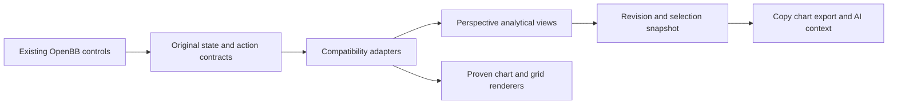

# Renderer compatibility discovery plan

Keep OpenBB's interface and place compatibility code below its controls. Perspective is a candidate analytical engine, not the replacement UI. The source audit shows that a direct library substitution is insufficient: removed dependencies also supplied selection, menus, chart models, remote tables and exports.

This is a discovery plan for 4.8-4.9, not approval of a complete replacement architecture. Inputs are the [capability matrix](../../../docs/renderer-capability-matrix.md), [architecture research](parity-research.md) and [verification contract](parity-verification.md). Initial surface/configuration findings are recorded in [discovery results](parity-findings.md); full runtime parity and the remaining probes are unverified.

Independent Astra review approved this bounded discovery plan; see the [review record](parity-review.md). Production architecture and implementation remain gated.

## Controller synthesis

Generalization: copy, chart creation, export and Copilot must consume the same selection and data revision. Derive that contract once from original callers rather than reconstructing it separately in every action.

Build versus adopt: retain original controls, widget IDs, queries, chart storage and theme settings. The owner selected Apache ECharts as the replacement chart engine. Evaluate Perspective Views for analytics, existing Community renderers for demonstrated behavior and existing ExcelJS for workbook output. Retain useful existing Plotly widgets. ECharts should shoulder chart rendering and interaction; compatibility code translates existing OpenBB settings, events and saved state. Do not build a new chart editor or speculate about emulating a complete vendor API.

The next chart probe uses ECharts for the original table-to-chart journey: create a chart, edit its settings, refresh data, save/reopen and export. Compare controls, outcomes and light/dark appearance with the original fixture. Then extend the mapping to the full capability matrix, including combination charts, navigator behavior and the open Highcharts option contract. Selection of ECharts does not prove those contracts are covered. Record unsupported behavior explicitly without hiding controls or changing feature flags. Package version and integration boundary remain to be verified before production dependency changes.

The first isolated translation probe and source boundary assessment are recorded in [ECharts findings](echarts-findings.md). Its localStorage roundtrip and programmatic edit do not complete the integrated journey above.

Simplification: avoid a generic renderer framework or new dashboard/editor. Keep adapters at existing table/chart/action boundaries. Do not integrate the restrictive financial guard or native Perspective explorer before resolving their conflicts with original behavior.

## Boundary

Own renderer compatibility, original state preservation and verification. Data API, authentication and deployment contracts retain their existing owners. PostgreSQL and Jupyter remain out of scope. Anthropic acceptance still precedes Excel add-in implementation; restoring existing table XLSX export is a distinct renderer capability.

This is a candidate boundary, not implemented architecture. Changes to storage keys, flag predicates, accepted payloads or financial results trigger revalidation against the full matrix.

## Bounded discovery waves

The controller first freezes reference manifests, fixtures, feature conditions and the test environment. Complete outstanding specialized-widget/export callers and vendor-supplied control inventories before full acceptance. Reference failures remain explicit. Do not infer candidate success from an unavailable reference or assume new dependency entitlements.

Each probe owns a separate ignored artifact directory, producing identities, fixtures, commands, exit codes, observed differences and an independently reviewed result. Do not change production widgets, flags, dependencies or saved data. Any production code subsequently extracted must enter the maintained inventory and pass 400 physical lines/file, 300 logical units/file and 50/function.

| Wave | Probe and artifact ownership | Model | Completion or stop condition |
| --- | --- | --- | --- |
| 1A | Original public surface and themes; `parity/surface/` | Sol | Original controls, fonts, palettes, background and sizing work without private vendor patches or native explorer chrome; otherwise identify the failing seam. |
| 1B | Open chart configuration; `parity/configuration/` | Astra | Map Highcharts four-constructor input and original models to existing public APIs. Identify missing equivalents; a smaller allowlist is not acceptance. Source analysis can overlap 1A; browser use is serialized. |
| 2A | Selection, actions and original aggregates; `parity/selection/` | Sol | Sorted/filtered/grouped ranges feed copy, chart, stats and AI from one revision. Preserve original aggregate choices/defaults. Depends on agreed state contract. |
| 2B | Remote hierarchy and paging; `parity/remote/` | Sol | Deterministic endpoint preserves requests, totals, expansion, failure/retry and selected scope. Never calculate full-dataset results from one page. |
| 3A | Chart model round trip; `parity/chart-state/` | Sol | Grouped/stacked, combination and non-Community models retain settings, navigator/mini-chart behavior, refresh, save/reopen and same-tab widget creation. Depends on configuration probe. |
| 3B | XLSX export; `parity/export/` | Sol | Original/candidate workbook values, types, styles and row scope match on styled/grouped/filtered fixtures. Depends on selection contract. Does not start the Excel add-in lane. |

Maximum concurrency is controller, two workers and one reviewer. One heavy build/browser run owns the queue; source analysis and lightweight checks can overlap. Serialize installs and shared fixture mutations. Astra reviews architecture, financial and remote-contract findings; Sol handles bounded routine review. Luna may audit matrix completeness but cannot accept complex compatibility.

## Join and implementation gate

Join findings into a design draft after critical seams have evidence. Failed probes produce concrete incompatibility reports, never fallback controls or silently disabled features. The open-ended Highcharts contract remains unresolved even if representative payloads pass. Do not equate unproven parity with impossibility, or overlapping chart families with compatibility.

After feasibility is established, replace obsolete native-explorer/reduced-Community design clauses, independently review the design and generate bounded remediation tasks. Each task owns explicit files, preserves original controls/flags/state, maps capability rows to meaningful regressions and carries the complexity caps. Historical 2.6-2.8 evidence remains intact and does not satisfy parity.

Final acceptance requires all original capabilities mapped and verified, integrated light/dark comparisons, working action/export outcomes, state round trips and exact image identity. Planned checks and package-removal scans cannot close this gate.
