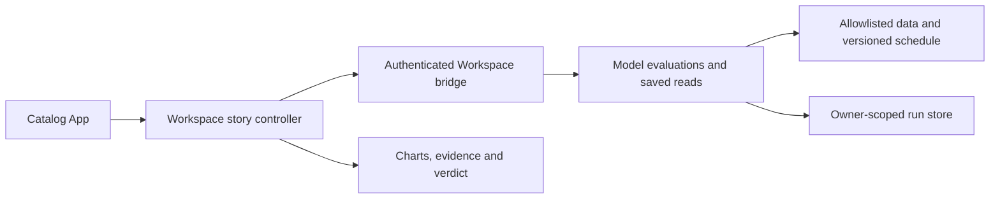

# Commodities versus technology story design

An analyst opens a catalog App, selects two proxies and a date, and reads a conclusion tied to one verified price-return spread. The App presents realized volatility and real yields alongside that conclusion. Two owner-scoped model runs supply all calculated values and their evidence. The first implementation milestone is a real, dated FMP snapshot that `proxy_comparison@2` can evaluate, alongside the dated availability outcome from `real_yield_regime@1`. [Approved requirements](requirements.md) · [Discovery findings](research.md)

## Boundary commitments

**Story ownership.** The catalog owns the ordered question, return, risk, real-yield and conclusion views. One Workspace controller per story instance owns its selection, pending requests, current run references and projections. Modeling owns acquisition, calculations, output checks and immutable runs. Integrate two story-specific acquisition mappings through its existing snapshot-source interface.

**Out of boundary.** New provider adapters, new factor formulas, issuer valuation, predictive signals and other stories require their own delivery. Withhold DFII10 context when an exact endpoint lacks evidence of availability by the decision cutoff. The price comparison and its numerical acceptance use the FMP snapshot retrieved for evaluation.

**Allowed dependencies.** Use the pinned Workspace fork, current chart renderer, existing authenticated modeling bridge, installed model descriptors, and allowlisted data API routes. The modeling service alone reads financial inputs for evaluation. Browser and catalog artifacts contain no provider credentials.

**Revalidation triggers.** A change to model IDs, method or reference versions, trace semantics, input basis, calendar revision, provider availability mapping, widget state schema or source pin requires the associated contract and browser checks. An incompatible saved reference opens with an explanation and requires an explicit new evaluation.

## Architecture and system flow

Generate the curated App directly in the catalog. Place a native story widget in the existing dashboard frame. Its ordered views use the same selection and evidence controller. Use the existing keyboard-operable selectors, date picker, theme tokens, chart controls and table drill-downs. Keep headings and units available as text, expose pending status to assistive technology and preserve focus when results change. Each price or risk view names FMP and the ETF. The macro headline names the Board of Governors of the Federal Reserve System via FRED and displays the FRED notice.

### Selection and acquisition contract

- Carry ordered commodity and technology symbols, ISO observation date and story schema version. Start with DBC and XLK. Offer evidenced proxies with their actual exposures, including GLD as a gold proxy. Permit changing either role through a symbol choice validated against instrument identity, exposure and supported listing calendar. VGT is the qualified alternate technology proxy. [Source qualification](source-qualification.md)
- Bind the selected local observation day, the DFII10 decision cutoff at the end of that day in the listing zone and the evaluation timestamp to the selection. Freeze the schedule revision for both evaluations. For the price comparison, the selected day ends the observation window and each FMP receipt timestamps the retrieved version. Disclose requested date and exact effective model window. For a non-session selection, report the dated model reason unless an explicit supported ending session was selected. Never roll the date silently.
- Through the existing authenticated evaluation route, send an exact model/version, typed assumptions and an acquisition request. Propose dataset IDs `story.etf_pair` and `story.dfii10`. The first admits only ordered symbols and calendar binding. The second admits the same calendar binding and fixes series DFII10. Validate dataset against model/version and match the ordered proxies, calendar and revision to the typed assumptions in the orchestrator before calling SnapshotSource.acquire. That interface sees only the acquisition request. Reject mismatched bindings and duplicate or unexpected parameters. Apply existing deadlines, cancellation and size limits. Freeze request examples against the Python service and TypeScript decoder before UI work.
- Acquire FMP split-adjusted dividend-excluded closes via the existing historical price route and DFII10 via the existing series route. For the current NYSE Arca funds, package a dated NYSE exchange calendar revision, source digest, covered sessions, special closures and publication evidence. Admit other listing calendars only with equivalent evidence. [Exchange calendar](https://www.nyse.com/trade/hours-calendars) Join expected sessions to observations by date. Schedule construction from returned price dates would conceal missing sessions. Preserve observation date, retrieval time, units and provider row identity separately. The FMP history route supplies retrieval provenance. Keep its `point_in_time_safe=false` basis and leave historical publication or vintage fields absent when the source supplies no evidence. For DFII10, map availability only with supported publication and vintage coverage by the decision cutoff. Retain archived first-seen time as separate provenance and withhold if either exact endpoint lacks eligible evidence.
- Assemble `sessions`, `left_closes` and `right_closes` for `proxy_comparison@2` on the retrieved-history basis. Assemble `sessions` and `dfii10` for `real_yield_regime@1`. Populate the descriptors' typed assumption sets, including proxy bindings and schedule revision. Version 2 uses the retrieved history for the selected observation window, carries the exact retrieved rows and provenance in the saved snapshot, and independently verifies the same price-return and volatility formulas. Keep `proxy_comparison@1` available with its existing point-in-time eligibility, calculations and saved-run contract. Represent an unavailable leg as missing eligible inputs with its dated reason so the model can return the other leg. Extend the existing bounded HTTP worker to carry safe, allowlisted denial and retry categories without exposing provider response text. Keep transport/entitlement failures distinct from a genuine empty history. Record a leg-specific safe failure code and symbol in snapshot provenance alongside its empty table. Display that cause with the model check. A failure affecting the whole request remains a service error. Before integration, demonstrate a versioned schedule and complete entitled FMP history within each preflight window. State any DFII10 endpoint gap in the saved context outcome. [Factor design](../factor-signals/design.md)

### Evaluation lifecycle and evidence

1. A selection change increments a generation number, clears all previous references, open evidence and verdict, and shows pending steps. Coalesce rapid edits and cancel obsolete work where possible. Compare both generation and selection before applying any result, error or saved reference. This also handles A → B → A.
2. Submit the comparison and macro evaluations sequentially to respect the default single evaluation slot. Render a completed step immediately. A failure in either request leaves the other eligible to run. On manual retry, rerun the affected model at the frozen selection, schedule revision and decision cutoff, including a saved partial run with a retryable leg-specific acquisition failure. A new price evaluation records its own retrieval times and saves its own immutable snapshot. Keep its valid leg visible until the replacement validates and retain the independent model reference. A permanent data gap stays withheld. If capacity is occupied, expose the retry action. Never attach a previous generation's run to the dashboard.
3. Read full run detail independently through the authenticated bridge. A story read needs no separate widget-projection request. If a save error returns a recovery run ID, read and validate that run before offering another evaluation. When a response is lost without an ID, do not automatically replay the write. Validate owner access through the existing service, model/version, ordered proxy assumptions for the pair, calendar/revision, observation date, decision/evaluation cutoff and output IDs before binding. On reopen compare each run to the saved selection and compare cutoffs across the two runs. Allow a single valid reference to render its own step. On an unavailable or mismatched reference report that state inline. A reopened dashboard performs reads only until the analyst changes selection or explicitly retries.
4. Decode exact decimal values from the wire. For each output, resolve its checks and independent reference match by output ID and join trace source_record_ids to snapshot row record_id (the provider source_record_id is separate) for input rows **in that run**. Expose session dates, revision, window, retrieval times, availability basis and freshness. Source rows for each leg show its closes independently. Display the dated 63 simple-return intermediates from its volatility trace and both eligible macro endpoint levels from their cited records or the dated reason for withheld context. Live input charts use the same run's source rows as the associated result, so a fresh provider revision cannot alter a saved chart.
5. Use verified `momentum_spread` with matching reference evidence and a bound run. Classify its exact decimal sign before formatting, including exponent notation and signed zero. A positive sign supports outperformance, zero identifies a tie, a negative sign identifies technology outperformance. Missing, withheld, unverified or malformed evidence yields insufficient data with the reason. Read each leg's momentum and volatility and the separate `regime` and `change` outputs independently. Compare verified risk levels to flag higher volatility alongside the winning proxy. Context cannot change the verdict.

### Saved configuration

Use a versioned, allowlisted story state for native dashboard save, template export and hydration. Persist role choices, date, per-view chart type, series/axis selections and permitted opaque run references. Persist the cutoff and schedule binding used to validate those references. Exclude chart datasets, cached widget responses, generated narrative, bearer tokens, annotations containing arbitrary response text and embedded input snapshots. Keep loaded results in transient state. On fresh reopen restore both input and result chart settings and read immutable runs under the current owner. A foreign or deleted reference yields the ordinary unavailable-run state. Template import validates the same fields. Earlier dashboards continue through their current serializers.

## File structure plan

Workspace paths below are relative to the pinned fork's `terminalpro/src/`. Develop in the owned checkout and integrate the accepted revision through the source lock. Paths marked new describe proposed work.

| Location | Responsibility |
|---|---|
| `pipeline/qopenbb_ci/catalog_story.py` (new), `pipeline/qopenbb_ci/catalog.py` | Declare the one curated App, register it in catalog generation and preserve its chart presets. |
| `services/data-api/qopenbb_data/modeling/service/story_acquisition.py` (new), `service/orchestrator.py`, `service/acquisition_http.py`, `service/acquisition.py` in the same modeling package | Dispatch the two dataset IDs, validate selection and normalize eligible inputs. Keep the existing FRED dataset contract compatible. |
| `services/data-api/qopenbb_data/modeling/service/story_schedule.py` (new) | Read proposed packaged `service/calendars/nyse_arca.json` with provenance, digest, coverage and revision. Load the versioned, source-attributed exchange schedule and resolve the requested window and cutoff binding. |
| `lib/modeling/storyContract.ts`, `lib/modeling/storyEvidence.ts` (new) | Decode typed run/selection contracts and project evidence, exact sign, and dated reasons. |
| `lib/modeling/storyController.ts` (new), `lib/modeling/evaluationClient.ts` | Manage selection, serial submissions, retries and authorized saved reads. Reuse authenticated transport while retaining issuer behavior. |
| `components/Widgets/ResearchStory.tsx` (new), `components/Widgets/index.ts`, `lib/utils/backendValidation/nativeWidget.ts`, `lib/types/app/widgetTypes.ts`, `utils/zodForms.ts` | Render ordered native views and admit the specific validated story declaration. Split evidence table and chart views into siblings if needed for the caps. |
| `lib/modeling/storyState.ts` (new), `lib/utils/exportTemplate.ts` | Use the existing createTemplates hydration without modifying its 919-line file. Validate widget params at mount and use the same strict config encoder for every state write and export. Keep the existing dashboard sync path unchanged. Persist only this encoding in the widget storage writer. |
| `tests/contracts/test_research_story.py`, `tests/factors/test_story_acquisition.py`, `verification/modeling-journey/story.spec.mts` (new) | Exercise catalog and wire compatibility, dated input assembly, and the actual packaged Workspace journey. Extend the testMatch in `verification/modeling-journey/playwright.config.mts` to discover the new journey and select the intended suite per runtime. Extend `verification/modeling-journey/packaged.py` to restore the modeling service and exercise retry on the same dashboard after the outage. Add controller, projection and state tests beside their Workspace modules. |

## Requirements traceability and verification

| Criteria | Observable acceptance |
|---|---|
| 1.1, 1.2 | Open the catalog story. Change each role and date independently and inspect all labels, dates, runs and drill-downs for the new selection. |
| 1.3, 1.4 | Delay A across B and then A again. No stale result, error or saved reference wins. Complete the journey by keyboard in both themes. |
| 2.1, 2.2 | Compare the chart and all 64 dated closes for each valid leg to its saved run. Check the retrieved-history label and per-leg receipt times, calendar, endpoints and percentage-point direction. |
| 2.3, 2.4, 2.5 | Match 63 dated returns, annualized risk and source credits. For eligible DFII10 runs, match both endpoint levels. Exercise a missing interior date, an unavailable ending observation and a higher-risk winner. |
| 3.1, 3.2 | Test positive, negative and tied verified spreads, including values that display as zero after rounding. |
| 3.3, 3.4 | Withhold a leg across a history gap, then withhold only macro context and then only risk. Assert each surviving result and its effect on the verdict. |
| 4.1 | Interrupt modeling, verify the inline reason, restore service and retry. Test side-specific provider denial and a delayed completion after retry. |
| 4.2, 4.3 | Save and reopen under a fresh authenticated session after a source revision. Assert original run IDs and rows, both chart configurations, cross-owner denial and an export containing only allowlisted values. |

Before UI integration, implement a preflight entry point at `verification/modeling-journey/story_preflight.py` and run `python3 verification/modeling-journey/story_preflight.py` against the isolated candidate. Evaluate the default pair, both role changes and DFII10 through the authenticated bridge. For each comparison, assert a verified matched-window spread, 64 FMP closes per leg, 63 dated returns and exact saved source rows with retrieval provenance. Verify eligible DFII10 endpoints when available. For the November 13 window, verify that the saved DFII10 outcome identifies the unavailable November 13 endpoint and that the verified spread still determines the verdict. Record calendar revision, source basis, retrieval times and sanitized saved-run evidence. A price entitlement, missing session or verification failure leaves the live comparison gate open. Include negative wire tests for reversed assumption bindings and a dataset used with the wrong model, a missing retrieval timestamp and dividend-adjusted closes. The last two cases withhold the spread.

Start with the production inventory and run its executable checker on the entire changed files in QOpenBB and the pinned fork. Each production task and the joined result must meet 400 physical lines/file, 300 logical units/file and 50 units/function. Provide an explicit fork base/head and extend image input allowlists for new runtime files. Freeze acquisition examples and saved-state fixtures before concurrent catalog and service work. Join them before browser integration. [Complexity gate](../../../docs/complexity.md)

Build the affected images with Dagger. Use portable verification commands and isolated headless Ubuntu Playwright, one worker, disposable state and real entitled prices and the applicable real DFII10 outcome. Record image identities, provider coverage and actual results in the breadth map after execution. Fixtures cover macro classification cases that the live cutoff does not supply. Close the live numerical journey with verified real price comparisons and evidence of the applicable macro outcome. Retain the published image set for rollback. [Testing policy](../../steering/testing.md) · [Build policy](../../steering/ci.md)
