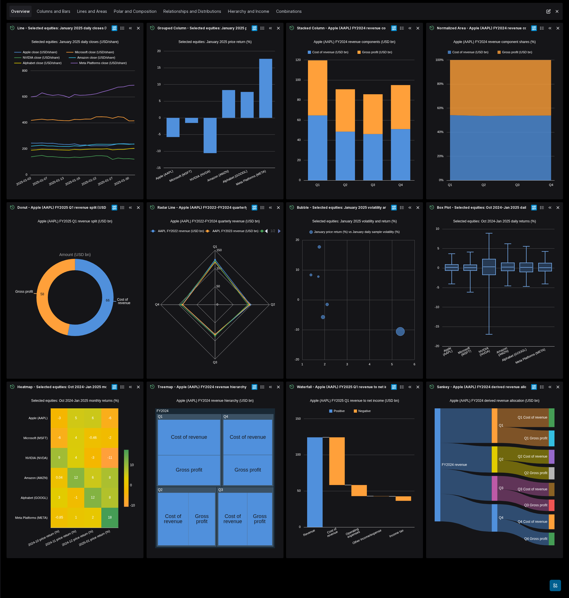
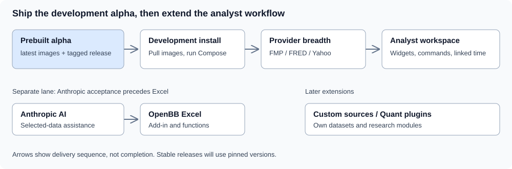

# QOpenBB

A self-hosted research workspace for financial engineers. Build on OpenBB, use FMP as the primary research source, and bring FRED, Yahoo Finance and later custom data into consistent analytical views.

**Available: [development alpha](https://github.com/norandom/QOpenBB/releases/tag/alpha-40689838352-1) with public prebuilt `latest` images.** Provider expansion, the Bloomberg-inspired analyst workspace, AI and Excel have separate specs so they do not hold up this release.

  

[Install](docs/install.md) · [Documentation](docs/index.md) · [Roadmap](docs/roadmap.md) · [Delivery status](docs/prototype-delivery.md) · [Provider coverage](docs/provider-coverage.md) · [Breadth evidence](.kiro/breadth.toml)

[Explore all 36 charts: analyst use cases, demo data, dimensions and interpretation](docs/chart-gallery.md)

[What we can reuse from OpenBB, and the smallest next development steps](docs/capability-reuse.md)

The gallery uses fixed FMP observations around January 2025, with each chart's market or fiscal period labelled. Open the gallery through Apps in the published development alpha. Save/reopen and retained-state recreation passed on the identified local candidate; [publication is verified separately](artifacts/reviewed/chart-gallery/publication-review.md).

Current [historical gallery milestone](.kiro/specs/analyst-workspace/historical-gallery-milestone.md):

- [x] Prepare fixed historical FMP data, 36 native chart configurations and API discovery.
- [x] Verify the assembled gallery, save/reopen and retained-state recreation.
- [x] Publish one overview and a [per-chart analyst guide](docs/chart-gallery.md) with reviewed screenshots.
- [x] Publish the gallery in the prebuilt alpha images.

## Status at a glance

The current alpha uses locked native uv backend packaging, readable Python application source under CPython and embedded Valkey 9.0.7. [Local runtime acceptance](artifacts/reviewed/python-source-packaging/runtime-review.md) covers gallery save/fresh-login reopen and login/password changes; a separate synthetic Redis snapshot/RQ and database-marker probe covers recreation. [Publication verification](artifacts/reviewed/python-source-packaging/publication-review.md) checks the released image identities and public pulls, without repeating browser acceptance on CI image bytes.

Deployment [login correction](.kiro/specs/openbb-self-service/login-password-policy.md):

- [x] Authenticate existing passwords without applying new-password strength rules.
- [x] Verify `.env` password replacement after Workspace recreation with retained account and data.
- [x] Verify browser login, incorrect-password rejection and password changes on the corrected local image.
- [x] Publish and verify the corrected prebuilt alpha images: [publication review](artifacts/reviewed/login-password/publication-review.md).

- [x] Deliver the first prototype, including accepted chart milestones, login fixes, uv packaging and Valkey; owner confirmed server startup on 2026-10-28. [First-spec closure](.kiro/specs/openbb-self-service/prototype-closure.md).

Snapshot: 2026-10-28. Follow the CI link for live run status; a green check does not establish deployment acceptance.

| Area | What exists | What remains |
| --- | --- | --- |
| Prototype | Published-image Compose login, starter income widget, refresh and diagnostics accepted; local pull-only install rehearsed; owner confirms deployed alpha is up | Generic required-symbol guard; broader host acceptance |
| CI/CD | Hosted checks and both Dagger builds passed; public images and tagged alpha published | Later stable release pinning and broader runtime acceptance |
| Data | Packaged starter widgets and 36-chart historical FMP gallery; annual AAPL income values and refresh accepted through the installed route | Broader live provider/widget acceptance, Yahoo adapter and named discovery |
| Visuals | Selected ECharts table-chart journeys with captured FMP data, including accepted pie/donut, Box Plot, Range Bar/Area, Waterfall and Radar Line/Area behavior and owner-reviewed appearance; verified bubble-range and miniature correction; existing Plotly; Perspective runtime foundation | Perspective dashboard integration, remaining renderer/table functions and shared theme |
| Analyst workflow | Existing dashboard editor and widget foundations; [investment-analysis contract](.kiro/specs/analyst-workspace/investment-analysis-contract.md) | Quarterly analysis, peer valuation, FMP DCF/WACC with macro context, inline research and saved assumptions |
| Extensions | Separate AI, Excel and custom-source specs | Implementation and end-to-end acceptance; Quant plugins later |

Previous [combination-chart milestone](.kiro/specs/analyst-workspace/chart-port-milestone.md):

- [x] Accept Column & Line, Area & Column and Custom Combination, including distinct axes and editor controls.
- [x] Verify captured FMP values, save/reopen/export and navigator/theme/refresh retention in the packaged image.
- [x] Publish and verify the updated alpha images, including anonymous pulls of both services.

See the [ECharts checklist](docs/echarts-status.md) for remaining chart families and callers.

Completed [Theme Settings preview milestone](.kiro/specs/analyst-workspace/theme-preview-milestone.md):

- [x] Replace the preview renderer while preserving controls, keyboard and legend behavior.
- [x] Make Padding work, including zero, with the existing saved format.
- [x] Verify packaged save/reopen, retained-FMP palette/PNG and owner-approved light/dark appearance.
- [x] Publish and verify the completed milestone images: [alpha-40506541604-1](https://github.com/norandom/QOpenBB/releases/tag/alpha-40506541604-1). See the [publication review](artifacts/reviewed/theme-preview/publication-review.md).

Completed [Sankey milestone](.kiro/specs/analyst-workspace/sankey-milestone.md):

- [x] Freeze reviewed mapping and financial contracts with a retained FMP income-allocation example.
- [x] Complete and independently review the parallel data and rendering modules.
- [x] Connect Sankey to the existing editor and saved-dashboard flow (source and packaged application accepted).
- [x] Accept real-FMP behavior, save/reopen/export and owner-reviewed light/dark appearances.
- [x] Publish and verify the completed Sankey milestone images: [alpha-40489065805-1](https://github.com/norandom/QOpenBB/releases/tag/alpha-40489065805-1).

The current prototype alpha includes four reviewed repairs: HTTP 200/null for an absent first-login questionnaire, packaging and serving for the existing data catalog, Workspace's fallback for unavailable external app previews, and an empty agent-discovery response for the data-only backend. AI remains a separate spec.

- [x] Verify release assets and both published images through six anonymous pulls.
- [x] Accept fresh onboarding and later login with clean diagnostics on the earlier prototype alpha Compose pair.
- [x] Match the installed starter's annual AAPL income identity, reporting date, USD revenue and refresh to the live response.
- [x] Complete the isolated pull-only local installation rehearsal.
- [ ] Verify owner-server deployment and repair the generic-widget empty-required-symbol guard.

See the [independent application review](artifacts/reviewed/prototype-onboarding/application-review.md), [application result](artifacts/reviewed/prototype-onboarding/application.json) and [delivery status](docs/prototype-delivery.md#current-prototype-repair). Broader provider acceptance, analyst persistence and infrastructure recovery remain separate.

Published: [scatter and bubble](.kiro/specs/analyst-workspace/xy-chart-milestone.md).

- [x] Correct the reported bubble spacing and miniature overflow, then replace its FMP sample after verification.
- [x] Publish the bubble-spacing and miniature-clipping correction.
- [x] Match original label density and clip main markers; verify small/wide FMP views and save/reopen/export.
- [x] Publish the label-refinement image milestone.
- [x] Implement and review the inactive X/Y/size field-assignment contract.
- [x] Implement and review the inactive numeric renderer, including actual ECharts geometry checks.
- [x] Connect and source-review rendering, editor controls and saved XY settings.
- [x] Accept real-FMP application behavior, synthetic edge cases and prior-family regressions in the candidate image.
- [x] Publish and verify the completed scatter/bubble milestone.

Previous: [histogram port](.kiro/specs/analyst-workspace/histogram-milestone.md).

- [x] Review the binning contract and capture 40 quarterly FMP observations.
- [x] Implement and independently verify the inactive binning module.
- [x] Implement and independently verify inactive interval rendering.
- [x] Connect and independently source-review the existing editor and application controls.
- [x] Source-review automatic axis rounding and retained zoom/reset scales.
- [x] Source-review endpoint-label overflow and original Bin count control order.
- [x] Source-review miniature height, plot alignment and full-bin labels.
- [x] Accept real-FMP application behavior, synthetic edge cases and prior-family regressions.
- [x] Publish and verify the completed histogram milestone.

Published: [pie and donut port](.kiro/specs/analyst-workspace/pie-milestone.md).

- [x] Review original field selection, concentric rings and saved alias.
- [x] Implement and independently verify inactive pie/donut assignments.
- [x] Implement and independently verify inactive rendering.
- [x] Connect and source-review the existing editor and application flow.
- [x] Repair title/legend editor transactions found by the first image run; source tests and independent review pass.
- [x] Restore effective pie legend defaults and retain original title/legend appearance; source checks pass.
- [x] Implement and source-review native legend paging, keyboard access and fitted donut titles.
- [x] Accept real-FMP behavior and the owner-reviewed appearance in the candidate image.
- [x] Publish and verify the completed milestone.

Published: [box plot port](.kiro/specs/analyst-workspace/box-plot-milestone.md).

- [x] Review original statistics and freeze the numerical helper contract.
- [x] Implement and independently verify original-matching numerical summaries.
- [x] Implement and independently verify the inactive box/whisker renderer.
- [x] Preserve original category identities in the inactive Box Plot capture helper.
- [x] Independently accept inactive Box capture and original aggregate setup.
- [x] Independently accept inactive Box axes/navigation and the existing-host adapter join.
- [x] Connect and independently source-review the existing editor and saved-state flow.
- [x] Pass retained-FMP and edge-case browser journeys against the packaged candidate.
- [x] Source-review the Box fill, legend, category-label and miniature refinements; packaged-image comparison accepted.
- [x] Source-review the real-sample collision and wheel-zoom layout repair; repaired candidate browser checks and owner visual acceptance pass.
- [x] Accept original/replacement appearance and complete Box application verification.
- [x] Publish and verify the completed milestone.

Published: [Range Bar/Area](.kiro/specs/analyst-workspace/range-chart-plan.md).

- [x] Independently accept the inactive range-summary helper.
- [x] Independently accept the inactive Range Bar renderer core.
- [x] Independently accept the inactive Range Area renderer core.
- [x] Independently accept Range capture/setup reuse while preserving Box behavior.
- [x] Independently accept inactive Range series styling and saved-option precedence.
- [x] Independently accept Range numeric value-axis planning and renderer handoff.
- [x] Accept numeric/time category geometry in both inactive Range renderer cores.
- [x] Preserve Range date/type provenance through Grid capture and statistical setup.
- [x] Compose Range charts with calendar/numeric axes, saved styling and measured layout.
- [x] Connect Range sessions, retained editor controls, navigation and pointer interactions, including original zoom defaults.
- [x] Implement and independently review the requested Range axis and legend refinements (R4i); default Area appearance accepted; navigator spacing and corrected default behavior pass both packaged FMP journeys; the accepted image pair is published.
- [x] Verify both Range families in the packaged application with real FMP data, save/reopen and export; publication is verified.

Published: [Waterfall](.kiro/specs/analyst-workspace/waterfall-milestone.md), following the [23 October work plan](.kiro/specs/analyst-workspace/autonomous-2026-10-23.md).

- [x] Review the signed-movement contract and original zero, missing-value and legend behavior.
- [x] Implement and independently accept cumulative movements.
- [x] Independently accept Waterfall appearance and control adapters.
- [x] Independently accept the W2A renderer source: 30 tests, three independent probes and combined complexity pass.
- [x] Independently accept the renderer/editor/session source join.
- [x] Review the first packaged failure and verify empty-selection remove/re-add recovery.
- [x] Verify the retained-FMP income-statement bridge, controls, save/reopen and export in an identified image; owner accepts the appearance.
- [x] Publish and verify the accepted milestone images.

Waterfall remains available in the current alpha alongside Radar. Local application acceptance and public image identities are verified separately; see the [release evidence](artifacts/reviewed/chart-waterfall/verification.md#published-waterfall-alpha).

## Delivery plan

Accepted chart milestone: [Treemap/Sunburst](.kiro/specs/analyst-workspace/hierarchy-milestone.md).

Radial Column/Bar is accepted and published; RC5 release assets and anonymous image pulls are verified. See the [Radial milestone](.kiro/specs/analyst-workspace/radial-milestone.md). [Treemap/Sunburst](.kiro/specs/analyst-workspace/hierarchy-milestone.md) is accepted for onboarded users and published; see the [delivery queue](docs/roadmap.md#active-chart-delivery-queue).

- [x] Verify hierarchy FMP values, controls, approved appearance, persistence and export.
- [x] Publish and verify the hierarchy milestone images: [alpha-40201437272-1](https://github.com/norandom/QOpenBB/releases/tag/alpha-40201437272-1).
- [x] Complete [Heatmap](.kiro/specs/analyst-workspace/heatmap-milestone.md): financial values, appearance, controls, persistence and export accepted.
- [x] Publish and verify the Heatmap milestone images: [alpha-40228938438-1](https://github.com/norandom/QOpenBB/releases/tag/alpha-40228938438-1).
- [x] Accept [Funnel, Cone Funnel and Pyramid](.kiro/specs/analyst-workspace/funnel-milestone.md): owner-approved appearance, financial lifecycle, visible controls and plain-color Cone PNG contents pass within the [reviewed scope](artifacts/reviewed/chart-funnel/verification.md).
- [x] Publish and verify the accepted Funnel milestone images: [alpha-40334144666-1](https://github.com/norandom/QOpenBB/releases/tag/alpha-40334144666-1).
- [x] Integrate Stacked Line and 100% Stacked Line renderer, editor and session; 231 affected checks pass.
- [x] Verify three packaged Stacked Line financial/lifecycle journeys; both appearances accepted.
- [x] Close Stacked Line axis/control checks, including repeated-date raw tooltips.
- [x] Publish and verify the accepted Stacked Line milestone images: [alpha-40371082771-1](https://github.com/norandom/QOpenBB/releases/tag/alpha-40371082771-1).

- [x] Freeze the Radial control contract and implement its inactive controls.
- [x] Implement the independently reviewed Radial Column shape helper.
- [x] Implement and independently review Radial numerical mapping and ECharts painting.
- [x] Connect Radial charts to the existing application and session workflow.
- [x] Correct Radial Column polar tick density and grid circles at source level.
- [x] Implement and independently accept Bar grids, bounded circle fitting and shared Radial legend spacing at source level.
- [x] Verify rebuilt Column and Bar appearance; owner approved both final appearances.
- [x] Accept the identified packaged real-FMP journeys and original comparisons (RC4).
- [x] Publish and verify the Radial release images (RC5): [alpha-40125164959-1](https://github.com/norandom/QOpenBB/releases/tag/alpha-40125164959-1).

Nightingale delivery:

- [x] Freeze original behavior and the retained FMP revenue-composition example (N0).
- [x] Implement the inactive native renderer (N1).
- [x] Implement the inactive existing-style controls (N2).
- [x] Connect the Table/File application and persistence paths (N3).
- [x] Accept real-data browser behavior and appearance (N4).
- [x] Publish the accepted milestone once (N5): [alpha-40104927952-1](https://github.com/norandom/QOpenBB/releases/tag/alpha-40104927952-1).

Published chart milestone: [Radar Line and Radar Area](.kiro/specs/analyst-workspace/radar-milestone.md).

- [x] Freeze original Radar behavior and the retained-FMP example; independently reviewed inactive contracts and fixture.
- [x] Independently accept the inactive Radar renderer.
- [x] Independently accept inactive Radar editor/session adapters.
- [x] Independently accept Radar capture and setup (RD3a).
- [x] Independently accept source integration through the existing session, editor and caller routes (RD3/RD3b).
- [x] Independently accept both packaged Radar behavioral journeys: retained FMP values, controls, refresh, fresh reopen and PNG export. [Evidence and samples](.kiro/specs/analyst-workspace/radar-milestone.md#fmp-samples).
- [x] Accept the current Radar Line/Area appearance and disclosed original/replacement differences (RD4).
- [x] Publish the accepted Radar milestone (RD5) as [alpha-40086673952-1](https://github.com/norandom/QOpenBB/releases/tag/alpha-40086673952-1); [release assets and six anonymous pulls verified](artifacts/reviewed/chart-radar/verification.md#published-radar-alpha).

The diagram shows delivery sequence and the Anthropic-before-Excel dependency, not completed work. Separate workstreams are not alpha release prerequisites. AI is independent of prototype acceptance. Custom sources have their own spec; Quant plugins remain a later extension. Existing persistence code, tests and the `./data/workspace` bind mount stay in place. Dashboard persistence acceptance belongs to the analyst spec; infrastructure recovery verification is deferred. Neither blocks this prototype.

## One analytical experience across providers

An analyst should be able to compare an equity, a commodity and a yield curve without learning each provider's API conventions. The planned workspace uses readable instrument names, familiar commands and linked dates, with consistent tables, charts and controls. Source labels stay visible.

Consistency preserves financial meaning: a spot benchmark is different from a futures contract; a yield curve's horizontal axis is tenor, not time; a filing's publication date differs from its reporting period. The [provider map](docs/provider-coverage.md) separates published coverage from installed and verified functionality.

The [Bloomberg-inspired visual reference](https://github.com/iconicvenom/bloomberg_free) guides the future theme and widget presentation. Existing OpenBB components and our chart work remain the foundation.

## Renderer roles

| Component | Role and current boundary |
| --- | --- |
| Apache ECharts | Implemented chart engine for selected table-to-chart journeys. Full family and caller compatibility remains open. [Done / todo](docs/echarts-status.md) |
| FINOS Perspective | Installed runtime, React host and isolated verification foundation. Pivot/explorer widget integration remains work for `analyst-workspace`. [Done / todo](docs/perspective-status.md) |
| Plotly | Existing endpoint-chart renderer retained. [Done / todo](docs/plotly-status.md) |
| Highcharts | Removed dependency. Legacy Highcharts configurations are not universally translated into ECharts. |

## Operate the prototype

Development uses Windows/WSL Docker; deployment uses the same Compose topology on private Linux. The origin serves HTTP on `0.0.0.0:23003`; the owner manages Cloudflare Access and cloudflared for `qopenbb.example.com`. State uses relative bind directories, not Docker-managed data volumes.

Dagger builds images only. Portable commands run verification and publication; GitHub Actions is the current runner, with Gitea portability retained. Development installation pulls the prebuilt `latest` alpha images; later stable releases use pinned versions. Installation uses these images and runs Compose without compiling source on the server. **The current release is the development alpha.** Use [delivery status](docs/prototype-delivery.md) for the remaining gates rather than treating the historical Compose proposal as an installation guide.

Credentials belong in ignored `.env`; [.env.sample](.env.sample) contains public placeholders. Jupyter is managed separately.

## Find the owning workstream

| Workstream | Scope |
| --- | --- |
| [Prototype delivery](.kiro/specs/openbb-self-service/spec.json) | Current baseline, CI/CD, image publication and installation |
| [Market data](.kiro/specs/market-data-integrations/requirements.md) | FMP horizontal coverage, FRED, Yahoo and future provider adapters. First batch: 13/26 tasks accepted; shared metadata, FMP statements and FRED provenance accepted; registration and further datasets next |
| [Analyst workspace](.kiro/specs/analyst-workspace/requirements.md) | Reusable widgets, command line, linked context, theme, renderer completion and saved research context |
| [Workspace AI](.kiro/specs/workspace-ai/requirements.md) | Anthropic discovery, grounding and streaming |
| [OpenBB Excel](.kiro/specs/openbb-excel/requirements.md) | Add-in and generated functions; retains the Anthropic-first dependency |
| [Custom data](.kiro/specs/custom-data-source/requirements.md) | Own datasets and later PostgreSQL |

Successor specs are initialized scopes, not completed implementations. [Spec ownership](.kiro/spec-ownership.toml) records the handover. The [breadth map](.kiro/breadth.toml) retains actual tests and evidence; the [contribution guide](docs/contributing.md) explains working conventions.

Sources are owned in the [Workspace fork](https://github.com/norandom/openbb-workspace) and [data API fork](https://github.com/norandom/openbb-data-api), with revisions in [sources.lock.json](sources.lock.json).
