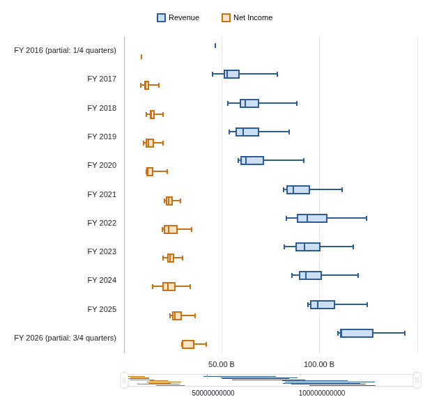
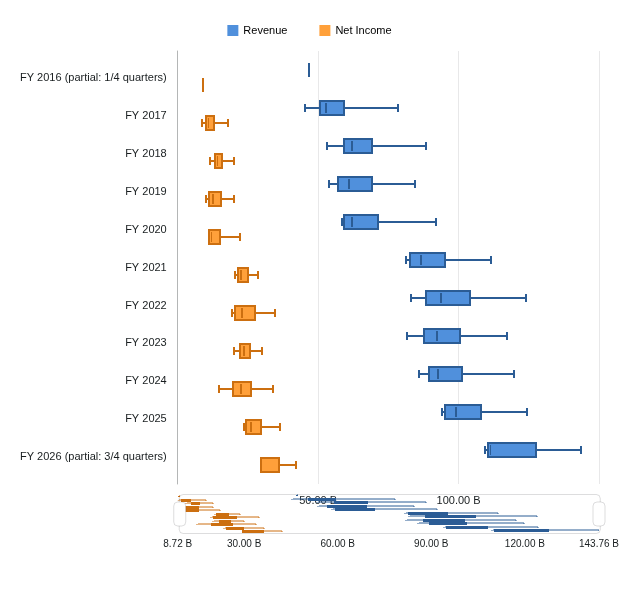

# Box Plot verification

Box Plot source integration through B3d is independently accepted. Identified-image, real-FMP application and original-appearance acceptance remain open, followed by publication. The existing published alpha is unchanged. The sections below retain the earlier task evidence and its scope at the time.

The original Grid 34.1.1 `BoxPlotChartProxy` calculates each category/field independently: sorted minimum and maximum, with quartiles at `(n - 1) * q` and the original interpolation expression. It does not use IQR fences or separate outlier points. The reviewer checked the retained bundle SHA-256 `1a195685c473488defe1ce535e3115c26a42b2be94ad6ccc7fefa351eac7094f` and the actual source around lines 9664-9820. Original Workspace: `38dffc33389aca0e4a87e0e88d42f7067aa220df`.

The [frozen B1 design](../../../.kiro/specs/analyst-workspace/box-plot-design.md) accepts the existing normalized finite-number/null domain. Empty groups produce no summary; nonfinite inputs or derived arithmetic overflow return diagnostics. This is explicitly bounded behavior, not equivalence for the original proxy's admitted infinities. B1 is one inactive numerical helper plus focused tests; no renderer, editor or saved-state change is accepted yet.

Independent source/design review: `artifacts/chart-box/b0-review.md`. Read-only integration tracing confirms the existing Box Plot gallery item and identifies shared session/host boundaries. No tests, builds, browser checks or provider requests were run for B0. Preliminary mapper/fixture suggestions are not approved interfaces. Later contracts and executable evidence belong to the [milestone](../../../.kiro/specs/analyst-workspace/box-plot-milestone.md).

## B1 numerical helper

Workspace `85ca9ea247cc0c97add941b5007661b75941e734` adds only `compatibility/boxSummary.ts` and its focused compatibility test. Missing-module RED was captured before implementation. The final focused Vitest run and independent rerun each passed 31 tests; scoped strict TypeScript passes. Combined complexity passes with no errors or violations: helper 60 physical lines, 48 logical units and maximum 22 per function.

Tests cover original odd/even/two-value/decimal quartiles, minimum/maximum rather than outlier fences, singleton/empty/all-null groups, repeated/signed values, omitted nulls, immutable input, malformed/sparse/throwing input and nonfinite derived arithmetic. The helper has no renderer, grouping, provider, editor or persistence effects. Existing browser tests were not rerun for this inactive addition. Source review and logs remain under `artifacts/chart-box/b1-*`; application acceptance is explicitly pending.

## B2 renderer design

Independent review approved the [inactive renderer design](../../../.kiro/specs/analyst-workspace/box-plot-renderer-design.md) after corrections to category alignment, numeric domains, typing acceptance and engine-time errors. A bounded installed-ECharts 6 SVG experiment verified public numeric slot coordinates with explicit custom labels/ticks in both directions, including singleton categories and the original custom-padding counterexample. Coordinate, label/tick, pointer identity and clipping assertions passed. This establishes the coordinate mechanism, not application or Box Plot appearance acceptance.

Original source inspection also confirmed that numeric nicing can expand fractional constant domains and explicit bounds. The inactive mapper separates semantic and transport domains; B3 must reconcile original effective nicing/ticks before activation. The existing broad TypeScript scope has inherited diagnostics (compiler exit 2); B2 requires zero new diagnostics and zero diagnostics in its own files against the captured baseline, not a claimed clean application build. Design review and spike inputs remain local under `artifacts/chart-box/b2-*`. At design review, renderer implementation was still open. B2 implementation is recorded below; real-FMP application acceptance and publication remain open.

## B2 inactive renderer

Workspace `95188eb3ac92188e62f32b8ba9d4897a6c8cc176` adds ten mapper modules and two focused test files. Independent review freshly reran the canonical focused suite: 40 tests pass (31 numerical helper, six mapper and three grouped real-ECharts SVG tests). Scoped Biome passes all 12 files. Combined complexity passes with zero errors or violations. No application routing, gallery, editor, provider or persistence code changed.

The engine checks cover vertical/horizontal box geometry, original band/group padding, null-category pointer identity, singleton/cap/median/whisker styles, native legend hide/remap, resize and SVG export, constant/empty/clipped data and renderer-error propagation through the existing lifecycle. Raw USD and B1 statistics remain unchanged. Missing-module and throwing-callback RED evidence preceded their fixes. Synthetic engine checks establish the inactive boundary only; real-FMP application evidence remains pending.

Final typing reports no diagnostics in B2 files. Both baseline and candidate retain 3,427 inherited diagnostics and compiler exit 2. Raw diagnostic comparison differs only at unchanged TableSettings.tsx(185,38), TS2769, where union members render in reversed order; independent review accepted that exact semantic-equivalence case. The raw comparison remains marked false and is retained locally, rather than presented as a clean TypeScript build. Initial checker execution lacked the pinned Node PATH; the corrected pinned-tool run passed.

Source review and reviewed-file hashes are retained in `artifacts/chart-box/b2-source-review.md` and `b2-source-reviewed-files.json`; focused test, lint, typing and complexity logs stay local. B3 must reconcile original effective numeric nicing/ticks and preserve existing capture, controls and host failure behavior before activation. B4 real-FMP image acceptance and B5 publication are still open.

## B3a category capture

Workspace `bca180284cefb7848b052dd4b8a4160fe0c0d5e8` adds only the inactive category-capture helper and its focused test. It preserves the normalized statistical category separately from the raw aggregation key, including missing/typed categories, Date epoch versus Date string identity, and default selection's per-row ordinal key. The default ordinal correction was caught during independent contract review before implementation. Raw inputs are not arbitrarily coerced; unsupported or throwing inputs return diagnostics. No grid capture, aggregation, editor, mapper or saved-state path was changed.

Independent review freshly passed 58 tests, strict scoped TypeScript and scoped Biome. Combined complexity passes with zero errors or violations: 79 physical lines, 41 logical units and maximum 17 per function. Missing-helper RED preceded implementation; initial test-title formatting and fixture typing failures were corrected and retained locally. Final reviewed source hashes and raw verification logs are under `artifacts/chart-box/b3a-*`.

The [integration contract](../../../.kiro/specs/analyst-workspace/box-plot-integration-design.md) retains B3b capture/aggregation, B3c original scale/navigation and B3d editor/session integration as open gates. B4 real-FMP image/appearance acceptance and B5 publication remain open. The parallel Range lane changes disjoint new files; shared integration and builds stay serialized.

## B3b inactive capture and aggregate setup

B3b inactive capture/setup is independently accepted at Workspace `7912870325e9ee12dadddf8a8fbe1a5fbf1a7ee6`. Fresh focused checks passed 88 tests; Biome passed eight files and combined complexity passed. Strict typing retains 2,713 inherited diagnostics, exit 2; raw comparison remains false with exactly two reviewed printed-order differences. Selected shared checks passed 112 tests and failed four Pie assertions reproduced at accepted B3a `bca1802`. B3c axes/navigation, B3d activation, B4 real-FMP/image/browser acceptance and B5 publication remain open. The published alpha is unchanged.

The inactive Box snapshot policy, raw-key grid capture and original finite-observation aggregates preserve absent versus null observations, signed-zero/order semantics, selected-field provenance and count units. They do not activate Box in the gallery/session. Independent approval and eight frozen hashes: `artifacts/chart-box/b3b-review.md`.

On 2026-10-21, the reviewer ran `b3b-focused.sh reviewer-focused` by absolute mounted path under WSL Debian with pinned Node 24.22.0: 88 passed, exit 0. `b3b-reviewer-static.sh` passed Biome on eight files, exit 0. Combined `b3b-complexity.json` reports zero errors/violations; owned maximum is 286 physical lines, 124 logical units and 29 per callable, within 400/300/50. The new adapter measures 113/70/22. Meaningful RED preceded implementation.

`b3b-typing-comparison.json` remains raw `pass=false`. Both compiler runs emit 2,713 inherited diagnostics, exit 2; only printed-order differences at useGridOptions.tsx:133 and useTableContext.tsx:133 were independently accepted. No owned-file diagnostics or suppressions remain. This is bounded diagnostic-delta acceptance, not a clean typecheck.

`b3b-reviewer-regressions.sh` passed 112 tests and failed four Pie assertions, exit 1. `b3b-pie-baseline.sh` reproduced the same names, locations and mismatch bodies at accepted B3a with identical dependencies/config: 15 passed/four failed. The other five selected files passed: gridCapture, gridCapture.grid, setupProjection, histogramProductionJoin and applicationSessionTransactions. This establishes no observed new failure delta, not clean Pie coverage.

Raw scripts, logs, exits, baseline comparison and hashes remain local under `artifacts/chart-box/b3b-*`. No build/browser/provider acceptance is claimed.

## B3c inactive axes/navigation and host adapter

B3c inactive Box axes/navigation and the existing-host adapter join are independently accepted at Workspace `b34984e46ee3fd942a5d80999dde77de1988896a`. Eighty tests across seven files, scoped Biome on 23 reviewed files and combined complexity pass. Canonical strict baseline/candidate each retain 3,427 identical inherited diagnostics, compiler exit 2, with no additions/removals. B3d activation, B4 real-FMP/application/visual acceptance and B5 publication remain open; the published alpha is unchanged.

Five new Box helpers and the existing host/lifecycle join preserve the source-derived numeric scale and category navigation without activating the family. The exact 23-path reviewed hashes are retained in `b3c-revision-owned-hashes.json`; 21 files changed, while boxPlotLayout and boxPlotSeries were reviewed unchanged. Independent approval: `artifacts/chart-box/b3c-review.md`.

Fresh independent verification used WSL Debian/mc and pinned Node 24.22.0: the existing seven-file command in `b3c-revision-focused-tests.sh` passed 80 tests, exit 0 (`b3c-review-final-tests.log`); `b3c-biome-check.sh` passed all 23 reviewed files without fixes, exit 0 (`b3c-review-final-biome.log`). Controller `b3c-revision-complexity.json` reports zero errors/violations under 400/300/50 caps. Final shared typing comparison `artifacts/chart-parallel/b3c-r3-typing-final-comparison.json` records 3,427 identical inherited diagnostics with no additions/removals, compiler exit 2. This is diagnostic-delta acceptance, not a clean typecheck. Missing-axis-module RED preceded implementation.

Independent review found and repaired two numerical defects. Zoom tick density now uses actual span/visible fraction before rounding: the retained-source span-149 case produces [-1,0,1]. If selected observations lie wholly outside explicit bounds, the empty-envelope guard retains the full numeric extent rather than an inverted fraction. Focused regressions and the existing 24-case retained-source arithmetic oracle pass. Actual SVG tests also verify one-time horizontal cropping, unchanged full overview widths, raw five-number summaries and measured collision-driven tick reduction.

No application/browser/provider/build acceptance belongs to B3c. B3d must resolve custom miniature admission and activate the existing flow. B4 retains explicit owner review of the original numeric-category autoscale quirk, two-pass font/layout differences and default horizontal miniature runtime comparison, alongside real-FMP controls, persistence, export and matched light/dark appearance. No full visual or milestone parity is claimed.

## B3d editor/session activation

B3d editor/session activation is independently source-accepted at Workspace `ba98f00b91693f3a9c3ae7ba3dea8b42806dceb4`. Focused application, gallery and mapper/host checks pass 94 tests; 51 selected prior-family checks pass. Scoped Biome and whole-file complexity pass. Typing retains inherited diagnostics; see the reviewed comparison below. B4 identified-image/FMP/visual acceptance and B5 publication remain open.

The existing Table/File gallery now routes Box Plot through the application session, editor and ECharts host. Original Direction, Whisker and Cap controls write the original saved paths. Latest Widget transactions preserve external edits; family changes recapture raw Box observations. Review repaired Auto Rotate reset, configured visibility in the main plot/miniature, initial host legend selection and legend retention when series are reordered. No feature flag or second editor was introduced.

Independent final verification used the existing one-worker configs: application/caller 44, gallery five and mapper/navigation/lifecycle 45 passed, exits 0. After removing two invalid test-only role-query options, the affected caller suite passed again (20 tests). The separate selected prior-family run passed 51 tests. Scoped Biome passed 43 changed files; combined 400/300/50 checks reported zero errors/violations. Exact final hashes, scripts and logs remain under `artifacts/chart-box/b3d-*`; independent verdict: `b3d-source-review.md`. Initial RED contains three missing-import failures, but its wrapper recorded zero, so that status is not presented as the test runner's exit.

Canonical application typing has 2,711 diagnostics versus 2,713 before the change, compiler exit 2. Two inherited combination-test diagnostics were removed by correct narrowing. The raw comparison remains false: 17 unchanged production diagnostics differ in printed union/property ordering or truncation, and seven inherited caller diagnostics move by 43 lines. Independent review accepted those exact differences; no new diagnostic remains. This is bounded diagnostic-delta acceptance, not a clean TypeScript build.

Browser preparation is separately source-reviewed at Workspace `563a746af51edcf1c07aa03c36bf72b290ca3f48`: two discovered scenarios, scoped Biome and independent retained-FMP fixture verification pass. They cover 40 quarterly observations grouped into 11 fiscal years, raw USD summaries, controls and lifecycle. At that preparation checkpoint they had not executed against the application. The old reference container lost its disposable temporary bind directory; the execution tool rejected a fresh reference startup with only “blocked by policy.” No alternative startup was attempted. B4 original/identified-image acceptance and B5 release remain open, and the published alpha is unchanged.

## B4 packaged-candidate browser progress

Two Box browser scenarios passed on 2026-10-21, exit 0, using one isolated headless worker. Run: `artifacts/chart-box/browser-ci-39638122414-run4`; independent review: `artifacts/chart-box/b4-browser-review.md`. The test fixes are committed at Workspace `993eb28b7a5134476408897fbe94919d67e27e2d`. Application image `sha256:05c1c6fc854a85c11f2859fbb9bc7d7961f14dbff5f687c2a38037cbbe926bfa` was built from `ba98f00b91693f3a9c3ae7ba3dea8b42806dceb4` in CI run 39638122414, verified and loaded locally, then started by the owner with no source overlay. CI publication was skipped.

The retained FMP AAPL income-statement sample contains 40 quarterly observations, 11 fiscal-year categories and original reported USD revenue/net income, dated 2016-09-24 through 2026-06-27. Partial years remain labelled. These are retained provider observations, not a fresh API retrieval. The checks verify raw summaries and box/cap geometry, exact source-formatted tooltip values, directions/themes, controls, navigation, legend visibility, refresh, saved settings, reopen and sampled export pixels. The second scenario passes missing, repeated, signed and singleton data, selection ordering and empty-selection recovery. Observed application diagnostics pass in the tested windows.

Runs 1-3 exposed test assumptions: repeated fiscal-year cells, tooltip caption/suffix ambiguity, original billion formatting and a one-tick axis beside the open editor. Corrections retain financial assertions and use the original formatting contract; geometry checks collapse/reopen the editor. All 110 retained statistics and 22 focused formatting cases match the pinned original formatter. Scoped Biome passes; its final whitespace-only change followed run 4. No application code changed.

Original/replacement visual comparison, default horizontal miniature comparison and final milestone review remain pending. B4 and B5 remain unchecked; no new alpha release is claimed. The representative samples below show candidate output only.

Provider provenance: `/stable/income-statement?symbol=AAPL&period=quarter&limit=40`, retained at `2026-10-20T14:06:05.149732+00:00`. Raw response SHA-256 `390dc8cbfc8302720a203bd9782d5e3b1f7363a4f762bdfcef079dbbe4c72f6b`; imported CSV SHA-256 `120e1dac7d9e0a541293fb9c8d40982959ce3a03fa8b33ef027ea52ceceb32cb`. No provider key or private account state is published.

## B4 original capture and default miniature comparison

Candidate run 5 passed both scenarios, exit 0, including default horizontal miniature light/dark geometry and the downstream styled/lifecycle checks. Test revision: `a3b71d2a85e7c80076d7b5fbc1bf0bfc7408f2bd`; application image/source remain `05c1c6fc` / `ba98f00`. The original-reference scenario passed separately, exit 0, at `artifacts/chart-box/reference-run1`; six views captured from original image `f48eb1c9` with the existing 43-file backend overlay (`23b6323e40a2edaa7267e25f72d032da8e92ccef09cc09545cb749fe2d2a15de`). The owner started both runtimes; controller status confirmed the original runtime at loopback port 57879. Independent evidence audit: `artifacts/chart-box/b4-browser-review.md`.

Both vertical captures are 619 by 284 at DPR 1. Original horizontal/miniature captures are 619 by 592; candidate captures are 619 by 593. The reference scenario uses the same retained CSV, field order and native resize sequence. This is a comparison with a recorded one-pixel height difference, not a claim of identical dimensions.

Visual refinement remains required: replacement bodies/legend use darker fills, the vertical numeric scale currently ends at 150B rather than the original 200B, and main numeric labels sit too close to the miniature. Default miniature direction is horizontal on both sides. Source investigation is in progress; B4/B5 and image publication remain open. The samples below document the discrepancy rather than accepted visual parity.

Original default miniature:

Current candidate default miniature:

