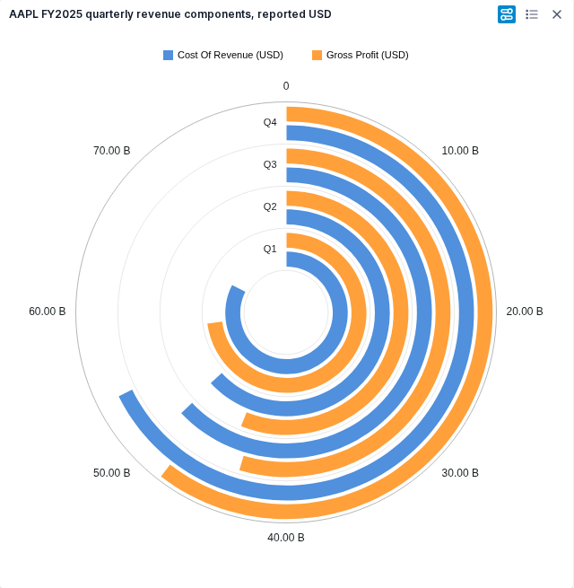
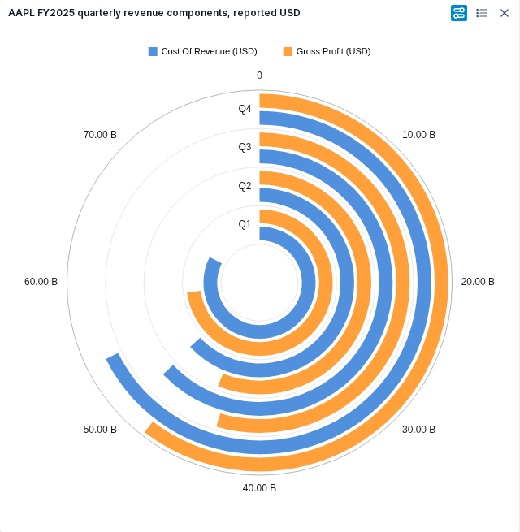
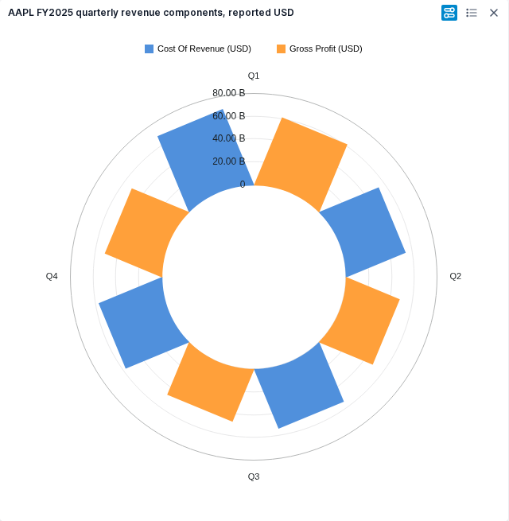
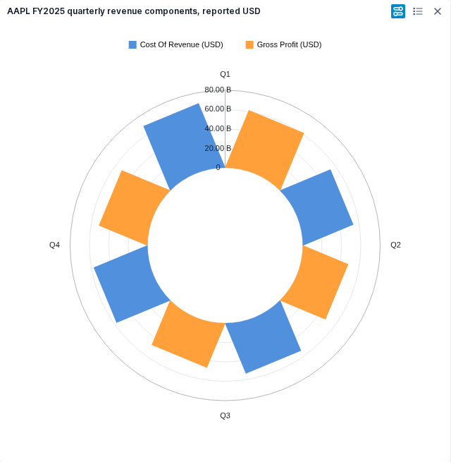

# Radial retained FMP comparison samples

These four light-theme PNGs are byte-for-byte copies of the final qView comparison images reviewed by the owner. They show AAPL FY2025 quarterly cost of revenue and gross profit in reported USD. Original and replacement panels are visual references, not a pixel-identity claim.

The final replacement image and packaged runtime identity were independently verified in [the RC4 review](final-acceptance-review.md): source `9d007b2f40b65ec5f1e2e760787a9fc2d9e4e3d5`, image `sha256:f1b71c759334ea08bf1a197a12ce855ac5252ab2d0acd87469f1398dae0f5291`. The originals remain separately identified as OpenBB Workspace `38dffc33389aca0e4a87e0e88d42f7067aa220df` in [the original comparison analysis](bar-visual-analysis.md). Final automated journeys separately verified both light and dark themes; these compact samples preserve the owner-reviewed side-by-side comparisons.

| Family | Original | Replacement |
| --- | --- | --- |
| Radial Bar |  |  |
| Radial Column |  |  |
