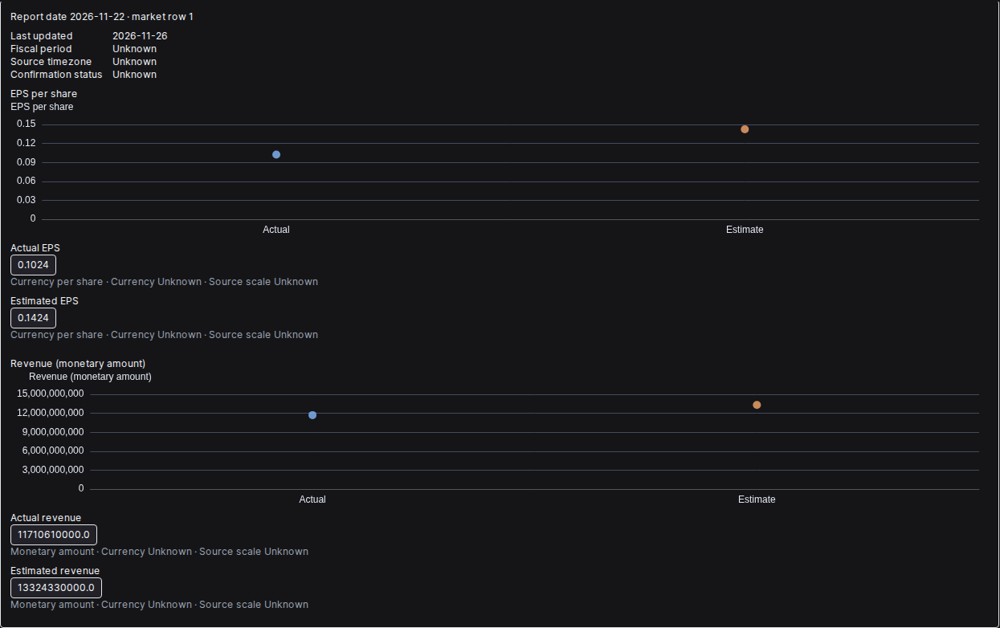

# Events and Documents live FMP verification

The November 27, 2026 journey verified the installed document inputs and the calendar's source-order coverage limit. The Workspace consistently reported **Partial evidence, 3 of 4 usable inputs**. MSFT's July 30, 2025 calendar record was present in FMP's full response at source row 1,334, beyond the 250 rows returned to the Workspace. The intended MSFT earnings chart remains unwitnessed in the live journey. [Sanitized ledger and per-receipt comparisons](live-summary.json)

## Candidate and request budget

| Service | Source revision | Installed image |
| --- | --- | --- |
| Workspace | `4a079a0384df7151fde8ce3b90d2af6e1f50a1b9` | `sha256:25fcec114dcd25a6cbb0edacadbfd3b29ff625557efd159ed5aeb73c763099f4` |
| Data API | `5583c958d35282cb59037aae8218cec31d540697` | `sha256:c5cbb466ec28790c38cfac02dab3c9bc7b8f51740f27874b91bcf73eb5ceb524` |

The single headless Chromium 156.0.8078.4 live run used the approved maximum of 15 provider sends. It sent four at launch, three at the AAPL-to-MSFT listing change, one per bound edit and four on authenticated reopen. Invalid symbol input, display changes, save and template export added zero sends. All 15 requests returned HTTP 200 at FMP and at the mounted Data API. There were zero guard denials, zero remaining sends, zero uncorrelated receipts, zero uncaught browser exceptions, and zero recorded browser console or network errors. The owned runtime stopped after collecting the ledger. [Frozen tuples](../../../tests/e2e/events-documents-plan.json)

The operator loaded only the FMP key from the project environment file into the launcher subprocess. The isolated browser ran without provider credentials. The executed command was `pipeline/.venv/bin/python tests/e2e/run_events_documents.py live`, using Node 24.22.1, the isolated Playwright browser cache and the local Docker socket. Before live acquisition, the guarded startup and controlled journey passed with zero provider sends. The controlled browser completed 34 acquisitions across 18 scenarios. The live browser passed. The live launcher exited 1 because its first oracle attempted to decode compressed provider bodies as UTF-8. The offline oracle now verifies the original raw-byte hashes, decompresses gzip and parses numeric tokens without rounding. Its offline rerun passed the same-send comparison. The launcher would still report incomplete live coverage for the missing issuer calendar row. [Runner](../../../tests/e2e/run_events_documents.py) and [oracle](../../../tests/e2e/events_documents_oracle.py)

## Live observations and open coverage

| Input | Same-send evidence |
| --- | --- |
| Earnings calendar | Launch returned 2,028 source rows for November 16–22, 2026 and retained source rows 1–250. Neither AAPL nor MSFT occurred in that provider response. Both the July 30, 2025 edit and reopen returned 1,440 source rows, including MSFT at zero-based ordinal 1,333. The retained 250 rows matched the source prefix in order, dates, update dates, missing values and all four numeric fields. The browser identified each clipped slice and displayed the selected listing and effective market window with the provider retrieval timestamp. The selected listing had zero UI rows in every live view. |
| SEC filings | Verified 44 returned and displayed rows across four receipts, with 20 for launch, 20 after switching to MSFT, two after editing bounds, and two on reopen. The checks compared filing date, accepted timestamp, form, CIK and distinct report and index targets. |
| Earnings-call transcript | Verified four returned and displayed transcripts, one per acquisition. The browser matched the selected company, fiscal period, event date or timestamp when supplied, and literal transcript text with the completeness-unknown label. |
| Company news | Verified 40 returned and displayed rows across four receipts. The checks compared company, headline, published timestamp, site, publisher, literal excerpt and link target, and inspected the content-status label. |

The same-send checks compared the retained 750 calendar row instances across the three provider receipts.

| Field | Numeric values matched in Data API rows | Missing values matched in Data API rows | Live UI marks | Live UI missing labels |
| --- | ---: | ---: | ---: | ---: |
| Actual EPS | 690 | 60 | 0 | 0 |
| Estimated EPS | 439 | 311 | 0 | 0 |
| Actual revenue | 626 | 124 | 0 | 0 |
| Estimated revenue | 502 | 248 | 0 | 0 |

The zero live chart marks apply separately to actual EPS, estimated EPS, actual revenue and estimated revenue. No live per-field `Missing` label was observed for either selected listing. No request returned an empty response body or an entitlement error. The no-issuer message described the retained market slice. The browser also displayed that wider-market coverage was unknown. The frozen calendar acquisition did not establish live rendering for MSFT even though FMP supplied that company's record. The clipped source row carried actual and estimated EPS of 3.65 and 3.37 and actual and estimated revenue of 76,441,000,000 and 73,926,767,276. Those values are from the raw capture. FMP reported a last update of October 29, 2025 and the receipt was retrieved on November 27, 2026.

The browser matched the provider retrieval timestamp and effective scope for each displayed receipt. Retrievals spanned 12:27:15–12:27:55 UTC on November 27, 2026. Source update dates and document event timestamps remain distinct from these receipt times. The browser verified the partial conclusion after each acquisition stage. The saved widget and the exported template preserved the selected listing, four bounds and display modes. The tests compared their storage structure and scanned for acquired document text. A fresh authenticated context restored the choices and made the planned four acquisitions. [Browser journey](../../../tests/e2e/events-documents-workspace.spec.mts)

## Earnings chart sample

*0151.HK actual and estimated EPS in currency per share and revenue in monetary amounts, report date November 22, 2026. FMP supplied neither currency nor source scale. Workspace revision `4a079a0384df7151fde8ce3b90d2af6e1f50a1b9` displayed point marks without converting the values. The replay used the installed Data API response from live launch receipt 2, source ordinal 0. Last updated November 26 and acquired November 27, 2026 at 12:27:17.938855 UTC.*

The browser replay used the captured calendar response byte for byte on the same packaged Workspace, with zero provider sends and zero guard denials. It selected 0151.HK and GMGMF from the retained rows of the same receipt. The three document slots used empty replay responses to isolate the chart. The oracle compared the original FMP bytes, normalized fields, displayed numbers and exact tooltip tokens. It verified 12 painted mark coordinates and their row and field identity, units and date across bar and point displays.

| Listing and source ordinal | Actual EPS | Estimated EPS | Actual revenue | Estimated revenue |
| --- | ---: | ---: | ---: | ---: |
| 0151.HK, 0 | 0.1024 | 0.1424 | 11,710,610,000 | 13,324,330,000 |
| GMGMF, 3 | -0.04375 | Missing | 209,235 | Missing |

The GMGMF replay displayed both `Missing` labels and drew no estimate marks in either display. Its last update was November 24, 2026. The evidence verifies real-data charts within the retained calendar slice during offline replay. It leaves the live MSFT chart and live selected-issuer missing-value behavior open.

Two initial replay attempts encountered an on-screen Workspace connection confirmation that covered the chart hover position. The final replay closed the confirmation through its UI control before testing the chart. The final guard ledger recorded zero sends. The screenshot contains only the earnings article. Visual and file checks found no credentials, account details, document text or hidden PNG text chunks. The exact image SHA-256 is recorded alongside the replay checks for independent review. [Replay evidence and sample hash](live-summary.json)

On the final harness, 12 focused verification tests passed. The replay uses `pipeline/.venv/bin/python tests/e2e/run_events_documents.py controlled --replay-launch-calendar <owned-capture-directory>`. The source directory holds private receipts and is required for offline verification. [Focused verification tests](../../../tests/e2e/test_events_documents_verification.py)
