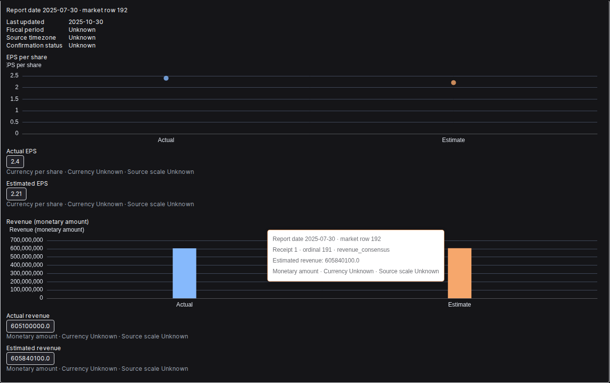

# Supplemental live Events and Documents verification

The supplemental native Workspace journey verified all four earnings marks on MORN and the two missing-estimate labels on DRQ using live FMP data. It exercised the listing switch, one bound edit for each input, save, template export, and fresh authenticated reopen. The reopened MORN result had three of four usable inputs because FMP returned an empty 2025 Q2 transcript. DRQ supplied a live transcript and had an empty news response. [Per-receipt verification and safe ledger](supplemental-summary.json)

## Candidate and guard

| Service | Tested source | Installed image |
| --- | --- | --- |
| Workspace | `4a079a0384df7151fde8ce3b90d2af6e1f50a1b9` | `sha256:25fcec114dcd25a6cbb0edacadbfd3b29ff625557efd159ed5aeb73c763099f4` |
| Data API | `5583c958d35282cb59037aae8218cec31d540697` | `sha256:c5cbb466ec28790c38cfac02dab3c9bc7b8f51740f27874b91bcf73eb5ceb524` |

The frozen supplemental schedule had SHA-256 `3909e84682f88ae7d5779fc47d93891490163fad6a08c7b0d403fc2671bccd33`. The first offline preflight exposed the installed 31-day company-news window limit. The final preflight validated the corrected 29-day window and matched the four restored query tuples after fresh login. It canceled 14 browser requests, including 10 while configuring the native app and four while verifying the restored app. Both preflight attempts sent zero provider requests. [Frozen DRQ-to-MORN plan](../../../tests/e2e/events-documents-supplemental-plan.json)

The live installer used the packaged catalog and saved the DRQ choices through the Workspace UI. During this setup, the browser canceled 10 requests while the guard was disarmed. The live test provided no substitute response bodies. After setup it opened the saved app in a fresh authenticated context, then captured every allowed send from the installed Data API. The browser process had no FMP credential. One headless Chromium 156.0.8078.4 worker ran the journey.

The guard recorded 15 actual sends with zero denials. All returned upstream HTTP 200. Eleven normalized to HTTP 200 and four empty arrays normalized to HTTP 204. Chart display changes, an invalid symbol edit, save and export caused no extra requests. The isolated browser recorded no unexpected console or network errors, and the owned runtime stopped. The browser exited 0 and the independent oracle passed offline against the original compressed captures. The launcher exited 1 because the reopened MORN transcript was empty and its final all-input assertion gates on usable evidence.

## Same-send comparison

The launch calendar covered July 29–30, 2025. The calendar edit and reopen covered July 30. The raw calendar counts were 2,607, 1,440 and 1,440 respectively. The Data API normalized the first 250 rows in FMP source order. Every retained date, listing, source update date, all four numeric-or-missing fields and clipping flag matched across the three captures. The launch calendar was reused for the listing switch. It put DRQ at source ordinal 232 and MORN at ordinal 191. The single-day receipts also put MORN at ordinal 191.

| Chart field | Live painted marks matched | Live Missing labels matched | Numeric values matched across 750 normalized rows | Missing values matched across 750 normalized rows |
| --- | ---: | ---: | ---: | ---: |
| Actual EPS | 4 | 0 | 726 | 24 |
| Estimated EPS | 3 | 1 | 486 | 264 |
| Actual revenue | 4 | 0 | 678 | 72 |
| Estimated revenue | 3 | 1 | 540 | 210 |

The chart check compared painted mark position, receipt-local row identity, exact value, measure and unit against the same-send normalized row and FMP payload. DRQ displayed actual EPS 0.2219 and actual revenue 224,234,000. Both estimates displayed `Missing` and had no marks. MORN displayed actual and estimated EPS of 2.4 and 2.21 and actual and estimated revenue of 605,100,000 and 605,840,100. FMP did not specify the currency or scale for either row. Both rows reported July 30, 2025, with provider last updates of September 30 for DRQ and October 30 for MORN. The launch receipt was acquired November 27, 2026 at 12:47:02.606921 UTC. The reopened MORN receipt was acquired at 12:47:32.646054 UTC that day.

The same-send oracle matched 25 filing rows, one transcript and 16 news rows across the journey. The browser verified their listing, applicable bounds and text or link details, with retrieval timestamps and content-status labels. DRQ's Q1 transcript was present while its news array was empty. MORN's Q1 and Q2 transcript queries were empty, including the Q2 fresh reopen. The conclusion was `Partial evidence · 3 of 4 FMP inputs have usable evidence.` after each named stage. No entitlement error occurred. The save and export assertions compared exact widget choices and scanned for acquired document text. A fresh authenticated context restored the listing, four bounds and display modes, then sent the four planned requests. [Packaged browser journey](../../../tests/e2e/events-documents-workspace.spec.mts) and [same-send oracle](../../../tests/e2e/events_documents_oracle.py)

## Live earnings chart sample

*MORN actual and estimated EPS in currency per share and revenue in monetary amounts, report date July 30, 2025. FMP currency and source scale were both unknown. Tested Workspace revision `4a079a0384df7151fde8ce3b90d2af6e1f50a1b9` displayed EPS points and revenue bars without unit conversion. Captured at authenticated reopen using live provider receipt 12, source ordinal 191. The tooltip's receipt number identifies the Workspace's local render generation.*

The screenshot is the cropped earnings article from the live browser. Visual inspection and PNG chunk verification found only chart details and no authentication or private account data. Its exact SHA-256 is `4750bc9bb89f622ff6c25bfbb9e1950177a219a11ee8bf8211e45265e92aa0fa`. [Original MSFT journey and reproduced chart scope](live.md)

## Four usable live inputs on CVNA

A targeted four-send run on the same candidate verified `Evidence available · 4 of 4 FMP inputs have usable evidence.` for CVNA. The frozen plan used the July 30, 2025 calendar, July 29–August 10 filing and news windows, and the 2025 Q2 transcript. The Workspace loaded the native app with those saved choices in a fresh authenticated session. Setup canceled 11 browser requests and sent none to FMP. All four live requests returned HTTP 200 at FMP and the installed Data API. The browser and same-send oracle both exited 0. No unexpected console or network errors, empty responses, guard denials or entitlement failures occurred. [Targeted plan](../../../tests/e2e/events-documents-four-input-plan.json) and [sanitized four-input evidence](four-input-summary.json)

The CVNA row was source ordinal 227 in the retained calendar slice. FMP last updated it August 17, 2026. The test acquired it November 27, 2026 at 12:50:37.564468 UTC. The browser verified actual and estimated EPS of 0.26 and 0.2334 in currency per share and actual and estimated revenue of 4,840,000,000 and 4,577,023,000 in monetary amounts. Currency and source scale remained unknown. It matched 20 SEC filings, one Q2 earnings-call transcript and 10 news items to the same four receipts.

The three live runs used 34 actual sends in total. The original MSFT journey used 15, the integrated DRQ-to-MORN journey used 15 and the CVNA proof used four. The offline seed checks and earlier replay added zero provider sends. The final focused verification suite passed all 13 tests. [Verification tests](../../../tests/e2e/test_events_documents_verification.py)
