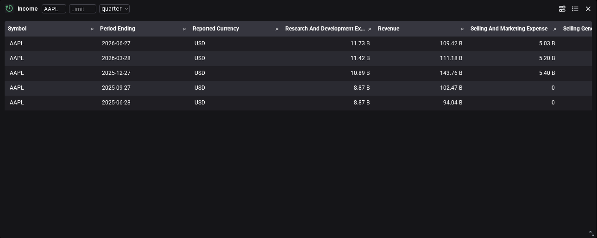

# Packaged financial exploration accepted

Task 6.2 is accepted on 2026-10-30. The Full Workspace and data API run together from the two exact local Dagger images without source overlays. One maintained browser journey passed in 34.6 seconds, with no skipped cases or retries. Its test body took 26.895 seconds. Independent review accepted the corrected viewport checks and the financial, error and persistence evidence.

The analyst adds the native Income widget, selects AAPL and MSFT annual data, returns to cached AAPL data, and changes to quarterly reporting. Currency, fiscal date and revenue agree with the observed API responses at the displayed precision. Each checked cell is scrolled into the clipped grid viewport. The source tooltip identifies FMP and the connected backend. Clearing the required symbol produces a safe validation error and hides the previous rows; restoring AAPL recovers the data. Refresh, a matching programmatic query, saved parameters and reopening in a fresh browser context all pass.

FMP observations through the fiscal quarter ending 2026-06-27, reported in USD. Revenue is displayed in billions; the source amount is 109,417,000,000 USD and the displayed value is 109.42 B. This is a provider observation, not a local financial calculation. The screenshot comes from the accepted packaged run.

The run records seven observations and nine browser income requests: five successful data requests and four expected missing-input failures, including the native retry. One additional programmatic request compares the same successful query. Cached revisits retain their original provenance. CDP, console and network checks contain only the explicitly expected validation failures; the reopened context is clean. No provider quota count is inferred from browser requests.

Catalog discovery checks all eleven native definitions alongside the existing gallery. Only Income receives this complete UI journey; this does not promote all eleven widget checks or establish an installer's entitlements. Financial metadata is checked separately through the API, while the existing UI exposes currency, date and source attribution. No financial metadata pane or financial modeling layer is added.

The scoped gate passes 79 maintained files with no size or parser violations. Tests are excluded from production caps; both configurations are within their limits. Application code, provider code, dependency sets and source pins are unchanged. The generic verification entry point still discovers its original eight infrastructure cases; the financial journey has its own configuration and reuses the maintained browser fixtures.

See [independent review](review.md) and [exact source and image identities](final-source.json). Earlier failures corrected test assumptions about the current picker, initialization, missing inputs and Radix tooltips. Independent review also caught offscreen AG Grid overscan; the accepted run adds an explicit viewport assertion and shows Revenue on screen. These verification repairs make no production bug-fix claim.

Main batch progress is 25/26. These are local image identities, not published release acceptance. Task 6.3 publishes and verifies the image pair and installation assets; owner-server deployment remains separate.
