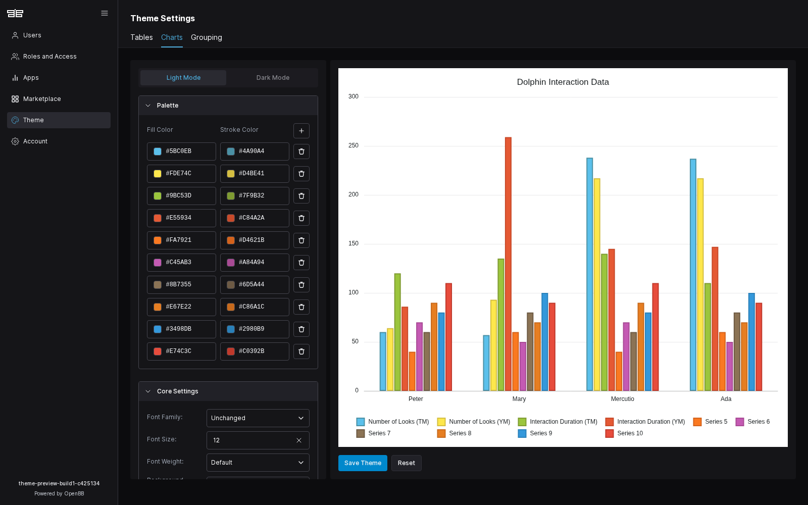
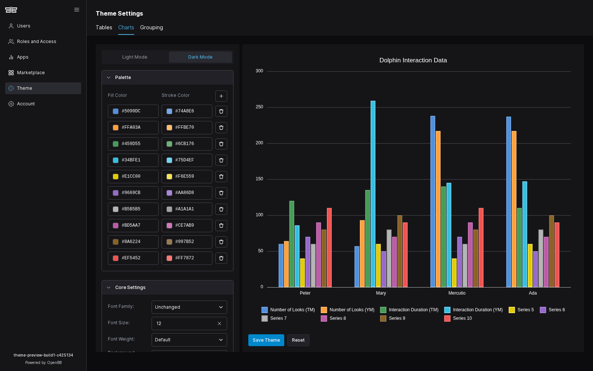
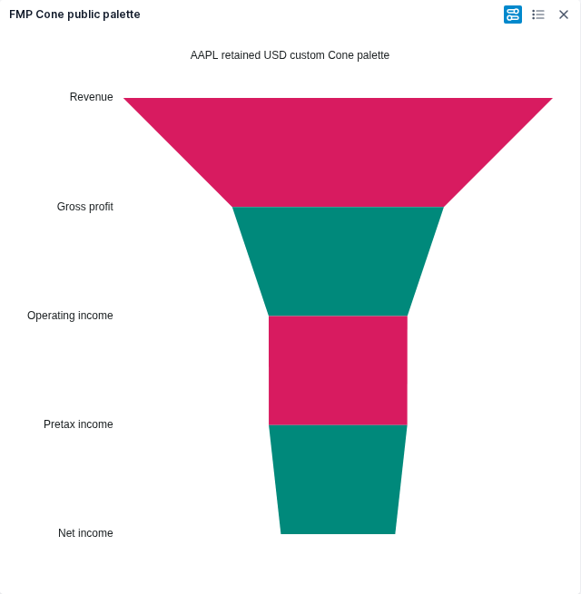

# Theme Settings preview application acceptance

The native preview and functional Padding are accepted on 2026-10-27. Two isolated, one-worker browser journeys passed in one minute against locally built image `sha256:9b0db4b2a3021cd8554b60bf3302affd9740d7087e672bf42594197f6dc2cd9b`, Workspace `c425134e95ac47961143988b5da315abb2969ae1` and QOpenBB `7cdb3bc`. The runtime used only disposable data, with no source overlay. The owner accepted the light/dark appearances in qView, including legend wrapping of 6+4 instead of 5+5 and small plot-spacing differences.

Padding 0 and 40 moved the rendered title anchor from y=8.5 to y=48.5 and changed the actual focused bar geometry. The journey verified keyboard and pointer tooltips, legend navigation/toggling/isolation, six-page narrow overflow, invalid-to-valid recovery, palette removal/addition, mode drafts, saved payloads, fresh-login read-back and Reset. All twelve console/page/request/HTTP diagnostic arrays across the two journeys were empty. Independent review verified the run and all 22 captured input hashes.

The preview retains the synthetic Dolphin Interaction Data sample; it is not FMP data. A separate ordinary File/Cone journey verified that a saved public palette reached real retained FMP values and the exported PNG. The AAPL FY2026 Q2 record dated 2026-03-28 contains revenue USD 111,184,000,000; gross profit 54,781,000,000; operating income 35,885,000,000; pretax income 35,833,000,000; and net income 29,578,000,000. These are unscaled reported income levels, not additive movements or a causal conversion pipeline. The source was `/stable/income-statement`, symbol AAPL, quarterly, limit 40, retrieved 2026-10-20T14:06:05.149732+00:00; retained fixture SHA-256 `c6b74bd3da1bca8d74438cf441e5b784c40ca27cc4e70d11da42cb34d7b206e8`.

Browser tests ran from `cdefb7638c0991281551db66415328e420287009`; its only difference from the image's source is a test-only full-page screenshot correction. The tested production code is unchanged. The later CI image bytes and release remain separate verification; no server deployment is claimed. Advanced paints, other caller integrations and general cross-widget chrome propagation remain open.

Original reference and accepted replacement, at the same viewport:

