# Choose a chart by the question you need to answer

Start with the research question, then check the units and transformation beside the chart. This gallery uses fixed historical FMP observations around January 2025 so that the same view can be inspected again. A price path, a revenue partition and an income bridge answer different questions even when their shapes look similar.

The screenshots below show all 36 native chart configurations in the local candidate, using the retained historical datasets. The gallery is not yet in the published alpha. Retained-state container recreation remains unverified; see the [capture evidence and current limitation](../artifacts/reviewed/chart-gallery/verification.md). Chart availability and renderer acceptance are tracked separately in [chart status](echarts-status.md).

| Your question | Start here |
|---|---|
| What changed, and which observation is larger? | [Compare levels and paths](#compare-levels-and-paths) |
| How does a total divide into components? | [Compare composition](#compare-composition) |
| Does the quarterly pattern repeat? | [Compare seasonal profiles](#compare-seasonal-profiles) |
| How do return, volatility and trading activity relate? | [Compare relationships](#compare-relationships) |
| How wide or uneven is the observed distribution? | [Inspect distributions and ranges](#inspect-distributions-and-ranges) |
| How do reported income measures reconcile or compare? | [Explain reconciliation and income levels](#explain-reconciliation-and-income-levels) |
| Which measures need different marks or axes? | [Combine measures](#combine-measures) |

## Open and retain the demonstration

On a gallery-enabled installation, open **Apps** and select **QOpenBB Historical Chart Gallery - January 2025**. If the card is absent, follow the [backend connection steps](install.md) using your current Workspace origin followed by `/data`, then return to **Apps**. The **Overview** tab contains twelve representative charts; the six family tabs contain all 36 demonstrations. Each entry below explains the saved demonstration first, then the analytical question and the limits of its encoding. Editing a demonstration changes its saved configuration; it does not fetch a different historical window.

The data API packages the historical observations and native app template together. Gallery dataset reads use that retained snapshot rather than issuing new FMP requests. The snapshot is `fmp-historical-2025-01-v1`; its source timestamps and transformations are retained with the datasets. Provider credentials are still required by the installation's broader readiness contract. A saved dashboard is not a substitute for the matching data API image.

For a newly opened gallery, save and reload the dashboard before changing Custom Combination series types. The immediate first-mount edit currently reverts; the same edit saves correctly after reload. This workaround was checked on the local candidate.

For container replacement, preserve `./data/workspace` and your private `.env`, and use matching Workspace and data API image references as described in [installation and updates](install.md#state-and-updates). The Workspace bind mount retains user state; the data API image supplies the historical datasets and template. Resume an edited dashboard from the sidebar or its saved URL. Selecting the Apps card again can open another copy. Retained-state recreation remains pending verification for this gallery; if a replacement loses the saved mappings or changes the observations, it fails the reproduction contract.

## Read the data before the shape

The market sample contains Apple (AAPL), Microsoft (MSFT), NVIDIA (NVDA), Amazon (AMZN), Alphabet Class A (GOOGL) and Meta Platforms (META). It is a selected group of US equities, not a market benchmark or a diversified portfolio. Price observations cover 2024-09-30 through 2025-01-31; the main market comparison is January 2025. The longer window supports October 2024 through January 2025 return distributions and monthly comparisons.

The FMP price endpoint is `stable/historical-price-eod/full`, with fixed `symbol`, `from=2024-09-30` and `to=2025-01-31` parameters. Prices were retrieved on 2026-10-27. Fundamentals use the retained AAPL quarterly income-statement response: FY2022 through FY2024, plus FY2025 Q1, whose period ended 2024-12-28 and whose filing date is 2025-01-31. Fiscal labels follow the provider; FY2022 Q1 ends in December 2021. A fiscal quarter is not a calendar quarter.

These are historical observations retrieved later. They may include later adjustments or restatements. They do not establish what a user could have retrieved in January 2025. Price returns use the response's `close` field consistently; the gallery makes no total-return, dividend-reinvestment or point-in-time-vintage claim.

### Fixed recipes

| Recipe | Observations and transformation |
|---|---|
| January prices | Daily `close`, 2025-01-02 through 2025-01-31, in USD/share. Preserve trading dates; do not fill weekends, holidays or absent prices with zero. The saved date category axis spaces observed trading sessions equally; a weekend or holiday does not create a wider interval. |
| Daily returns | Sort each symbol by date. For each observed trading day, calculate `r(t) = 100 * (close(t) / close(previous trading day) - 1)`. Units are percent. Retain 2024-09-30 as the preceding close for October. A missing preceding close produces a missing return. |
| Monthly returns | For each October 2024 through January 2025 month, calculate `100 * (last close in month / last close before month - 1)`. January uses the final December close, not the first January close. This is a compounded price change, not the arithmetic sum of daily returns. |
| January relationship | One row per symbol. X is sample standard deviation of January daily returns, `sqrt(sum((r-mean(r))^2)/(n-1))`, in percent per trading day. Y is the January monthly return in percent. Size is the January mean of `close * volume`, in USD/day. Use matching observations and report a missing result when fewer than two returns remain. |
| Revenue components | For each AAPL FY2024 quarter, use `costOfRevenue` and `grossProfit`. Their sum equals `revenue`. Express amounts in USD billions by dividing reported USD by `1e9`; keep full precision for calculations. |
| Seasonal revenue | AAPL revenue for Q1 through Q4, with separate FY2022, FY2023 and FY2024 series, in USD billions. Each spoke compares the same financial measure. |
| Latest reported quarter | AAPL FY2025 Q1, period ended 2024-12-28, filed 2025-01-31. Use original reported USD, or USD billions where labelled; EPS is USD/share. |
| Income combinations | AAPL quarterly revenue and net income for FY2024 Q1 through FY2025 Q1, in USD billions. The custom combination adds reported basic `eps`, in USD/share, on the right axis. |

All returns are price returns. Daily volatility is not annualized. `close * volume` is a trading-activity proxy using the closing price, not an executed-notional measure, company revenue or market capitalization. Rounding belongs in labels, after calculation. Omit a missing observation or show a gap; do not silently substitute a zero. Colors identify the stated series or category unless a continuous color scale is explicitly described. Marker size is constant unless a size field is stated.

## Compare levels and paths

### Grouped Column: compare January performance

Use this view to compare the six equities' January 2025 price returns. X is company name and symbol; Y is January close-to-close return in percent. Color identifies the return series; bar width has no financial meaning. Use the monthly-return recipe and a zero baseline. A taller bar represents a larger percentage change, not a larger dollar profit or a portfolio contribution.

The native column axis thins company labels at this width. The [horizontal version](#groupedBar) shows all six names together.

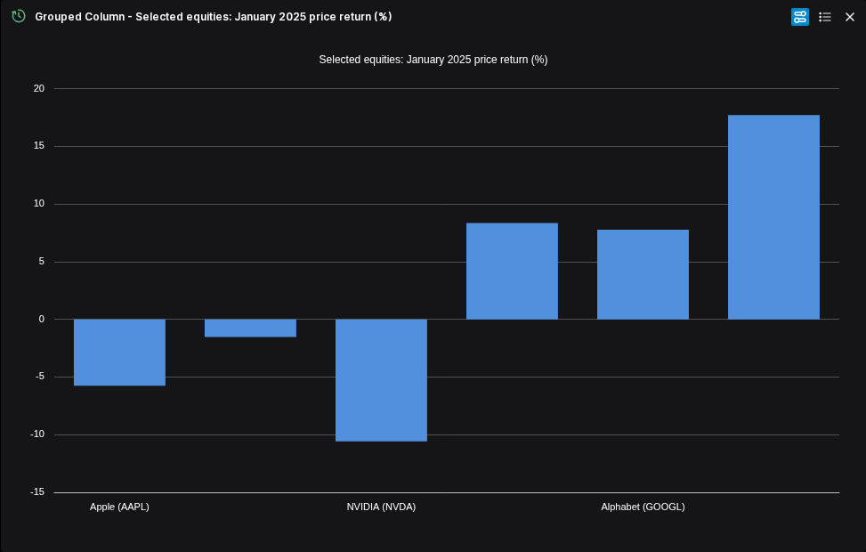

### Grouped Bar: compare monthly returns horizontally

Use horizontal bars when symbol labels or ranking matter more than time order. Y is company name and symbol; X is January 2025 price return in percent. Color identifies the return series; thickness is constant. Keep the same monthly-return formula and zero baseline as Grouped Column. Sorting changes the reading order, not the observation window; label negative returns explicitly.

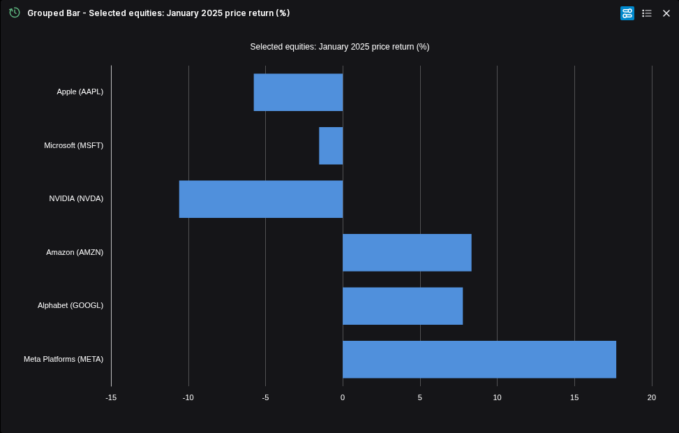

### Line: inspect daily price paths

Use this view to locate changes within January 2025. X is trading date with equal spacing between observed sessions; Y is close in USD/share; color identifies the named company. Size is constant. Hover a date to compare all six closes in the Shared tooltip. Horizontal distance measures session count, not elapsed calendar days. A higher nominal share price does not imply stronger performance, a larger company or a greater portfolio weight. Use the return comparison for performance across symbols.

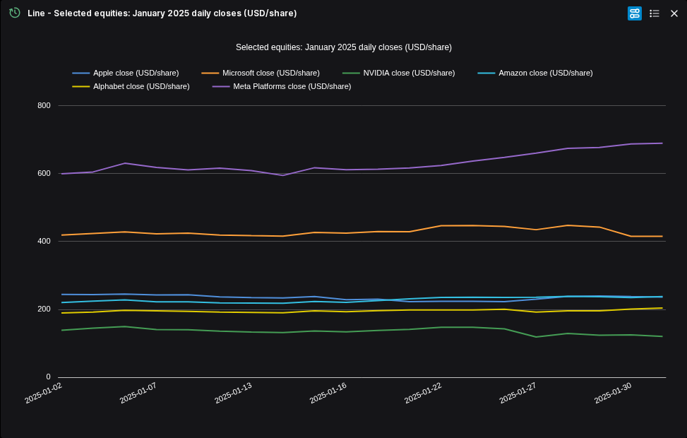

### Area: inspect one price path against its baseline

Use the AAPL January 2025 close series when a filled path helps show its level through time. X is trading date; Y is USD/share; color identifies AAPL. Fill opacity and area do not encode volume or accumulated value. Keep the series unstacked and retain the labelled baseline. Integrating the filled region would not produce investment profit.

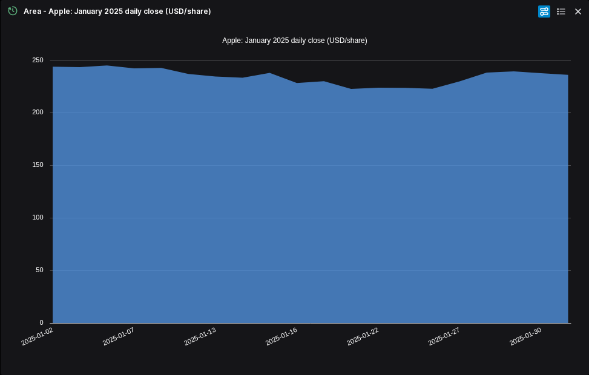

## Compare composition

The stacked demonstrations use mutually exclusive cost of revenue and gross profit. Their total is revenue. Revenue and gross profit together would double-count part of the business; stock prices have no additive interpretation here. For normalized views, each component is `100 * component / revenue` within its quarter. The plotted axis is percent; native legends retain the source-field names, including their original USD-billion units. A 100% total removes information about the quarter's absolute size.

### Stacked Column: compare quarterly revenue and its split

Use AAPL FY2024 Q1 through Q4 to compare total revenue and its components together. X is fiscal quarter; Y is USD billions; color identifies cost of revenue or gross profit. Stack height is revenue; width is constant. Divide reported USD by `1e9`. Compare components away from the baseline with their labels because their floating boundaries make small differences harder to judge.

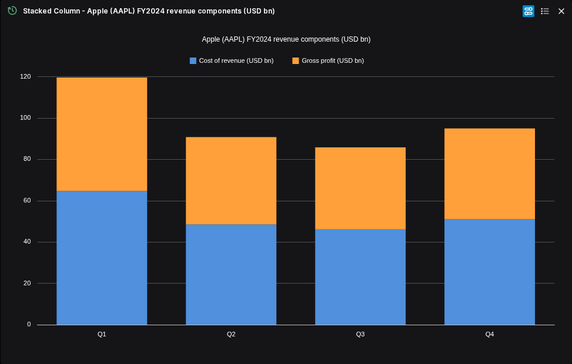

### 100% Stacked Column: compare gross-margin shares

Use the same four FY2024 quarters to separate mix changes from revenue scale. X is fiscal quarter; Y is percent of that quarter's revenue; color identifies cost of revenue or gross profit. Each positive stack totals 100%; width is constant. The gross-profit share is gross margin. Equal stack heights do not imply equal revenue.

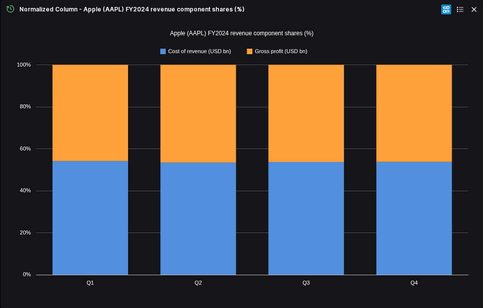

### Stacked Bar: compare revenue components horizontally

Use horizontal stacks for a compact quarter-by-quarter revenue comparison. Y is AAPL FY2024 fiscal quarter; X is USD billions; color identifies cost of revenue or gross profit. The combined bar is revenue; thickness is constant. Use the reported components without adding an overlapping revenue series. Horizontal orientation changes label placement, not the accounting identity.

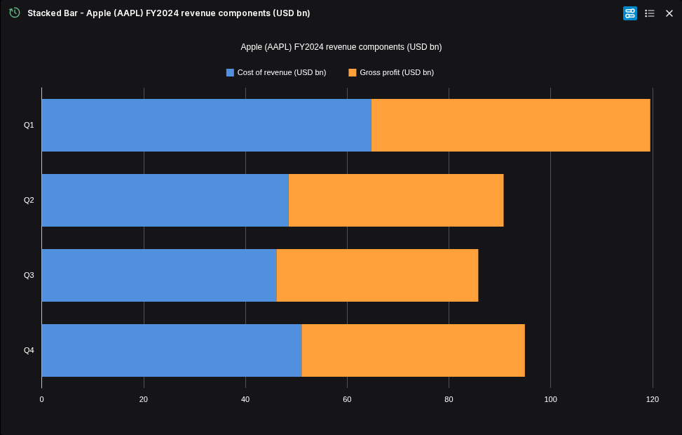

### 100% Stacked Bar: compare the cost share by quarter

Use AAPL FY2024 Q1 through Q4 when the question is how much of revenue remains after cost of revenue. Y is fiscal quarter; X is percent of revenue; color identifies cost of revenue or gross profit. Thickness is constant. Normalize each quarter separately. Read gross profit as a share of revenue; do not infer a dollar change from a percentage-point change.

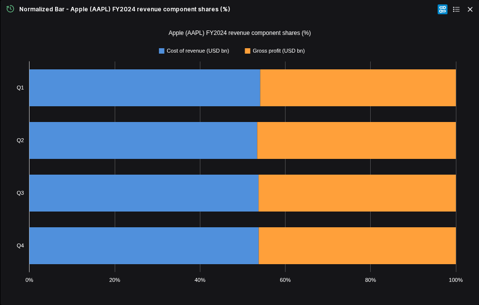

### Stacked Line: follow cumulative component boundaries

Use the four FY2024 quarters to inspect the cumulative boundaries of AAPL's revenue split. X is fiscal quarter; Y is cumulative USD billions; color identifies cost of revenue or gross profit. Marker size is constant. The upper boundary represents their sum, revenue; the upper series' own value is the difference between boundaries. The connection between discrete quarters does not add monthly observations.

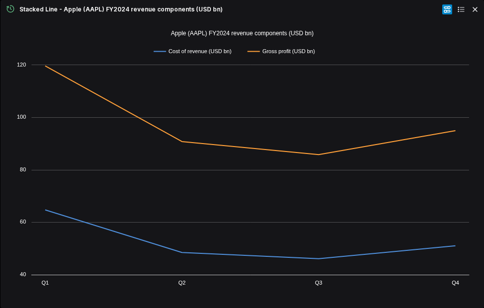

### 100% Stacked Line: follow cumulative revenue shares

Use the same quarterly components to inspect their normalized boundaries. X is FY2024 fiscal quarter; Y is cumulative percent of revenue; color identifies component; marker size is constant. Normalize within each quarter. The top boundary stays at 100% for the complete positive pair, so use the internal boundary and labels to read changes in gross margin.

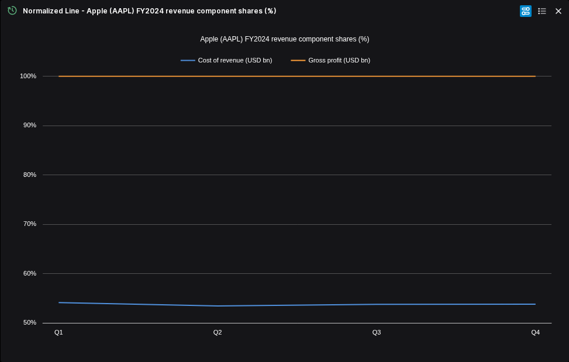

### Stacked Area: inspect the revenue partition across quarters

Use AAPL FY2024 Q1 through Q4 to show component bands and their combined scale. X is fiscal quarter; Y is cumulative USD billions; color identifies cost of revenue or gross profit. Band thickness represents the component; total height is revenue. The filled area between quarter points is a visual interpolation, not revenue earned on intermediate dates.

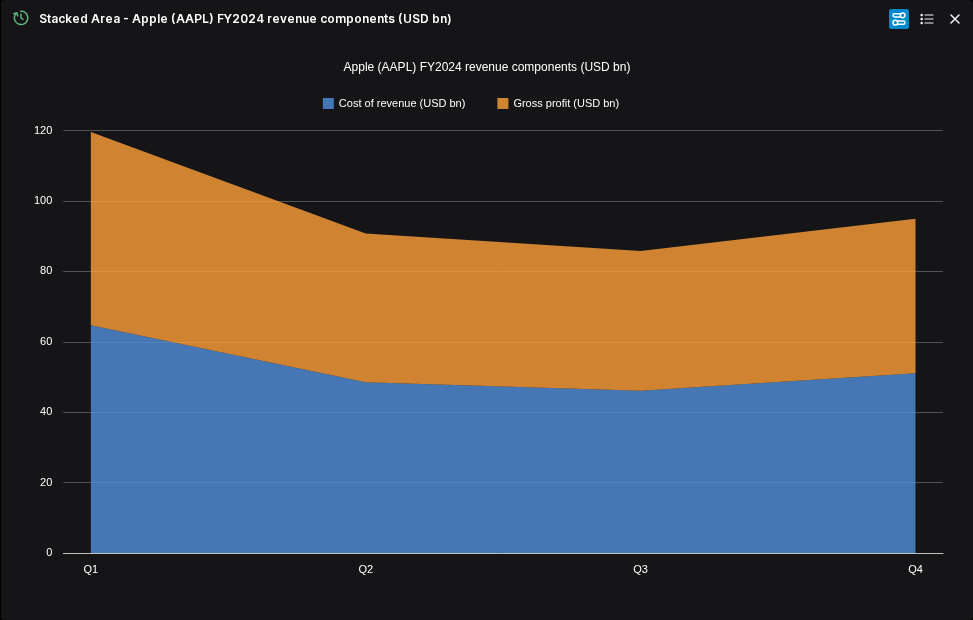

### 100% Stacked Area: inspect mix across quarters

Use normalized bands to focus on cost share and gross margin. X is AAPL FY2024 fiscal quarter; Y is cumulative percent of revenue; color identifies component. Each band's thickness is its percentage share; there is no separate size field. Normalize each quarter by its own revenue. This view deliberately hides absolute revenue and should be read beside a level chart when scale matters.

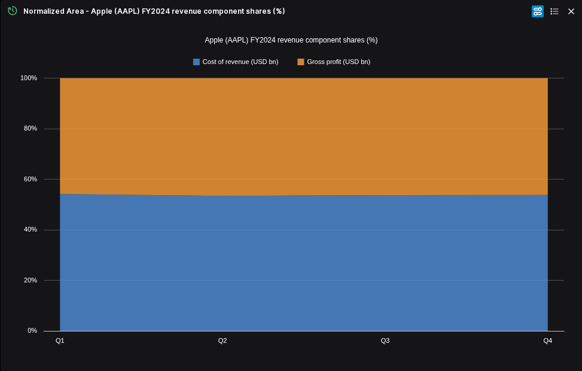

### Pie: inspect one reported revenue split

Use AAPL FY2025 Q1 to show the cost-of-revenue and gross-profit partition at one reporting date. Slice angle represents each component's fraction of revenue; color identifies component. Labels show USD billions and/or percentage; there are no X/Y axes or independent size field. Use the quarter ended 2024-12-28, filed 2025-01-31. Do not add revenue as a third slice or treat gross profit as net income.

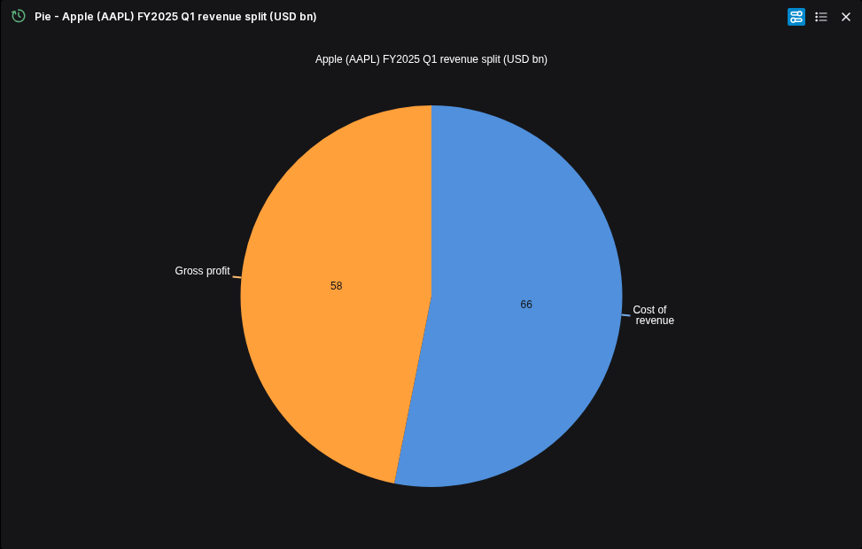

### Donut: inspect the same split with a central total

Use the same FY2025 Q1 components when a central revenue label is useful. Arc angle represents share of revenue; color identifies cost of revenue or gross profit. The hole and ring thickness are style choices, not data dimensions. Values are USD billions, with percentages derived from the same quarter's revenue. `doughnut` is an alias of `donut`, not an additional chart type.

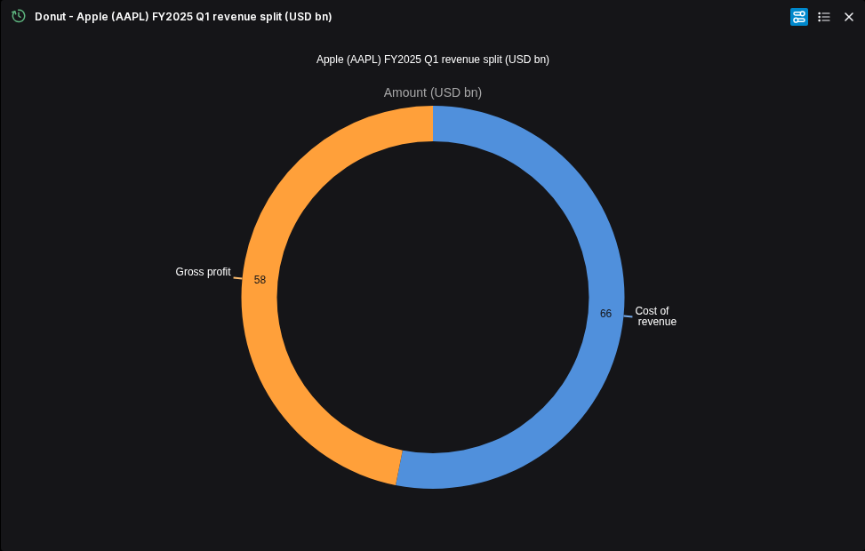

### Nightingale: compare a revenue split around a circle

Use AAPL FY2024 quarters as angular categories, with cost of revenue and gross profit stacked on the radial numeric axis. Radius encodes cumulative USD billions; color identifies component. Equal category sectors do not mean equal revenue, and sector area is not a linear dollar scale. Read the radial axis and component labels rather than estimating a percentage from apparent area.

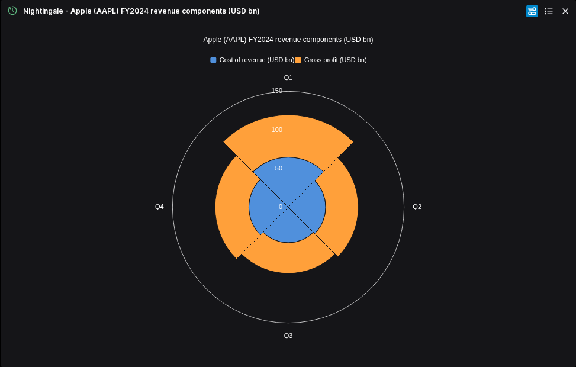

### Treemap: inspect nested revenue components

Use AAPL FY2024 revenue as a hierarchy: year, then quarter, then cost of revenue or gross profit. Rectangle area encodes leaf USD billions; nesting identifies parent membership and labels identify components. This demonstration uses a uniform blue fill, with no additional color variable. There are no financial X/Y coordinates or separate size field. Parent totals derive from their leaves. Include only the two mutually exclusive components at each quarter; adding the quarter's revenue as another leaf doubles its weight.

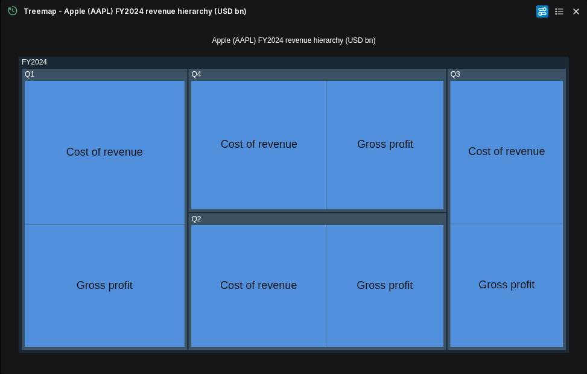

### Sunburst: inspect the same hierarchy by ring

Use the same FY2024 year-to-quarter-to-component hierarchy. Ring depth identifies hierarchy level; angular span allocates the USD-billion leaf weights within their parents. Labels identify components; the uniform blue fill carries no additional variable. Radius identifies depth, not financial magnitude. Compare siblings within a ring and inspect tooltips for amounts. Outer rings cover more area geometrically, so apparent area across rings is not a valid dollar comparison.

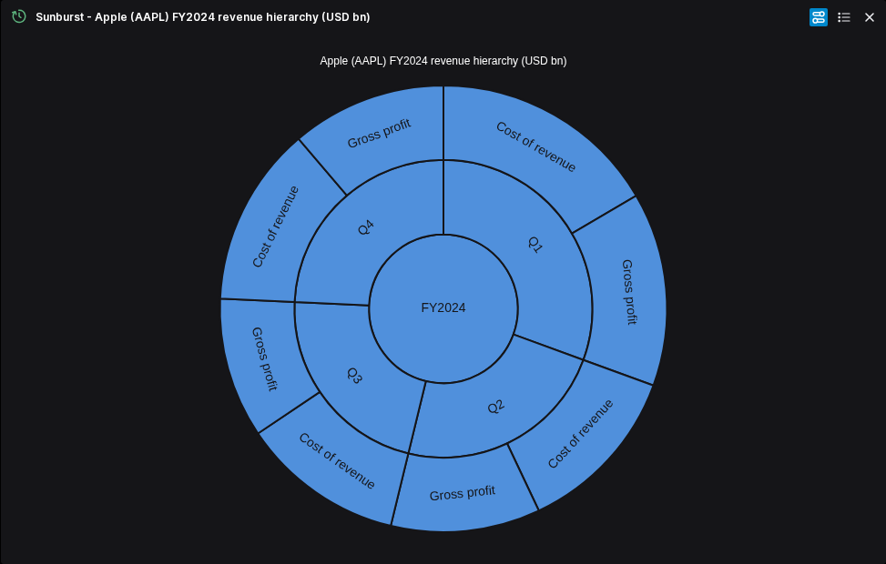

## Compare seasonal profiles

### Radar Line: compare quarterly revenue profiles by fiscal year

Use AAPL FY2022, FY2023 and FY2024 to compare seasonal shape. Spokes are Q1 through Q4; radial distance is quarterly revenue in USD billions; color is fiscal year. Marker size is constant. Use a common numeric scale for every spoke. Each point is the same financial measure; mixing revenue, EPS and margin on unnormalized spokes would make the polygon uninterpretable.

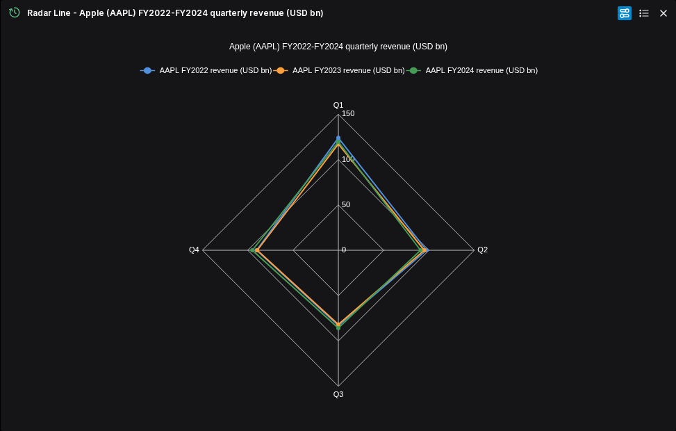

### Radar Area: compare filled quarterly profiles

Use the same Q1-Q4 revenue matrix for FY2022 through FY2024. Spoke is fiscal quarter; radial distance is USD billions; color identifies fiscal year. Filled polygon area is a shape cue, not annual revenue or a financial ratio. Use labels or the source quarters for exact comparisons, especially where fills overlap. Do not compare polygon area as if it were the sum of quarterly revenue.

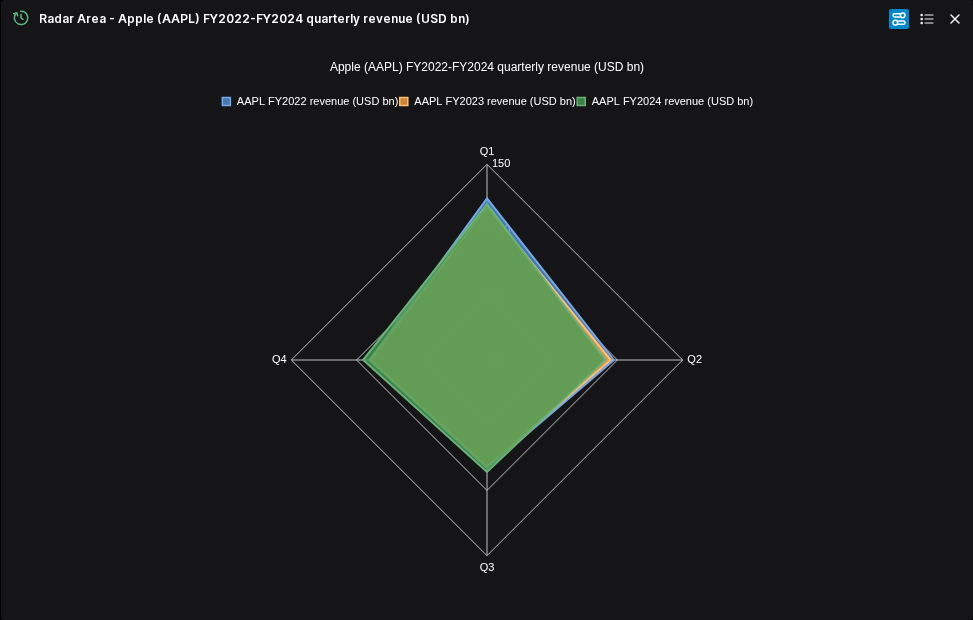

### Radial Column: compare quarterly revenue on a radial scale

Use AAPL FY2024 Q1 through Q4 for a circular alternative to columns. Angular position is fiscal quarter; radial extent is revenue in USD billions; color identifies the revenue series. Column width is a layout choice. Keep the numeric radial scale visible. The circular layout supports pattern recognition but makes precise level comparisons harder than a common-baseline column chart.

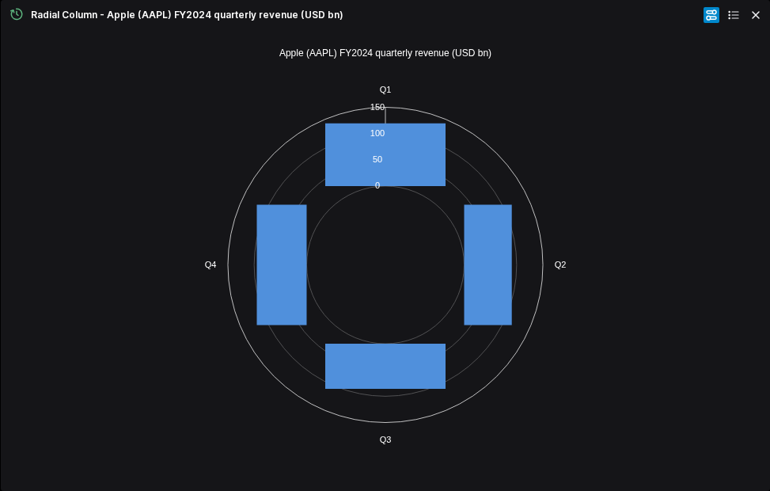

### Radial Bar: compare quarters as separate arcs

Use the same FY2024 quarterly revenue values. Radial band identifies fiscal quarter; angular extent encodes revenue in USD billions; color identifies the revenue series. Band thickness is constant styling. Read the numeric angular scale, not arc length alone: an outer arc can look longer because its radius is larger. Use ordinary bars when exact ranking is the main task.

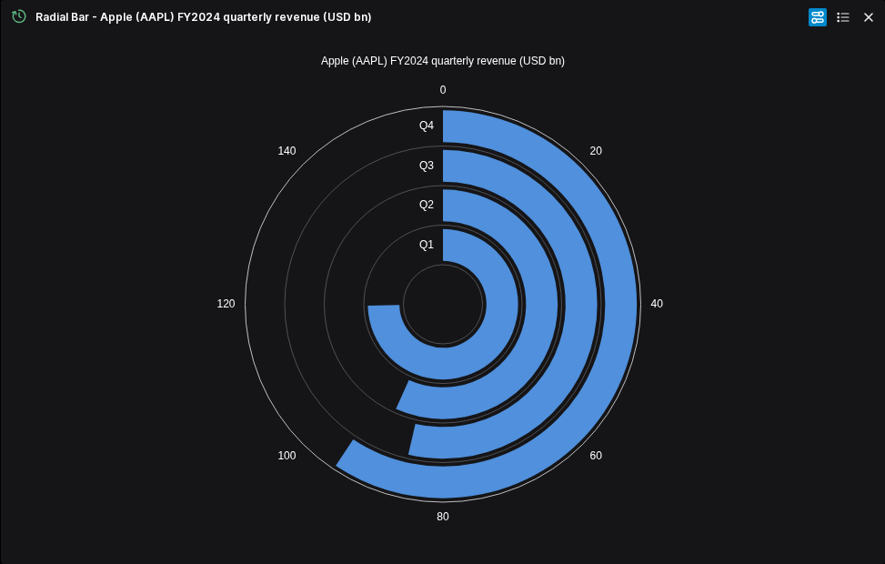

## Compare relationships

### Scatter: compare realized volatility with January return

Use one point per selected equity for January 2025. X is sample standard deviation of daily returns in percent per trading day; Y is monthly close-to-close return in percent. Each point represents a company, identified by name and symbol in its tooltip; color identifies the plotted series and marker size is constant. Use the January-relationship recipe. Six selected observations describe this sample; a slope or visual grouping does not establish causation or a stable risk premium.

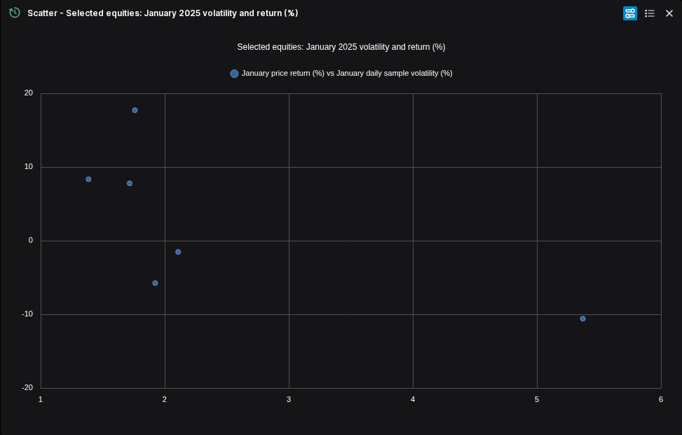

### Bubble: add trading activity to the return-volatility comparison

Use the same six January observations and X/Y definitions as Scatter. Size is mean daily `close * volume` in USD/day; the tooltip identifies the company by name and symbol, and color identifies the series. The current mapping interpolates marker diameter linearly between the selected minimum and maximum marker sizes across the size-field domain. Bubble area is therefore not proportional to dollar activity. Read the raw size value in the tooltip for quantitative comparisons.

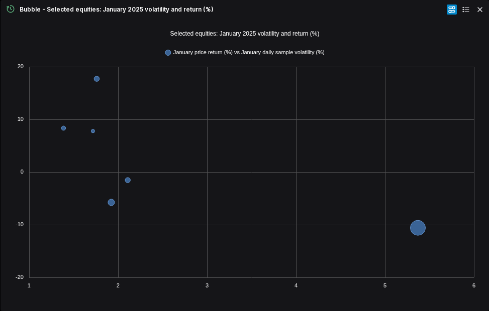

### Heatmap: locate strong and weak months across symbols

Use the six equities and October 2024 through January 2025 monthly price returns. X is month; Y is company name and symbol; continuous color is return in percent; cell size is constant. Calculate each monthly return from consecutive month-end closes, including the preceding September close for October. Read the color legend and zero level. A missing observation needs a gap, not a neutral-colored zero; this is a return matrix, not a correlation matrix.

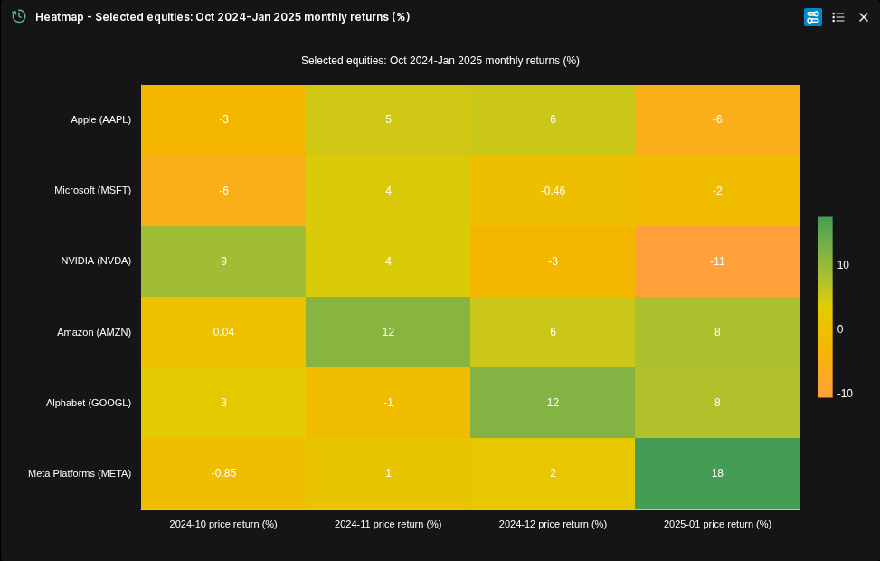

## Inspect distributions and ranges

### Histogram: inspect the frequency of daily returns

Use AAPL daily price returns from October 2024 through January 2025. X is a daily-return bin in percent; Y is the number of observed trading-day returns in that bin. Color identifies the frequency series; bin width is part of the saved configuration, not a size field. Compute returns from closes before binning. The saved view uses twelve one-percentage-point bins from -6% to +6%. Each bin includes its lower edge and excludes its upper edge, except that the final upper edge is included. All 84 Apple observations fall within this envelope. Changing the bins changes the picture. Frequency is not probability density or a fitted forecast.

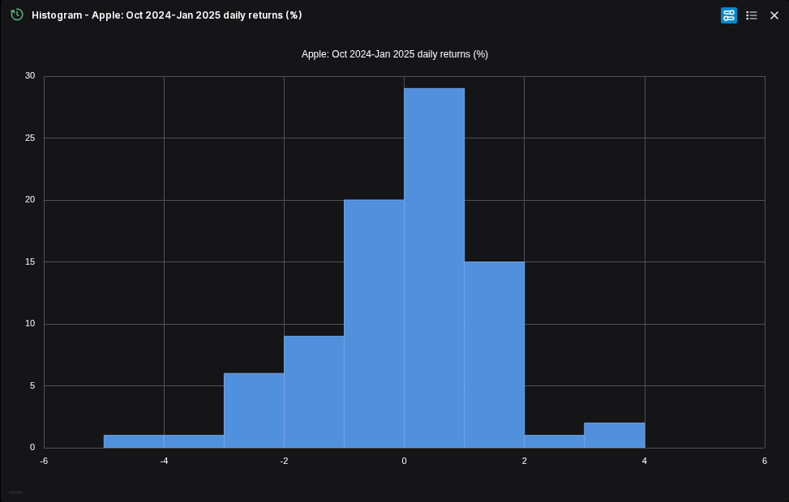

### Box Plot: compare daily-return distributions

Use the six equities' daily price returns from October 2024 through January 2025. X is company name and symbol; Y is return in percent; color identifies the return series. The box spans the 25th to 75th percentiles and marks the median. The current implementation sorts observations and interpolates each quantile at position `(n-1)*p`; whiskers are the observed minimum and maximum. They are not Tukey 1.5-IQR fences, and this display does not identify separate outliers.

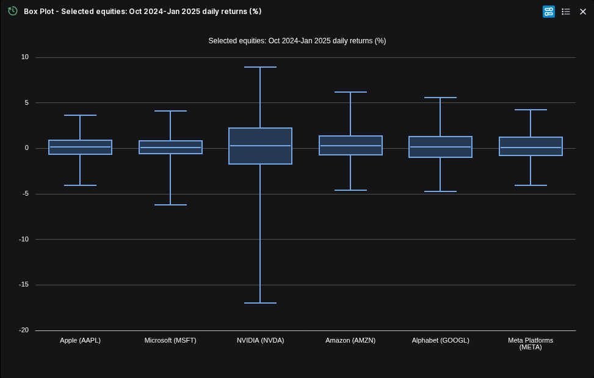

### Range Bar: compare the observed return span

Use each symbol's repeated daily-return observations from October 2024 through January 2025. Category is company name and symbol; the numeric axis is daily return in percent; each bar spans observed minimum to maximum. Color identifies the return series; thickness is constant. This reduces the sample to its extremes and hides frequency and median. The inputs are repeated returns, not open/high/low/close columns or forecast confidence bounds.

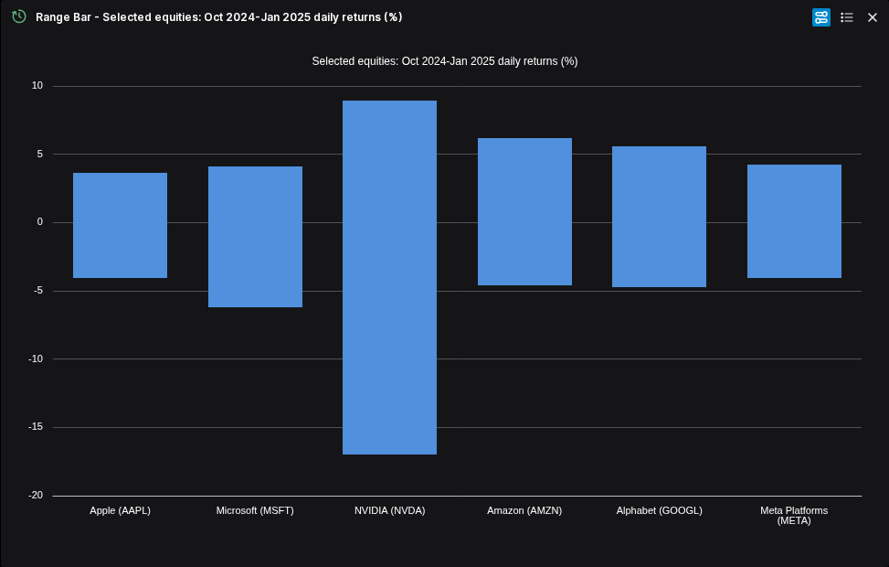

### Range Area: compare AAPL's monthly daily-return envelopes

Use AAPL daily returns grouped by October 2024, November, December and January 2025. X is month; Y is daily return in percent; the filled band joins each month's observed minimum and maximum. Color identifies the return series; no independent size field is used. Keep each month's repeated observations before summarizing. The connected band is not an intraday high-low range, a monthly cumulative return or a confidence interval.

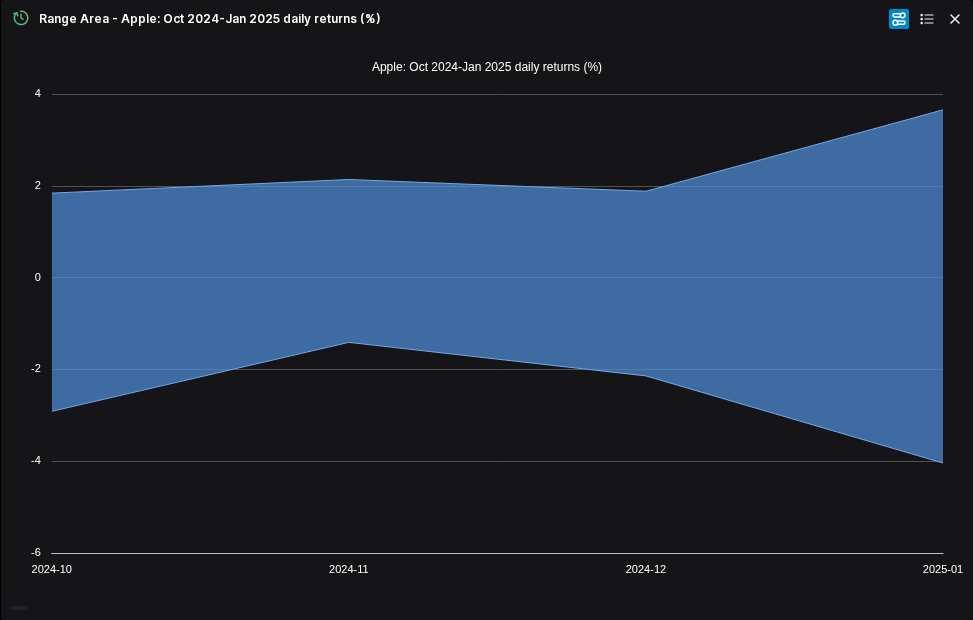

## Explain reconciliation and income levels

### Waterfall: reconcile revenue to net income

Use AAPL FY2025 Q1, ended 2024-12-28 and filed 2025-01-31. X is the ordered bridge step; Y is cumulative USD billions. Start with revenue, subtract cost of revenue, subtract operating expenses, add signed `totalOtherIncomeExpensesNet`, then subtract income tax expense to reach net income. Color distinguishes increasing and decreasing steps; width is constant. The final running balance is net income; this example has no separate total bar. Gross profit, operating income and pretax income are reconciliation subtotals, not extra movements. Check each subtotal against the reported field before accepting the bridge.

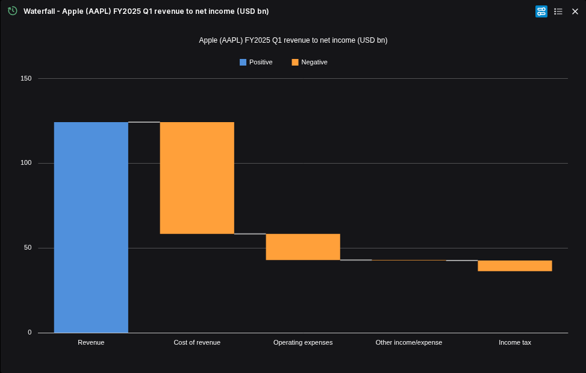

### Sankey: trace a derived allocation of FY2024 revenue

Use a derived AAPL FY2024 hierarchy: total revenue to quarterly revenue, then each quarter to its cost of revenue and gross profit. Node columns identify the allocation stage; link width represents USD billions; color identifies the branch or component. There are no numeric X/Y axes or independent marker-size field. Sum the four quarterly revenue fields for the source total and reconcile every quarter's outgoing links. This is an income-statement allocation, not observed cash movement, customer migration or a source-of-funds statement.

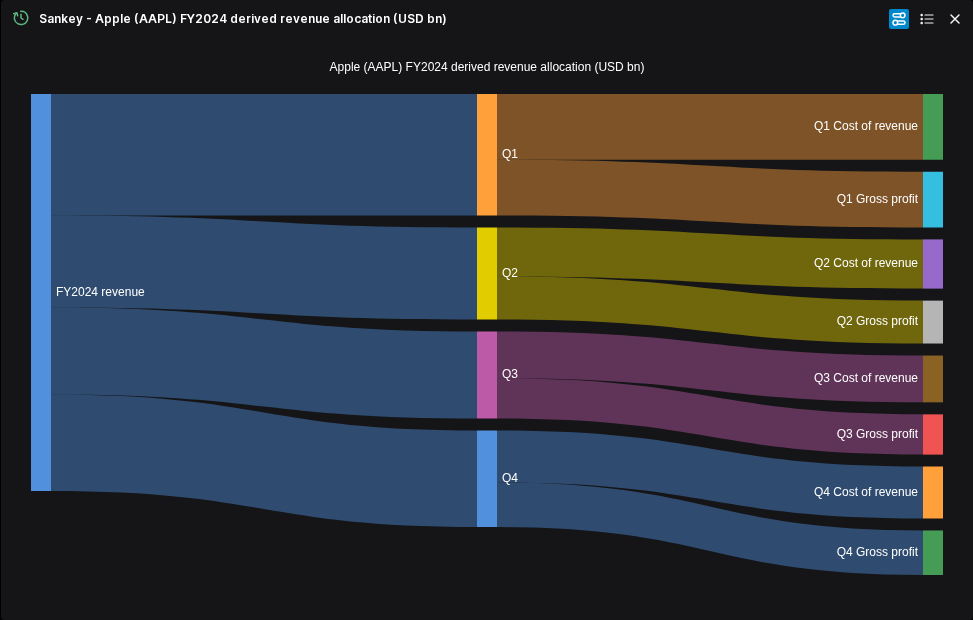

### Funnel: compare reported income levels

Use AAPL FY2025 Q1 revenue, gross profit, operating income, income before tax and net income, each in USD billions. Stage order and labels identify the income measure; stage magnitude is the reported amount. The uniform blue fill carries no additional variable. These measures overlap, so their sum has no accounting meaning. The shape compares levels at the quarter ended 2024-12-28; it does not measure customer conversion, probability or the path of a dollar through consecutive transactions.

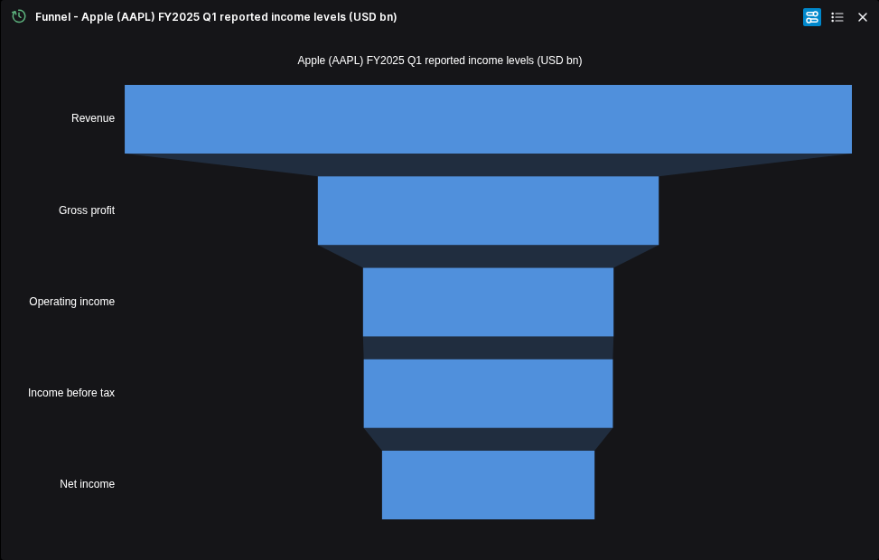

### Cone Funnel: compare the same income levels with tapered geometry

Use the same FY2025 Q1 reported income-level sequence as Funnel, in USD billions. Stage identifies the financial measure; geometry reflects its magnitude; color identifies the level. There are no financial X/Y axes or separate size field. The cone styling does not add a volume measure. Inspect tooltips or the source values for amounts, and use Waterfall when the question requires an additive reconciliation of expenses and income.

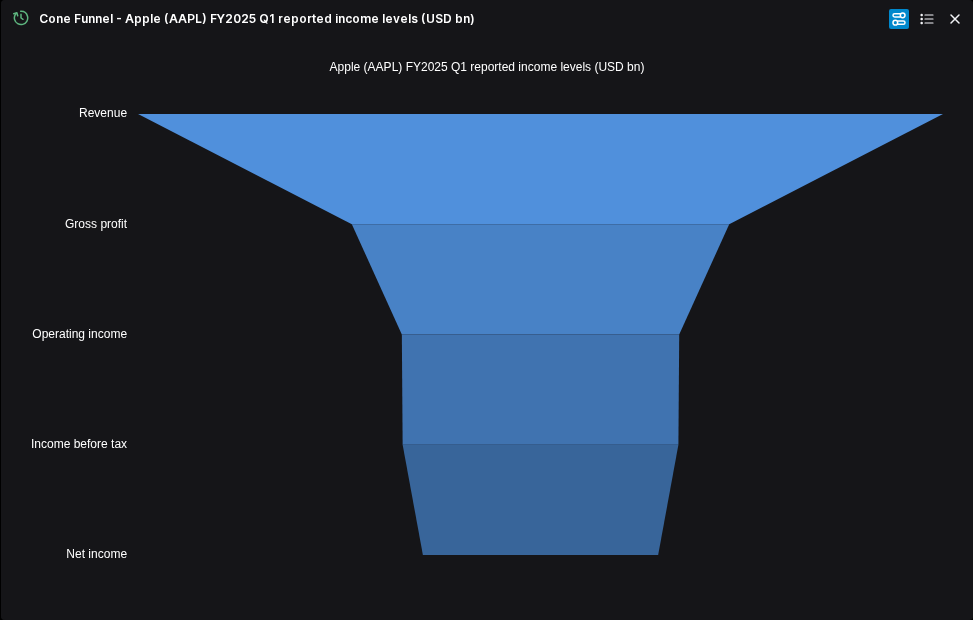

### Pyramid: compare positive reported income magnitudes

Use the positive FY2025 Q1 income levels to compare the same reported measures in a pyramid layout. Stage identifies revenue, gross profit, operating income, income before tax or net income; geometry represents magnitude in USD billions; color identifies measure. The measures overlap and do not partition a total. Their visual normalization must not be interpreted as a percentage of revenue or a conversion rate. Inspect tooltips or the source values for amounts and calculate ratios separately.

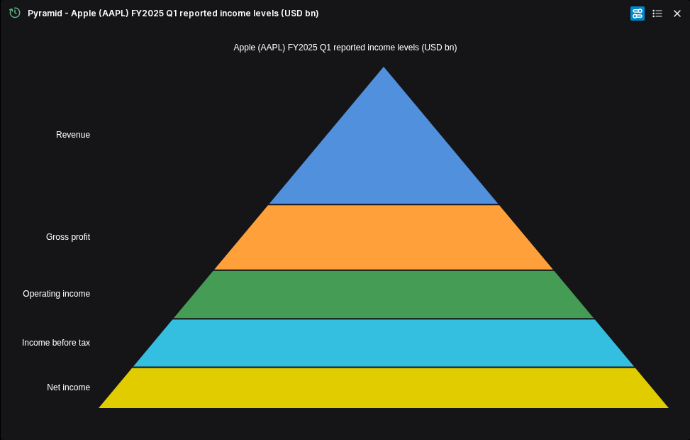

## Combine measures

### Column & Line: compare revenue with net income

Use AAPL FY2024 Q1 through FY2025 Q1. X is fiscal quarter; left Y is USD billions. Revenue uses columns and net income uses a line; color identifies measure; marker and column sizes are styling. Both series use the primary axis in this preset. The shared unit supports comparison, but the overlapping accounting measures must remain unstacked. A secondary-axis assignment belongs to the custom combination below.

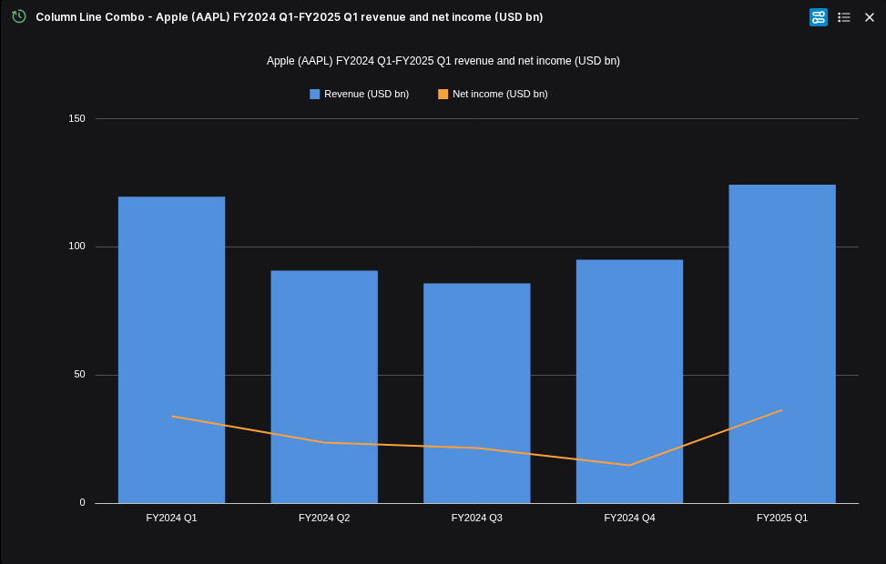

### Area & Column: compare the revenue path with income bars

Use the same five AAPL quarters, with revenue as the area series and net income as columns. X is fiscal quarter; left Y is USD billions; color identifies measure. With one area series, no additional components contribute to its stack. Both measures use the primary axis in this preset. Filled revenue is a level cue, not accumulated revenue, and net income is already contained in revenue rather than an additive component beside it.

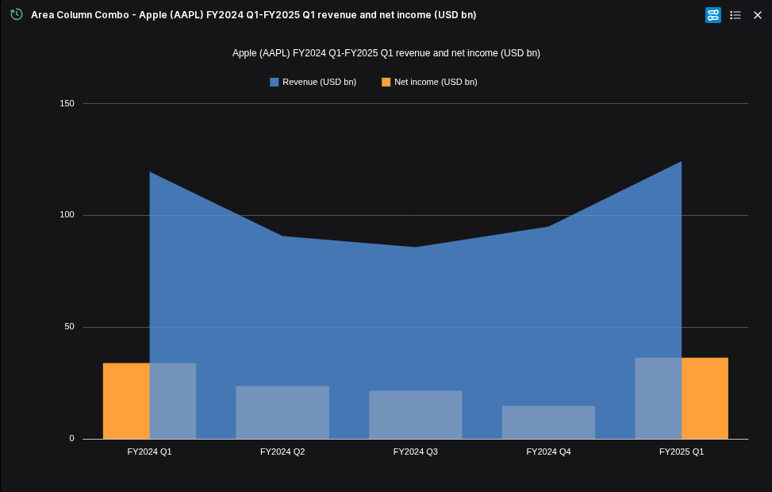

### Custom Combination: compare income scale with reported EPS

Use AAPL FY2024 Q1 through FY2025 Q1. X is fiscal quarter. Assign revenue to unstacked columns and net income to a line on the left axis in USD billions; assign reported basic EPS to a line on the right axis in USD/share. Color identifies the three measures; size is constant styling. Preserve these explicit series and axis assignments in the saved model. The right-axis scale is independent, so apparent intersections and parallel slopes are not evidence of equality or correlation. Reported EPS should not be reconstructed from rounded chart labels.

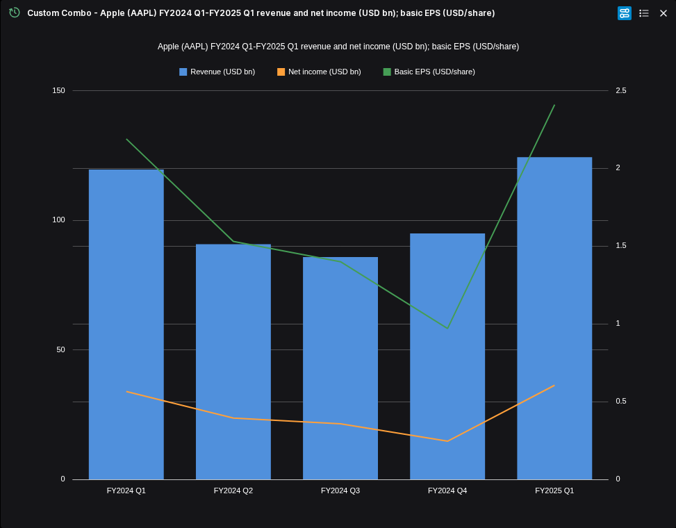

## Check a demonstration before reusing it

Match the screenshot to its saved chart type, selected columns, series order, axis assignments, date window and transformations. Confirm that the displayed unit agrees with the data recipe. Recompute one representative point from the retained observations and inspect missing-value behavior. A view fails this guide's contract if its period, unit or formula is misstated, or if the saved state cannot reproduce the demonstrated mapping.

The gallery covers 35 chart types in the editor catalog plus Custom Combination when saved series assignments are present. Donut's `doughnut` alias does not increase that count. A screenshot shows a particular view; it does not establish complete renderer parity, server deployment or provider entitlements. Use [data runtime](data-runtime.md) for provider behavior and [evidence guidance](evidence.md) for verification boundaries.
