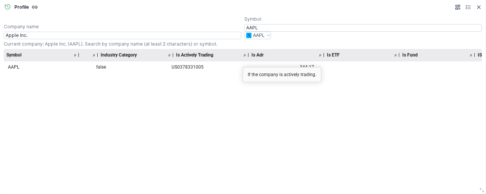
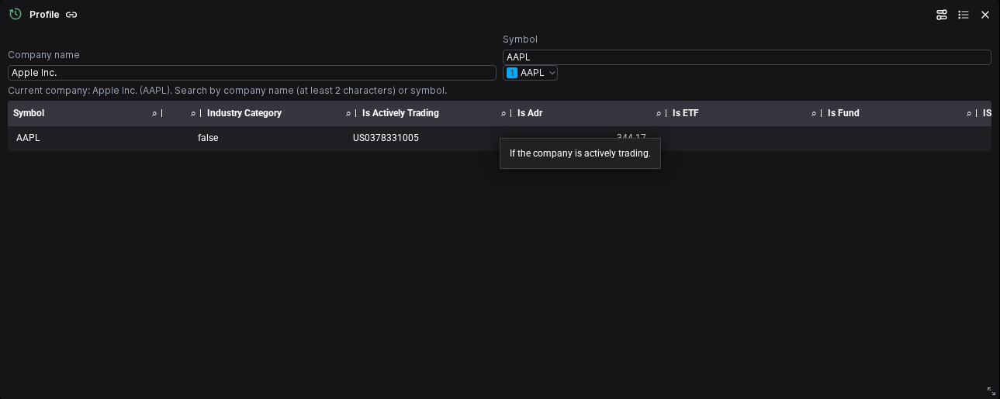

# Find a company by name or symbol

Use **Company name** and the adjacent **Symbol** field to select an FMP listing in the existing Workspace widgets. Packaged acceptance is complete for the candidate; publication in prebuilt images is pending. The [acceptance review](../artifacts/reviewed/company-selector/20261106-acceptance-review.md) records the tested scope.

## Select and link a company

1. Connect the bundled backend using [first-login onboarding](install.md#first-login-and-onboarding), then add an eligible FMP widget to a dashboard.
2. Enter at least two characters in Company name, or start typing a symbol. Select the result after checking its name, symbol, exchange, currency and provider. Typing a company name or pressing Tab alone does not select a listing.
3. Use the existing Symbol group control to link compatible widgets from the same FMP connection. A company selection updates those widgets together. Keep independent comparisons and macro series in their own groups.
4. Save the dashboard. Company identity and group state are retained when reopening, including after replacing the Workspace container while keeping its data bind.

The selector is available in the immediate-query **Profile, Income, Balance, Cash, Historical prices, Metrics, Ratios and Enterprise values** widgets. Existing Period/Limit controls and manual Symbol entry remain available. Use the existing comparison editor for multiple symbols; replacing a comparison list requires an explicit action.

An unresolved name means the listing could not be identified reliably. Check the symbol, connection and visible lookup error instead of assuming the old company name still applies. The selector keeps source identity with the widget and sends ordinary financial parameters to the data API.

FRED series-name lookup, universal commands, curated analyst dashboards and financial calculations have separate roadmap items. This delivery adds instrument selection to the current widgets.

## Accepted selector views

Light and dark views use Apple Inc. / AAPL from the real FMP run on 2026-11-06. These images show selector presentation. The table is horizontally scrolled and has a native hover tooltip; financial values are established by the response and viewport assertions in the acceptance review.

For deployment, keep the [configured Workspace data bind](install.md#persistence-and-updates). The acceptance run recreated its disposable container with that retained bind; backup/restore and owner-server verification remain separate obligations.
